# Xenon Recoils and LHC Missing-Momentum Tests of Exothermic Pseudo-Dirac Dark Matter

**Authors and affiliations to be confirmed**

## Abstract

We ask which parameters of an exothermic pseudo-Dirac dark matter model can account for a reference xenon recoil yield and be tested by the CMS monojet search. The vector mediator couples more strongly to heavier quarks, so xenon recoils and collider production probe different quark flavors. We match the truth-level yield of a benchmark motivated by the high-energy LZ recoil candidate and solve for the Planck relic abundance on the on-shell and off-shell branches. For small photon mixing and a narrow mediator, we recast the 66 public CMS Run 2 monojet bins and exclude a subset of the on-shell solutions at 95% CL. Three benchmarks with large top couplings give observed limits $\mu_{95}=0.607$, $0.340$, and $0.273$. All three limits stay below unity when the target yield varies by $25\%$ in either direction. Two of the three benchmarks lie at the upper coupling boundary of the scan. We assess the effects of low-energy mixing, the local excited-state fraction, the relic-density measurement, and finite signal samples. We also examine top-associated production at lower mediator masses.

## 1. Introduction

In an extended recoil window with an exposure of $2.84$ tonne yr, the LUX-ZEPLIN (LZ) Collaboration reported a candidate consistent with a nuclear recoil energy of $E_R=248\pm23_{\rm stat}\pm23_{\rm syst}$ keV. Across the models tested by LZ, the excess over the background-only hypothesis had a global significance of $2.6\sigma$ and a maximum local significance of $3.4\sigma$. In exothermic scattering, the heavier dark state releases energy as it transitions to the lighter state. Dark matter with a mass of tens of GeV can therefore produce energetic nuclear recoils. Gemmell, Hooper, and Krnjaic studied this mechanism and the Galactic Center gamma-ray excess using a flavor-universal quark vector current. We use their exothermic benchmark to set a reference yield for our study of xenon recoils, thermal freeze-out, and LHC signatures. [1](https://arxiv.org/html/2609.02823) · [2](https://arxiv.org/html/2609.26570v1)

The quark couplings determine how the mediator is produced, and the invisible decay threshold determines whether it can produce a dark pair on shell. Du, Huang, and Xie studied endothermic scattering in a gauge-complete leptophobic $U(1)_B$ model. At their $1.44$ TeV benchmark, the two-body invisible decay is kinematically closed and dijet searches provide the main collider test. Earlier work also examined loop-induced and top-associated production of top-philic vector mediators. Here we ask whether missing-momentum searches can probe mediators with masses from tens to about two hundred GeV once we impose the exothermic recoil yield and the thermal abundance. We evaluate the relic and collider conditions at the same four-dimensional parameter points and track off-shell solutions in the two-dimensional projection. [3](https://arxiv.org/html/2609.07225) · [4](https://arxiv.org/abs/1512.00471)

## 2. Effective model

We take $m_1=m_\chi$ and $m_2=m_\chi+\Delta m$. A spin-1 mediator $V_\mu$ couples to the off-diagonal vector current of the two dark states. The benchmark interaction in the electroweak-broken basis is

$$
\mathcal L_{\rm int}=V_\mu\left[\sum_{q=u,d,s,c,b,t}g_t\frac{\widehat m_q}{172\,\mathrm{GeV}}\bar q\gamma^\mu q
+i\frac{g_\chi}{2}\bar\chi_1\gamma^\mu\chi_2\right],\qquad
\widehat m_q=(0.0022,0.0047,0.096,1.27,4.18,172)\,\mathrm{GeV}.
\tag{1}
$$

At zero mixing, $g_t$ is the coefficient of the $Vt\bar t$ vertex, and the dark transition coupling has magnitude $g_\chi/2$. We take $g_{Vq}\propto\widehat m_q$ as a phenomenological flavor ansatz in the electroweak broken phase. The reference masses $\widehat m_q$ fix the ratios of quark couplings. A complete $U(1)_X$ theory would also specify the charges, the mechanism of fermion mass generation, and the matching conditions. For purely vector couplings, different coefficients for the up- and down-type members of a left-handed weak doublet require electroweak-breaking operators or additional mixing. [5](https://arxiv.org/abs/1510.02110) · [6](https://arxiv.org/abs/1605.04917)

Once the low-energy matching coefficients are specified, Eq. (1) gives the recoil kinematics and the leading coherent rate. With these vertices, the closed-quark-loop amplitude for $gg\to gV$ satisfies the QCD Ward identity. The relic-density and monojet predictions depend on the operators, particles, and kinematically open channels of the effective model. Additional $V$–$Z$ mixing, matching operators, or new particles could change the recoil amplitude, annihilation rates, mediator width, or production rates. Charged-current processes also depend on electroweak cancellations in the longitudinal amplitudes, as the single-top study in Section 7 illustrates. [5](https://arxiv.org/abs/1510.02110) · [6](https://arxiv.org/abs/1605.04917)

| Quantity | Benchmark or range |
|---|---|
| Mass splitting and present local excited fraction | $\Delta m=1$ MeV, $f_2=0.5$ |
| Local dark matter density | $\rho_\chi=0.3\ \mathrm{GeV\,cm^{-3}}$ |
| Halo speeds $(v_0,v_E,v_{\rm esc})$ | $(238,254,544)\ \mathrm{km\,s^{-1}}$ |
| Dark mass and dark coupling | $20\le m_\chi\le100$ GeV, $0.10\le g_\chi\le1.50$ |
| CMS monojet grid | $72\le M_V\le200$ GeV, $0.1\le g_t\le\sqrt{4\pi}$ |
| On-shell template requirements | $M_V-m_1-m_2\ge5\Gamma_V$, $\Gamma_V/M_V<0.03$ |

We set the upper scan boundary at $g_t=\sqrt{4\pi}$, where $g_t^2/(4\pi)=1$. An assessment of higher-order corrections is needed near that boundary. For top-associated production, we scan the relic branches separately over $M_V=20$–100 GeV.

## 3. Xenon recoils and the LZ yield condition

At leading order in the vector-charge matching, $f_p=2g_{Vu}+g_{Vd}$ and $f_n=g_{Vu}+2g_{Vd}$, giving $f_p/g_t=5.29\times10^{-5}$ and $f_n/g_t=6.74\times10^{-5}$. The coherent charge of a nucleus of mass number $A$ is $Q_A=Zf_p+(A-Z)f_n$. With nuclear mass $m_A$ and reduced mass $\mu_A=m_2m_A/(m_2+m_A)$, the minimum incident speed and the differential truth-level rate are

$$
\begin{aligned}
v_{\min}(E_R)&=\frac{|m_A E_R/\mu_A-\Delta m|}{\sqrt{2m_A E_R}},\
\frac{dR}{dE_R}&=\frac{f_2\rho_\chi}{m_2}\sum_A w_A\,
\frac{(g_\chi Q_A/2)^2 F_A^2(q)}{2\pi(M_V^2+q^2)^2}\,\eta(v_{\min}),
\qquad q^2=2m_AE_R .
\end{aligned}
\tag{2}
$$

Here $w_A$ is the mass fraction of each isotope in natural xenon, and we compute $F_A$ from a two-parameter Fermi density. The velocity integral is $\eta(v_{\min})=\int_{v>v_{\min}}d^3v\,f_{\rm lab}(\mathbf v)/v$. We approximate the dark masses as degenerate in the flux and reduced mass and retain the splitting in $v_{\min}$. The recoil energy at zero incident speed is $E_R^\star=\Delta m\,\mu_A/m_A$. The location of the spectral peak also depends on the velocity distribution and nuclear form factors. [2](https://arxiv.org/html/2609.26570v1) · [6](https://arxiv.org/abs/1605.04917)

We recalculate the yield at the benchmark in Fig. 6 of Ref. [2], $(m_\chi,M_V,g_B,g_\chi)=(35\,\mathrm{GeV},30\,\mathrm{GeV},1.46\times10^{-5},0.32)$, with $g_{Vq}=g_B/6$. We obtain $N_0=1.12044$ expected truth-level events in the signal window $[5.4,269.9]$ keV and $7.39\times10^{-4}$ in the sideband $[350,675]$ keV. After folding in the detector response, the reference paper reports about 1 and $8\times10^{-4}$ events, respectively. We set the normalization of the mass-weighted model by requiring the same truth-level yield $N_0$ in the signal window. The full LZ analysis uses corrected S1 and S2 signals from 1710 events in its science sample. [1](https://arxiv.org/html/2609.02823) · [2](https://arxiv.org/html/2609.26570v1) · [7](https://doi.org/10.17182/hepdata.182472.v1)

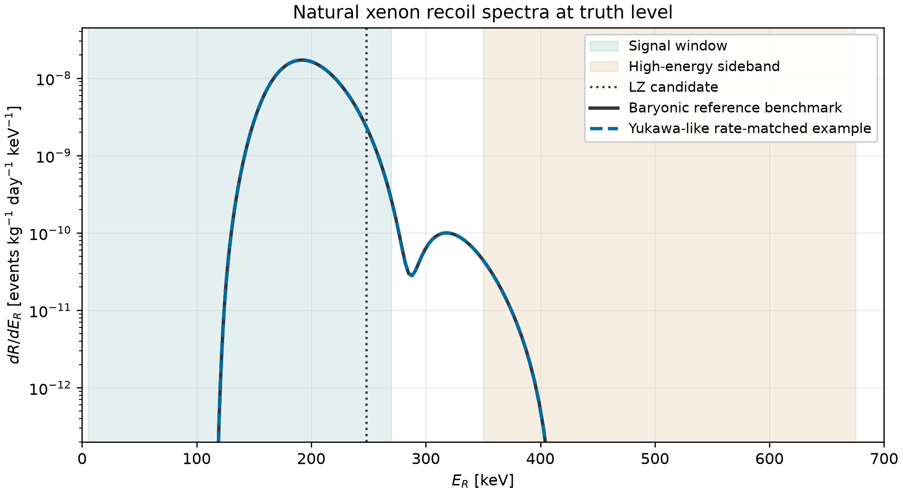

**Figure 1.** Truth-level differential recoil rates in events kg$^{-1}$ day$^{-1}$ keV$^{-1}$. Both models use $m_\chi=35$ GeV and $M_V=30$ GeV. For the mass-weighted model, $g_t=0.12763$ and $g_\chi=0.29779$ reproduce the reference yield. The vertical line marks the reconstructed recoil energy of the LZ candidate, and shading marks the integration windows.

In the contact limit $q\ll M_V$, the rate depends on the coupling combination $\kappa=g_tg_\chi/M_V^2$. We denote the tree-level solution that matches the reference yield at the baseline halo and $f_2=0.5$ by $\kappa_0(m_\chi)$. We define $r=N_{\rm ROI}^{\rm truth}/N_0$ and let $K_\gamma$ be the ratio of the rate with photon mixing to the tree-level rate at fixed parameters. The couplings then follow from

$$
\kappa=\kappa_0(m_\chi)\sqrt{\frac{r}{K_\gamma(m_\chi,d_\gamma)}\frac{0.5}{f_2}},\qquad
g_\chi=\frac{M_V^2}{g_t}\kappa.
\tag{3}
$$

Integrating the spectrum separately at each mass gives $\kappa_0(35,40,44\,\mathrm{GeV})=(4.223,5.665,7.202)\times10^{-5}\ \mathrm{GeV}^{-2}$. As the dark matter mass increases, the characteristic recoil energy approaches the upper edge of the window, and a larger coupling product is needed to reproduce the reference yield. At fixed spectral shape, the normalization scales with $r/f_2$. We set $r=1$ for the reference yield and vary it over the prescribed range $r\in[0.75,1.25]$ to test the effect of the normalization. This range carries no LZ confidence level. The 95% CL limits come from the CMS monojet likelihood in Section 5.

## 4. Thermal abundance and physical branches

We assume a standard thermal history and chemical equilibrium between the two states during freeze-out. Their total number density $n=n_1+n_2$ obeys

$$
\dot n+3Hn=-\langle\sigma_{\rm eff}v\rangle(n^2-n_{\rm eq}^2),\qquad
\langle\sigma_{\rm eff}v\rangle=\sum_{i,j=1,2}\frac{n_i^{\rm eq}n_j^{\rm eq}}{(n^{\rm eq})^2}\langle\sigma_{ij}v\rangle .
\tag{4}
$$

The two states have nearly equal equilibrium weights near freeze-out because $\Delta m\ll T_f$. We calculate their combined abundance with CalcHEP and micrOMEGAs 7.1.4, using `Fast=0` and `Beps=1e-9`, and require them to account for the full Planck abundance $\Omega_ch^2=0.1200\pm0.0012$. Near resonance, coannihilation through $\chi_1\chi_2\to V^*\to b\bar b,c\bar c$ makes the relic abundance sensitive to $M_V$. For example, $b\bar b$ accounts for about $92\%$ of the coannihilation rate at one on-shell benchmark with $m_\chi=35$ GeV. Annihilation of two particles in the same dark state to $VV$ can set the abundance when that channel opens. [8](https://doi.org/10.1103/PhysRevD.43.3191) · [9](https://doi.org/10.1016/0550-3213%2891%2990438-4) · [10](https://arxiv.org/abs/2312.14894) · [11](https://arxiv.org/abs/1807.06209)

At fixed $m_\chi$, Eq. (3) gives the coupling and propagator factor for coannihilation as

$$
\frac{(g_tg_\chi)^2}{(M_V^2-s)^2+M_V^2\Gamma_V^2}
=\frac{\kappa^2 M_V^4}{(M_V^2-s)^2+M_V^2\Gamma_V^2}.
\tag{5}
$$

Changing $g_\chi$ affects the thermal average through the mediator width. Changing $M_V$ also shifts the resonance relative to the energies accessible at freeze-out. At $m_\chi=35$ GeV, $g_\chi=0.18$, and $M_V\simeq87.56$ GeV, the local logarithmic slope of the abundance with respect to the mediator mass is about $0.158\ \mathrm{GeV}^{-1}$. In this slice, the Planck $\pm2\sigma$ interval corresponds to $M_V\simeq87.43$–$87.68$ GeV. When we vary $m_\chi$ as well, the yield and abundance conditions define multiple two-dimensional surfaces in the four-dimensional parameter space. More than one dark matter mass can satisfy both conditions at the same $(M_V,g_t)$.

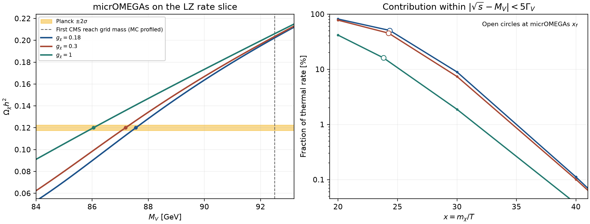

**Figure 2.** The left panel fixes $m_\chi=35$ GeV. The right panel shows the contribution of the pole neighborhood to the instantaneous thermal average. Open symbols mark the freeze-out temperatures at the individual points.

The main grid uses $r=1$, $f_2=0.5$, and $d_\gamma(0)=0$ and includes the finite spacelike photon-mixing contribution from $c,b,t$ quarks. At each $(M_V,g_t)$, we eliminate $g_\chi$ with Eq. (3) and look for crossings of $\Omega_\chi h^2=0.1200$ on both sides of $M_V-2m_\chi-\Delta m=0$. The grid contains 35 mediator masses and 29 top couplings. We bracket roots at dark mass intervals of at most $1.10$ GeV and sample more finely near threshold. To propagate the measured abundance uncertainty, we solve separately for $0.1176,0.1188,0.1200,0.1212,0.1224$ at 11 representative coordinates. We record the parameters and collider limit for each root.

The Gaussian term $-2\ln\mathcal L_\Omega=[(\Omega_\chi h^2-0.1200)/0.0012]^2+\mathrm{const.}$ describes the measurement uncertainty on the abundance. We record the outcome for each target abundance separately when a branch disappears or reaches a scan boundary. For example, at $M_V=150.4$ GeV and $g_t=1.260$, the central solution at $r=2$ requires $g_\chi=1.498$. For the two lower abundance targets we find no root within $g_\chi\le1.50$.

## 5. LHC production, reconstruction, and statistical analysis

### 5.1 Truth cross sections and reconstruction

The monojet signal includes the tree-level channels $q\bar q\to gV$ and $qg\to qV$ and their charge conjugates, as well as the finite closed-quark-loop contribution $gg\to gV$. For a pure vector current, the three-point amplitude $gg\to V$ cancels. With an extra gluon, the four-point amplitude can be nonzero. We sum the tree and loop cross sections because these contributions have distinct initial states. We calculate $pp\to t\bar tV$ at tree level. We use MadGraph5_aMC@NLO 3.6.6 with `nn23lo1` at 13 TeV and evaluate 11 values of $M_V$. In the narrow-width approximation, the cross section for final state $X$ is

$$
\sigma_X=\sigma_X^{\rm prod}(M_V;g_t=1)\,g_t^2\,\mathrm{BR}(V\to\chi_1\chi_2).
\tag{6}
$$

With the loose jet cut $p_T^j>20$ GeV, the truth-level $j+\mathrm{MET}$ cross section is comparable to the inclusive $t\bar t+\mathrm{MET}$ cross section near $M_V\simeq118$ GeV. Applying $p_T^{\rm miss}>200$ GeV to both channels gives a cross-section ratio $\sigma(j+\mathrm{MET})/\sigma(t\bar t+\mathrm{MET})$ of $0.135$–$0.149$. For example, at $(m_\chi,M_V,g_t,g_\chi)=(35,87.18,1.070,0.30)$ the two cross sections are $0.166$ and $1.23$ pb, respectively. We treat the top quarks as stable, so $p_T^{\rm miss}=p_T(V)$. The experimental sensitivity also depends on the top decays, reconstruction cuts, and backgrounds. [4](https://arxiv.org/abs/1512.00471) · [12](https://arxiv.org/abs/1405.0301) · [13](https://arxiv.org/abs/1507.00020)

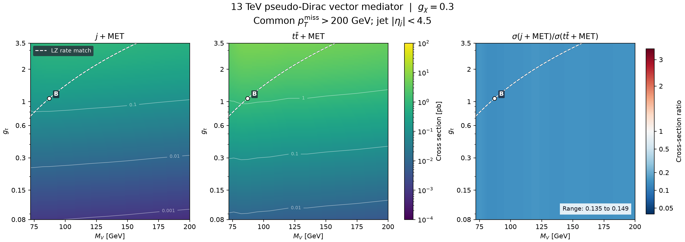

**Figure 3.** Truth-level cross sections in pb and their ratio for $m_\chi=35$ GeV and $g_\chi=0.30$. The dashed curve shows the tree-level LZ yield-matching condition. The monojet cross section includes the leading tree channels and the $gg\to gV$ loop contribution.

We build reconstructed monojet templates with Pythia 8.312 and Delphes 3.5.0, treating the on-shell $V$ as invisible. Both samples start at generator-level $p_T^j=100$ GeV. To increase statistics in the tails, we generate additional tree and loop samples starting at 350 and 480 GeV, respectively, then combine the samples in mutually exclusive generator-level intervals. At $M_V=120$ GeV we add a loop-sample boundary at 230 GeV. Our reconstruction cuts approximate CMS EXO-20-004. We require the leading AK4 jet to satisfy $p_T>100$ GeV and $|\eta|<2.4$, and require $p_T^{\rm miss}>250$ GeV. We apply jet azimuthal cuts, lepton and photon vetoes, and heavy-flavor-related vetoes, and account for the 2018 HEM region. The data span three years and about $137\ \mathrm{fb}^{-1}$, with 22 monojet signal bins per year. [14](https://arxiv.org/abs/2203.11601) · [15](https://arxiv.org/abs/1307.6346) · [16](https://arxiv.org/abs/2107.13021) · [17](https://doi.org/10.14428/DVN/IRF7ZL)

### 5.2 The 66-bin profile likelihood

We use the public observations $n_i$, the background-only control-region prediction $\mathbf b$, its covariance $C_b$, and the signal $\mathbf s$ at each point to construct

$$
\mathcal L(\mu,\mathbf b',\mathbf s')=
\prod_{i=1}^{66}{\rm Pois}(n_i\mid b_i'+\mu s_i')
\,G(\mathbf b';\mathbf b,C_b)\,G(\mathbf s';\mathbf s,C_s).
\tag{7}
$$

We constrain the signal yields to be nonnegative and the Poisson means to be positive. The signal covariance $C_s$ includes the multinomial covariance of the simulated counts, cross-section integration errors, and a common $1.6\%$ luminosity uncertainty. We retain correlations across years when they share simulated events. Between mass nodes, we interpolate yields linearly and combine the covariances of independent samples with squared interpolation weights. For each branch, $\mu=1$ denotes its nominal prediction. We obtain $\mu_{95}$ by solving the asymptotic condition $CL_s=0.05$ with a one-sided profile-likelihood statistic. The expected limits use an Asimov data set built from the central background prediction. The observed limits use the measured $n_i$ and a conditional background Asimov data set. The five expected quantiles describe background fluctuations. We propagate the relic-density uncertainty by solving again for each physical root. [18](https://doi.org/10.17182/hepdata.106115.v2/t14) · [19](https://doi.org/10.17182/hepdata.106115.v2/t15) · [20](https://cds.cern.ch/record/2242860) · [21](https://arxiv.org/abs/1007.1727) · [22](https://doi.org/10.1088/0954-3899/28/10/313)

We use $\tilde q_\mu=-2\ln[\mathcal L(\mu,\widehat{\widehat{\boldsymbol\theta}}_\mu)/\mathcal L(\widehat\mu,\widehat{\boldsymbol\theta})]$, set it to zero when $\widehat\mu>\mu$, and constrain $\widehat\mu\ge0$. With $a=\sqrt{\tilde q_{\mu,A}}$, the observed asymptotic statistic is

$$
CL_s(\mu)=\frac{\Phi(-z_\mu)}{\Phi(a-z_\mu)},\qquad
z_\mu=\begin{cases}\sqrt{\tilde q_\mu},&\tilde q_\mu\le a^2,\\
(\tilde q_\mu+a^2)/(2a),&\tilde q_\mu>a^2.\end{cases}
\tag{8}
$$

For the expected bands, we solve $a=z-\Phi^{-1}[0.05\Phi(z)]$ on the nominal background Asimov data set for $z=-2,-1,0,1,2$. [21](https://arxiv.org/abs/1007.1727)

Appendix C compares the 66-bin fit using official CMS vector templates with the published fit. It also compares the cutflow, acceptance, and MET spectra from independent simulation. CMS reports expected and observed vector mass boundaries of 2.198 and 1.957 TeV. The 66-bin reconstruction gives 2.208 and 1.941 TeV. The discrepancies are larger for individual observed limits at low masses and for absolute yields from independent simulation.

## 6. Monojet results and stability

### 6.1 Branch-resolved results at the central relic abundance

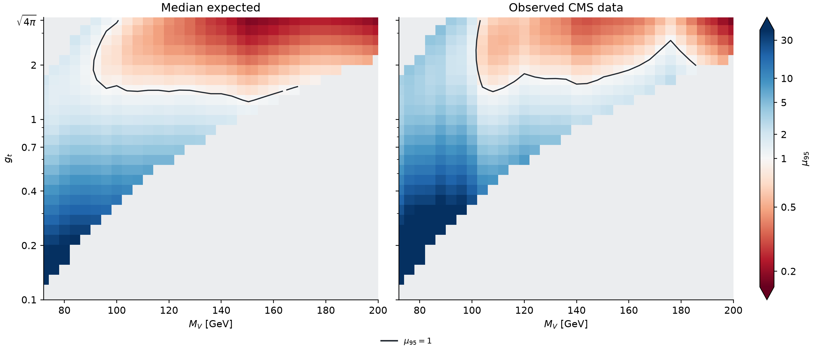

**Figure 4.** At the reference yield $r=1$ with $f_2=0.5$ and $d_\gamma(0)=0$, Eq. (3) fixes $g_\chi=g_\chi(m_\chi;M_V,g_t)$. Let $\mathcal D_\chi$ be the set of masses $20\le m_\chi\le100$ GeV for which Eq. (3) gives $0.10\le g_\chi\le1.50$. At each $(M_V,g_t)$ we define

$$
\mathcal S_{\rm on}(M_V,g_t)=\left\{m_\chi\in\mathcal D_\chi:\ \Omega_\chi h^2=0.1200,\quad M_V-m_1-m_2\ge5\Gamma_V,\quad \Gamma_V/M_V<0.03\right\}.
$$

Where $\mathcal S_{\rm on}$ contains exactly one solution, the color shows the 95% CL limit $\mu_{95}$ from CMS data alone for that branch. The black contour marks $\mu_{95}=1$. Gray marks coordinates without a unique on-shell solution satisfying the narrow-width criteria in the scan. We treat other dark mass solutions at the same coordinate separately and use the full $pp\to j\chi_1\chi_2$ amplitude for off-shell solutions.

Of the 1,015 grid coordinates, 434 have a unique on-shell solution at the central relic abundance that satisfies the template requirements. With the reference templates in Fig. 4, the expected and observed limits fall below unity at 208 and 151 points, respectively. The lowest sampled masses with $\mu_{95}<1$ are 92 and 104 GeV. These counts and masses depend on the grid spacing. At the interior point $(M_V,g_t)=(112\,\mathrm{GeV},2.747)$, the solution $(m_\chi,g_\chi)=(40.055\,\mathrm{GeV},0.260)$ gives expected and observed limits of $0.513$ and $0.540$. The smallest observed limit with the reference templates is $0.181$ at $(200\,\mathrm{GeV},\sqrt{4\pi})$. With pooled templates at three mass nodes, the number of observed limits below unity rises to 162, with 11 grid points crossing the exclusion contour (Appendix C). Section 7 discusses the off-shell roots at lower masses.

At some mediator masses, monojet sensitivity is confined to a finite interval in $g_t$. At fixed masses and LZ yield, $g_\chi\propto g_t^{-1}$, so $\Gamma_{\chi_1\chi_2}=A/g_t^2$ and $\Gamma_{\rm SM}=Bg_t^2$, with $A,B$ constant on the slice. The signal factor in Eq. (6) is $g_t^2/(1+(B/A)g_t^4)$ and peaks where the two widths are equal. At larger $g_t$, the invisible branching fraction can decrease enough to offset the increase in production.

| $M_V$ [GeV] | $g_t$ | $m_\chi$ [GeV] | $g_\chi$ | Expected $\mu_{95}$ | Observed $\mu_{95}$ | Observed for $r=0.75$–$1.25$ |
|---:|---:|---:|---:|---:|---:|---:|
| 80 | 0.503 | 33.027 | 0.482 | 6.891 | 15.58 | 15.55–15.64 |
| 100 | 1.264 | 38.065 | 0.400 | 1.333 | 2.305 | 2.276–2.352 |
| 120 | 3.073 | 41.116 | 0.284 | 0.412 | 0.607 | 0.570–0.664 |
| 150.4 | 1.260 | 43.896 | 1.286 | 0.986 | 1.822 | 1.820–1.824 |
| 150.4 | 3.545 | 43.896 | 0.457 | 0.184 | 0.340 | 0.329–0.357 |
| 190.4 | 3.545 | 45.854 | 0.823 | 0.219 | 0.273 | 0.270–0.277 |

**Table 2.** Representative on-shell branches. The expected and observed limits at the reference yield use $r=1$, $f_2=0.5$, $d_\gamma(0)=0$, and the central Planck abundance. The last column gives the range of observed limits obtained by solving for the abundance at each target yield. The upper scan boundary is $g_t=3.545$. At $M_V=150.4$ GeV and $g_t=1.260$, the expected limit lies below the exclusion threshold and the observed limit lies above it.

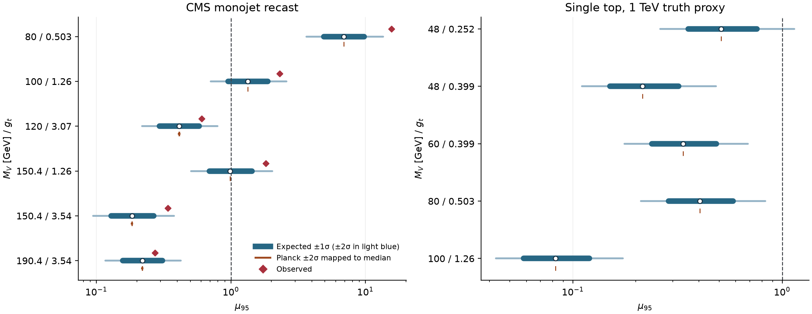

**Figure 5.** Blue intervals show the $\pm1\sigma$ and $\pm2\sigma$ expected quantiles from background fluctuations. Brown marks show the effect of the Planck $\pm2\sigma$ measurement uncertainty on the median expected limit. Red diamonds mark observed limits. The single-top panel uses the $\sqrt{\hat s}<1$ TeV truth-level proxy described in Section 7.

At the representative points, the Planck measurement uncertainty changes the median expected monojet limit $\mu_{95}$ by at most $0.44\%$. Accounting for finite signal statistics and luminosity weakens the median expected limits by about $1.4\%$–$6.6\%$ compared with fits that fix the signal template. At 120 GeV, varying the relic abundance gives limits between $0.41056$ and $0.41415$. The $1\sigma$ expected band from background fluctuations is $[0.295,0.581]$. A model-specific covariance for scale and PDF uncertainties, production matching, and detector efficiencies remains to be determined.

### 6.2 Low-energy photon mixing, the rate target, and the excited fraction

We define $d_\gamma=e\epsilon_\gamma/g_t$ so that positive $d_\gamma$ increases the proton coupling by $g_t d_\gamma$. The zero-momentum kinetic mixing $d_\gamma(0)$ is an independent matching input. At fixed quark couplings, charged-quark loops determine the finite correction relative to zero momentum. Using a common Helm form factor, this changes $Q_A/g_t$ by $Z[d_\gamma(0)+\delta d_{cbt}(-q^2)]$. For $^{131}$Xe, the tree-level charge $Q_A/g_t\simeq8.05\times10^{-3}$ implies a cancellation near $d_\gamma(0)\simeq-1.49\times10^{-4}$. At $m_\chi=35$ GeV, varying $d_\gamma(0)=\pm7\times10^{-6}$ gives rates between $0.908$ and $1.095$ times the tree-level value, with $\kappa/\kappa_0=0.956$–$1.050$ required to match the yield. Near cancellation, the required ratio $\kappa/\kappa_0$ is about 56.5. Within the scanned coupling ranges, we find no solution at the central abundance at any of the 11 coordinates tested in this case. [6](https://arxiv.org/abs/1605.04917) · [23](https://doi.org/10.1103/tqw9-zm9x)

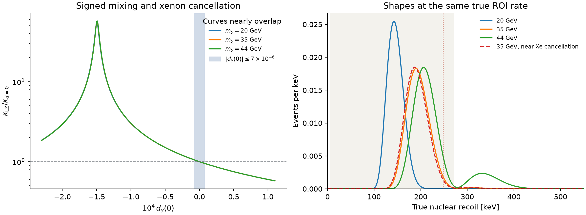

**Figure 6.** The left panel shows how photon mixing changes the coupling required to match the yield. The right panel compares spectra with the same integrated truth-level yield. After Gaussian smoothing with a width of 32.5 keV, the signal densities near 248 keV at $m_\chi=20,35,44$ GeV are approximately $2.75\times10^{-4}$, $4.54\times10^{-3}$, and $6.98\times10^{-3}$ events/keV. The energy-spectrum approximation uses Gaussian smoothing alone. The LZ S1/S2 response and backgrounds enter an event-level analysis.

Varying the target yield over $r=0.75$–$1.25$ changes the median expected monojet limit by at most $9.4\%$ at the points tested. Reducing $f_2$ alone to 0.45 or 0.30 changes it by up to $3.0\%$ and $12.8\%$, respectively. Varying only the low-energy mixing within $|d_\gamma(0)|\le7\times10^{-6}$ changes it by at most $2.8\%$. At the 120 GeV benchmark, the choices $(d_\gamma(0),r,f_2)=(+7\times10^{-6},0.75,0.50)$ and $(-7\times10^{-6},1.25,0.45)$ give median expected limits of $0.465$ and $0.367$, respectively. Appendix A discusses how late downscattering and the excited-state lifetime affect the present-day fraction.

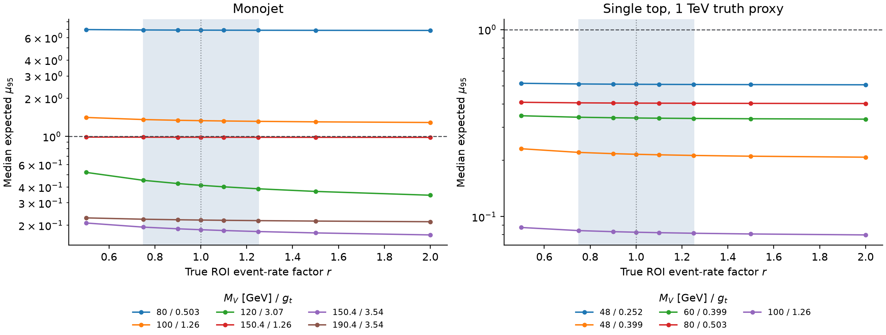

**Figure 7.** We solve for the central Planck abundance and compute the CMS limit for each on-shell point at each fixed target yield. The shaded interval $r=0.75$–$1.25$ is the prescribed range for the normalization test, corresponding to $0.84$–$1.40$ expected truth-level events.

## 7. Top-associated production

The large top-quark coupling $g_t$ makes $pp\to t\bar tV^{(*)}\to t\bar t\chi_1\chi_2$ another possible collider probe. On-shell enhancement can occur when $M_V>2m_\chi+\Delta m$. Below this threshold we generate the four-body final state directly. In the low-mass scan, $(M_V,g_t)=(48\,\mathrm{GeV},0.252)$ has three solutions at the central abundance, with $m_\chi=20.445,25.260,45.878$ GeV. The lightest solution is on shell. At off-shell benchmarks with $M_V=30,46,60$ GeV, the full matrix element at 13 TeV gives $t\bar t+\mathrm{MET}$ cross sections of $0.033$, $0.041$, and $1.13$ fb, respectively, for truth-level $p_T^{\rm miss}>250$ GeV. Limits in the CMS all-hadronic two-$b$-tag category also require the acceptance after top decays, the binned signal yields, and the background correlations. [24](https://arxiv.org/abs/2505.05300)

For the single-top channel $pp\to tj\chi_1\chi_2$, we estimate the expected sensitivity in the 15 bins of the CMS AH $1b\,1\mathrm{FJ}$ category. We approximate the backgrounds with the published central values and bin uncertainties from the fit with a 100 GeV scalar signal, keeping only the diagonal covariance. For the signal we use truth-level cuts, simplified top decays, and approximate $b$ tagging. At $(M_V,g_t)=(60\,\mathrm{GeV},0.399)$, the cuts $\sqrt{\hat s}<1.5,1.0,0.75$ TeV give median expected limits of $0.052,0.337,3.43$, respectively. The strong dependence on this cut is related to the charged weak current connecting up- and down-type quarks with unequal vector couplings. We use the cut variation to test the contribution of high-energy events. A quantitative exclusion requires an electroweak completion and validation of the reconstructed signal and background constraints. [5](https://arxiv.org/abs/1510.02110) · [24](https://arxiv.org/abs/2505.05300) · [25](https://doi.org/10.17182/hepdata.154755.v1/t2)

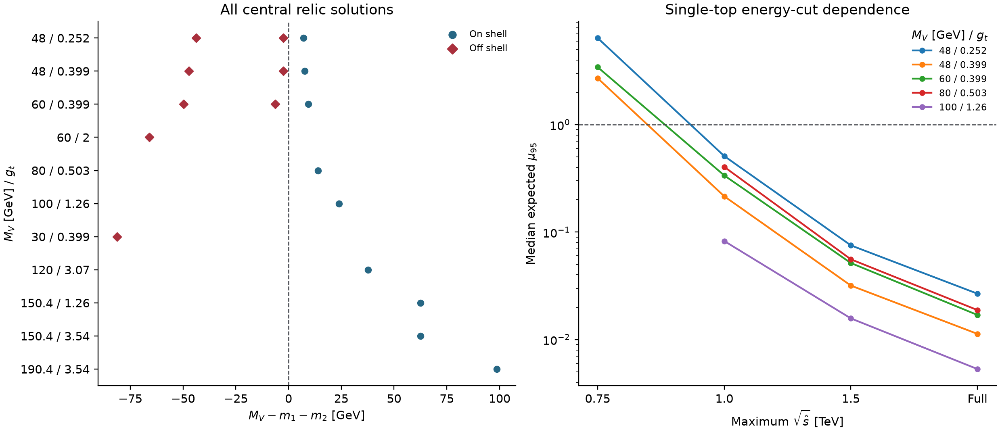

**Figure 8.** The left panel shows $M_V-m_1-m_2$ at representative central relic solutions. The right panel shows how the expected single-top sensitivity varies with the partonic-energy cut for on-shell solutions. The charged weak current connects top and bottom quarks with different $V$ couplings, so the high-energy behavior of longitudinal weak-boson amplitudes depends on cancellations in the electroweak completion. Varying the cut probes that dependence. Missing markers at 0.75 TeV indicate samples for which the approximate likelihood gives no finite limit.

## 8. Conclusions

In this broken-phase vector model, light-quark couplings set the leading coherent xenon recoil amplitude, and heavy-quark couplings drive production at the LHC. For small photon mixing, fixed dark-state splitting, and a standard thermal history, the CMS Run 2 monojet recast excludes some on-shell solutions that reproduce the reference recoil yield and central Planck abundance. Their observed 95% CL limits satisfy $\mu_{95}<1$. The three sensitive benchmarks remain excluded when the truth-level yield target varies by $25\%$. For lighter mediators, on-shell and off-shell relic solutions can occur at the same mediator mass and top coupling. The strong dependence on the partonic-energy cut limits the single-top result to an exploratory estimate. A joint confidence region would require an event-level LZ likelihood for the model, theoretical uncertainties on the abundance, and profiling over shared parameters.

## Appendix A. Xenon recoil and matching checks

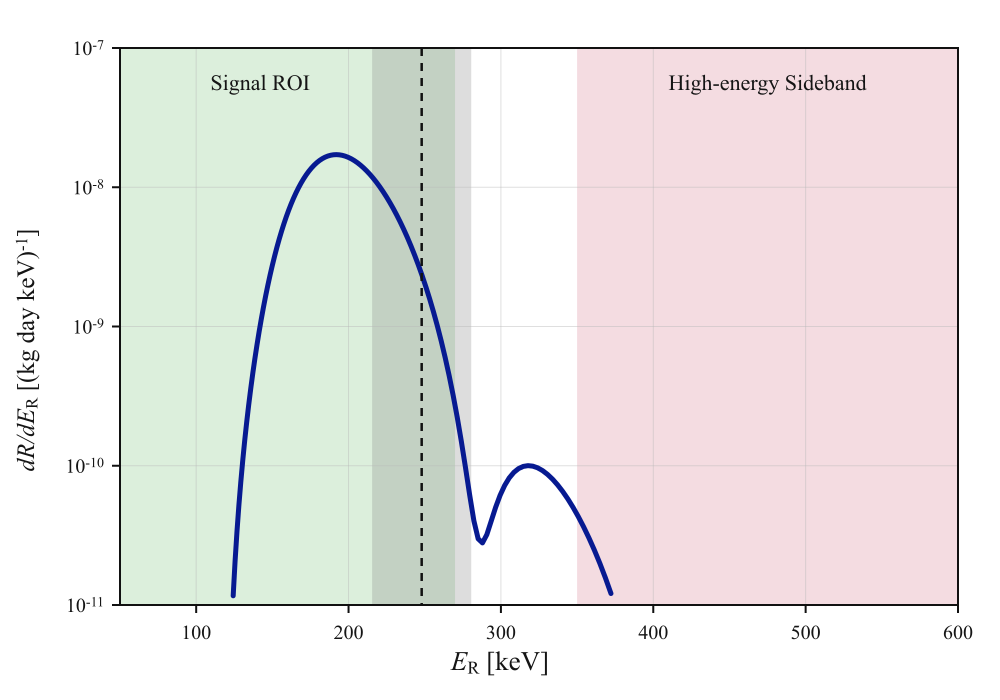

**Figure A1.** Independent reproduction of the universal-vector reference benchmark, used to check the recoil shape and units.

After subtraction at zero momentum, the finite heavy-quark contribution to photon mixing is

$$
\delta d_{cbt}(s)=-\frac{2\alpha}{\pi}\sum_{q=c,b,t}N_cQ_q\frac{\widehat m_q}{m_t}
\int_0^1 dx\,x(1-x)\log\left[1-\frac{s x(1-x)}{\widehat m_q^2}-i0\right].
\tag{A1}
$$

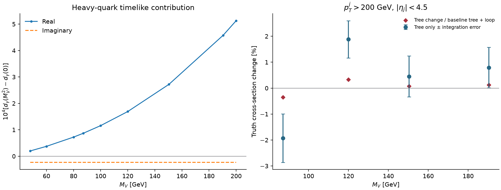

**Figure A2.** At four on-shell masses we include $\delta d_{cbt}(M_V^2)$ in the $pp\to Vj$ tree amplitude. For $p_T^j>200$ GeV, the tree cross section changes by about $2\%$ or less. Relative to the original tree-plus-loop cross section, the shift is below $0.4\%$. For the relic calculation, we approximate the finite term by its real part evaluated at the dark-pair threshold or at the mediator pole. The largest shifts in $\Omega h^2$ across the four points are $1.12\times10^{-4}$ and $4.64\times10^{-4}$, respectively. Lowering `Beps` by two orders of magnitude changes the abundance by less than $2\times10^{-11}$ at three numerical benchmarks. [Timelike rates](data/timelike_rate_summary.csv) · [Relic numerical audit](data/relic_numerical_audit.csv)

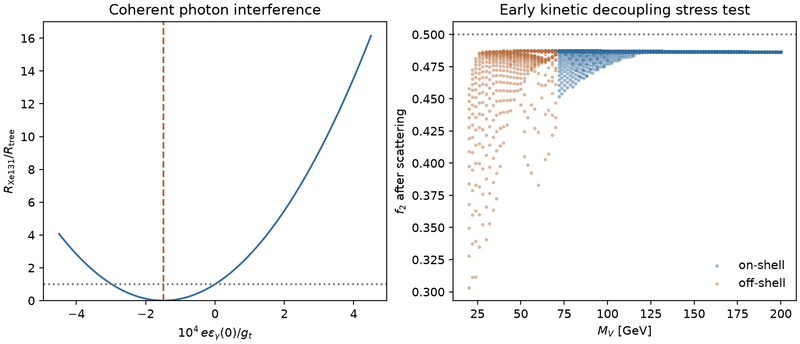

**Figure A3.** The conversion $\chi_2\chi_2\leftrightarrow\chi_1\chi_1$ can change the excited-state fraction after chemical freeze-out. In the standard thermal histories tested, with additional decay suppressed and the Standard Model bath included, the minimum at the on-shell benchmarks is $f_2\simeq0.45$ and falls to about $0.30$ at some off-shell benchmarks. The splitting $\Delta m<2m_e$ closes the electron-pair decay channel. Independent $V$–$Z$ mixing or a transition dipole can still affect the lifetime. [2](https://arxiv.org/html/2609.26570v1) · [26](https://arxiv.org/abs/2108.13422)

After the total abundance freezes out, detailed balance for dark-state conversion gives $\dot f_2=-n_\chi\langle\sigma v\rangle_{22\to11}[f_2^2-e^{-2\Delta m/T_\chi}(1-f_2)^2]$, where $T_\chi$ is the dark-sector kinetic temperature. We model conversion with Born contact scattering and vary the assumptions about kinetic decoupling. The resulting $f_2$ values serve as benchmarks for those thermal histories.

## Appendix B. Cross-section cuts and the mass projection

The UFO for the closed quark loop includes a rational $R_2$ vertex for $gggV$ for each quark flavor. We replace the photon vector coupling in `loop_sm` to obtain the coefficient $i g_{Vq}g_s^3/(48\pi^2)$ per flavor, with color structure $d^{abc}$. Including this term gives a numerical Ward/BRS test ratio of about $6.3\times10^{-24}$ for $gg\to gV$ at $M_V=87.18$ GeV and a partonic energy of 1 TeV. [13](https://arxiv.org/abs/1507.00020)

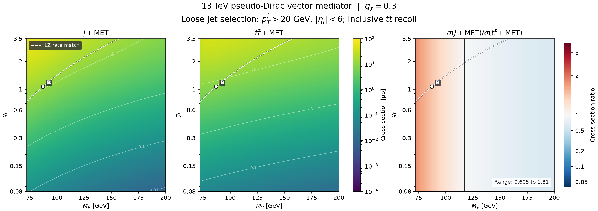

**Figure B1.** The jet selection is $p_T^j>20$ GeV and $|\eta_j|<6$, and the top-pair final state has no truth MET cut. Comparison with Fig. 3 shows the effect of the selection threshold.

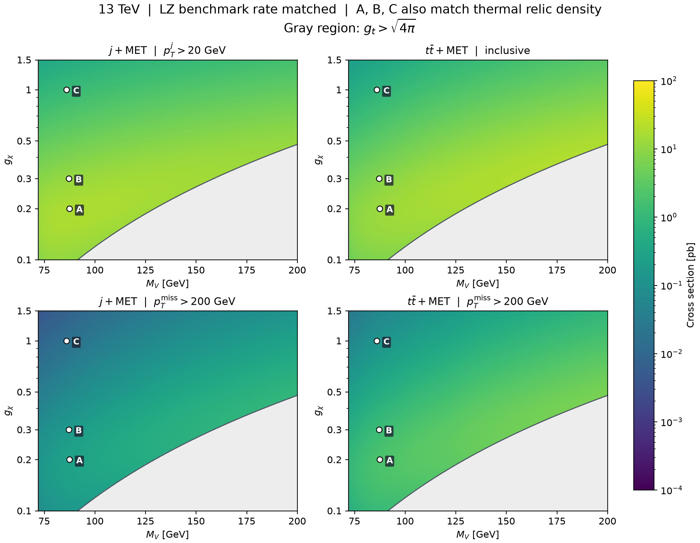

**Figure B2.** We fix $m_\chi=35$ GeV and determine $g_t$ from the tree-level equal-rate condition. A, B, and C are separate relic-density benchmarks. The remaining colors show cross sections subject to the equal-rate condition alone. [Cross-section table](data/truth_benchmarks.csv)

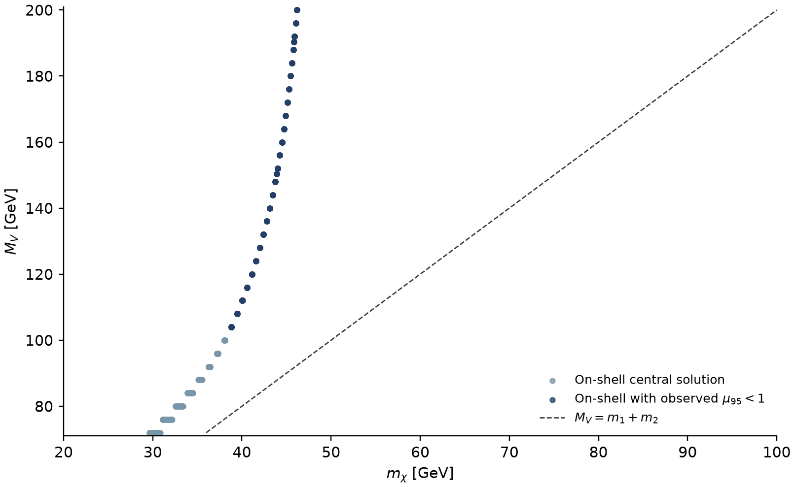

**Figure B3.** Projection of the central relic grid onto $(m_\chi,M_V)$. Dark blue marks on-shell roots with observed $\mu_{95}<1$. Multiple coupling solutions can overlap in the mass projection.

## Appendix C. Validation of the CMS monojet recast

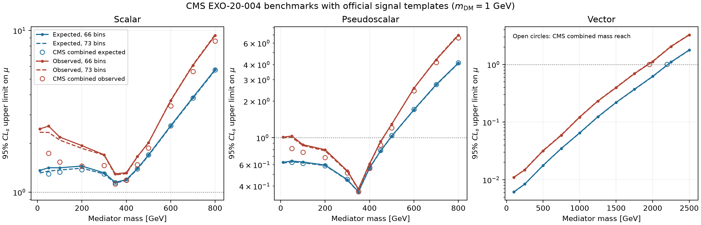

**Figure C1.** Comparison of limits obtained using official CMS signal templates. For scalar and pseudoscalar benchmarks between 50 and 800 GeV, the expected limits from the 66-bin fit differ from the published combination by at most about $9\%$. The largest difference in observed limits is about $48\%$. The mass boundaries provide a separate check of the overall reach for the official vector benchmark. [16](https://arxiv.org/abs/2107.13021) · [27](https://doi.org/10.17182/hepdata.106115.v2/t1)

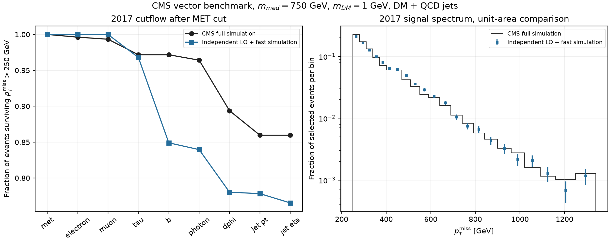

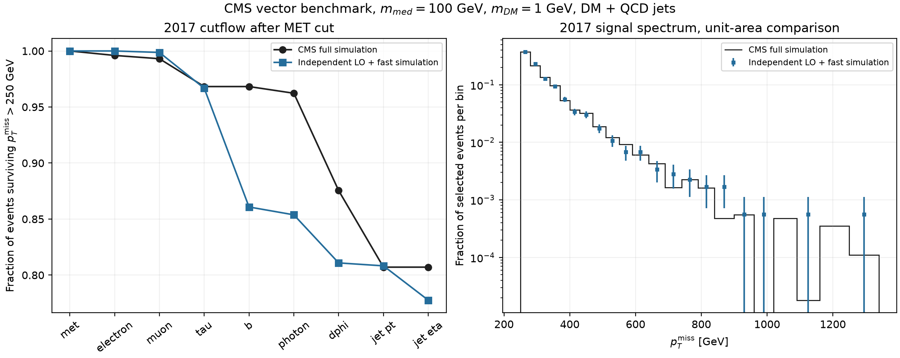

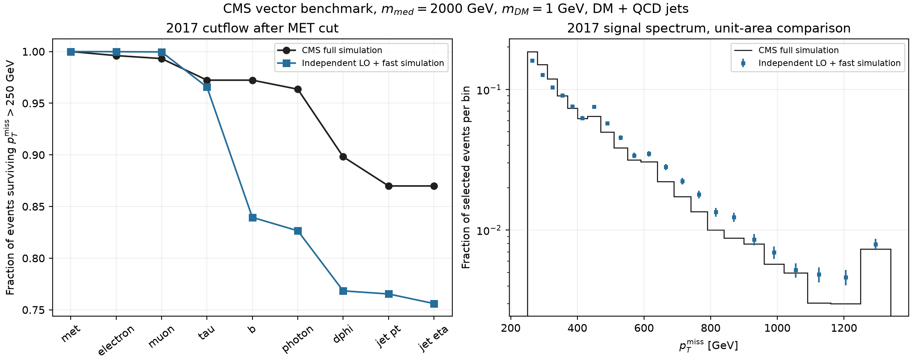

**Figures C2–C4.** Comparison of independent LO event generation and fast detector simulation with official CMS vector benchmarks. For the 100 GeV benchmark in 2017, the efficiency after the MET cut is $76.91\%$ for CMS and $77.76\%$ in our simulation. The absolute QCD signal yield in our simulation is 0.629 times the CMS yield. The two samples use different generator and reconstruction settings, including NLO matching in the official sample. We compare the normalized shapes and the absolute yields separately. [28](https://doi.org/10.17182/hepdata.106115.v2/t20)

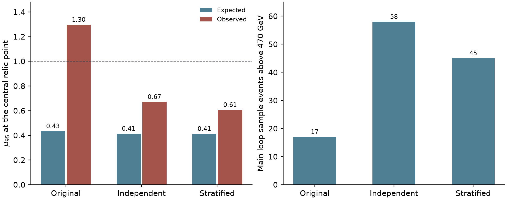

**Figure C5.** Of the 3,600 events in the original loop sample, 17 pass the reconstructed selection and fall in MET bins above 470 GeV. At the same central relic solution, the original sample gives an observed $\mu_{95}$ of about 1.30. An independent sample gives 0.67, and a stratified sample gives 0.61. The main analysis uses the stratified template and all observed counts. [Template comparisons](data/template_replica_comparison.csv)

### Independent template test at three sensitive benchmarks

We keep $(M_V,g_t,m_\chi,g_\chi)$ fixed at the 120, 150.4, and 190.4 GeV benchmarks in Table 2, along with the 66-bin CMS likelihood and background covariance. Loop templates A and B use independent hard-process and shower samples, with generator-level jet $p_T$ boundaries of $(100,230,480)$ and $(100,260,520)$ GeV, respectively. The three strata typically contain 6,600, 4,000, and 3,200 generated events. For the lowest stratum of A at 120 and 150.4 GeV, we use an independent archived sample of 10,800 events and a new sample of 4,800 events, respectively, and retain events with $100\le p_T^j<230$ GeV. Both fits share a newly generated tree template. We also repeat both fits with the original tree template. We average the loop templates with equal weights, combine the Monte Carlo covariances with squared weights, and count the common tree uncertainty once.

We rank the year-specific MET bins using $|s_i[(C_b+\operatorname{diag}\mathbf b)^{-1}\mathbf s]_i|$, evaluated with the reference signal and the background-only information. In the eight highest-ranked bins, we compare the yield differences with the Monte Carlo uncertainties of the independent loop samples. We also sum yields across years in the 470–690 GeV and above-690 GeV intervals and refit the upper limits using all 66 bins.

| $M_V$ [GeV] | Expected A / B / pooled | Observed A / B / pooled | Largest key-bin difference in MC standard deviations |
|---:|---:|---:|---:|
| 120 | 0.389 / 0.407 / 0.408 | 0.527 / 0.621 / 0.561 | 1.05 |
| 150.4 | 0.230 / 0.243 / 0.242 | 0.219 / 0.254 / 0.234 | 0.88 |
| 190.4 | 0.174 / 0.178 / 0.179 | 0.200 / 0.200 / 0.198 | 1.68 |

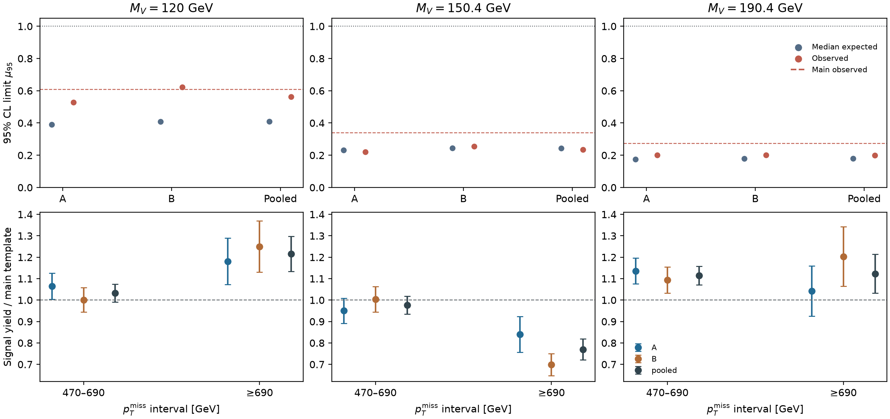

**Figure C6.** The top panels show the CMS 95% CL limits. The dashed lines mark the reference observed limits from Table 2. The lower panels show the yield of each template divided by the reference yield in two combined MET intervals. The error bars represent the Monte Carlo uncertainty of each template. The linked table provides yields by year and bin. [66-bin yields and errors](data/template_validation_bins.csv) · [Sample sizes and seeds](data/template_validation_runs.csv) · [Fitted limits](data/template_validation_limits.csv)

The two templates agree within about $1.7$ Monte Carlo standard deviations in the key bins and combined high-MET intervals. All three benchmarks give observed $\mu_{95}<1$. Across templates and target yields in the range $r=0.75$–$1.25$, the largest observed limit is $0.680$. At 120 and 150.4 GeV, the two stratifications still give observed limits that differ by about $16\%$ and $15\%$ of their mean, respectively. At 150.4 and 190.4 GeV, the pooled limits are about $31\%$ and $27\%$ below the reference values in Table 2. The three exclusion decisions are stable across the sampling schemes tested, while the numerical limits retain some dependence on Monte Carlo statistics and template shape.

We refit the original grid with the three pooled templates, replacing the 120 and 150 GeV nodes and adding the 190.4 GeV node. After interpolation, the number of points with expected $\mu_{95}<1$ changes from 208 to 199, and the observed count changes from 151 to 162. The lowest sampled masses remain 92 and 104 GeV, respectively. The absolute yield discrepancy in Fig. C3 still limits the validation of the signal acceptance. [Grid limits after the template refit](data/template_contour_refit.csv)

## Appendix D. Top-associated channels for light mediators

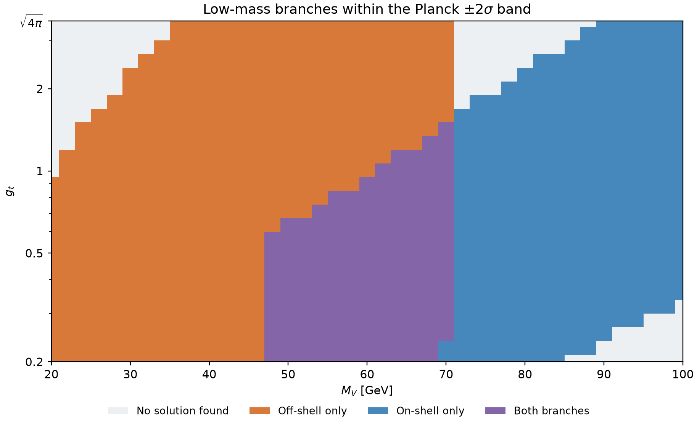

**Figure D1.** Independent low-mass scan with tree-level yield matching. Colors identify the relic branches found within the Planck $\pm2\sigma$ band. Purple indicates that both on-shell and off-shell solutions are present.

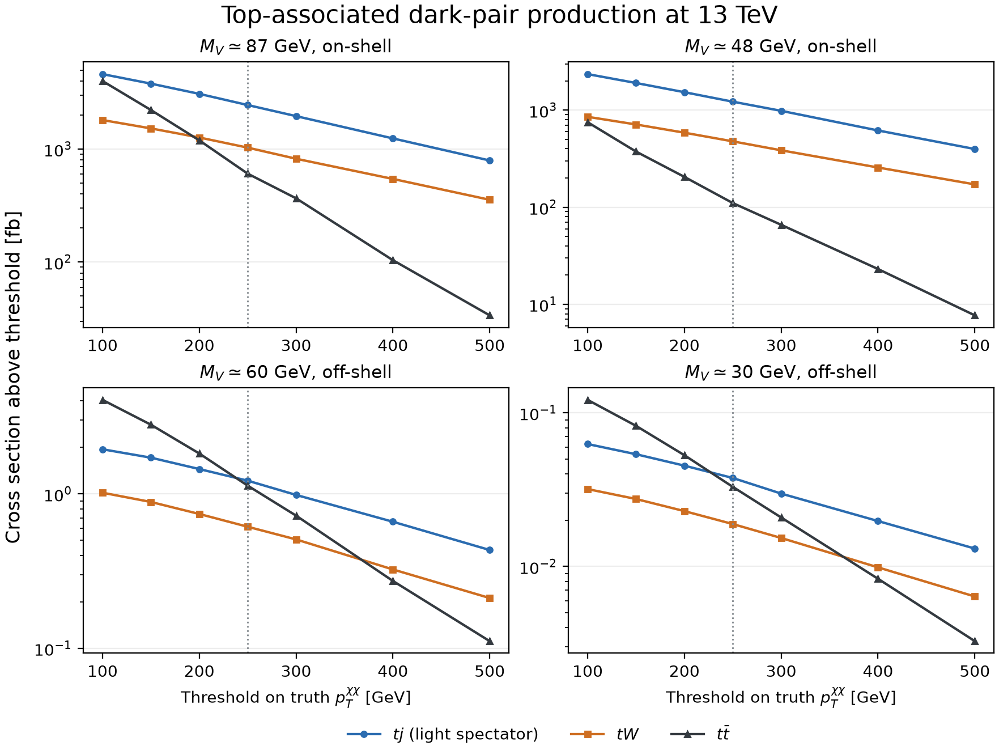

**Figure D2.** Cross sections in fb above different truth-level MET thresholds for dark-pair production with $tj$, $tW$, or $t\bar t$ at four on-shell or off-shell benchmarks. Deriving experimental limits requires simulating top decays and validating reconstruction and selection efficiencies at the same parameter points. [Off-shell top-pair cross sections](data/off_shell_ttmet.csv) · [Single-top sensitivity estimate](data/single_top_expected.csv)

For $m_\chi\ge20$ GeV and $M_V\le40.001$ GeV, dark-pair production proceeds through an off-shell mediator. To derive a top-pair exclusion from fully simulated samples, one must check $m_\chi$, the decay threshold, and the template normalization at each point with a common reference yield. The published CMS backgrounds come from a simultaneous fit that includes signal-region data. An observed recast requires background constraints independent of the signal-region counts. [24](https://arxiv.org/html/2505.05300v1)

## Data and reproducibility

[Root-by-root grid limits](data/center_grid_limits.csv) · [Grid summary](data/center_grid_summary.json) · [Benchmark roots at all targets](data/benchmark_roots.csv) · [Benchmark uncertainty summary](data/branch_uncertainties.csv) · [Figure and data provenance](FIGURE_SOURCES.md)

## References

1. LZ Collaboration, *Search for Dark Matter Particle Interactions in an Extended Nuclear Recoil Energy Window with the LUX-ZEPLIN (LZ) Experiment*. [arXiv:2609.02823](https://arxiv.org/abs/2609.02823)
2. C. Gemmell, D. Hooper, and G. Krnjaic, *A Simple Dark Matter Model to Explain the LZ Event and Galactic Center Excess*. [arXiv:2609.26570](https://arxiv.org/abs/2609.26570)
3. X.-Y. Du, W. Huang, and K. Xie, *Pseudo-Dirac Inelastic Dark Matter in the Leptophobic $U(1)_B$ Model: Confronting the LUX-ZEPLIN High-Recoil Event with Collider Searches*. [arXiv:2609.07225](https://arxiv.org/abs/2609.07225)
4. P. Cox, A. D. Medina, T. S. Ray, and A. Spray, *Novel Collider and Dark Matter Phenomenology of a Top-philic $Z'$*. [arXiv:1512.00471](https://arxiv.org/abs/1512.00471)
5. F. Kahlhoefer, K. Schmidt-Hoberg, T. Schwetz, and S. Vogl, *Implications of Unitarity and Gauge Invariance for Simplified Dark Matter Models*. [arXiv:1510.02110](https://arxiv.org/abs/1510.02110)
6. F. D’Eramo, B. J. Kavanagh, and P. Panci, *You Can Hide but You Have to Run: Direct Detection with Vector Mediators*. [arXiv:1605.04917](https://arxiv.org/abs/1605.04917)
7. LZ Collaboration, extended nuclear-recoil search, HEPData record. [doi:10.17182/hepdata.182472.v1](https://doi.org/10.17182/hepdata.182472.v1)
8. K. Griest and D. Seckel, *Three Exceptions in the Calculation of Relic Abundances*, Phys. Rev. D **43**, 3191 (1991). [doi:10.1103/PhysRevD.43.3191](https://doi.org/10.1103/PhysRevD.43.3191)
9. P. Gondolo and G. Gelmini, *Cosmic Abundances of Stable Particles: Improved Analysis*, Nucl. Phys. B **360**, 145–179 (1991). [doi:10.1016/0550-3213(91)90438-4](https://doi.org/10.1016/0550-3213%2891%2990438-4)
10. G. Alguero et al., *micrOMEGAs 6.0: N-Component Dark Matter*. [arXiv:2312.14894](https://arxiv.org/abs/2312.14894)
11. Planck Collaboration, *Planck 2018 Results. VI. Cosmological Parameters*. [arXiv:1807.06209](https://arxiv.org/abs/1807.06209)
12. J. Alwall et al., *The Automated Computation of Tree-Level and Next-to-Leading Order Differential Cross Sections, and Their Matching to Parton Shower Simulations*. [arXiv:1405.0301](https://arxiv.org/abs/1405.0301)
13. V. Hirschi and O. Mattelaer, *Automated Event Generation for Loop-Induced Processes*. [arXiv:1507.00020](https://arxiv.org/abs/1507.00020)
14. C. Bierlich et al., *A Comprehensive Guide to the Physics and Usage of PYTHIA 8.3*. [arXiv:2203.11601](https://arxiv.org/abs/2203.11601)
15. DELPHES 3 Collaboration, *DELPHES 3: A Modular Framework for Fast Simulation of a Generic Collider Experiment*. [arXiv:1307.6346](https://arxiv.org/abs/1307.6346)
16. CMS Collaboration, *Search for New Particles in Events with Energetic Jets and Large Missing Transverse Momentum in Proton-Proton Collisions at $\sqrt{s}=13$ TeV*, JHEP **11** (2021) 153. [arXiv:2107.13021](https://arxiv.org/abs/2107.13021)
17. A. Albert, *Implementation of a Search for New Phenomena in Events Featuring Energetic Jets and Missing Transverse Energy (137 fb$^{-1}$, 13 TeV, CMS EXO-20-004)*, MadAnalysis 5 (2021). [doi:10.14428/DVN/IRF7ZL](https://doi.org/10.14428/DVN/IRF7ZL) · [Implementation and validation description](https://doi.org/10.21468/SciPostPhys.14.1.009)
18. CMS EXO-20-004, public monojet background covariance, HEPData Table 14. [doi:10.17182/hepdata.106115.v2/t14](https://doi.org/10.17182/hepdata.106115.v2/t14)
19. CMS EXO-20-004, observed and background yields, HEPData Table 15. [doi:10.17182/hepdata.106115.v2/t15](https://doi.org/10.17182/hepdata.106115.v2/t15)
20. CMS Collaboration, *Simplified Likelihood for the Re-Interpretation of Public CMS Results*. [CMS-NOTE-2017-001](https://cds.cern.ch/record/2242860)
21. G. Cowan, K. Cranmer, E. Gross, and O. Vitells, *Asymptotic Formulae for Likelihood-Based Tests of New Physics*. [arXiv:1007.1727](https://arxiv.org/abs/1007.1727)
22. A. L. Read, *Presentation of Search Results: The $CL_s$ Technique*, J. Phys. G **28**, 2693–2704 (2002). [doi:10.1088/0954-3899/28/10/313](https://doi.org/10.1088/0954-3899/28/10/313)
23. F. Forner and F. Tellander, *Renormalization of $U(1)$ Gauge Boson Kinetic Mixing*, Phys. Rev. D **113**, 056015 (2026). [doi:10.1103/tqw9-zm9x](https://doi.org/10.1103/tqw9-zm9x) · [arXiv:2512.14836](https://arxiv.org/abs/2512.14836)
24. CMS Collaboration, *Search for Dark Matter Produced in Association with One or Two Top Quarks in Proton-Proton Collisions at $\sqrt{s}=13$ TeV*. [arXiv:2505.05300](https://arxiv.org/abs/2505.05300)
25. CMS top-associated search, AH $1b\,1\mathrm{FJ}$ post-fit MET spectrum, HEPData Table 2. [doi:10.17182/hepdata.154755.v1/t2](https://doi.org/10.17182/hepdata.154755.v1/t2)
26. M. Carrillo González and N. Toro, *Cosmology and Signals of Light Pseudo-Dirac Dark Matter*. [arXiv:2108.13422](https://arxiv.org/abs/2108.13422)
27. CMS EXO-20-004, public spin-1 signal templates, HEPData Table 1. [doi:10.17182/hepdata.106115.v2/t1](https://doi.org/10.17182/hepdata.106115.v2/t1)
28. CMS EXO-20-004, public monojet cutflow, HEPData Table 20. [doi:10.17182/hepdata.106115.v2/t20](https://doi.org/10.17182/hepdata.106115.v2/t20)
