# 放热型伪狄拉克暗物质的氙核反冲与 LHC 缺失横动量检验

## 摘要

我们研究质量加权矢量中介子与放热型伪狄拉克暗物质的唯象。对轻夸克的质量抑制使氙核反冲与对撞机产生分别对不同味道的耦合敏感。我们以 LZ 高能核反冲候选所启发的参考模型为基准匹配真值事例率，再对每个在壳或离壳分支求解 Planck 热遗迹丰度。利用 CMS Run 2 单喷注公开的 66 个分箱，在参考率切片上重构 CMS-only 95% CL 信号强度上限。在小低能光子混合及窄宽度条件下，CMS 单喷注数据对部分在壳联立解有排除灵敏度。三个强灵敏代表点的 observed $\mu_{95}$ 为 $0.607$、$0.340$ 和 $0.273$，当 LZ 真值率目标上下改变 $25\%$ 时仍小于 1。这些点位于较大的顶夸克耦合处，其中两点在扫描耦合上界。我们分别量化低能混合、局域激发态比例、丰度测量和信号模拟统计的影响，并讨论顶夸克伴随产生在较低中介子质量区的互补性。

## 1. 引言

LUX-ZEPLIN（LZ）在 $2.84$ tonne yr 的扩展反冲能窗分析中报告了一个与 $E_R=248\pm23_{\rm stat}\pm23_{\rm syst}$ keV 相容的核反冲样事例。对 LZ 测试的模型集合，纯背景假设的全局显著性为 $2.6\sigma$，最大局域显著性为 $3.4\sigma$。放热型非弹性散射可在较重暗态跃迁时释放能量，使几十 GeV 的暗物质产生高能核反冲。Gemmell、Hooper 和 Krnjaic 用普适夸克矢量流研究了这一机制与银河中心伽马射线超额。本文采用其放热基准定义参考率，研究氙核反冲、热丰度和 LHC 信号。 [1](https://arxiv.org/html/2609.02823) · [2](https://arxiv.org/html/2609.26570v1)

对撞机灵敏度同时依赖耦合的味结构与中介子的不可见衰变阈值。Du、Huang 和 Xie 在规范完备的 leptophobic $U(1)_B$ 中研究了吸热跃迁，其 $1.44$ TeV 基准的不可见二体衰变关闭，主要由双喷注搜索检验。顶亲和矢量中介子的圈图和顶夸克伴随产生也已有独立研究。本文考察两种物理条件的交集：放热氙反冲所要求的低能耦合乘积，以及在几十至约两百 GeV 中介子质量下由重味产生驱动的缺失横动量信号。我们在相同的四维参数点上施加丰度与对撞机条件，并在二维投影中显示离壳解的存在。 [3](https://arxiv.org/html/2609.07225) · [4](https://arxiv.org/abs/1512.00471)

## 2. 有效模型

取 $m_1=m_\chi$、$m_2=m_\chi+\Delta m$，并以两态的非对角矢量流与自旋 1 中介子 $V_\mu$ 耦合。在电弱破缺后的基底中，基准相互作用为

$$
\mathcal L_{\rm int}=V_\mu\left[\sum_{q=u,d,s,c,b,t}g_t\frac{\widehat m_q}{172\,\mathrm{GeV}}\bar q\gamma^\mu q
+i\frac{g_\chi}{2}\bar\chi_1\gamma^\mu\chi_2\right],\qquad
\widehat m_q=(0.0022,0.0047,0.096,1.27,4.18,172)\,\mathrm{GeV}.
\tag{1}
$$

$g_t$ 是零混合时的 $Vt\bar t$ 顶点系数，暗态跃迁顶点的大小为 $g_\chi/2$。本文使用电弱破缺相（broken phase）的有效模型，取 $g_{Vq}\propto\widehat m_q$ 为唯象味结构假设。参考质量 $\widehat m_q$ 定义味耦合比例，这一比例由模型输入指定。完整 $U(1)_X$ 理论中的电荷、费米子质量生成和匹配需要另外确定。对于纯矢量耦合，同一左手弱双重态中不同的上、下型系数需要电弱破缺算符或额外混合。 [5](https://arxiv.org/abs/1510.02110) · [6](https://arxiv.org/abs/1605.04917)

给定低能匹配系数时，氙核反冲运动学与领先相干率可直接由式（1）计算。本文保留的闭合夸克圈 $gg\to gV$ 振幅在这组顶点下满足 QCD Ward 恒等式。丰度和 monojet 的数值结果以所列算符、粒子及开放道为条件。电弱完备化可通过额外的 $V$–$Z$ 混合、匹配算符或新粒子改变核振幅、湮灭率、中介子宽度和产生率。含带电弱流的过程还依赖纵向振幅的电弱抵消，第 7 节检验这一依赖。 [5](https://arxiv.org/abs/1510.02110) · [6](https://arxiv.org/abs/1605.04917)

| 物理量 | 基准或范围 |
|---|---|
| 暗态劈裂、今日局域激发态比例 | $\Delta m=1$ MeV，$f_2=0.5$ |
| 局域暗物质密度 | $\rho_\chi=0.3\ \mathrm{GeV\,cm^{-3}}$ |
| 晕速度参数 $(v_0,v_E,v_{\rm esc})$ | $(238,254,544)\ \mathrm{km\,s^{-1}}$ |
| 暗质量与暗耦合 | $20\le m_\chi\le100$ GeV，$0.10\le g_\chi\le1.50$ |
| CMS 单喷注网格 | $72\le M_V\le200$ GeV，$0.1\le g_t\le\sqrt{4\pi}$ |
| 在壳模板适用条件 | $M_V-m_1-m_2\ge5\Gamma_V$，$\Gamma_V/M_V<0.03$ |

$g_t=\sqrt{4\pi}$ 对应 $g_t^2/(4\pi)=1$，这里作为扫描边界。接近该上界的结果应结合高阶修正评估。低质量顶夸克通道另用 $M_V=20$–100 GeV 的独立分支扫描。

## 3. 氙核反冲与 LZ 等率条件

对质子和中子取领先矢量荷 $f_p=2g_{Vu}+g_{Vd}$、$f_n=g_{Vu}+2g_{Vd}$，得到 $f_p/g_t=5.29\times10^{-5}$、$f_n/g_t=6.74\times10^{-5}$。质量数为 $A$ 的原子核具有相干荷 $Q_A=Zf_p+(A-Z)f_n$。令 $m_A$ 为核质量，$\mu_A=m_2m_A/(m_2+m_A)$，则放热跃迁的最小入射速度和真值微分率为

$$
\begin{aligned}
v_{\min}(E_R)&=\frac{|m_A E_R/\mu_A-\Delta m|}{\sqrt{2m_A E_R}},\
\frac{dR}{dE_R}&=\frac{f_2\rho_\chi}{m_2}\sum_A w_A\,
\frac{(g_\chi Q_A/2)^2 F_A^2(q)}{2\pi(M_V^2+q^2)^2}\,\eta(v_{\min}),
\qquad q^2=2m_AE_R .
\end{aligned}
\tag{2}
$$

$w_A$ 是天然氙同位素的质量分数，$F_A$ 由数值双参数 Fermi 核密度给出，$\eta(v_{\min})=\int_{v>v_{\min}}d^3v\,f_{\rm lab}(\mathbf v)/v$。数值计算在通量和约化质量中采用质量简并近似，保留 $v_{\min}$ 中的劈裂。零速度可及的核反冲能量为 $E_R^\star=\Delta m\,\mu_A/m_A$，实际谱峰还受速度分布和核形状因子影响。 [2](https://arxiv.org/html/2609.26570v1) · [6](https://arxiv.org/abs/1605.04917)

对文献 [2] 图 6 的参考点 $(m_\chi,M_V,g_B,g_\chi)=(35\,\mathrm{GeV},30\,\mathrm{GeV},1.46\times10^{-5},0.32)$，按 $g_{Vq}=g_B/6$ 重算，真值信号窗 $[5.4,269.9]$ keV 内有 $N_0=1.12044$ 个期望事例，侧带 $[350,675]$ keV 内有 $7.39\times10^{-4}$ 个。参考论文在响应折叠后分别得到约 1 和 $8\times10^{-4}$ 个。我们令新味结构在同一真值计算中给出 $N_0$。LZ 的科学样本包含 1710 个事件，完整检验使用校正的 S1 和 S2。这里的等率条件用于把候选所启发的信号规模传入模型参数。 [1](https://arxiv.org/html/2609.02823) · [2](https://arxiv.org/html/2609.26570v1) · [7](https://doi.org/10.17182/hepdata.182472.v1)

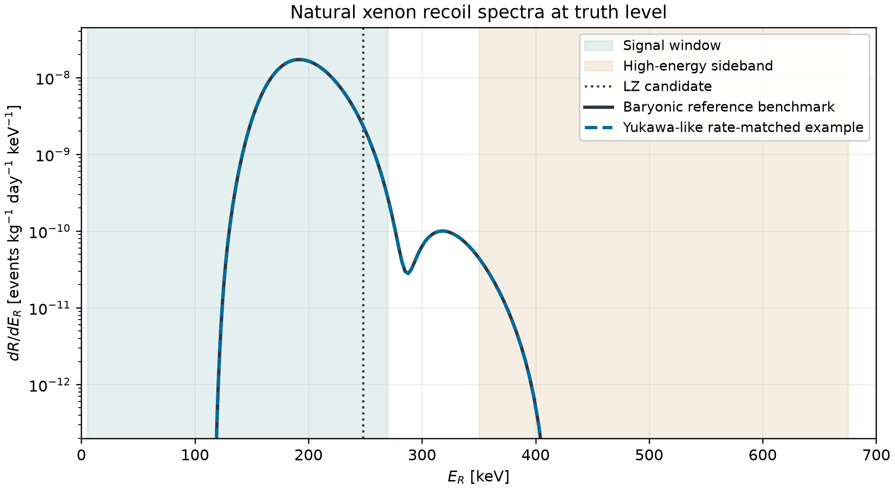

**图 1.** 参考模型和质量加权矢量模型的真值微分率，单位为事例 kg$^{-1}$ day$^{-1}$ keV$^{-1}$。两者取 $m_\chi=35$ GeV、$M_V=30$ GeV，等率模型取 $g_t=0.12763$、$g_\chi=0.29779$。竖线标记 LZ 候选的重建能量，底色为积分能窗。

在 $q\ll M_V$ 时，率的耦合部分由 $\kappa=g_tg_\chi/M_V^2$ 决定。记基准晕与 $f_2=0.5$ 下的树级等率解为 $\kappa_0(m_\chi)$，并定义 $r=N_{\rm ROI}^{\rm truth}/N_0$。令 $K_\gamma$ 表示同参数下光子项修正后的率与树级率之比。则

$$
\kappa=\kappa_0(m_\chi)\sqrt{\frac{r}{K_\gamma(m_\chi,d_\gamma)}\frac{0.5}{f_2}},\qquad
g_\chi=\frac{M_V^2}{g_t}\kappa.
\tag{3}
$$

我们逐质量计算积分，$\kappa_0(35,40,44\,\mathrm{GeV})=(4.223,5.665,7.202)\times10^{-5}\ \mathrm{GeV}^{-2}$。较大的暗质量把特征反冲能量推近窗口上边缘，因而等率条件需要更大的耦合乘积。对给定谱形，$r/f_2$ 控制归一化。**$r=1$ 是由 LZ 候选启发的参考真值率，$r\in[0.75,1.25]$ 是事先指定的归一化变化范围，没有 LZ 置信水平。** 本文的 95% CL 上限由第 5 节的 CMS 单喷注似然给出。

## 4. 热丰度与联立解

在标准热史及冻结期间两暗态维持化学平衡的假设下，对 $n=n_1+n_2$ 求解

$$
\dot n+3Hn=-\langle\sigma_{\rm eff}v\rangle(n^2-n_{\rm eq}^2),\qquad
\langle\sigma_{\rm eff}v\rangle=\sum_{i,j=1,2}\frac{n_i^{\rm eq}n_j^{\rm eq}}{(n^{\rm eq})^2}\langle\sigma_{ij}v\rangle .
\tag{4}
$$

由于 $\Delta m\ll T_f$，两态在冻结附近的平衡权重接近相等。采用 CalcHEP 模型和 micrOMEGAs 7.1.4，以 `Fast=0`、`Beps=1e-9` 求总丰度，并令两态共同饱和 Planck 的 $\Omega_ch^2=0.1200\pm0.0012$。共湮灭 $\chi_1\chi_2\to V^*\to b\bar b,c\bar c$ 使丰度在共振附近对 $M_V$ 敏感。$m_\chi=35$ GeV 的一个在壳代表点中，$b\bar b$ 约占共湮灭的 $92\%$。当两暗态的同种粒子湮灭到 $VV$ 打开时，暗扇区末态也能控制丰度。 [8](https://doi.org/10.1103/PhysRevD.43.3191) · [9](https://doi.org/10.1016/0550-3213%2891%2990438-4) · [10](https://arxiv.org/abs/2312.14894) · [11](https://arxiv.org/abs/1807.06209)

固定 $m_\chi$ 并施加式（3）后，共湮灭的耦合和传播子因子为

$$
\frac{(g_tg_\chi)^2}{(M_V^2-s)^2+M_V^2\Gamma_V^2}
=\frac{\kappa^2 M_V^4}{(M_V^2-s)^2+M_V^2\Gamma_V^2}.
\tag{5}
$$

改变 $g_\chi$ 可通过宽度影响热平均，改变 $M_V$ 也改变极点与热可及区间的距离。在 $m_\chi=35$ GeV、$g_\chi=0.18$、$M_V\simeq87.56$ GeV 的切片上，丰度的局部对数斜率约为 $0.158\ \mathrm{GeV}^{-1}$，Planck 的 $\pm2\sigma$ 对应 $M_V\simeq87.43$–$87.68$ GeV。允许 $m_\chi$ 变化后，两个约束在四维参数空间定义多张二维解面，可在同一 $(M_V,g_t)$ 坐标上有多个根。

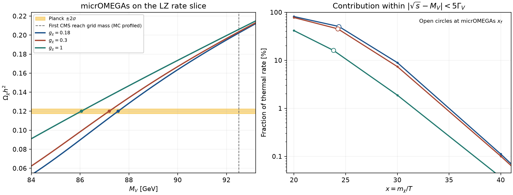

**图 2.** 左图为 $m_\chi=35$ GeV 的固定暗质量切片。右图为极点邻域对瞬时热平均率的贡献，空心标记对应各参数点的冻结温度。

主网格取 $r=1$、$f_2=0.5$、$d_\gamma(0)=0$，包括 $c,b,t$ 光子混合在核反冲动量下的有限项。固定 $(M_V,g_t)$ 后由式（3）消去 $g_\chi$，在质量和耦合范围内分别搜索 $M_V-2m_\chi-\Delta m$ 两侧满足 $\Omega_\chi h^2=0.1200$ 的过零根。主扫描用 35 个中介子质量和 29 个顶耦合节点，质量求根的括区间隔至多 $1.10$ GeV，并在阈值附近加密。丰度误差由 11 个代表坐标上对 $0.1176,0.1188,0.1200,0.1212,0.1224$ 各自求根来传播。每个根保留自己的参数及上限。

这一传播对应高斯观测项 $-2\ln\mathcal L_\Omega=[(\Omega_\chi h^2-0.1200)/0.0012]^2+\mathrm{const.}$。在发生分支消失或扫描边界截断时，各丰度目标分别保留。例如 $M_V=150.4$ GeV、$g_t=1.260$ 的点在 $r=2$ 时，中心解需要 $g_\chi=1.498$，而向下改变丰度的两个目标在 $g_\chi\le1.50$ 内未找到根。丰度的理论系统误差未纳入高斯观测项。

## 5. LHC 产生、重建与统计

### 5.1 真值截面与重建

单喷注包含 $q\bar q\to gV$、$qg\to qV$ 及共轭树图，以及有限的闭合夸克圈振幅 $gg\to gV$。纯矢量流的 $gg\to V$ 三点振幅相消，伴随胶子使四点振幅可以非零。本文将不同初态的树图和 $gg$ 圈图按截面相加。顶对伴随过程 $pp\to t\bar tV$ 在树级计算。使用 MadGraph5_aMC@NLO 3.6.6、13 TeV 和 `nn23lo1`，采用 11 个 $M_V$ 节点。在窄宽度近似下，对每个末态用

$$
\sigma_X=\sigma_X^{\rm prod}(M_V;g_t=1)\,g_t^2\,\mathrm{BR}(V\to\chi_1\chi_2).
\tag{6}
$$

宽喷注切选 $p_T^j>20$ GeV 下，$M_V\simeq118$ GeV 附近的 $j+\mathrm{MET}$ 与无 MET 切选的 $t\bar t+\mathrm{MET}$ 真值截面相当。两个末态共同要求真值 $p_T^{\rm miss}>200$ GeV 后，比值 $\sigma(j+\mathrm{MET})/\sigma(t\bar t+\mathrm{MET})$ 降至 $0.135$–$0.149$。例如 $(m_\chi,M_V,g_t,g_\chi)=(35,87.18,1.070,0.30)$ 的截面分别为 $0.166$ 和 $1.23$ pb。这里顶夸克稳定，$p_T^{\rm miss}=p_T(V)$。实验灵敏度还取决于衰变、重建选择和背景。 [4](https://arxiv.org/abs/1512.00471) · [12](https://arxiv.org/abs/1405.0301) · [13](https://arxiv.org/abs/1507.00020)

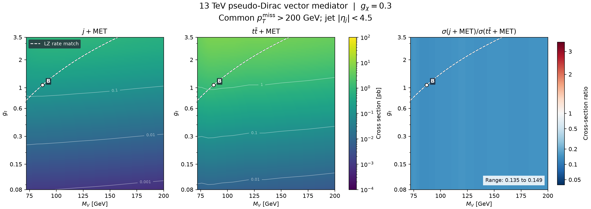

**图 3.** 固定 $m_\chi=35$ GeV、$g_\chi=0.30$，比较两个末态和截面比，单位为 pb。虚线是树级 LZ 等率条件。圈图为 $gg\to gV$，计算范围是领先树图加该圈图贡献。

用 Pythia 8.312 和 Delphes 3.5.0 生成单喷注重建模板，将在壳 $V$ 作为不可见粒子。树图和圈图从生成级 $p_T^j=100$ GeV 起始，分别在 350 和 480 GeV 用硬样本加密，按互斥生成区间合并。120 GeV 节点另以 230 GeV 作圈图分层边界。重建选择近似 CMS EXO-20-004，包括领先 AK4 喷注 $p_T>100$ GeV、$|\eta|<2.4$，$p_T^{\rm miss}>250$ GeV、喷注方位角选择、轻子、光子及重味相关否决，并处理 2018 年 HEM 区域。三年共约 $137\ \mathrm{fb}^{-1}$、每年 22 个信号分箱。 [14](https://arxiv.org/abs/2203.11601) · [15](https://arxiv.org/abs/1307.6346) · [16](https://arxiv.org/abs/2107.13021) · [17](https://doi.org/10.14428/DVN/IRF7ZL)

### 5.2 66-bin 剖面似然

以公开观测计数 $n_i$、控制区纯背景拟合均值 $\mathbf b$、背景协方差 $C_b$ 和各点的预测信号 $\mathbf s$ 建立

$$
\mathcal L(\mu,\mathbf b',\mathbf s')=
\prod_{i=1}^{66}{\rm Pois}(n_i\mid b_i'+\mu s_i')
\,G(\mathbf b';\mathbf b,C_b)\,G(\mathbf s';\mathbf s,C_s).
\tag{7}
$$

约束信号产额非负、泊松均值为正。$C_s$ 计入有限模拟的多项式计数协方差、截面积分误差和一个 $1.6\%$ 的共通信号亮度扰动。重复使用模拟事件的年份之间保留相关项。质量节点间线性插值信号产额，以权重平方插值独立样本的协方差。用 $\mu=1$ 表示该分支的名义预测。用单边剖面似然统计量与渐近 $CL_s=0.05$ 求 $\mu_{95}$。Expected 以背景中心构造 Asimov，observed 使用实测 $n_i$ 与条件背景 Asimov。五个 expected 分位点描述背景涨落，丰度目标变化则逐个物理解传播。 [18](https://doi.org/10.17182/hepdata.106115.v2/t14) · [19](https://doi.org/10.17182/hepdata.106115.v2/t15) · [20](https://cds.cern.ch/record/2242860) · [21](https://arxiv.org/abs/1007.1727) · [22](https://doi.org/10.1088/0954-3899/28/10/313)

令 $\tilde q_\mu=-2\ln[\mathcal L(\mu,\widehat{\widehat{\boldsymbol\theta}}_\mu)/\mathcal L(\widehat\mu,\widehat{\boldsymbol\theta})]$，在 $\widehat\mu>\mu$ 时置零，并约束 $\widehat\mu\ge0$。以 $a=\sqrt{\tilde q_{\mu,A}}$，观测渐近统计量写作

$$
CL_s(\mu)=\frac{\Phi(-z_\mu)}{\Phi(a-z_\mu)},\qquad
z_\mu=\begin{cases}\sqrt{\tilde q_\mu},&\tilde q_\mu\le a^2,\\
(\tilde q_\mu+a^2)/(2a),&\tilde q_\mu>a^2.\end{cases}
\tag{8}
$$

对于 expected 带，在中心背景 Asimov 上用 $a=z-\Phi^{-1}[0.05\Phi(z)]$ 求根，其中 $z=-2,-1,0,1,2$。 [21](https://arxiv.org/abs/1007.1727)

附录 C 用 CMS 官方矢量模板检查 66-bin 统计重构，并用独立模拟检查 cutflow、接受率和 MET 谱。官方矢量质量边界的 expected 与 observed 分别为 2.198 和 1.957 TeV，66-bin 复算得到 2.208 和 1.941 TeV。轻中介子逐点 observed 上限和独立模拟的绝对产额仍有较大差别，因此本文给出公共似然重解释及其验证范围。

## 6. 单喷注结果及稳定性

### 6.1 中心丰度的分支结果

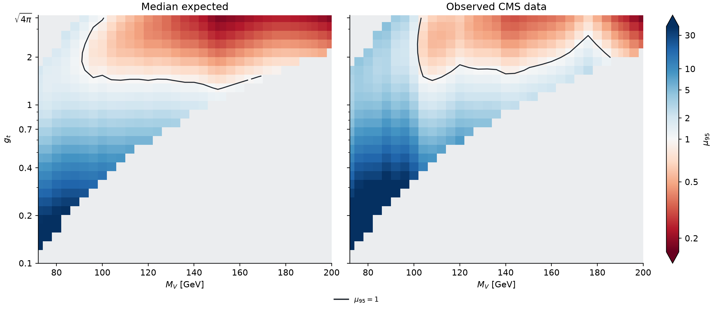

**图 4.** 在 $r=1$、$f_2=0.5$、$d_\gamma(0)=0$ 的参考率切片上，由式（3）令 $g_\chi=g_\chi(m_\chi;M_V,g_t)$。令 $\mathcal D_\chi$ 为满足 $20\le m_\chi\le100$ GeV 且由式（3）得到 $0.10\le g_\chi\le1.50$ 的暗质量集合。在每个 $(M_V,g_t)$ 坐标，定义

$$
\mathcal S_{\rm on}(M_V,g_t)=\left\{m_\chi\in\mathcal D_\chi:\ \Omega_\chi h^2=0.1200,\quad M_V-m_1-m_2\ge5\Gamma_V,\quad \Gamma_V/M_V<0.03\right\}.
$$

当 $\mathcal S_{\rm on}$ 恰含一个解时，颜色给出该解的 CMS-only 95% CL 上限 $\mu_{95}$。黑线为 $\mu_{95}=1$，灰格表示该扫描没有可着色的解。图中数值只对应这一在壳分支。对同一坐标的其他暗质量解，需单独计算上限，离壳解使用完整 $pp\to j\chi_1\chi_2$ 振幅。

在 1,015 个网格点上找到 434 个中心丰度解，均为满足模板条件的唯一在壳根。使用图 4 的基准模板，expected 和 observed 分别有 208 和 151 个点的 $\mu_{95}<1$，最低采样质量分别为 92 和 104 GeV。点数和首次越线质量随采样间距而变。在网格内部，$(M_V,g_t)=(112\,\mathrm{GeV},2.747)$ 的解为 $(m_\chi,g_\chi)=(40.055\,\mathrm{GeV},0.260)$，得到 expected $0.513$ 和 observed $0.540$。基准扫描的最小 observed 值为 $0.181$，位于 $(200\,\mathrm{GeV},\sqrt{4\pi})$。附录 C 用三套合并模板节点重拟合这些物理解，得到 162 个 observed 点，并定位 11 个跨越边界的格点。低质量延伸中的离壳分支见第 7 节。

部分质量切片的灵敏区在 $g_t$ 方向有上下边界。固定两质量和 LZ 等率条件时，$g_\chi\propto g_t^{-1}$，因此 $\Gamma_{\chi_1\chi_2}=A/g_t^2$、$\Gamma_{\rm SM}=Bg_t^2$，其中 $A,B$ 在该切片固定。式（6）的信号系数为 $g_t^2/(1+(B/A)g_t^4)$，最大值在两个部分宽度相等处。这说明在较高 $g_t$ 处，更大的产生率可以被更小的不可见分支比抵消。

| $M_V$ [GeV] | $g_t$ | $m_\chi$ [GeV] | $g_\chi$ | expected $\mu_{95}$ | observed $\mu_{95}$ | $r=0.75$–$1.25$ 的 observed |
|---:|---:|---:|---:|---:|---:|---:|
| 80 | 0.503 | 33.027 | 0.482 | 6.891 | 15.58 | 15.55–15.64 |
| 100 | 1.264 | 38.065 | 0.400 | 1.333 | 2.305 | 2.276–2.352 |
| 120 | 3.073 | 41.116 | 0.284 | 0.412 | 0.607 | 0.570–0.664 |
| 150.4 | 1.260 | 43.896 | 1.286 | 0.986 | 1.822 | 1.820–1.824 |
| 150.4 | 3.545 | 43.896 | 0.457 | 0.184 | 0.340 | 0.329–0.357 |
| 190.4 | 3.545 | 45.854 | 0.823 | 0.219 | 0.273 | 0.270–0.277 |

**表 2.** 代表在壳分支。中央列使用 $r=1$、$f_2=0.5$、$d_\gamma(0)=0$、Planck 中心值。末列每次改变率目标都重新求丰度。$g_t=3.545$ 对应扫描上界。$M_V=150.4$ GeV、$g_t=1.260$ 的点表明 expected 灵敏度与实际 observed 排除可以明显不同。

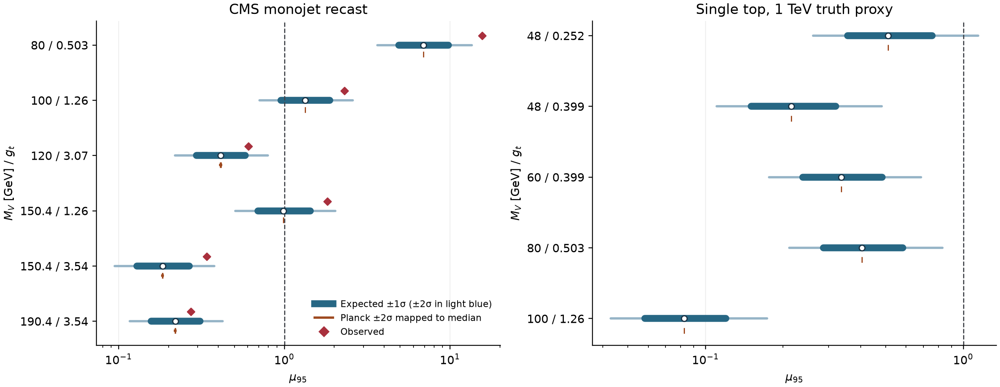

**图 5.** 蓝色带为背景涨落的 $\pm1\sigma$、$\pm2\sigma$ expected 分位点，棕色短线为丰度测量的 $\pm2\sigma$ 向 median expected 的传播，红色菱形为 observed。右图 single-top 使用 $\sqrt{\hat s}<1$ TeV 的真值代理，详见第 7 节。

对代表点，Planck 测量误差使 monojet median $\mu_{95}$ 最多移动 $0.44\%$。有限模拟统计及亮度近似使 median 比固定信号时放宽约 $1.4\%$–$6.6\%$。对 120 GeV 点，丰度传播给出 $0.41056$–$0.41415$，背景涨落的 $1\sigma$ expected 带是 $[0.295,0.581]$。两者对应不同的统计问题。截面尺度、PDF、产生匹配和探测器效率的模型专属协方差仍需单独确定。

### 6.2 低能光子混合、率目标和激发态比例

定义 $d_\gamma=e\epsilon_\gamma/g_t$，正号表示质子顶点增加 $g_t d_\gamma$。动能混合的常数项 $d_\gamma(0)$ 是独立匹配输入。给定夸克耦合后，有限动量差由带电夸克圈决定。在共同 Helm 形状因子近似下，核电荷 $Q_A/g_t$ 增加 $Z[d_\gamma(0)+\delta d_{cbt}(-q^2)]$。对 $^{131}$Xe，树级 $Q_A/g_t\simeq8.05\times10^{-3}$，因此 $d_\gamma(0)\simeq-1.49\times10^{-4}$ 附近发生相消。在 $m_\chi=35$ GeV，$d_\gamma(0)=\pm7\times10^{-6}$ 使率变为树级的 $0.908$–$1.095$，所需 $\kappa/\kappa_0=0.956$–$1.050$。相消情景所需 $\kappa/\kappa_0\simeq56.5$，在测试的 11 个坐标与耦合范围内无中心丰度解。 [6](https://arxiv.org/abs/1605.04917) · [23](https://doi.org/10.1103/tqw9-zm9x)

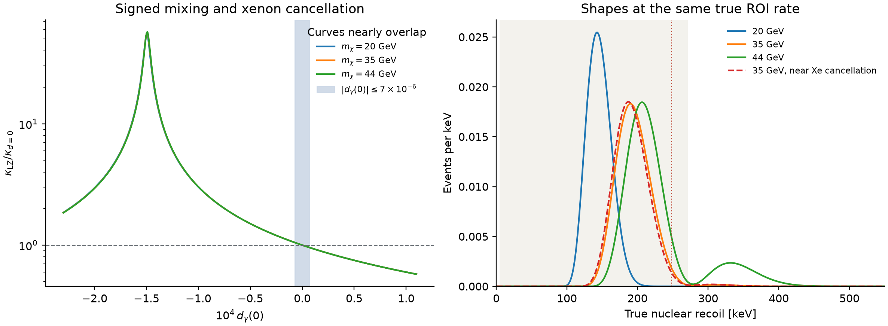

**图 6.** 左图显示低能混合对等率所需耦合的影响，右图显示同一积分率允许不同的谱形。$m_\chi=20,35,44$ GeV 的谱用常数 32.5 keV 高斯平滑后，248 keV 附近的信号密度分别约为 $2.75\times10^{-4}$、$4.54\times10^{-3}$ 和 $6.98\times10^{-3}$ 事例/keV。该能量代理未包含 LZ 的 S1/S2 背景与响应。

对 $r=0.75$–$1.25$ 的测试点，monojet median 最大改变 $9.4\%$。将 $f_2$ 单独降为 0.45 或 0.30，最大改变分别为 $3.0\%$ 和 $12.8\%$。在 $|d_\gamma(0)|\le7\times10^{-6}$ 的测试中，单独变化使 median 最多移动 $2.8\%$。例如 120 GeV 点在 $(d_\gamma(0),r,f_2)=(+7\times10^{-6},0.75,0.50)$ 和 $(-7\times10^{-6},1.25,0.45)$ 下，median 分别为 $0.465$、$0.367$。这些是固定情景检验。今日激发态比例还取决于化学冻结后的退激散射和寿命，附录 A 给出估计。

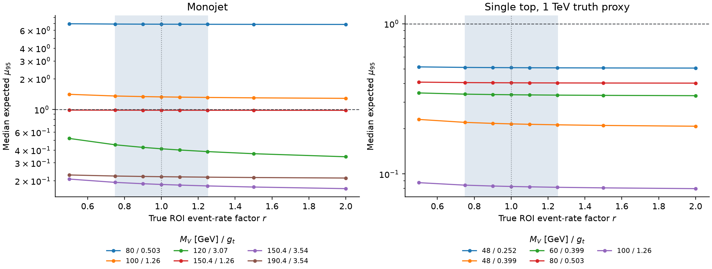

**图 7.** 固定 Planck 中心值，在每个率目标重新求解各在壳点。浅蓝区标示归一化敏感性检验的预设区间 $r=0.75$–$1.25$，对应 $0.84$–$1.40$ 个真值期望事例。CMS 上限在各个固定率目标下分别计算。

## 7. 顶夸克伴随产生

由于 $g_t$ 可显著大于轻味顶点，$pp\to t\bar tV^{(*)}\to t\bar t\chi_1\chi_2$ 提供独立的产生通道。$M_V>2m_\chi+\Delta m$ 时可有在壳增强，低于阈值时需要直接生成四体末态。低质量分支扫描显示 $(M_V,g_t)=(48\,\mathrm{GeV},0.252)$ 的三个中心丰度根为 $m_\chi=20.445,25.260,45.878$ GeV，仅第一个在壳。用完整矩阵元计算三个代表离壳点，13 TeV 真值 $p_T^{\rm miss}>250$ GeV 下的 $t\bar t+\mathrm{MET}$ 截面分别为 $0.033,0.041,1.13$ fb，对应 $M_V=30,46,60$ GeV。由此可见，跨阈值时必须检查所选暗质量和传播子。CMS 全强子双 $b$ 标签区的上限还依赖顶衰变接受率、分箱信号和背景相关性。 [24](https://arxiv.org/abs/2505.05300)

单顶通道 $pp\to tj\chi_1\chi_2$ 使用 CMS AH $1b\,1\mathrm{FJ}$ 类别作 15-bin expected 试算。以公开的 100 GeV 标量信号加背景拟合后的背景中心与逐 bin 误差作为代理，取对角相关结构，并用真值选择、简化顶衰变和 $b$ 标记估算信号。部分子能量切口的影响较大。在 $(M_V,g_t)=(60\,\mathrm{GeV},0.399)$，依次采用 $\sqrt{\hat s}<1.5,1.0,0.75$ TeV 得到 median $\mu_{95}=0.052,0.337,3.43$。这种依赖与弱流连接耦合不等的上、下型夸克相关。三个切口检验同一有效相互作用对高能事件的依赖。该通道的定量排除还需要指定电弱完备化并验证信号重建和背景约束。 [5](https://arxiv.org/abs/1510.02110) · [24](https://arxiv.org/abs/2505.05300) · [25](https://doi.org/10.17182/hepdata.154755.v1/t2)

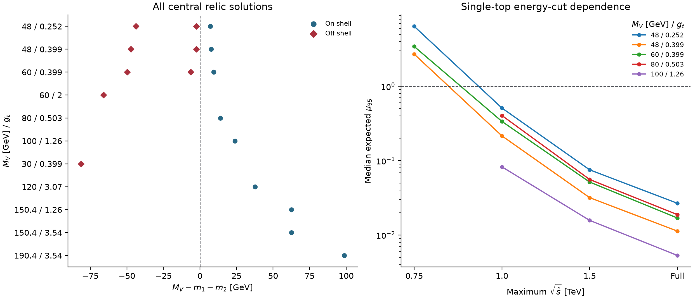

**图 8.** 左图为各代表坐标的 $M_V-m_1-m_2$。右图显示在壳 single-top expected 灵敏度试算随部分子能量切口的变化。带电弱流连接 $V$ 耦合不同的顶、底夸克，纵向弱玻色子振幅的高能行为依赖规范完备化所要求的抵消。这里的能量切口是诊断量。正文的排除结论来自 monojet。0.75 TeV 处缺失标记对应当前统计代理下未得到有限上限的样本。

## 8. 结论

在电弱破缺相的质量加权矢量耦合假设下，氙反冲探测轻味相干振幅，LHC 对重味产生敏感。固定小光子混合、暗态劈裂和标准热史后，CMS Run 2 单喷注在参考率匹配和中心丰度所选的部分在壳解上给出 CMS-only observed 95% CL 上限 $\mu_{95}<1$。所测试的真值率目标上下改变 $25\%$ 时，三个强灵敏代表点仍满足这一条件。低质量处可同时有在壳和离壳丰度解。Single-top 的能量切口检验给出探索性灵敏度。要构建实验联合置信区域，还需要本模型的 LZ 事件级似然、丰度理论误差及共同参数的剖面化。

## 附录 A. 氙反冲与匹配检查

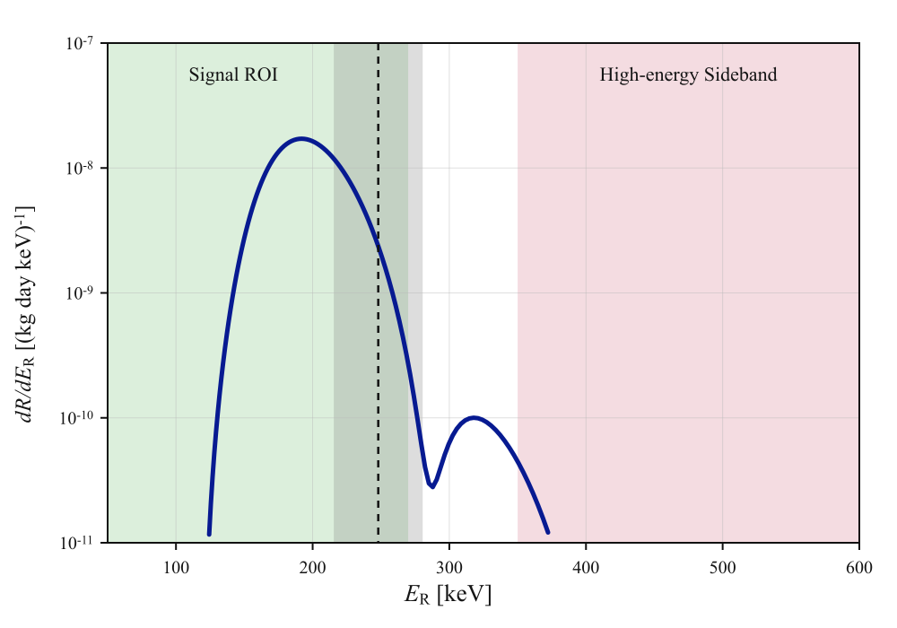

**图 A1.** 普适矢量耦合参考模型的独立复算，用于核对反冲谱的形状和单位。

零动量减除后，重夸克光子混合的有限项为

$$
\delta d_{cbt}(s)=-\frac{2\alpha}{\pi}\sum_{q=c,b,t}N_cQ_q\frac{\widehat m_q}{m_t}
\int_0^1 dx\,x(1-x)\log\left[1-\frac{s x(1-x)}{\widehat m_q^2}-i0\right].
\tag{A1}
$$

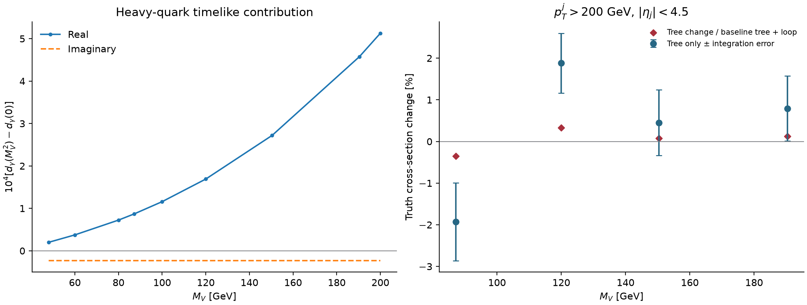

**图 A2.** 四个在壳质量点中，把 $\delta d_{cbt}(M_V^2)$ 代入 $pp\to Vj$ 树图后，$p_T^j>200$ GeV 的树图截面改变约 $2\%$ 以内。用原树图加圈图总率作分母时，变化低于 $0.4\%$。这一检查涉及指定的光子有限项。将其实部在暗态对阈值和媒介子极点分别作为常数代入丰度计算，四点的 $\Omega h^2$ 最大移动为 $1.12\times10^{-4}$ 和 $4.64\times10^{-4}$。降低 `Beps` 两个数量级，三个数值基准的丰度变化小于 $2\times10^{-11}$。 [时样截面](data/timelike_rate_summary.csv) · [丰度数值复查](data/relic_numerical_audit.csv)

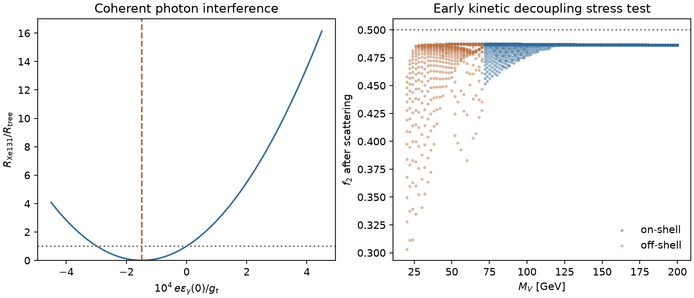

**图 A3.** 化学冻结后，$\chi_2\chi_2\leftrightarrow\chi_1\chi_1$ 可继续改变激发态比例。在所测标准热史和小额外衰变的假设下，含标准模型热浴的压力测试给出在壳基准最低 $f_2\simeq0.45$，所测离壳基准可低至约 $0.30$。$\Delta m<2m_e$ 关闭电子对衰变，独立 $V$–$Z$ 混合与跃迁偶极仍可影响寿命。 [2](https://arxiv.org/html/2609.26570v1) · [26](https://arxiv.org/abs/2108.13422)

在总丰度冻结后，只考虑暗态自转化时，详细平衡给出 $\dot f_2=-n_\chi\langle\sigma v\rangle_{22\to11}[f_2^2-e^{-2\Delta m/T_\chi}(1-f_2)^2]$，其中 $T_\chi$ 为暗扇区动理学温度。上述热史检查用 Born 接触散射并改变动理学退耦设定。$f_2$ 的数值因而作为条件基准处理。

## 附录 B. 截面切选与质量投影

闭合夸克圈的 UFO 含按味道分开的 $gggV$ 有理 $R_2$ 顶点。使用 $d^{abc}$ 的颜色结构，每个味道的系数为 $i g_{Vq}g_s^3/(48\pi^2)$，由 `loop_sm` 的光子矢量顶点替换得到。在 $M_V=87.18$ GeV 的测试点和 1 TeV 部分子能量下，包含此项时数值 Ward/BRS 检查的比值约为 $6.3\times10^{-24}$。该验证针对本文保留的 $gg\to gV$ 振幅。 [13](https://arxiv.org/abs/1507.00020)

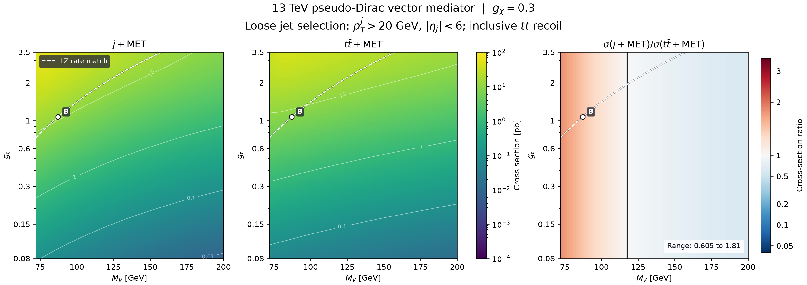

**图 B1.** 喷注切选 $p_T^j>20$ GeV、$|\eta_j|<6$，顶对末态无真值 MET 切选。与图 3 的差异反映选择阈值的影响。

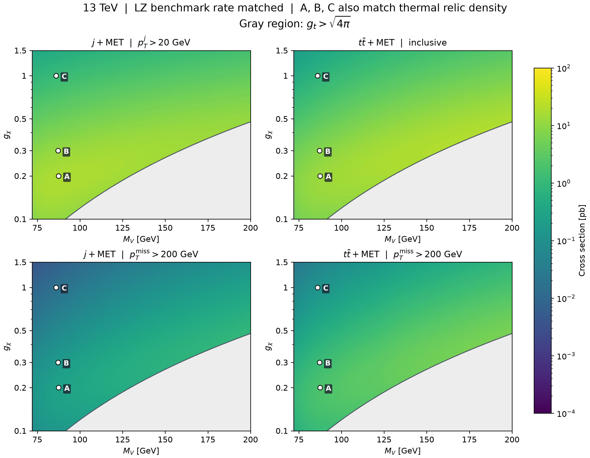

**图 B2.** 固定 $m_\chi=35$ GeV，按树级 LZ 等率条件确定 $g_t$。A、B、C 为另行核对过丰度的点，其余颜色仅表示等率面上的真值截面。 [截面表](data/truth_benchmarks.csv)

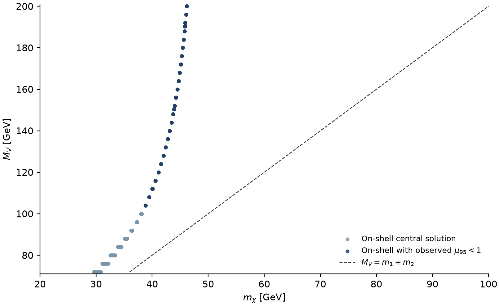

**图 B3.** 同一中心丰度网格投影至 $(m_\chi,M_V)$。深蓝色标出该在壳根本身满足 observed $\mu_{95}<1$ 的参数点。多个耦合解可在质量投影中重叠。

## 附录 C. CMS 单喷注复分析验证

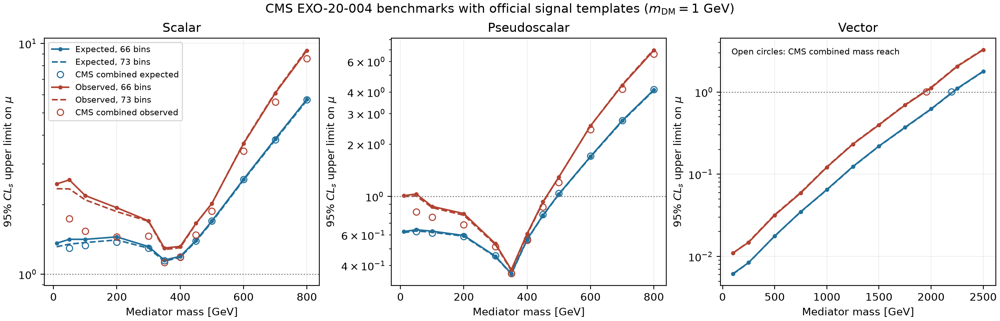

**图 C1.** 使用官方信号模板的上限对照。50–800 GeV 的标量和赝标量点，66-bin expected 与发表组合的差别至多约 $9\%$，observed 最大差别约 $48\%$。矢量质量边界的良好一致性适用于该官方基准的总体尺度。 [16](https://arxiv.org/abs/2107.13021) · [27](https://doi.org/10.17182/hepdata.106115.v2/t1)

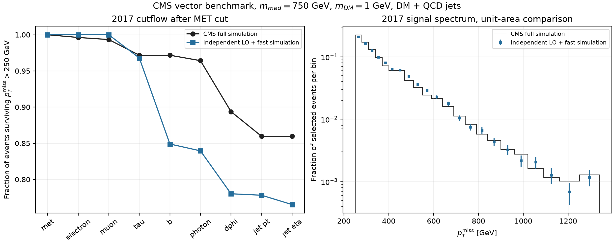

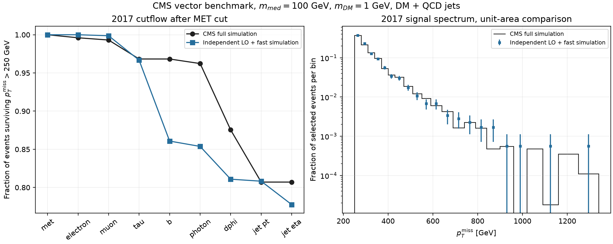

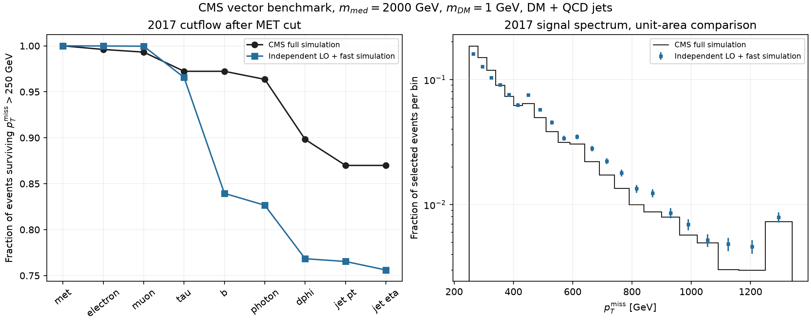

**图 C2–C4.** 独立 LO 生成加快模拟与 CMS 官方基准的比较。以 2017 年、100 GeV 为例，MET 后条件效率为 CMS $76.91\%$、本计算 $77.76\%$，绝对 QCD 信号产额为 CMS 的 $0.629$。独立样本与官方 NLO 匹配样本具有不同的生成和重建设置。归一化谱形与绝对效率分别检验。 [28](https://doi.org/10.17182/hepdata.106115.v2/t20)

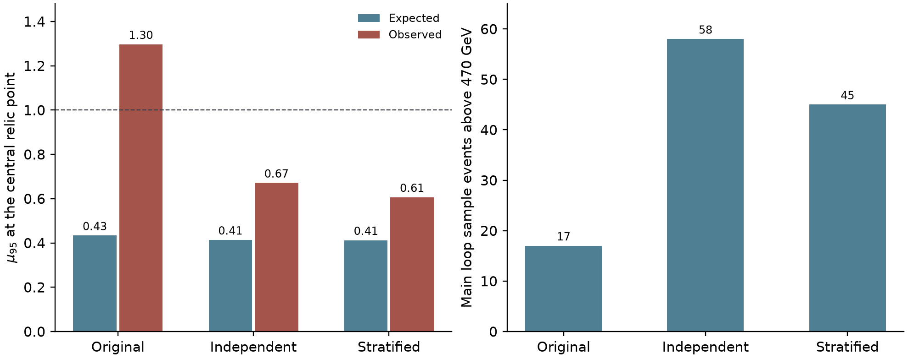

**图 C5.** 原始主圈图样本的 3,600 个事件中，只有 17 个通过重建并进入 470 GeV 以上的 MET 分箱。用独立样本与分层补样本复算，固定同一个中心丰度点，observed $\mu_{95}$ 从约 1.30 降至 0.67 和 0.61。主分析沿用分层结果和全部实测计数。 [模板复算数据](data/template_replica_comparison.csv)

### 三个强灵敏点的独立模板检验

在表 2 的 120、150.4 和 190.4 GeV 强灵敏点固定 $(M_V,g_t,m_\chi,g_\chi)$，保持 66-bin CMS 似然与背景协方差。两套圈图模板 A、B 的生成级喷注 $p_T$ 分层边界分别为 $(100,230,480)$ 和 $(100,260,520)$ GeV。两套的硬过程与 shower 样本独立。通常三层各用 6,600、4,000、3,200 个生成事件。A 的 120 GeV 与 150.4 GeV 低层分别取档案中的独立 10,800 事例样本和本次新生成的 4,800 事例样本，再限制到 $100\le p_T^j<230$ GeV。两套均使用新生成的树图模板，并另以原树图模板重做拟合。合并时取两套圈图模板的均值，按权重平方传播模拟协方差，共用的树图误差只计一次。

以基准信号 $s_i$ 和纯背景信息量排序，取 $|s_i[(C_b+\operatorname{diag}\mathbf b)^{-1}\mathbf s]_i|$ 最大的八个按年份分开的 MET 分箱。对这些分箱比较两套模板的差值与独立圈图模拟误差，同时比较 470–690 GeV 和 690 GeV 以上两个合并区间的产额，并用完整 66-bin 模板重新拟合上限。

| $M_V$ [GeV] | Expected A / B / 合并 | Observed A / B / 合并 | 关键分箱最大差值（模拟误差单位） |
|---:|---:|---:|---:|
| 120 | 0.389 / 0.407 / 0.408 | 0.527 / 0.621 / 0.561 | 1.05 |
| 150.4 | 0.230 / 0.243 / 0.242 | 0.219 / 0.254 / 0.234 | 0.88 |
| 190.4 | 0.174 / 0.178 / 0.179 | 0.200 / 0.200 / 0.198 | 1.68 |

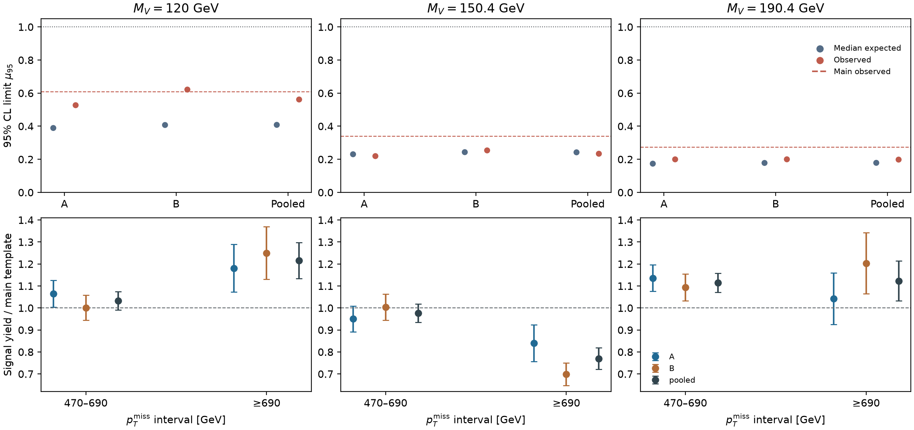

**图 C6.** 上排为 CMS 95% CL 上限，虚线为表 2 的基准 observed 值。下排为两个合并 MET 区间的产额与基准模板之比，误差棒给出对应模板的模拟误差。逐年逐分箱产额另列。 [66-bin 产额及误差](data/template_validation_bins.csv) · [样本与随机种子](data/template_validation_runs.csv) · [拟合上限](data/template_validation_limits.csv)

两套模板的关键分箱和合并高 MET 区间在约 $1.7$ 倍模拟标准差内相容。三个点均保持 observed $\mu_{95}<1$，把测试的率目标变化 $r=0.75$–$1.25$ 传入各模板时，最大的 observed 上限为 $0.680$。120 和 150.4 GeV 的 observed 上限在两套分层之间仍有约 $16\%$ 和 $15\%$ 的差别，以两套均值为分母。150.4 和 190.4 GeV 的合并上限较表 2 的基准值分别下降约 $31\%$ 和 $27\%$。因此三处代表点的排除判断对所测补样方式稳定，逐点上限的精度仍受模拟统计与模板形状影响。

将三个合并模板用于原物理网格重拟合，替换 120、150 GeV 节点并加入 190.4 GeV 节点。Expected 满足 $\mu_{95}<1$ 的点由 208 变为 199，observed 由 151 变为 162，最低采样质量仍为 92 和 104 GeV。该比较覆盖三个模板节点及其插值影响。图 C3 的绝对产额差异仍限制了对信号接受率的验证。 [替换模板后的逐点上限](data/template_contour_refit.csv)

## 附录 D. 轻媒介子顶夸克通道

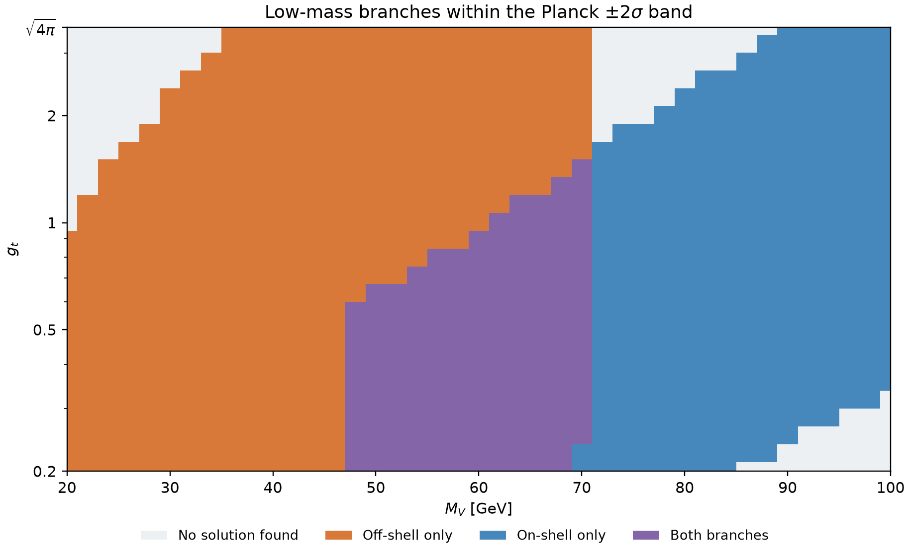

**图 D1.** 较轻质量的独立树级等率扫描。颜色表示 Planck $\pm2\sigma$ 带内找到的在壳、离壳分支类型。紫色格点存在两种分支。图中颜色仅表示分支存在性。

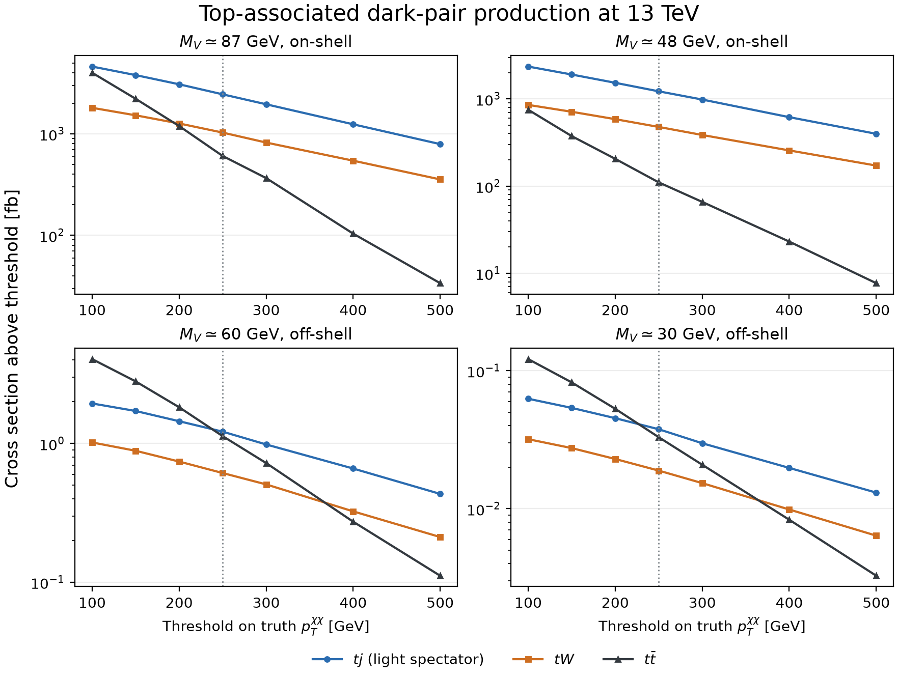

**图 D2.** 在四个在壳或离壳基准上，比较 $tj$、$tW$ 和 $t\bar t$ 伴随暗态对产生在不同真值 MET 门槛以上的截面，单位为 fb。实验上限需要在相同参数点做顶夸克衰变、重建和选区验证。 [离壳顶对截面](data/off_shell_ttmet.csv) · [单顶试算](data/single_top_expected.csv)

在本文的 $m_\chi\ge20$ GeV 范围内，$M_V\le40.001$ GeV 的点只能通过离壳 $V$ 产生暗态对。将顶对全链样本用于定量排除时，需要在共同的参考率约定下逐点核对 $m_\chi$、阈值和模板归一化。CMS 发表图中的顶对背景产额来自包含信号区数据的联合拟合，重构 observed 上限还需要可独立用于信号区计数的背景约束。 [24](https://arxiv.org/html/2505.05300v1)

## 数据与复现

[主网格逐根上限](data/center_grid_limits.csv) · [网格统计](data/center_grid_summary.json) · [代表点逐目标结果](data/benchmark_roots.csv) · [代表点误差汇总](data/branch_uncertainties.csv) · [图与数据来源](FIGURE_SOURCES.md)

## 参考文献

1. LZ Collaboration, *Search for Dark Matter Particle Interactions in an Extended Nuclear Recoil Energy Window with the LUX-ZEPLIN (LZ) Experiment*. [arXiv:2609.02823](https://arxiv.org/abs/2609.02823)
2. C. Gemmell, D. Hooper, and G. Krnjaic, *A Simple Dark Matter Model to Explain the LZ Event and Galactic Center Excess*. [arXiv:2609.26570](https://arxiv.org/abs/2609.26570)
3. X.-Y. Du, W. Huang, and K. Xie, *Pseudo-Dirac Inelastic Dark Matter in the Leptophobic $U(1)_B$ Model: Confronting the LUX-ZEPLIN High-Recoil Event with Collider Searches*. [arXiv:2609.07225](https://arxiv.org/abs/2609.07225)
4. P. Cox, A. D. Medina, T. S. Ray, and A. Spray, *Novel Collider and Dark Matter Phenomenology of a Top-philic $Z'$*. [arXiv:1512.00471](https://arxiv.org/abs/1512.00471)
5. F. Kahlhoefer, K. Schmidt-Hoberg, T. Schwetz, and S. Vogl, *Implications of Unitarity and Gauge Invariance for Simplified Dark Matter Models*. [arXiv:1510.02110](https://arxiv.org/abs/1510.02110)
6. F. D’Eramo, B. J. Kavanagh, and P. Panci, *You Can Hide but You Have to Run: Direct Detection with Vector Mediators*. [arXiv:1605.04917](https://arxiv.org/abs/1605.04917)
7. LZ Collaboration, extended nuclear-recoil search, HEPData record. [doi:10.17182/hepdata.182472.v1](https://doi.org/10.17182/hepdata.182472.v1)
8. K. Griest and D. Seckel, *Three Exceptions in the Calculation of Relic Abundances*, Phys. Rev. D **43**, 3191 (1991). [doi:10.1103/PhysRevD.43.3191](https://doi.org/10.1103/PhysRevD.43.3191)
9. P. Gondolo and G. Gelmini, *Cosmic Abundances of Stable Particles: Improved Analysis*, Nucl. Phys. B **360**, 145–179 (1991). [doi:10.1016/0550-3213(91)90438-4](https://doi.org/10.1016/0550-3213%2891%2990438-4)
10. G. Alguero et al., *micrOMEGAs 6.0: N-Component Dark Matter*. [arXiv:2312.14894](https://arxiv.org/abs/2312.14894)
11. Planck Collaboration, *Planck 2018 Results. VI. Cosmological Parameters*. [arXiv:1807.06209](https://arxiv.org/abs/1807.06209)
12. J. Alwall et al., *The Automated Computation of Tree-Level and Next-to-Leading Order Differential Cross Sections, and Their Matching to Parton Shower Simulations*. [arXiv:1405.0301](https://arxiv.org/abs/1405.0301)
13. V. Hirschi and O. Mattelaer, *Automated Event Generation for Loop-Induced Processes*. [arXiv:1507.00020](https://arxiv.org/abs/1507.00020)
14. C. Bierlich et al., *A Comprehensive Guide to the Physics and Usage of PYTHIA 8.3*. [arXiv:2203.11601](https://arxiv.org/abs/2203.11601)
15. DELPHES 3 Collaboration, *DELPHES 3: A Modular Framework for Fast Simulation of a Generic Collider Experiment*. [arXiv:1307.6346](https://arxiv.org/abs/1307.6346)
16. CMS Collaboration, *Search for New Particles in Events with Energetic Jets and Large Missing Transverse Momentum in Proton-Proton Collisions at $\sqrt{s}=13$ TeV*, JHEP **11** (2021) 153. [arXiv:2107.13021](https://arxiv.org/abs/2107.13021)
17. A. Albert, *Implementation of a Search for New Phenomena in Events Featuring Energetic Jets and Missing Transverse Energy (137 fb$^{-1}$, 13 TeV, CMS EXO-20-004)*, MadAnalysis 5 (2021). [doi:10.14428/DVN/IRF7ZL](https://doi.org/10.14428/DVN/IRF7ZL) · [Implementation and validation description](https://doi.org/10.21468/SciPostPhys.14.1.009)
18. CMS EXO-20-004, public monojet background covariance, HEPData Table 14. [doi:10.17182/hepdata.106115.v2/t14](https://doi.org/10.17182/hepdata.106115.v2/t14)
19. CMS EXO-20-004, observed and background yields, HEPData Table 15. [doi:10.17182/hepdata.106115.v2/t15](https://doi.org/10.17182/hepdata.106115.v2/t15)
20. CMS Collaboration, *Simplified Likelihood for the Re-Interpretation of Public CMS Results*. [CMS-NOTE-2017-001](https://cds.cern.ch/record/2242860)
21. G. Cowan, K. Cranmer, E. Gross, and O. Vitells, *Asymptotic Formulae for Likelihood-Based Tests of New Physics*. [arXiv:1007.1727](https://arxiv.org/abs/1007.1727)
22. A. L. Read, *Presentation of Search Results: The $CL_s$ Technique*, J. Phys. G **28**, 2693–2704 (2002). [doi:10.1088/0954-3899/28/10/313](https://doi.org/10.1088/0954-3899/28/10/313)
23. F. Forner and F. Tellander, *Renormalization of $U(1)$ Gauge Boson Kinetic Mixing*, Phys. Rev. D **113**, 056015 (2026). [doi:10.1103/tqw9-zm9x](https://doi.org/10.1103/tqw9-zm9x) · [arXiv:2512.14836](https://arxiv.org/abs/2512.14836)
24. CMS Collaboration, *Search for Dark Matter Produced in Association with One or Two Top Quarks in Proton-Proton Collisions at $\sqrt{s}=13$ TeV*. [arXiv:2505.05300](https://arxiv.org/abs/2505.05300)
25. CMS top-associated search, AH $1b\,1\mathrm{FJ}$ post-fit MET spectrum, HEPData Table 2. [doi:10.17182/hepdata.154755.v1/t2](https://doi.org/10.17182/hepdata.154755.v1/t2)
26. M. Carrillo González and N. Toro, *Cosmology and Signals of Light Pseudo-Dirac Dark Matter*. [arXiv:2108.13422](https://arxiv.org/abs/2108.13422)
27. CMS EXO-20-004, public spin-1 signal templates, HEPData Table 1. [doi:10.17182/hepdata.106115.v2/t1](https://doi.org/10.17182/hepdata.106115.v2/t1)
28. CMS EXO-20-004, public monojet cutflow, HEPData Table 20. [doi:10.17182/hepdata.106115.v2/t20](https://doi.org/10.17182/hepdata.106115.v2/t20)
