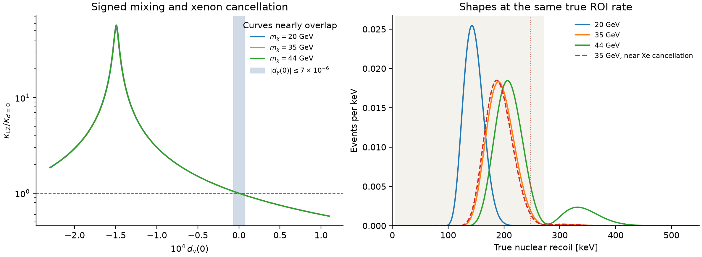
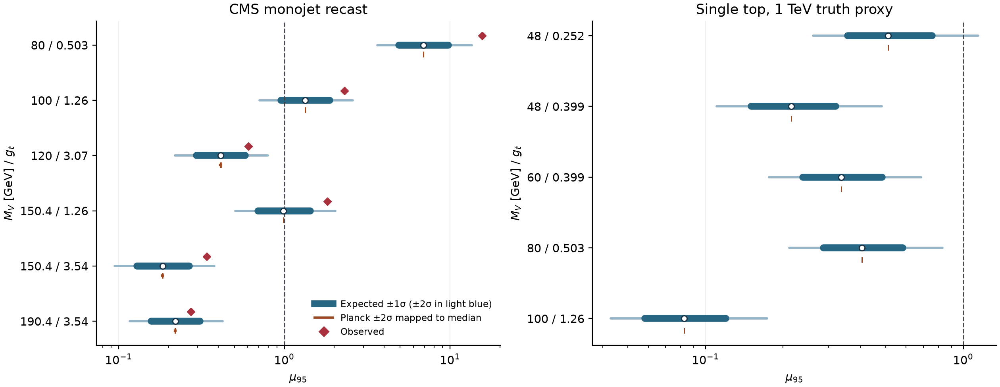
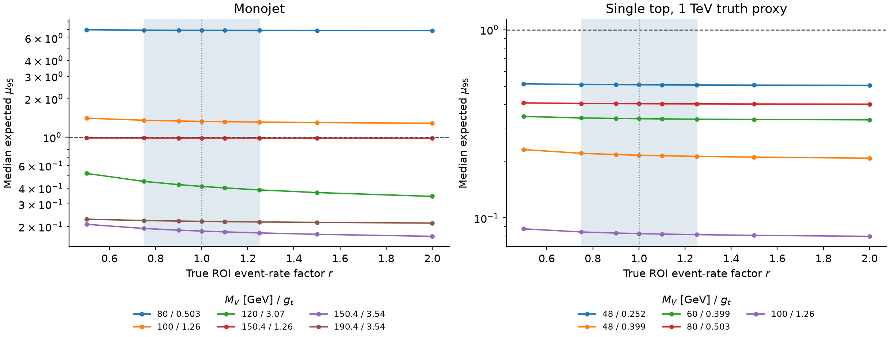
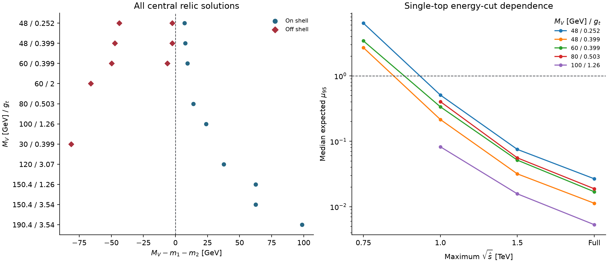
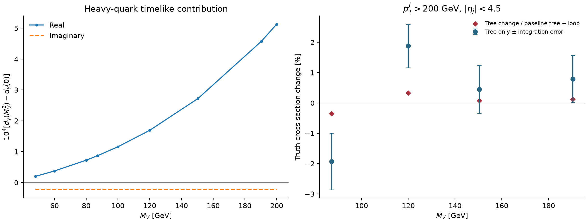

# 伪狄拉克暗物质的低能匹配、LZ 归一化和 CMS 上限误差

2026 年 11 月 10 日 · 代表点复算

在现有 Yukawa-like 矢量中介子模型中，**把低能光子混合定义在小混合区间后，放开 LZ 事例率不会改变本次测试的 monojet 强灵敏点。** 采用 Planck 中心值，三个点的 monojet observed $\mu_{95}$ 分别为 $0.607$、$0.340$ 和 $0.273$。在 LZ 真值事例率上下变化 $25\%$ 时，三个上限仍小于 1。相反，若低能混合接近氙振幅的相消点，或达到单独取顶夸克对数所示的量级，丰度解的分支会重排。稿件中需要明确写出低能匹配条件。Single-top 的部分子能量依赖比这两项归一化误差更大，目前适合报告 expected 灵敏度。

## 1. 低能混合如何进入氙核反冲

采用现有模型的耦合约定 $g_{Vq}=g_t m_q/m_t$、$m_t=172$ GeV，以及非对角 $V\chi_1\chi_2$ 顶点 $g_\chi/2$。定义 $m_\chi=m_{\chi_1}$，固定 $\Delta=m_{\chi_2}-m_{\chi_1}=1$ MeV。以下 $d_\gamma$ 的符号定义为使质子的有效耦合增加 $g_t d_\gamma$。在电弱破缺后的基底中，可写成 $d_\gamma=e\epsilon_\gamma/g_t$，光子流对夸克和轻子的贡献为 $g_t Q_f d_\gamma$。

光子和 $V$ 的混合两点函数需要一个局域反项。给定 Yukawa-like 夸克顶点可以算出夸克圈的动量差 $d_\gamma(q^2)-d_\gamma(0)$，而常数 $d_\gamma(0)$ 还依赖匹配条件。一个可复用的基准是直接定义物理低能质子耦合对应的 $d_\gamma(0)$，取零为中心，再报告带符号的变化。若从电弱尺度以上定义理论，需另外指定超荷混合和实现左右手夸克顶点的算符。左右手均为纯矢量且同一弱双重态的上、下夸克耦合不等，通常要求电弱破缺插入或额外混合。$V$–$Z$ 混合及独立匹配算符因此应在相应完备化中计算。 [动力学混合重整化](https://arxiv.org/abs/2512.14836) · [矢量中介子的低能匹配](https://arxiv.org/abs/1605.04917) · [电弱规范一致性与暗物质简化模型](https://arxiv.org/abs/1702.00016)

在共同的 Helm 核形状因子近似下，核振幅中的无量纲电荷为

$$
\begin{aligned}
Q_A^{(0)}&=Z(2m_u+m_d)/m_t+(A-Z)(m_u+2m_d)/m_t,\\
Q_A(E_R)&=Q_A^{(0)}+Z[d_\gamma(0)+\delta d_{cbt}(-2m_AE_R)] .
\end{aligned}
$$

氙的 $Z=54$，对 $^{131}$Xe 有 $Q_A^{(0)}\simeq8.05\times10^{-3}$。所以 $d_\gamma(0)\simeq-1.49\times10^{-4}$ 即可使两个振幅接近相消。即使 $d_\gamma(0)$ 数值很小，仍须和 Yukawa 压低的 $u,d$ 树级电荷比较。有限的 $c,b,t$ 圈动量项在 $d_\gamma(0)=0$ 时使 $m_\chi=35$ GeV 的窗口积分移动 $-0.077\%$。上次单独加入格点 QCD 的奇异矢量电荷半径，在 $m_\chi=20$–100 GeV 使积分移动约 $1.2\%$–$1.9\%$。本次主扫描只重算光子项，轻强子匹配和质子、中子形状因子的差异在相消附近尤其重要。 [奇异矢量电荷半径](https://arxiv.org/abs/1606.07075) · [此前的核响应和激发态核对](../lz_model_checks_20261110/CHECKS.md)

令 $\kappa=g_tg_\chi/M_V^2$，以九种天然氙同位素计算

$$
K_\gamma(m_\chi,d)=\frac{\sum_A\int_{\rm ROI}dE_R\,w_A(E_R,m_\chi)\,Q_A(E_R)^2}
{\sum_A\int_{\rm ROI}dE_R\,w_A(E_R,m_\chi)\,[Q_A^{(0)}]^2},\qquad
w_A\propto a_A A F_A^2(E_R)\,\eta\!\left(\frac{|m_AE_R/\mu_{\chi A}-\Delta|}{\sqrt{2m_AE_R}}\right).
$$

这里 $a_A$ 是同位素数丰度，$\eta$ 是晕速度反比积分。$K_\gamma$ 只比较固定 $m_\chi,\kappa,f_2$ 的率。$m_\chi=35$ GeV 时结果如下。

| $d_\gamma(0)$ | 固定耦合下的事例率比 $K_\gamma$ | 固定事例率所需 $\kappa/\kappa_{\rm tree}$ |
|---:|---:|---:|
| $0$ | 0.9992 | 1.0004 |
| $-7\times10^{-6}$ / $+7\times10^{-6}$ | 0.908 / 1.095 | 1.050 / 0.956 |
| $-5\times10^{-5}$ / $+5\times10^{-5}$ | 0.442 / 1.780 | 1.504 / 0.749 |
| $-1.49\times10^{-4}$ | $3.13\times10^{-4}$ | 56.5 |
| $-5.45\times10^{-3}$ / $+5.45\times10^{-3}$ | 1260 / 1406 | 0.0282 / 0.0267 |

最后一行用 $\lvert 2\alpha/(3\pi)\ln[(1\,\mathrm{TeV}/m_t)^2]\rvert$ 设量级，只检验一个未受抑制的光子匹配可能带来的影响。相消行同样用于检验参数的敏感性。$|d_\gamma(0)|\le7\times10^{-6}$ 对应本次要求的约 $10\%$ 率稳定性。

## 2. 放开 LZ 事例率的定义

LZ 扩展能窗分析曝光量为 $2.84$ tonne yr，科学样本包含 1710 个事件。$248\pm23_{\rm stat}\pm23_{\rm syst}$ keV 是其中一个核反冲样候选。LZ 使用校正后的 S1 和 S2 做扩展似然，在其测试模型范围内，纯背景假设的全局显著性为 $2.6\sigma$。公开记录提供数据和限值表，当前复算使用的发布内容缺少用于重建本模型 LZ 似然的背景与响应模板。 [LZ 论文及附录](https://arxiv.org/html/2609.02823) · [LZ HEPData](https://doi.org/10.17182/hepdata.182472.v1)

归一化基准来自原伪狄拉克论文图 6 的普适夸克耦合点 $m_\chi=35$ GeV、$M_V=30$ GeV、$g_B=1.46\times10^{-5}$、$g_\chi=0.32$。用此前的核响应程序重算，在 **真值** $5.4$–$269.9$ keV 窗口得到 $N_0=1.12044$ 个信号事例。这个模型预测定义比较尺度。 [原伪狄拉克论文](https://arxiv.org/html/2609.26570v1) · [原基准的真值复算](../pseudoDiracB_20261004/REPRODUCTION_REPORT.md)

定义 $r=N_{\rm ROI}^{\rm truth}/N_0$，则 LZ 归一化约束写为

$$
\kappa(m_\chi;r,f_2,d)=\kappa_{\rm tree}(m_\chi)\sqrt{\frac{r}{K_\gamma(m_\chi,d)}\frac{0.5}{f_2}},\qquad
g_\chi=\frac{M_V^2}{g_t}\kappa .
$$

基准晕参数为 $\rho_0=0.3$ GeV/cm$^3$、$v_0=238$ km/s、$v_E=254$ km/s、$v_{\rm esc}=544$ km/s。主区间 $r\in[0.75,1.25]$ 即约 $0.84$–$1.40$ 个真值事例。实际计算 $r=0.75,0.90,1,1.10,1.25$，再以 $0.50,1.50,2.00$ 检查更大偏移。区间是人为设定的敏感性检验，其端点没有 LZ 置信水平。固定质量和谱形时，$r$ 与 $f_2$ 只通过比值改变归一化。另测 $f_2=0.45,0.30$，以及两组联合变化 $(d,r,f_2)=(+7\times10^{-6},0.75,0.50)$ 与 $(-7\times10^{-6},1.25,0.45)$。这两个联合点检验当前计算中的端点响应。此前的转化计算支持长寿命在壳基准取 $f_2\simeq0.5$，该判断依赖迟期转化、热史及额外衰变算符。 [激发态比例估计](../lz_model_checks_20261110/CHECKS.md)

同一总事例率允许不同核反冲谱。用 $\sigma_E=\sqrt{23^2+23^2}=32.5$ keV 的高斯作粗略平滑，在 $m_\chi=20,35,44$ GeV 的同率样本中，$248$ keV 处的信号密度分别为 $2.75\times10^{-4}$、$4.54\times10^{-3}$ 和 $6.98\times10^{-3}$ 事例/keV。这个能量密度用于说明形状信息的重要性。它没有包含 S1/S2 响应、效率拟合或背景，所以未用它给分支分配统计权重。低质量 single-top 在壳点尤其需要这个区分。

## 3. Planck 中心解及丰度误差传播

假设 $\chi_1,\chi_2$ 合计饱和暗物质丰度，并采用 Planck 2018 基准 $\Omega_ch^2=0.1200\pm0.0012$。对固定的 $(M_V,g_t,r,f_2,d)$，先由 LZ 积分确定 $g_\chi(m_\chi)$，再在 micrOMEGAs 7.1.4 求 $\Omega_\chi h^2(m_\chi)$。匹配后的 CalcHEP 模型包含 $Q_qd$ 对夸克顶点的改动和 $g_{V\ell}=-g_t d$，由模型重算湮灭和宽度。扫描中采用动量无关的 broken-phase 光子流系数，取 $d_{\rm hard}=d_\gamma(0)$。实际时样动量差在第 5 节另算。三个 $d=0$ 样本的丰度、$x_f$ 和宽度与原模型一致到相对 $10^{-7}$。在固定 $(M_V,m_\chi,g_t,g_\chi)=(87.18,35,1.070,0.30)$ 下，$d=+0.00545$ 会使 $\Omega h^2$ 从 $0.11988$ 降到 $0.11527$，约为 Planck 测量误差的 $3.8$ 倍。 [Planck 2018](https://arxiv.org/abs/1807.06209) · [CalcHEP 对照记录](relic_validation.log)

丰度的观测项为

$$
-2\ln\mathcal L_\Omega=\frac{(\Omega_\chi h^2-0.1200)^2}{0.0012^2}+\mathrm{const}.
$$

主结果取每个分支的中心解，误差使用 $0.1176,0.1188,0.1200,0.1212,0.1224$ 五个丰度目标各自重新求根。按 $M_V-2m_\chi-\Delta$ 的符号分开搜索在壳、离壳，在 $20\le m_\chi\le100$ GeV、$0.1\le g_\chi\le1.5$ 的已有表和耦合范围内，以最多 $0.70$ GeV 的网格括区并在阈值附近加密。共计算 $11\times21=231$ 个设置和 28,120 次主扫描丰度调用，找到 1,557 条记录，包含不同丰度目标的同一分支。中心值基准有 9 个在壳解和 8 个离壳解。$|d|\le7\times10^{-6}$、$r$ 单独在 $[0.75,1.25]$ 或 $f_2$ 单独降到 $0.30$ 时，11 个测试坐标的中心解数量均保持。相消设置在上述搜索范围内无中心解。两个大混合设置各有 4 和 3 个中心解。

例如 $(M_V,g_t)=(48\,\mathrm{GeV},0.252)$ 同时有 $m_\chi=20.445,25.260,45.878$ GeV 三个中心解。第一个在壳，后两个离壳。另一个例子是 $(150.4\,\mathrm{GeV},1.260)$ 在 $r=2$ 时的在壳解。中心解需要 $g_\chi=1.498$，Planck 向下位移的两个目标在 $g_\chi\le1.5$ 内未找到解。分支计数改变时，各目标分别列出，表中省略连续误差区间。由此可区分参数范围截断与对撞机排除。主扫描包含过零的根，紧邻阈值或相切的根仍受括区分辨率限制。 [逐目标原始根](relic_roots.jsonl) · [按分支整理的丰度误差](branch_uncertainties.csv)

另用三个固定参数点检验 micrOMEGAs 数值误差。主计算取 `Fast=0`、`Beps=1e-9`。降低 `Beps` 两个数量级，三个点的 $\Omega h^2$ 差小于 $2\times10^{-11}$。切换到快速积分时，最大差为 $2.6\times10^{-4}$。联合变化情景中的一个 60 GeV 离壳分支最初缺少 $+1\sigma$ 根，经 $5$ MeV 局部加密后在 $m_\chi=59.77745$ GeV 找到对应解，丰度残差 $2.8\times10^{-6}$，已补入最终表。上述比较检查数值方法，热史、QCD 状态方程、微扰匹配和截面计算仍各有物理误差。 [丰度数值复查](relic_numerical_audit.csv)

## 4. 对撞机统计及数值结果

### 4.1 分箱似然

Monojet 采用 CMS EXO-20-004 三年共 66 个信号区 bin。信号以原模型的 LO 树图加已有重夸克圈图模板为基础，包含原有快模拟选取。120 GeV 使用后来独立生成并按生成级 $p_T$ 分段的加密圈图模板。背景用公开中心值与完整协方差，observed 用公开实测计数。对于窄宽且在壳的点，模板乘 $g_t^2\,\mathrm{BR}(V\to\chi_1\chi_2)$。要求 $M_V-m_1-m_2\ge5\Gamma_V$、$\Gamma_V/M_V<0.03$，并限于已有模板质量范围。非零 $d$ 时，圈图按顶耦合变化重标定，树图按原分箱形状作基准并另测极端味道重标度。所有 observed 复算都使用 $d=0$ 的模板，含 $r,f_2,\Omega$ 变化下的分支比。 [CMS EXO-20-004](https://arxiv.org/abs/2107.13021) · [背景协方差](https://doi.org/10.17182/hepdata.106115.v2/t14) · [数据计数](https://doi.org/10.17182/hepdata.106115.v2/t15) · [120 GeV 模板核对](../monojet_mchi_scan_20261106/results/gap120/replica_comparison.csv)

$$
\mathcal L_{\rm CMS}(\mu,\mathbf b',\mathbf s')=
\prod_i \mathrm{Pois}(n_i\mid b'_i+\mu s'_i)\,G(\mathbf b';\mathbf b,C_b)\,G(\mathbf s';\mathbf s,C_s).
$$

$C_s$ 对 monojet 包含模拟计数、截面积分误差，并用一个幅度 $1.6\%$ 的共同 nuisance 近似信号亮度变化。约束信号 bin 非负。Expected 以纯背景 Asimov 数据取中位数，再用渐近 $CL_s=0.05$ 求背景涨落的五个分位点。计算中，以 $z=-2,-1,0,1,2$ 解 $\sqrt{q_{\mu,A}}=z-\Phi^{-1}[0.05\Phi(z)]$。Observed 对真实计数剖面拟合，并用背景条件 Asimov。单独改变 Planck 目标得到的 $\mu_{95}$ 区间是模型预测传播。两类带的统计对象不同。 [渐近剖面似然方法](https://arxiv.org/abs/1007.1727)

Single-top 取 CMS 全强子 AH $1b\,1\mathrm{FJ}$ 类别作 $t/\bar t+j+\mathrm{DM}$ 的 15-bin expected 试算。使用公开图中 100 GeV 标量信号加背景拟合后的背景中心和单 bin 误差作为代理，按对角协方差处理。信号用已有真值选取及简化顶衰变、$b$ 标记和 MC 计数。主列采用 $\sqrt{\hat s}<1$ TeV。由于 $W$ 连接耦合不同的上、下型夸克，纵向电弱贡献对高能完备化敏感。$\sqrt{\hat s}$ 扫描用于量化这一依赖，当前模型没有给出其物理截止尺度。 [CMS 单顶/顶对联合搜索](https://arxiv.org/abs/2505.05300) · [AH $1b\,1\mathrm{FJ}$ 数据表](https://doi.org/10.17182/hepdata.154755.v1/t2)

### 4.2 在壳基准和误差量级

表中采用 $r=1$、$f_2=0.5$、$d=0$、Planck 中心值。方括号为 expected 的背景涨落 $\pm1\sigma$。单顶一列是上述 $1$ TeV 试算。

| $M_V$ [GeV] | $g_t$ | $m_\chi$ [GeV] | monojet expected | monojet observed | single-top expected |
|---:|---:|---:|---:|---:|---:|
| 48 | 0.252 | 20.445 | — | — | 0.510 [0.356, 0.756] |
| 48 | 0.399 | 20.161 | — | — | 0.215 [0.150, 0.320] |
| 60 | 0.399 | 25.313 | — | — | 0.337 [0.239, 0.484] |
| 80 | 0.503 | 33.027 | 6.891 [4.916, 9.771] | 15.58 | 0.404 [0.286, 0.582] |
| 100 | 1.264 | 38.065 | 1.333 [0.952, 1.883] | 2.305 | 0.083 [0.058, 0.120] |
| 120 | 3.073 | 41.116 | 0.412 [0.295, 0.581] | 0.607 | — |
| 150.4 | 1.260 | 43.896 | 0.986 [0.691, 1.431] | 1.822 | — |
| 150.4 | 3.545 | 43.896 | 0.184 [0.129, 0.267] | 0.340 | — |
| 190.4 | 3.545 | 45.854 | 0.219 [0.157, 0.310] | 0.273 | — |

两个 $g_t=3.545$ 点位于此前采用的 $g_t\le\sqrt{4\pi}$ 扫描上边界，120 GeV 点也在较大耦合处。这里的灵敏度对应当前 LO 模板和耦合范围。原始数据的 `point` 栏保留历史标识，耦合以单列 `gt` 为准。

Planck 的 $\pm2\sigma$ 对基准 monojet median 的最大相对移动约 $0.44\%$，对 single-top 约 $0.05\%$。例如 120 GeV 的 monojet median 为 $0.41236$，传播结果是 $0.41056$–$0.41415$。对同一点，$r\in[0.75,1.25]$ 给出的 median 为 $0.387$–$0.451$，observed 为 $0.570$–$0.664$。这个点的不可见分支比约 $0.50$，比其他接近饱和的点更容易受 LZ 归一化影响。$|d|\le7\times10^{-6}$ 单独改变时，测试点的 monojet median 最多移动 $2.8\%$。$f_2=0.45$ 和 $0.30$ 各自最多移动 $3.0\%$ 和 $12.8\%$。联合变化的两个测试点给 120 GeV 的 median $0.367$–$0.465$。这里所有百分数分别比较同一分支。

| 来源或诊断 | 代表点上的影响 | 报告方式 |
|---|---|---|
| Planck 测量误差 | monojet $\le0.44\%$，single-top $\le0.05\%$ | 每个分支分别列中心与 $\pm1,\pm2\sigma$ 的解 |
| LZ 真值率变化 $r=0.75$–$1.25$ | monojet median 最多 $9.4\%$，single-top $2.4\%$ | 固定情景，逐点重算丰度 |
| 信号 MC 和亮度 | monojet median 比固定信号上限放宽 $1.4\%$–$6.6\%$ | 剖面化信号协方差 |
| Single-top 信号 MC | 主列比固定信号上限放宽约 $3.2\%$–$6.4\%$ | 真值 MC 对角近似，包含积分误差 |
| CMS 背景涨落 | 120 GeV 的 expected $1\sigma$ 带为 $[0.295,0.581]$ | 报告五个 expected 分位点 |
| Single-top 的部分子能量 | $(60,0.399)$ 点从 $1.5$ TeV 到 $1.0$、$0.75$ TeV 得到 $0.052,0.337,3.43$ | 分开画三种切口，未定义统计误差 |

Single-top 的部分子能量诊断主导当前判断。在 $0.75$ TeV 诊断中，部分锚点的模拟在有信息量的尾部缺少事件，表格里的 `inf` 代表该近似未求到有限上限。已有离壳完整矩阵元试算中，$M_V=46$ GeV、$m_\chi=24.10$ GeV、$g_t=0.399$ 的 expected $\mu_{95}$ 即使用全能量仍约为 56，$M_V=60$ GeV、$m_\chi=62.99$ GeV、$g_t=2.004$ 则约为 11。离壳产生必须用完整过程 $pp\to tj\chi_1\chi_2$，而且这些已有离壳样本仅覆盖个别点。对于 48 GeV 的在壳支，即使试算的 median 小于 1，同坐标的其他丰度解需要各自的 CMS 模板。 [既有离壳试算](../single_top_pilot_20261110/expected_benchmarks.csv)

现有 monojet 官方矢量基准的 66-bin 复算在 TeV 质量边界上与 CMS 相差不到 $1\%$。在更接近本研究的低质量标量或赝标量逐点比较中，observed 偏差可达数十个百分点。该差异包含类别覆盖和简化似然的影响。独立模拟的绝对效率和 MET 尾部另有差异。以同形状整体重标定为例，120 GeV 的 observed 上限为 $0.607$，信号产额减到名义值的 $60.7\%$ 时，上限就移动到 1。$150.4$ GeV、$g_t=1.260$ 的 expected 本身为 $0.986$，属于对少量模型或接受度偏差敏感的边界点，observed 为 $1.822$。重整化和因子化尺度、PDF、匹配和探测器效率的模型专属变化尚无可用的逐 bin 协方差。丰度的理论误差也需与 Planck 的测量误差分开处理。 [官方 CMS benchmark 复算](../monojet_cms_benchmark_20261107/REPORT.md)

## 5. 时样混合对 monojet 的独立检查

在 $q^2=0$ 减除后，采用同一符号约定计算重夸克有限项

$$
\delta d_{cbt}(s)=-\frac{2\alpha}{\pi}\sum_{q=c,b,t}N_cQ_q\frac{m_q}{m_t}
\int_0^1 dx\,x(1-x)\ln\!\left[1-\frac{s x(1-x)}{m_q^2}-i0\right].
$$

例如 $M_V=120$ GeV 时，$\delta d_{cbt}(M_V^2)\simeq1.69\times10^{-4}-2.32\times10^{-5}i$，足以明显改变个别价夸克顶点。为判断其实际权重，在 Fudan 工作站用 MadGraph 3.6.6 重跑 $pp\to Vj$ 树图。取 $g_t=1$、13 TeV、`nn23lo1`、$p_T^j>200$ GeV、$|\eta_j|<4.5$，每个设置生成 1,200 个事件。在壳 $V$ 的纯树级振幅只有一次对应味道的 $Vq\bar q$ 插入，因此用 $|m_q/m_t+Q_q\delta d_{cbt}(M_V^2)|$ 可保留复数修正对树图平方的作用。

| $M_V$ [GeV] | 原树图 [pb] | 加有限项树图 [pb] | 树图变化及积分误差 | 树图变化除以原树图加圈图 |
|---:|---:|---:|---:|---:|
| 87.18 | 0.03001 | 0.02943 | $-1.93\%\pm0.93\%$ | $-0.36\%$ |
| 120 | 0.02511 | 0.02558 | $+1.88\%\pm0.72\%$ | $+0.33\%$ |
| 150.4 | 0.02115 | 0.02125 | $+0.45\%\pm0.79\%$ | $+0.08\%$ |
| 190.4 | 0.01637 | 0.01650 | $+0.79\%\pm0.78\%$ | $+0.12\%$ |

最后一列用同一真值切口的已有圈图作为分母的一部分，给出**这一个光子有限项经树图进入总率的量级**。原 monojet 过选模板的树图事例约占 $5\%$–$6\%$。这与硬切口后圈图占主导一致。该检查覆盖了当前强灵敏的三个质量点。逐 bin 接受度、低质量离壳、独立 $V$–$Z$ 项和电弱完备化仍是分开的计算。 [时样混合及原始截面](timelike_tree_probe.csv) · [真值截面汇总](timelike_rate_summary.csv)

对四个丰度中心解再固定全部质量和耦合，仅把 $\mathrm{Re}\,\delta d_{cbt}$ 作为湮灭顶点中的常数代入 micrOMEGAs。用暗物质对阈值 $s=(2m_\chi+\Delta)^2$ 估算时，$\Omega h^2$ 最大移动 $1.12\times10^{-4}$。用 $s=M_V^2$ 取值时，最大移动 $4.64\times10^{-4}$，约为 Planck 测量误差的 $0.39$ 倍。四点的总宽度变化均小于 $0.09\%$。这两个固定动量设置检验已算出的有限项在相关能标上的影响。精确的时样计算需要把复数形状因子代入热平均积分。 [固定动量的丰度检查](relic_numerical_audit.csv)

## 6. 可用于稿件的表述

在明确规定低能光子匹配、假设暗物质饱和 Planck 丰度并放开 LZ 真值率基准的前提下，所检验的在壳分支中，$(M_V,g_t)=(120,3.073),(150.4,3.545),(190.4,3.545)$ 的 CMS monojet observed 上限均小于模型预测。在 $r=0.75$–$1.25$ 内，三个点的 observed 上限分别落在 $0.570$–$0.664$、$0.329$–$0.357$ 和 $0.270$–$0.277$。重夸克有限时样混合的树图检查显示其硬喷注总率效应在亚百分比量级。由此可以保留这几个点作为小混合基准的主要结果，并将 $r$ 作为分开的归一化变化展示。对接近 $\mu_{95}=1$ 的点，应报告灵敏度随误差的变化。对有多个丰度解的二维坐标，应同时列在壳、离壳分支和各自的适用统计结果。

如要将 $r$ 的变化和丰度理论误差升级成正式联合区间，需要为本模型建立 LZ 的响应与背景似然，以及模型预测 $\Omega h^2$ 的理论误差。联合似然可写为 $\mathcal L_{\rm LZ}\,\mathcal L_\Omega\,\mathcal L_{\rm CMS}$，对共有参数与各实验 nuisance 剖面化。如果二维投影的目标是排除整个 $(M_V,g_t)$ 坐标，就需要让不同分支都参与同一检验。$t\bar t+\mathrm{MET}$ 的排除图也应使用同样的分支核对和误差口径。当前数值结果覆盖 monojet 与 single-top。

## 数据与复现

- [LZ 匹配及归一化表](matching_by_mass.csv) · [候选能量附近的谱形诊断](recoil_shape_proxy.csv) · [LZ 公开表目录](lz_release.json)
- [逐个物理解与全部上限](physical_roots_and_limits.csv) · [分支误差表](branch_uncertainties.csv)
- [micrOMEGAs 扫描驱动](run_relic_scan.py) · [工作站 CalcHEP 修改和根搜索](relic_scan_remote.py) · [丰度数值复查脚本](relic_numerical_audit.py) · [CMS 拟合](collider_errors.py) · [制图与汇总](summarize.py) · [时样 MadGraph 检查](timelike_probe.py)
