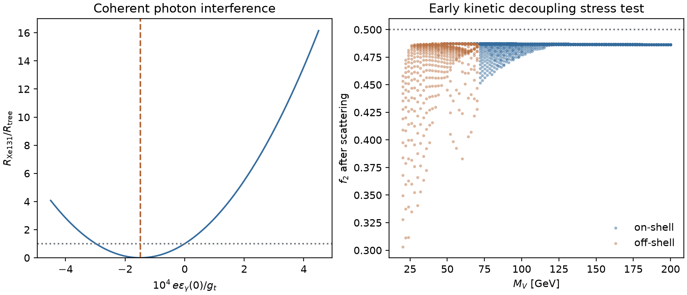

# Yukawa 型矢量模型的 LZ 匹配和激发态比例检查

沿用正文的非对角暗扇区顶点 $g_\chi/2$、质量加权矢量耦合 $g_{Vq}=g_t\widehat m_q/(172\,\mathrm{GeV})$、质量劈裂 $\Delta m=1$ MeV，以及 LZ 的 $5.4$–$269.9$ keV 真值事件率匹配。

## 1. 一圈低能匹配

树级有效核子荷是 $f_p/g_t=5.29\times10^{-5}$ 和 $f_n/g_t=6.74\times10^{-5}$。定义 $d_\gamma(Q)=e\epsilon_\gamma(Q)/g_t$，符号约定为光子诱导的质子耦合为 $+e\epsilon_\gamma$。忽略较高阶核响应时，低动量相干核荷变为

$$
\frac{Q_A(Q)}{g_t}=Z\frac{f_p}{g_t}+(A-Z)\frac{f_n}{g_t}+Z d_\gamma(Q).
$$

对于 $^{131}$Xe，$Q_A^{(0)}/g_t=8.05\times10^{-3}$。因此 $|d_\gamma(0)|\simeq1.49\times10^{-4}$ 时，光子项与树级振幅同量级。单独考虑这个项，若要求在树级解附近将事例率变化控制在约 $10\%$，则需要 $|d_\gamma(0)|\lesssim7\times10^{-6}$。

动能混合是有效理论允许的独立项。含有 $V$ 和电磁电荷的夸克会产生混合真空极化，其常数部分依赖重整化边界和重粒子阈值。按破缺相电磁流估算，若在 $1$ TeV 把该项取为零，仅 top 的领先对数就给出

$$
|d_\gamma(0)|\sim \frac{2\alpha}{3\pi}\log\frac{(1\,\mathrm{TeV})^2}{m_t^2}
\simeq5.45\times10^{-3}.
$$

这是量级示例。完整电弱匹配需要指定规范完备化和阈值。用九种天然氙同位素及共同 Helm 核形状因子重算 $m_\chi=35$ GeV 的 ROI，得到下列结果。$\kappa=g_tg_\chi/M_V^2$，表中的事例率比固定 $\kappa$ 和 $f_2$。

| 匹配检查 | $N_{\rm ROI}/N_{\rm tree}$ | 匹配同一事例率所需的 $\kappa/\kappa_{\rm tree}$ |
|---|---:|---:|
| $d_\gamma(0)=0$，保留 $c,b,t$ 光子圈图的有限动量项 | 0.9992 | 1.0004 |
| $d_\gamma(0)=+10^{-5}$ | 1.138 | 0.938 |
| $d_\gamma(0)=-10^{-5}$ | 0.870 | 1.072 |
| top 对数量级，建设性干涉 | $1.41\times10^3$ | 0.0267 |
| top 对数量级，破坏性干涉 | $1.26\times10^3$ | 0.0282 |

奇异夸克的净矢量荷为零，但有限 $Q^2$ 下有非零电形状因子。单独加入格点 QCD 奇异电荷半径给出的 $g_{Vs}G_E^s$ 项，$m_\chi=20$–100 GeV 的 ROI 增加约 $1.2$%–$1.9$%。重夸克矢量流的 QCD 匹配与标量流不同。单个 $V$ 的矢量流插入在一圈双胶子振幅中相消。重夸克矢量流仍有更高阶和导数型强子算符。光子–轻强子匹配、$V$–$Z$ 质量混合和独立的高维算符系数还需要完整低能匹配。 [矢量中介子的直接探测匹配](https://doi.org/10.1007/JHEP08%282016%29111) · [重夸克矢量流的低能算符](https://arxiv.org/abs/2310.09085) · [奇异夸克电荷半径](https://arxiv.org/abs/1606.07075)

因此当前树级 LZ 归一化的适用条件是低能净混合足够小。大混合示例中的 $\kappa$ 变化足以要求重新做联合扫描，同时需要将诱导的夸克和轻子顶点带入遗迹丰度及对撞机计算。

## 2. 激发态比例的热史和对参数的影响

总遗迹丰度与今日激发态比例是不同的量。总丰度冻结时 $T_f\gg\Delta m$，两态接近等丰度。随后用 Planck 总丰度确定 $n_\chi$，演化 $\chi_2\chi_2\leftrightarrow\chi_1\chi_1$，同时对和 SM 浴的转化做压力测试。

$$
\dot f_2=-n_\chi\langle\sigma v\rangle_{22\to11}
\left[f_2^2-e^{-2\Delta m/T_\chi}(1-f_2)^2\right]
$$

散射用 Born 接触极限，热平均用 $\sqrt{(6T_\chi+8\Delta m)/m_\chi}$ 估计末态相对速度。压力测试令动理学退耦早至 $T_\gamma=m_\chi/25$，退耦后 $T_\chi$ 按非相对论自由冷却。SM 浴在 $T_\gamma\ge20$ MeV 时采用瞬时平衡所能造成的最大向下作用，之后用放大的单向散射率估计残余损失。这个测试采用标准辐射主导热史、无抵消型大电磁接触耦合，且额外衰变可忽略。 [激发态的散射与衰变](https://arxiv.org/abs/2108.13422) · [热自由度表](https://member.ipmu.jp/satoshi.shirai/DM2020/)

| 现有代表解 | 仅暗扇区自转化的最低 $f_2$ | 加入 SM 浴压力测试的最低 $f_2$ |
|---|---:|---:|
| 轻中介子在壳格点 | 0.468 | 0.467 |
| monojet 在壳格点 | 0.452 | 0.452 |
| 轻中介子离壳格点 | 0.385 | 0.303 |

银河系晕内自退激的估计光学深度小于 $10^{-9}$。$\Delta m<2m_e$ 关闭 $e^+e^-$ 衰变。若有独立 $V$–$Z$ 质量混合，按原模型公式，扫描在壳格点上导致今日激发态损失 $10\%$ 的 $m_{VZ}$ 最小约 $8.4$ MeV，定义为拉格朗日项 $m_{VZ}^2 V_\mu Z^\mu$。独立的电磁跃迁偶极也需要由模型对称性约束。三光子宽度只估算了 Euler–Heisenberg 项，接近电子阈值的离壳极端点需要精确衰变积分。 [原模型的混合与寿命公式](https://arxiv.org/html/2609.26570v1) · [三光子阈值修正](https://arxiv.org/abs/1705.00619)

固定低能匹配后，LZ 事例率约束 $f_2\kappa^2$，故 $\kappa(f_2)=\kappa(0.5)\sqrt{0.5/f_2}$。对 11 个 $(M_V,g_t)$ 代表点，在每个 $f_2$ 下先调整 LZ 归一化，再用 micrOMEGAs 重新解 $m_\chi,g_\chi$ 以满足 $0.1176\le\Omega h^2\le0.1224$。当 $f_2=0.45$ 时，11 个点均保留原来的在壳或离壳分支。在固定中介子质量的窄宽近似下，用新的不可见分支比对原信号模板重新归一化，四个 single-top 点的 expected $\mu_{95}$ 变化不超过 $0.63\%$，四个 monojet 点不超过 $3.1\%$。这些比例沿用各自现有的拟合与理论切口。$f_2=0.30$ 时 11 个点仍保留原分支，$f_2=0.10$ 时已有两个点失去原分支。所有数值是代表点检查，边界附近的格点仍需用对应 $f_2$ 逐格评估。

因此，在激发态长寿命且低能匹配已固定的情况下，$f_2\simeq0.5$ 足以描述当前在壳对撞机基准。低质量离壳区应额外给出 $f_2=0.30$ 的对照。核反冲谱的运动学形状在固定质量下不随 $f_2$ 改变，重新求解质量和耦合后则应按新参数重新计算。

- [低能匹配表](loop_matching.csv)
- [热史压力测试逐点结果](thermal_fraction.csv)
- [micrOMEGAs 重解](fraction_refit.csv)
- [在壳 expected 上限重归一化](fraction_expected_rescaling.csv)
