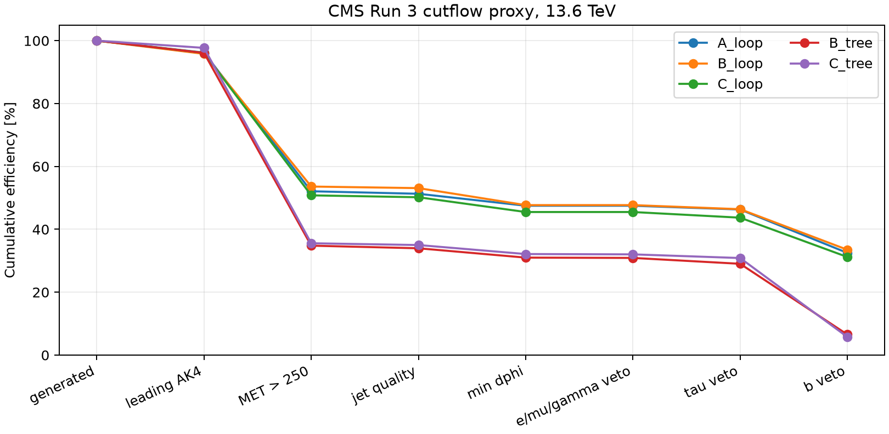
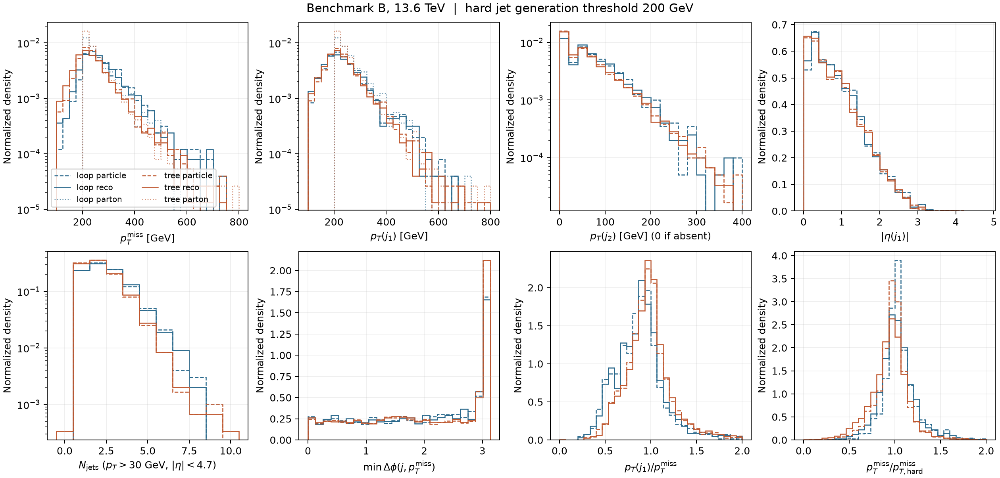
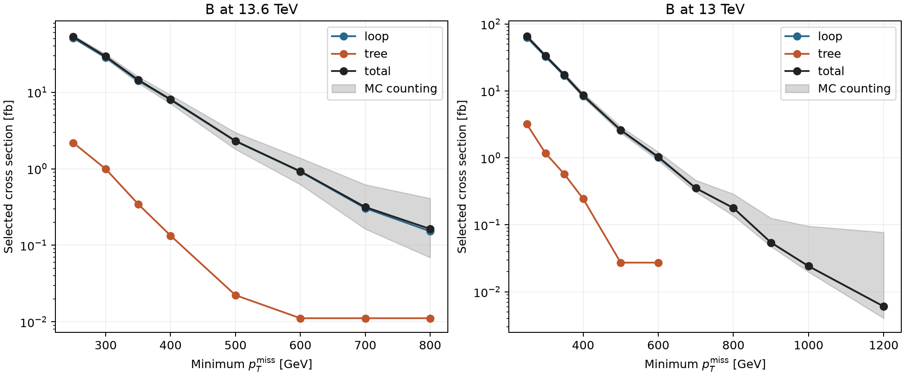
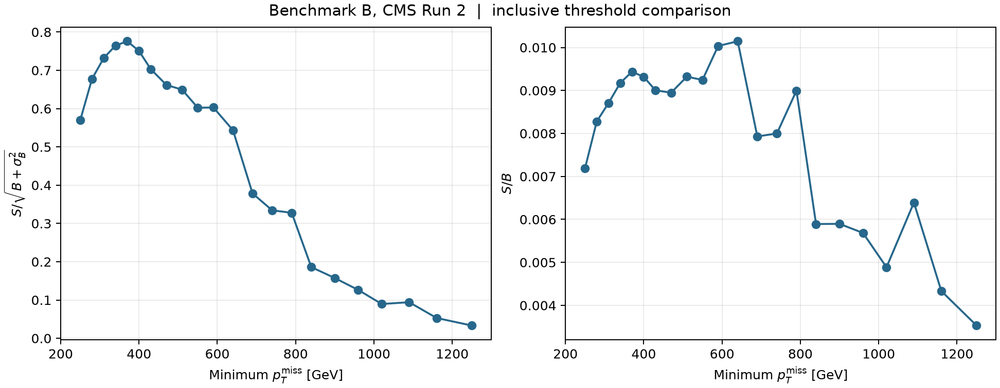

# Pseudo-Dirac Yukawa-like monojet 分析

## 样本和归一化

沿用 LZ 和 relic 的 A、B、C 树级基准点。固定 $m_{\chi_1}=35$ GeV、$m_{\chi_2}-m_{\chi_1}=1$ MeV，$g_{Vq}=g_t\widehat m_q/(172\,\mathrm{GeV})$，暗顶点大小为 $g_\chi/2$。

| 点 | $M_V$ [GeV] | $g_t$ | $g_\chi$ | $\mathrm{BR}(V\to\chi_1\chi_2)$ |
|---|---:|---:|---:|---:|
| A | 87.530 | 1.61770 | 0.200 | 0.60994 |
| B | 87.183 | 1.06994 | 0.300 | 0.88890 |
| C | 86.048 | 0.31268 | 1.000 | 0.99902 |

生成使用 MadGraph 3.6.6、`nn23lo1` 和上一轮通过 Ward 检查的 R2 修正 UFO。圈图为 $gg\to gV$，以不可见、稳定的 $V$ 代理 $\chi_1\chi_2$ 的总四动量，并对生产截面乘一次不可见分支比。树级直接生成 $pp\to j\chi_1\chi_2$。两部分在此精度下可以相加。

所有九份样本，共 34,000 个事件，经过 Pythia 8.312（Monash）和 Delphes 3.5.0（CMS 卡，anti-$k_T$，$R=0.4$）。自定义暗粒子被设置为稳定、无可见量能响应，并从真值喷注输入排除。逐事件检查了输入和输出事件数、不可见粒子身份及硬过程横向动量平衡，重建文件内嵌 LHE 与原 LHE 的暗系统 $p_T$ 最大差为 $4.8\times10^{-5}$ GeV。抽样核对还确认 shower 后保留了各基准点的 LHE 质量。

13.6 TeV 样本使用原来的生成门槛 $p_T^j>200$ GeV、$|\eta_j|<4.5$。13 TeV 的 B 点另生成 $p_T^j>100$ GeV 的 6,000 个圈图和 15,000 个树级事件，以及 $p_T^j>480$ GeV 的 3,000 个圈图事件。13 TeV 合并时，宽样本提供生成级 $p_T^j<480$ GeV 的圈图事件，尾部样本提供 $p_T^j\ge480$ GeV 的圈图事件，各自按原始生成截面归一化。宽样本独立估计 $p_T^j>480$ GeV 为 $3.22^{+0.49}_{-0.43}$ fb，尾部直接积分给出 $3.023\pm0.009$ fb，两者在事件统计误差内一致。

切选效率以各自生成样本为分母。每一部分的选后截面为

$$
\sigma_{\mathrm{sel}}=\sigma_{\mathrm{gen}}\frac{\sum_{\mathrm{pass}}w_i}{\sum_{\mathrm{gen}}w_i}.
$$

CSV 分列给出约 68% Wilson 事件统计区间和积分误差。合并曲线的误差带将各独立样本的上下偏差分别平方相加。高 MET 空 bin 表示本次没有采到通过事件。

## 效率与运动学

13.6 TeV 采用 CMS Run 3 初步分析的主要可复现 cuts。要求重建 $p_T^{\rm miss}>250$ GeV、领先 AK4 $p_T>100$ GeV 且 $|\eta|<2.5$、四条领先且 $p_T>30$ GeV 的喷注与 MET 的最小 $\Delta\phi>0.5$。加入领先喷注带电和中性能量分数代理、隔离 $e/\mu/\gamma$、$\tau$ 和 b 喷注否决。b 否决采用文中工作点的近似，每条 $p_T>20$ GeV、$|\eta|<2.4$ 的喷注按 b 味 85%、其他味 10% 的标签率采样，喷注门槛沿用 Run 2。 [CMS Run 3 选区](https://inspirehep.net/files/2ea92142316796b1c1e8b3079a0972b1#page=7)

| 13.6 TeV 通道 | 生成截面 [fb] | 最终通过 / 生成 | 累计效率 | 选后截面 [fb] |
|---|---:|---:|---:|---:|
| A 圈图 | 240.02 | 325 / 1,000 | 32.50% | 78.01 |
| B 圈图 | 152.54 | 335 / 1,000 | 33.50% | 51.10 |
| B 树级 | 33.47 | 196 / 3,000 | 6.53% | 2.19 |
| C 圈图 | 14.56 | 312 / 1,000 | 31.20% | 4.54 |
| C 树级 | 3.25 | 173 / 3,000 | 5.77% | 0.19 |

B 点圈图的硬过程 MET 中位数为 245.8 GeV，树级为 233.3 GeV。快模拟重建后，两者分别为 258.2 和 225.5 GeV，90% 分位数分别为 386.2 和 332.9 GeV。约 77% 圈图事件和 69% 树级事件在重建后有至少两条 $p_T>30$ GeV、$|\eta|<4.7$ 的喷注。$\min\Delta\phi$ 和喷注数在 shower 后才产生非平凡分布。

B 点树级样本的硬喷注约 83% 为 b 夸克或反夸克。b 否决这一步保留约 22.5% 的树级事件和 72.2% 的圈图事件。换回默认 Delphes b 标签参数后，B 点选后总截面从 53.29 fb 变为 66.24 fb。这个对照反映工作点建模的影响。

## Cut-based 分析

| 重建 MET 门槛 [GeV] | B，13.6 TeV [fb] | C，13.6 TeV [fb] | B，13 TeV [fb] |
|---|---:|---:|---:|
| 250 | 53.29 | 4.730 | 66.20 |
| 300 | 29.37 | 2.652 | 33.59 |
| 400 | 8.07 | 0.818 | 8.64 |
| 500 | 2.31 | 0.257 | 2.61 |
| 600 | 0.93 | 0.045 | 1.04 |

表中为树级加圈图。13 TeV 列为 Run 2 公布的 MadAnalysis5 公共 cuts，逐年度 HEM veto 在下文的信号区计数中应用。13.6 TeV 列为 Run 3 cuts 的快模拟近似，仍以 200 GeV 生成门槛为条件。两列采用不同选区和样本门槛，无法用比值单独提取能量效应。B 点在 13.6 TeV、MET $>250$ GeV 后，圈图占 95.9%，合并截面的事件统计区间为 $[51.03,55.59]$ fb。

用 13 TeV 的宽样本检查迁移，最终通过 MET $>250$ GeV 的事件中，原来会被生成级 200 GeV 门槛挡掉的比例为圈图 11.7%、树级 12.8%。将重建门槛提到 400 GeV 后，圈图中这一比例为 4.7%（6 个通过事件）。13.6 TeV 暂无同能量的宽生成样本。

### 与 CMS Run 2 背景比较

在 13 TeV 使用 CMS 发布的 MadAnalysis5 选区及对应的 Delphes 卡，按 2016、2017 和 2018 年分别计算 22 个 MET bin 的信号产额，2018 年加入公开实现中的 HEM 否决。背景均值、观测计数和 bin 间协方差来自公开数据。对每一个独立使用的 inclusive 门槛，以 $S/\sqrt{B+\sigma_B^2}$ 排序，其中 $\sigma_B^2$ 是入选 bin 协方差子矩阵的元素总和。 [CMS Run 2 公开实现](https://doi.org/10.14428/DVN/IRF7ZL) · [CMS HEPData](https://doi.org/10.17182/hepdata.106115.v2)

| MET 门槛 [GeV] | B 点信号事件数 | 背景事件数 | $S/B$ | 排序指标 |
|---|---:|---:|---:|---:|
| 250 | 8,389 | 1,166,878 | 0.72% | 0.57 |
| 340 | 2,450 | 267,073 | 0.92% | 0.76 |
| 370 | 1,663 | 176,263 | 0.94% | 0.78 |
| 400 | 1,121 | 120,296 | 0.93% | 0.75 |
| 470 | 483 | 54,016 | 0.89% | 0.66 |

对本次 B 点，340–400 GeV 的相邻门槛表现接近。$370$ GeV 给出扫描中的最高值，但与相邻点的差距小于模拟和建模精度。该指标用于对 inclusive cuts 排序，正式排除或发现判断需要联合拟合。

## 精度与数据

- Run 2 复算遵循公开 MadAnalysis5 实现。该实现省略完整实验选区中的 DeepAK8 重叠剔除、MET 一致性和部分质量 cuts。CMS 的公开验证使用 ADD 样本。
- Run 3 使用 Run 2 Delphes 卡近似重建。真实 PUPPI、pileup、trigger、HCAL timing、charged-PF / calorimeter MET 一致性和完整逐喷注质量均未标定。当前公开结果提供 recoil 分箱，所用材料未给出统计模型。 [CMS Run 3 PAS](https://cms-results.web.cern.ch/cms-results/public-results/preliminary-results/NPS-25-008/index.html)
- shower 从单硬喷注样本开始。额外喷注由 shower 生成，未做多重度匹配和尺度/PDF 误差扫描。圈图仍采用窄宽度近似。LZ 归一化和 relic 条件沿用输入基准，未包含低能环修正。
- `results/cutflow.csv` 记录每步和累计效率，`results/kinematics.csv` 记录运动学摘要，`results/combined_thresholds.csv` 和 `results/met_bins.csv` 记录截面，`results/cms_run2_bin_yields.csv` 记录逐年信号与背景。运行卡、日志和逐事件变量保存在 `analysis_evidence.tar.gz`，ROOT 文件留在工作站 `/home/cms/phenomenology/monojet_analysis_20261106/detector`。
