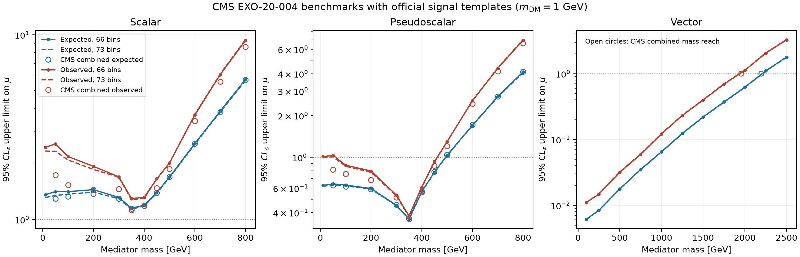
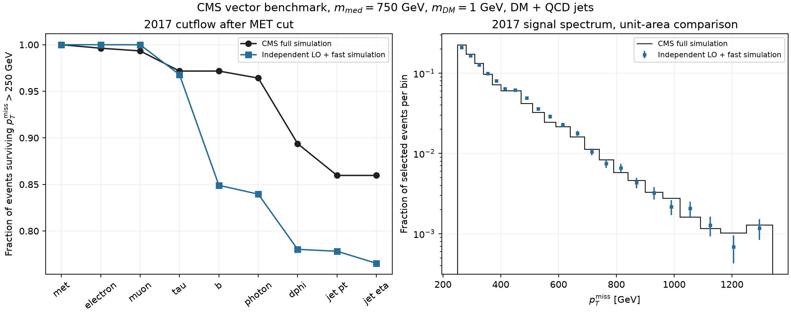

# CMS EXO-20-004 官方基准复现

验证以 CMS 发表的 $s$ 道暗物质简化模型为对象。拟合代码、数据分箱和背景约束与伪狄拉克 monojet 主分析一致。把官方模板输入拟合与独立重建信号分开比较，前者检验统计方法，后者检验从硬过程到实验选区的信号预测。

## 1. 用 CMS 官方信号模板验证统计方法

从 HEPData v2 读取三年 monojet 的 66 个分箱。各年份、各产生模式的官方产额先对齐分箱标签，再相加。spin-1 模板包含 DM + QCD jets、DM + W(qq) 和 DM + Z(qq)。背景中心值来自控制区的纯背景拟合，observed 使用信号区实测计数。背景的完整协方差由表 14 给出。逐格核对了这些输入与主分析一致。官方模板的 `Sample size` 误差作为独立逐 bin 信号 MC 方差加入，并另作固定模板对照。 [CMS 论文](https://arxiv.org/abs/2107.13021) · [spin-1 模板](https://doi.org/10.17182/hepdata.106115.v2/t1) · [spin-0 模板](https://doi.org/10.17182/hepdata.106115.v2/t2) · [背景协方差](https://doi.org/10.17182/hepdata.106115.v2/t14) · [数据与背景产额](https://doi.org/10.17182/hepdata.106115.v2/t15)

沿用主分析的 Poisson × Gaussian 剖面似然。expected 以中心背景构造纯背景 Asimov 数据，observed 使用实测计数及条件背景 Asimov，二者均求 $CL_s=0.05$。个别低质量 spin-1 模板相加后仍有负的 MC 中心估计，拟合将该 bin 的中心信号置零并保留公开的统计误差。原始产额保存在谱形表中。报告下列两种公开输入组合。

- **66 bins**。三年 monojet，正是伪狄拉克主分析所用选区。
- **73 bins**。在 66 bins 上加公开信号模板覆盖的 2016 mono-V 七个分箱，并保留类别间背景相关性。HEPData v2 的对应信号模板只覆盖 2016 mono-V，CMS 发表的组合结果还包含 2017、2018 的 mono-V 类别以及内部控制区似然。 [联合协方差](https://doi.org/10.17182/hepdata.106115.v2/t12) · [联合产额](https://doi.org/10.17182/hepdata.106115.v2/t13) · [2016 spin-1 mono-V 模板](https://doi.org/10.17182/hepdata.106115.v2/t5) · [2016 spin-0 mono-V 模板](https://doi.org/10.17182/hepdata.106115.v2/t6)

### 1.1 矢量媒介子质量边界

取 $m_{\rm DM}=1$ GeV、$g_q=0.25$、$g_\chi=1$。在相邻公开质量节点间对 $\log\mu_{95}$ 线性插值求 $\mu_{95}=1$，与 CMS 公开二维轮廓在 $m_{\rm DM}=1$ GeV 的交点比较。CMS 报告正文将结果约写为 expected 2.2 TeV、observed 1.95 TeV。 [CMS 图 7b](https://cms-results.web.cern.ch/cms-results/public-results/publications/EXO-20-004/index.html) · [CMS observed 轮廓](https://doi.org/10.17182/hepdata.106115.v2/t41) · [CMS expected 轮廓](https://doi.org/10.17182/hepdata.106115.v2/t40)

| 输入 | Median expected 边界 [TeV] | Observed 边界 [TeV] |
|---|---:|---:|
| CMS 发表组合，HEPData 轮廓读数 | 2.198 | 1.957 |
| 本文三年 monojet，66 bins | 2.208 | 1.941 |
| 本文加 2016 mono-V，73 bins | 2.212 | 1.934 |

66-bin 拟合在质量边界上分别相差 $+0.45\%$ 和 $-0.80\%$。直接线性插值 $\mu_{95}$ 给出 2.197 和 1.930 TeV，说明公开网格的插值本身约带来 11 GeV 的差别。质量边界接近说明统计方法能复现该矢量基准的总体排除尺度。这个百分比描述质量边界，不能当作逐点 $\mu_{95}$ 精度或伪狄拉克信号建模误差。矢量基准的公开数据给出 $\mu_{95}=1$ 的轮廓，并未提供每个节点的 CMS 数字上限。

### 1.2 直接比较逐质量 expected 与 observed 上限

标量和赝标量两个 $s$ 道基准有 CMS 发表的逐质量 $\mu_{95}$，可用于更严格的点对点比较。取共同公布的 50–800 GeV 范围，每种耦合 11 个质量节点。表中偏差为本分析的上限除以 CMS 组合上限再减 1。 [CMS 标量上限](https://doi.org/10.17182/hepdata.106115.v2/t48) · [CMS 赝标量上限](https://doi.org/10.17182/hepdata.106115.v2/t49)

| 基准 | 66 bins expected 偏差 | 66 bins observed 偏差 | 73 bins expected 偏差 | 73 bins observed 偏差 |
|---|---:|---:|---:|---:|
| 标量 | −0.3% 至 +9.2% | +7.6% 至 +47.5% | −1.2% 至 +4.0% | +7.7% 至 +36.6% |
| 赝标量 | −1.0% 至 +2.5% | +3.8% 至 +26.9% | −1.5% 至 +0.9% | +2.6% 至 +23.6% |

低质量基准显示 observed 上限对实际数据涨落和所含类别更敏感。例如在赝标量 100 GeV，CMS 的 expected、observed 分别为 0.617、0.759，66-bin 复算为 0.631、0.876。标量 50 GeV 的 66-bin observed 为 2.56，CMS 为 1.74。偏差与拟合范围和统计模型的差别共同存在，公开数据不足以逐项分解。这样的逐点对照比只看矢量质量边界更能反映轻媒介子区域的 observed 复现精度。

另用 SciPy 的信赖域优化器独立剖面化固定模板的 66-bin 似然，对矢量 2000 GeV、赝标量 100 GeV、标量 50 GeV 三个点重新求根。六个 expected 和 observed 数值与主程序相对一致至 $3\times10^{-8}$。这一比较检查数值求解，CMS 组合与简化似然的差别由上表评估。 [独立优化器对照](results/independent_optimizer_check.csv)

数值及脚本见 [逐点上限](results/official_template_limits.csv)、[矢量质量边界](results/vector_reach.csv) 和 [复算代码](scripts/benchmark_fit.py)。

## 2. 独立模拟对照 cutflow 与 MET 谱

选 HEPData 同时提供 cutflow 和信号谱的矢量基准 $m_{\rm med}=100,750,2000$ GeV，均取 $m_{\rm DM}=1$ GeV、$g_q=0.25$、$g_\chi=1$。每点独立生成 45,000 个 $pp\to\chi\bar\chi+j$ 事件。用公开 DMsimp UFO、MadGraph 3.6.6、13 TeV、`nn23lo1`，要求生成级 $p_T^j>100$ GeV、$|\eta_j|<4.5$，再使用主分析的 Pythia 8.312、Delphes 3.5.0 和近似 monojet 选择。三点均核对了 LHE 与 Delphes 事件总数以及每个事件的两个不可见粒子。原 UFO 只做了 Python 3 语法与卡片写入兼容处理。CMS 官方信号采用 NLO 一、二 parton 样本及 FxFx 匹配，并有完整探测器响应。 [官方 cutflow](https://doi.org/10.17182/hepdata.106115.v2/t20) · [官方谱形](https://doi.org/10.17182/hepdata.106115.v2/t1) · [CMS 生成设置，第 3 节](https://arxiv.org/pdf/2107.13021) · [DMsimp UFO](https://cp3.irmp.ucl.ac.be/projects/feynrules/wiki/DMsimp)

比较两个效率。累计 $A\epsilon$ 是最终事件数除以各自的生成样本总数，依赖生成切选和匹配。MET 后条件效率是最终事件数除以通过重建 $p_T^{\rm miss}>250$ GeV 的事件数，更直接反映该步骤之后的选择。CMS 的触发、MET 品质、领先喷注能量比例、mono-V 重叠排除等步骤在我们的近似模拟里没有独立实现，逐步表中保留空值。2018 施加与主分析相同的 HEM 筛选。

### 2.1 2017 年结果

| $m_{\rm med}$ [GeV] | 累计 $A\epsilon$，CMS / 本文 | MET 后条件效率，CMS / 本文 | 最终 QCD 信号总产额，本文 / CMS | $p_T^{\rm miss}>550$ GeV 占比，CMS / 本文 |
|---:|---:|---:|---:|---:|
| 100 | 13.90% / 3.95% | 76.91% / 77.76% | 0.629 | 2.69% / 2.76% |
| 750 | 31.40% / 22.60% | 81.70% / 76.53% | 0.825 | 10.36% / 10.88% |
| 2000 | 37.62% / 30.78% | 83.18% / 75.61% | 0.874 | 16.58% / 20.11% |

绝对产额按本次生成截面、模拟事件权重和 CMS 曝光计算，未用 CMS 产额校准。2018 对应的三个绝对产额比分别为 0.624、0.835、0.873。累计效率与产额比属于不同的比较，因为分母和生成截面来自各自的样本。

在 750 GeV 的 2017 样本中，$b$ veto 是逐步比较中一个明显的差异。独立模拟中，MET 后条件效率在该步从 96.79% 降到 84.90%，CMS 表中该步为 97.17% 到 97.17%。另一方面，CMS 的 mono-V 重叠排除继续削减官方样本。这两个效应在总效率上可以部分抵消。现有比较定位了差异出现的步骤，单凭该表无法分解底味成分、标签误识别和生成匹配各自的影响。

左图比较双方都有对应实现的切选，分母各自取已通过 MET 切选的事件数。右图对最终选区的 MET 谱分别归一到单位面积，以显示形状差别，末 bin 含溢出。低质量点的尾部统计较少，例如 100 GeV 的 2017 样本在 550 GeV 以上只剩 49 个独立模拟事件。 [100 GeV 谱与 cutflow](figures/vector_100_detector_validation.png) · [2000 GeV 谱与 cutflow](figures/vector_2000_detector_validation.png)

### 2.2 把独立模板送回相同的 66-bin 拟合

固定官方的 DM + W(qq) 和 DM + Z(qq) 产额，只替换 DM + QCD jets 部分，以衡量独立生成与探测器处理对拟合的影响。第一、二列使用固定信号模板，第三列用独立模拟的截面、分箱产额与模拟统计协方差。第四列仅作诊断，把独立模拟每年的 QCD 总产额替换为 CMS 值、保留独立模拟的分箱形状，并固定信号模板。2016 和 2017 复用同一近似选择，2018 加 HEM 筛选。所有上限均用同一组背景约束和 CMS 数据。下表各格依次为 expected / observed。

| $m_{\rm med}$ [GeV] | CMS 官方模板，固定 | 独立 QCD，固定 | 独立 QCD，含 MC 统计 | 只替换 QCD 形状，固定 |
|---:|---:|---:|---:|---:|
| 100 | 0.00615 / 0.00980 | 0.00869 / 0.01568 | 0.00922 / 0.02652 | 0.00532 / 0.00946 |
| 750 | 0.03497 / 0.05853 | 0.04202 / 0.07406 | 0.04209 / 0.07574 | 0.03432 / 0.06031 |
| 2000 | 0.62181 / 1.11708 | 0.56771 / 1.05936 | 0.56897 / 1.06797 | 0.49223 / 0.91776 |

750 GeV 的形状替换本身使两个上限变化约 2–3%，而绝对模拟产额较低，使上限更弱。2000 GeV 的谱尾较硬，形状和产额的影响方向相反。100 GeV 只替换形状时，observed 与官方模板的同一拟合接近，但独立模拟的绝对归一化和尾部 MC 误差会显著放宽上限。这也解释了为什么仅比较归一化谱不足以验证限值。

[逐步 cutflow](results/detector_cutflow_comparison.csv) · [逐 bin 谱与产额](results/detector_spectrum_comparison.csv) · [效率及上限汇总](results/detector_summary.csv) · [独立模拟脚本](scripts/simulate_vector.py) · [对照分析脚本](scripts/compare_detector.py)

## 3. 对当前论文的含义

使用 CMS 官方信号模板时，本文的简化似然复现了发表的矢量基准质量边界，spin-0 基准的 expected 逐点结果也接近 CMS 组合结果。轻媒介子点的 observed 逐点差异，以及独立 LO 快模拟的绝对产额与尾部统计，限制了可以宣称的精度。本文的伪狄拉克排除结果应继续标明是 monojet-only 重解释。这个验证没有给伪狄拉克模型引入统一校正因子，也没有改动原有排除图。
