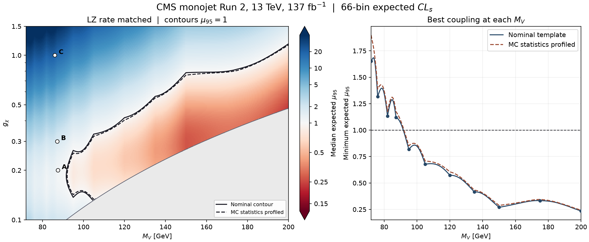

# LZ 等率平面上的 CMS Monojet 预期上限

**13 TeV｜CMS Run 2，137 $\mathrm{fb}^{-1}$｜66-bin 泊松剖面似然**

## 结果

已在同一参数平面叠加热遗迹丰度。图和带内逐点复算见[热遗迹丰度与 CMS Monojet](../monojet_relic_overlay_20261106/REPORT.md)。

左图颜色为固定信号模板的中位预期 $\mu_{95}$。黑实线和黑虚线分别标出名义模板和剖面化有限 MC 统计后的 $\mu_{95}=1$。右图在每个 $M_V$ 上取允许耦合中的最小 $\mu_{95}$，圆点为实际生成和重建的质量节点。[展示用 PDF](figures/expected_mu95_lz_plane.pdf)

| 基准点 | $M_V$ [GeV] | $g_\chi$ | $g_t$ | 名义 expected $\mu_{95}$ | 含有限 MC 统计约束 |
|---|---:|---:|---:|---:|---:|
| A | 87.530 | 0.20 | 1.618 | 1.15 | 1.20 |
| B | 87.183 | 0.30 | 1.070 | 1.78 | 1.87 |
| C | 86.048 | 1.00 | 0.313 | 19.8 | 20.3 |

三个原有 LZ＋relic 基准的中位预期上限均高于各自的名义强度 $\mu=1$。A、C 通过相邻质量的信号模板插值得到，B 为直接计算节点。

在二维 LZ 等率平面上，**约 $M_V=93$ GeV 起出现 $\mu_{95}<1$ 的耦合区间**。名义网格上的首个质量为 92.0 GeV，纳入有限 MC 统计约束后为 92.5 GeV。这个位置取决于质量节点之间的谱形插值，宜按约数解读。下表给出剖面化有限 MC 后的几个代表性截面。

| $M_V$ [GeV] | 满足 expected $\mu_{95}<1$ 的 $g_\chi$，网格近似 | 此质量的最小 expected $\mu_{95}$ |
|---|---:|---:|
| 100 | 0.15–0.26 | 0.86 |
| 120 | 0.17–0.40 | 0.61 |
| 150 | 0.27–0.75 | 0.29 |
| 200 | 0.48–1.14 | 0.24 |

本次扫描最小值出现在 $M_V=200$ GeV、$g_\chi\simeq0.480$、$g_t\simeq3.52$，名义及含有限 MC 的 $\mu_{95}$ 分别为 0.234 和 0.242。该点在质量上边界且靠近所采用的 $g_t$ 上界。这里的灵敏度区域只施加了 LZ 事件率条件。

## 参数平面

使用现有 Yukawa-like 纯矢量 pseudo-Dirac 模型，固定 $m_{\chi_1}=35$ GeV、$m_{\chi_2}-m_{\chi_1}=1$ MeV、今日局域激发态比例 $f_2=0.5$。暗顶点系数为 $g_\chi/2$。对每个 $(M_V,g_\chi)$ 采用同一条树级 LZ 基准等率关系求 $g_t$。

$$
g_t(M_V,g_\chi)=\frac{0.0380063}{g_\chi}
\left(\frac{M_V}{30\ \mathrm{GeV}}\right)^2.
$$

范围为 $72\le M_V\le200$ GeV、$0.10\le g_\chi\le1.50$，图中遮蔽 $g_t>\sqrt{4\pi}$ 或 $\Gamma_V/M_V\ge0.03$ 的点。横轴从 72 GeV 开始，暗粒子对的在壳阈值为 70.001 GeV。A、B、C 延用此前在相同 LZ 假设下得到的热遗迹基准点。平面中的其他点只施加了 LZ 等率条件。

## 逐质量的重建信号模板

在 72、76、82、87.183、95、105、120、135、150、175、200 GeV 分别生成 MadGraph 3.6.6 在壳 $V+j$ 树图和经 Ward 验证的 $gg\to Vg$ 圈图，PDF 为 $\texttt{nn23lo1}$。每个质量点用 $g_t=1$ 得到产生截面和运动学。采用 Pythia 8.312 与 Delphes 3.5.0，将 $V$ 当作稳定不可见粒子，以其四动量表示暗粒子对。共处理 44 份样本、227,700 个事件。逐事件核对了 LHE 对齐、不可见粒子身份和质量。

| 分量 | 生成级门槛 | 用于模板的生成级区间 | 每节点目标事件数 |
|---|---:|---:|---:|
| 圈图主体 | 100 GeV | 100–480 GeV | 3,600 |
| 圈图尾部 | 480 GeV | $\ge480$ GeV | 2,100 |
| 树图主体 | 100 GeV | 100–350 GeV | 12,000 |
| 树图尾部 | 350 GeV | $\ge350$ GeV | 3,000 |

表中门槛和区间均指生成级 $p_T^j$，$|\eta_j|<4.5$。按互斥生成级区间拼接，各自使用对应生成截面除以原始生成事件数。重建选区沿用 CMS Run 2 公共 MadAnalysis5 近似，包括领先 AK4、MET、角度和对象否决。2016、2017、2018 分别用 36、41、60 $\mathrm{fb}^{-1}$；2018 额外施加公开实现的 HEM 否决。每年 22 个互斥 MET bin，最后一 bin 含 overflow。质量节点之间逐 bin 线性插值，插值后对完整模板做拟合。[CMS 公开实现](https://doi.org/10.14428/DVN/IRF7ZL)

在壳近似下，同一质量的 66 个信号 bin 共用一个因子 $K=g_t^2\mathrm{BR}(V\to\chi_1\chi_2)$。因此对参考模板求出的上限 $\nu_{95}$ 精确对应二维平面上 $\mu_{95}=\nu_{95}/K$，其中 $\mu=1$ 表示该参数点自身的名义信号。这保留了质量依赖的谱形、接受率和树圈比例。

## 泊松拟合

使用 CMS 公布的控制区拟合背景 $b_i$ 和完整 $66\times66$ 背景协方差 $C$，取纯背景 Asimov 数据 $n_i=b_i$。在每个待检验信号强度下对背景偏移 $\theta$ 剖面化。

$$
\mathcal L(\mu,\boldsymbol\theta)\propto
\prod_{i=1}^{66}\mathrm{Pois}(n_i\mid b_i+\theta_i+\mu s_i)
\exp\!\left[-\tfrac12\boldsymbol\theta^{\mathsf T}C^{-1}\boldsymbol\theta\right].
$$

保持每个 bin 的均值为正。通过 $CL_s=2\Phi(-\sqrt{q_{\mu,A}})=0.05$ 求中位预期上限。用此前的 B 点原始模板复算得到 $\mu_{95}=1.73685$，复现综合报告第 6.3 节。新扫描对 B 点也独立生成并重建，用来检查跨样本稳定性。[CMS 背景和协方差](https://doi.org/10.17182/hepdata.106115.v2) · [CMS 简化似然](https://cds.cern.ch/record/2242860/files/NOTE2017_001.pdf) · [Asimov 方法](https://arxiv.org/abs/1007.1727)

## 统计与适用范围

热图颜色使用名义信号模板。另做一轮带有限 MC 统计约束的剖面拟合。对每个独立生成样本按成对的年份选择类别构造多项分布协方差，保留同一个 MC 事件在不同年份产额之间的相关性，并加入独立的 MadGraph 积分误差。记信号模板协方差为 $C_s$，在测试强度 $\mu$ 下，线性高斯模板偏移与背景偏移可合并为 $C+\mu^2 C_s$ 并剖面化。图中的虚线用于展示这一对照。数据表还保存了 120 次 MC 重采样的中央 68% 区间，用于诊断有限样本对谱形的影响。重采样区间与实验的预期波动带含义不同。

本结果沿用快模拟与公共选区近似。生成级 $p_T^j<100$ GeV 的重建迁移、尺度/PDF、匹配及探测器响应未作为拟合扰动参数。$\mu_{95}<1$ 表示该点进入所用模型和信号模板下的中位预期排除范围。对模型的最终判断还需要观测拟合及信号系统误差评估。

## 数据与复核

- [二维网格](results/expected_mu95_grid.csv) 包含 63,440 个坐标点，其中 46,106 个通过耦合与宽度筛选。两种 $\mu_{95}$ 和有效标记分列保存。
- [11 组 66-bin 模板](results/cms66_signal_templates.csv) 分列树图、圈图和背景。[质量节点上限](results/mass_node_limits.csv) 保存 $g_t^2\mathrm{BR}=1$ 下的参考强度上限。[节点信号协方差](results/node_signal_covariances.npz) 与之对应。
- [A、B、C 数表](results/benchmark_expected_limits.csv) 和 [扫描摘要](results/summary.json) 记录基准、最小值和 $\mu_{95}=1$ 的网格起点。
- [运行证据](scan_evidence.tar.gz) 包含 MadGraph 卡、积分和 Delphes 日志、44 份分箱计数及切选复核。[拟合与绘图脚本](scripts/expected_scan.py) 使用综合报告中的公开 CMS 背景输入。新切选脚本在旧 B 点圈图上逐类别复现了原来的计数。
