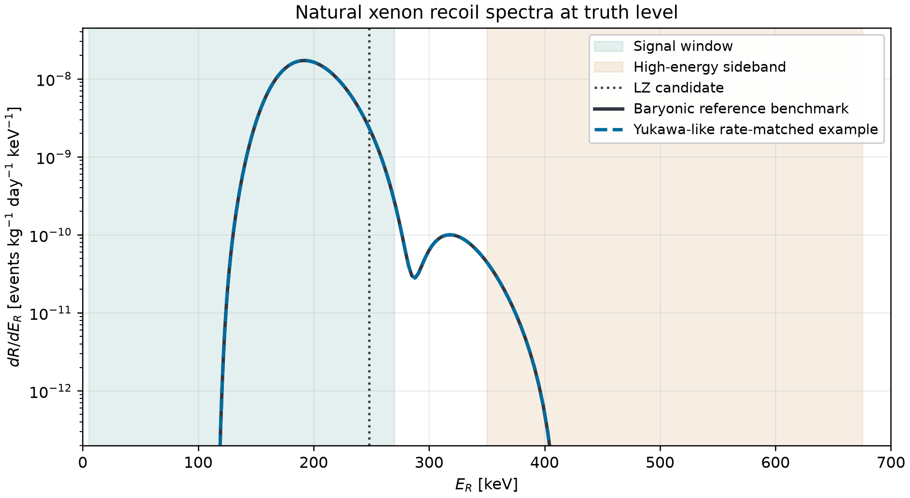
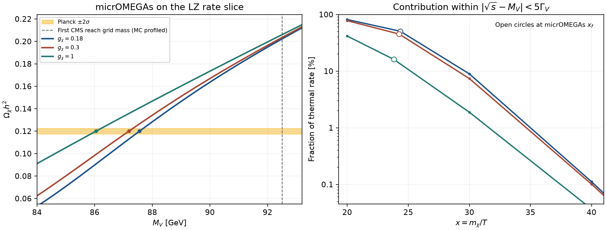
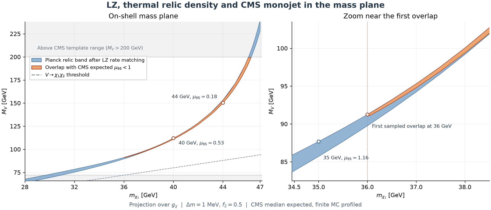
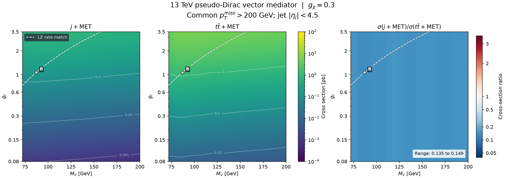
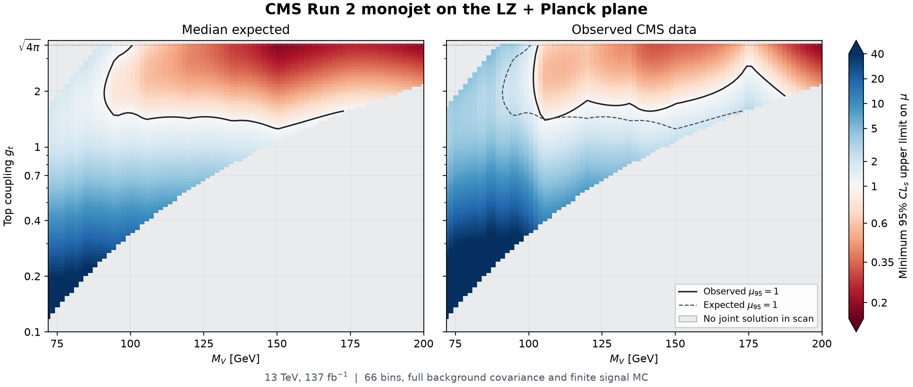
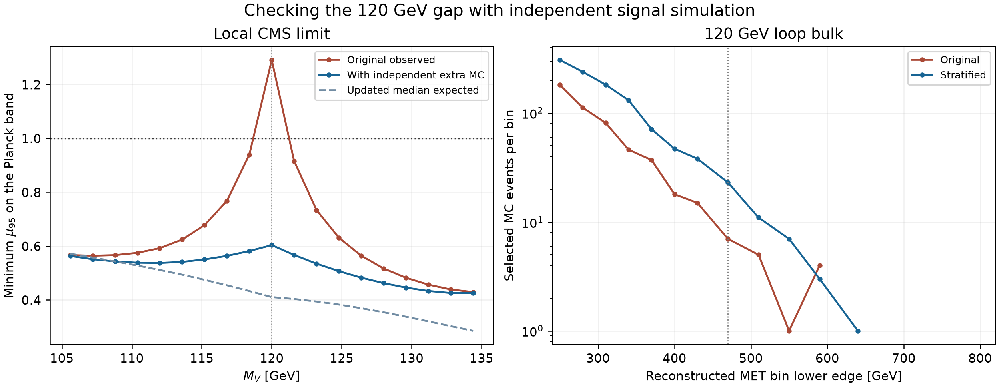

# 放热伪狄拉克暗物质的氙核反冲与 LHC 单喷注检验

**论文初稿 · 2026 年 11 月 6 日**  
**作者与单位**　待填

## 摘要

LUX-ZEPLIN（LZ）在扩展核反冲能窗的搜索中报告了一个与约 248 keV 核反冲相容的候选事件。我们研究一种放热伪狄拉克暗物质模型，其中轻矢量媒介子通过非对角暗流连接两个 Majorana 态，并以与参考夸克质量成比例的矢量耦合连接标准模型。首先复算天然氙的反冲谱，并以文献基准的真值事件率固定 $g_tg_\chi/M_V^2$。随后计算两态共湮灭的热遗迹丰度，选出与 Planck 全量冷暗物质丰度相容的参数。最后模拟矢量媒介子的在壳产生与不可见衰变，用 CMS Run 2 在 13 TeV、137 $\mathrm{fb}^{-1}$ 下的 66 个 monojet 信号区分箱及其完整背景协方差，计算中位预期与观测 95% $CL_s$ 上限。在固定质量劈裂 $\Delta m=1$ MeV 和今日局域激发态比例 $f_2=0.5$ 的切片上，具有观测灵敏度的最低媒介子质量网格节点为 $M_V=102.4$ GeV，对应代表性暗物质质量约 39 GeV。扫描内最低观测信号强度上限为 $\mu_{95}^{\rm obs}\simeq0.18$，位于 $M_V=200$ GeV 和 $g_t=\sqrt{4\pi}$ 的扫描边界。独立补充信号模拟后，原轮廓在 $M_V=120$ GeV 附近的缺口闭合。这些结果给出指定低能匹配和热史假设下的 monojet 灵敏度。

**关键词**　非弹性暗物质、伪狄拉克费米子、核反冲、热冻结、单喷注与缺失横动量

## 1. 引言

LZ 在 2.84 tonne yr 的氙靶曝光中将核反冲搜索能窗扩展至约 270 keV，报告了一个与 $248\pm23_{\rm stat}\pm23_{\rm sys}$ keV 核反冲相容的候选事件。LZ 对其所检验的模型给出的全局显著性为 $2.6\sigma$，最大局域显著性为 $3.4\sigma$。本文以该候选事件为动机，考察放热非弹性散射这一条件性解释，并使用独立的对撞机数据检验它要求的信号强度。 [1](https://arxiv.org/abs/2609.02823)

在伪狄拉克体系中，激发态 $\chi_2$ 散射到较轻的 $\chi_1$ 时可以释放质量差，从而提高较大核反冲能量处的事件率。Gemmell、Hooper 和 Krnjaic 在强子亲和的轻矢量模型中展示了这一机制，并给出用于核反冲复算的基准。Du、Huang 和 Xie 则研究了重子数规范模型，以吸热跃迁和 TeV 量级媒介子的双喷注搜索为重点。本文保留放热跃迁，采用质量加权的夸克矢量耦合，考察百 GeV 量级媒介子的不可见衰变及 CMS 单喷注灵敏度。 [2](https://arxiv.org/abs/2609.26570) · [3](https://arxiv.org/abs/2609.07225)

分析依次处理三个量。氙核反冲固定小动量转移下的耦合组合，热冻结利用共湮灭的类时传播子筛选质量和耦合，CMS 利用缺失横动量分布约束留下的信号。我们报告 LZ 等率切片与 Planck 丰度带上逐点的 CMS 上限。联合图采用这三步的条件筛选，统计置信度归属于 CMS 检验。

## 2. 模型与参数

暗部门包含质量分别为 $m_1=m_\chi$ 和 $m_2=m_\chi+\Delta m$ 的两个 Majorana 费米子，以及质量为 $M_V$ 的无色自旋一粒子 $V_\mu$。在电弱对称性破缺后的质量本征态基底中，使用

$$
\mathcal L_{\rm int}
= V_\mu\left[
   \sum_{q=u,d,s,c,b,t}g_{Vq}\,\bar q\gamma^\mu q
   + i\frac{g_\chi}{2}\,\bar\chi_1\gamma^\mu\chi_2
 \right],\qquad
g_{Vq}=g_t\,\frac{\widehat m_q}{172\ {\rm GeV}}.
\tag{1}
$$

式（1）的相位约定对应 Hermitian 的非对角 Majorana 矢量流，暗顶点的耦合模为 $g_\chi/2$。$g_t$ 是实际的 $Vt\bar t$ 顶点系数。定义味结构的固定参考数为 $\widehat m_q=(0.0022,0.0047,0.096,1.27,4.18,172)$ GeV。传播与相空间中使用各生成程序的运动学质量输入。本文所称 Yukawa-like 指耦合系数的质量比例，洛伦兹结构为纯矢量。基准计算只包含式（1）的门户顶点。我们把它作为电弱破缺相的有效参数化，分波幺正性和电弱规范补全的影响在第 7 节讨论。 [4](https://arxiv.org/abs/1510.02110)

| 量 | 本文的主分析设定 |
|---|---|
| 质量劈裂与局域激发态比例 | $\Delta m=1$ MeV，$f_2=0.5$ |
| 局域暗物质总密度 | $\rho_\chi=0.3\ {\rm GeV\,cm^{-3}}$ |
| 晕速度参数 $(v_0,v_E,v_{\rm esc})$ | $(238,254,544)\ {\rm km\,s^{-1}}$ |
| 暗质量粗扫 | $20\le m_\chi\le100$ GeV |
| CMS 在壳媒介子模板 | $72\le M_V\le200$ GeV |
| 耦合扫描 | $0.10\le g_\chi\le1.50$，$g_t\le\sqrt{4\pi}$ |
| CMS 窄宽度筛选 | $\Gamma_V/M_V<0.03$，$M_V-m_1-m_2\ge5\Gamma_V$ |

**表 1.** 主分析输入及扫描范围。宽度条件用于 CMS 在壳信号模板。

在上述定义下，$m_\chi$、$M_V$、$g_t$ 和 $g_\chi$ 独立输入。$g_t=\sqrt{4\pi}$ 对应 $g_t^2/(4\pi)=1$，用于限定扫描。$f_2$ 是今日局域数密度比例的输入。热冻结方程求得的是暗物质总丰度。

## 3. 氙核反冲与 LZ 等率归一化

### 3.1 从夸克矢量流到核反冲率

在领先矢量荷匹配下，质子与中子的耦合分别为

$$
f_p=2g_{Vu}+g_{Vd},\qquad
f_n=g_{Vu}+2g_{Vd},\qquad
Q_A=Zf_p+(A-Z)f_n .
\tag{2}
$$

在本文味结构下，$f_p=5.29\times10^{-5}g_t$，$f_n=6.74\times10^{-5}g_t$。$Q_A$ 是质量数 $A$、质子数 $Z$ 的核的相干荷。相干振幅随动量转移乘以 $F_A(q)$。本文以 micrOMEGAs 的数值双参数 Fermi 核密度计算 $F_A$，对九种天然氙同位素按质量分数 $w_A$ 求和。式（2）使用树级矢量荷，尺度演化和环级混合另见第 7 节。 [5](https://arxiv.org/abs/1605.04917)

设 $m_A$ 为核质量，$\mu_A=m_2m_A/(m_2+m_A)$ 为入射暗态与核的约化质量。领先非相对论阶给出放热跃迁的最小入射速度

$$
v_{\min}(E_R)=
\frac{\left|m_A E_R/\mu_A-\Delta m\right|}{\sqrt{2m_A E_R}},
\qquad q^2=2m_AE_R .
\tag{3}
$$

零速可及的反冲能量为 $E_R^\star=\Delta m\,\mu_A/m_A$。能量释放使 $v_{\min}$ 在这个有限反冲能量处达到零，核形状因子和速度分布共同决定实际谱峰的位置。对归一化到 1 的实验室晕速度分布 $f_{\rm lab}(\mathbf v)$，定义 $\eta(v_{\min})=\int_{|\mathbf v|>v_{\min}}d^3v\,f_{\rm lab}(\mathbf v)/|\mathbf v|$。微分截面正比于 $m_A(g_\chi Q_A/2)^2/[2\pi v^2(M_V^2+q^2)^2]$。乘上入射数密度、速度与每单位质量的核数后，得到自然单位下的真值率

$$
\frac{dR}{dE_R}
=\frac{f_2\rho_\chi}{m_2}
 \sum_A w_A\,
 \frac{(g_\chi Q_A/2)^2}{2\pi(M_V^2+2m_AE_R)^2}
 F_A^2(q)\,\eta\!\left(v_{\min}(E_R)\right).
\tag{4}
$$

数值计算在质量简并近似下使用 $m_1$ 处理约化质量和入射数密度，相对质量差为 $\Delta m/m_\chi\ll1$。率的单位换算及曝光只用于给出每单位质量、每单位时间的能谱和能窗积分。

### 3.2 基准复算与归一化定义

我们首先采用文献 [2] 图 6 的基准 $m_\chi=35$ GeV、$M_V=30$ GeV、$\Delta m=1$ MeV、$g_B=1.46\times10^{-5}$、$g_\chi=0.32$，并取其普适夸克顶点 $g_{Vq}=g_B/6$。在 2.84 tonne yr 曝光中，本文的真值计算给出 $N_{\rm ROI}=1.12044$ 和 $N_{\rm SB}=7.39\times10^{-4}$。积分区间分别为 $[5.4,269.9]$ keV 和 $[350,675]$ keV。文献 [2] 对同一基准的响应折叠后事件数约为 1 和 $8\times10^{-4}$。我们将真值级的 $1.12044$ 定为后续等率目标，以在同一计算约定下比较两种耦合结构。 [2](https://arxiv.org/html/2609.26570v1)

**图 1.** 文献基准与 Yukawa-like 等率解在 $m_\chi=35$ GeV、$M_V=30$ GeV 的真值微分率。后者取 $g_t=0.12763$、$g_\chi=0.29779$。纵轴采用 events $\mathrm{kg^{-1}\,day^{-1}\,keV^{-1}}$。竖线标记候选事件的重建反冲能量。背景色标记积分能窗。曲线尚未折叠 LZ 的能量依赖效率和重建响应。

对 $M_V$ 远大于氙反冲的动量转移的区域，式（4）的归一化由 $\kappa=g_tg_\chi/M_V^2$ 控制。记以单位 $\kappa^2$ 计算的 ROI 积分系数为 $\mathcal I_{\rm ROI}(m_\chi,\Delta m,f_2,\rho_\chi)$，则

$$
N_{\rm ROI}^{\rm truth}=\kappa^2\,\mathcal I_{\rm ROI},\qquad
\kappa_{\rm LZ}(m_\chi)=
\sqrt{\frac{1.12044}{\mathcal I_{\rm ROI}(m_\chi,\Delta m,f_2,\rho_\chi)}}.
\tag{5}
$$

数值上逐质量在 $M_V=100$ GeV 计算有限传播子的真值积分，再在对撞机范围内以接触极限缩放。$\kappa_{\rm LZ}$ 在 $m_\chi=35,40,44$ GeV 时分别为 $4.223,5.665,7.202$，单位均为 $10^{-5}\ {\rm GeV}^{-2}$。在固定劈裂下，增大 $m_\chi$ 会把特征反冲能量推向 ROI 上边界，因而同一 ROI 事件数需要重新求 $\kappa_{\rm LZ}$。固定其他输入时，$\kappa_{\rm LZ}\propto(f_2\rho_\chi)^{-1/2}$。

我们另作单事件谱形检查，用常数 $\sigma_E=\sqrt{23^2+23^2}$ keV 的高斯响应代理，并沿用文献 [2] 的空侧带构造。对固定谱形，令 $\lambda(E)=\kappa^2\lambda_0(E)$，则一件候选事件的似然为 $\mathcal L_{\rm LZ}\propto \exp[-N_{\rm ROI}-N_{\rm SB}]\lambda(248\ {\rm keV})$，其幅度最大似然解满足 $N_{\rm ROI}+N_{\rm SB}=1$。该检查用于比较等率约定，完整的 LZ 事件级响应、背景和覆盖率仍需独立建模。主 observed 图采用式（5）。 [1](https://arxiv.org/abs/2609.02823) · [2](https://arxiv.org/abs/2609.26570)

## 4. 热遗迹丰度与质量投影

假设标准热史及冻结期间暗态间的化学平衡。对总数密度 $n=n_1+n_2$，使用

$$
\dot n+3Hn=-\langle\sigma_{\rm eff}v\rangle(n^2-n_{\rm eq}^2),\qquad
\langle\sigma_{\rm eff}v\rangle=
\sum_{i,j=1,2}\frac{n_i^{\rm eq}n_j^{\rm eq}}{(n^{\rm eq})^2}
\langle\sigma_{ij}v\rangle .
\tag{6}
$$

当 $\Delta m\ll T_f$ 时，两态在冻结期间都有近似相同的平衡权重。我们使用 CalcHEP 模型与 micrOMEGAs 7.1.4 计算总丰度，暗质量扫描采用 darkOmega 的准确积分选项 fast=0 及 Beps=$10^{-9}$。采用 Planck 基准 $\Lambda$CDM 的 $\Omega_c h^2=0.1200\pm0.0012$，并取 $0.1176\le\Omega_\chi h^2\le0.1224$ 作为全量暗物质的筛选带。该宽度来自观测误差。 [6](https://doi.org/10.1103/PhysRevD.43.3191) · [7](https://arxiv.org/abs/2312.14894) · [8](https://arxiv.org/pdf/1807.06209)

在本文的在壳不可见媒介子分支，冻结主要通过 $\chi_1\chi_2\to V^*\to b\bar b,c\bar c$ 共湮灭。以 $m_\chi=35$ GeV 的代表解为例，$b\bar b$ 约占共湮灭贡献的 92%。代入 LZ 归一化后，截面的耦合和传播子因子为

$$
\frac{(g_tg_\chi)^2}{(M_V^2-s)^2+M_V^2\Gamma_V^2}
=\frac{\kappa_{\rm LZ}(m_\chi)^2M_V^4}
       {(M_V^2-s)^2+M_V^2\Gamma_V^2}.
\tag{7}
$$

在固定两个质量的情况下，沿 LZ 等率切片改变 $g_\chi$ 主要通过总宽度改变式（7）。改变 $M_V$ 则直接改变与共湮灭极点的距离。因此固定 $m_\chi$ 后，丰度带允许 $g_\chi$ 改变，同时只留下相对窄的 $M_V$ 区间。该现象依赖于热平均。以 $m_\chi=35$ GeV、$g_\chi=0.18$、$M_V\simeq87.56$ GeV 为例，在 $T_f\simeq1.44$ GeV 时，$\lvert\sqrt{s}-M_V\rvert<5\Gamma_V$ 的区间贡献约一半瞬时热平均率，随后随温度下降快速减弱。丰度在该切片的局部对数斜率约为 $0.158\ {\rm GeV}^{-1}$，将 Planck 的约 $\pm2\%$ 映射为 $M_V=87.43$–$87.68$ GeV。 [9](https://doi.org/10.1016/0550-3213(91)90438-4)

**图 2.** 左图固定 $m_\chi=35$ GeV，并沿 LZ 等率切片扫描媒介子质量。右图显示极点附近对不同温度下瞬时热平均率的贡献。空心点为各参数点的冻结温度。

让 $m_\chi$ 随扫描改变时，共湮灭阈值和 LZ 归一化同时改变。在上分支，$m_\chi=35$ GeV 的丰度带覆盖 $M_V\simeq85.7$–$87.7$ GeV，而 $m_\chi=40$ GeV 对应约 $111.1$–$112.1$ GeV。固定等率目标及中心丰度后，四个参数受到两个等式约束。在所研究的上分支附近可用 $(m_\chi,g_\chi)$ 作局部坐标，有限丰度容差则给中心解一定厚度。投影到 $(m_\chi,M_V)$ 时，沿 $g_\chi$ 方向的变化大部分重叠，形成窄的质量包络。在 $m_\chi=35$ GeV 的较低质量区，还存在约 $M_V=62.3$ GeV 的阈值下共湮灭解及轻媒介子 $VV$ 湮灭解。本文对撞机拟合选择能够在壳产生不可见暗粒子对的分支。

**图 3.** 蓝色为 Planck 丰度带沿 $g_\chi$ 的扫描包络。橙色显示初始信号模板下至少有一个耦合解满足中位预期 $\mu_{95}<1$ 的质量组合。这里用预期曲线说明质量移动。采用补样本的最终观测结果见图 5。

## 5. LHC 单喷注信号与 CMS 复分析

### 5.1 硬过程与重建模板

在 $pp$ 对撞中，不可见衰变 $V\to\chi_1\chi_2$ 由一个可见喷注平衡横动量。我们计算 $q\bar q\to Vg$、$qg\to Vq$ 及其交叉过程的树级贡献，以及闭合夸克圈诱导的 $gg\to Vg$。质量加权的夸克耦合压低轻夸克树级振幅，也使顶夸克圈在硬缺失横动量下重要。下文比较三个固定 $m_\chi=35$ GeV 的等率与丰度基准 A、B、C，其 $(M_V/{\rm GeV},g_t,g_\chi)$ 分别为 $(87.530,1.618,0.20)$、$(87.183,1.070,0.30)$、$(86.048,0.313,1.00)$。所采用的圈图 UFO 含有味分辨的 $gggV$ 有理项。在 B 基准的一个 $1$ TeV 部分子质心能量的相空间点，用动量替换外部胶子极化后的振幅平方与原矩阵元平方之比约为 $6.3\times10^{-24}$。此验证对应所用闭合夸克圈振幅。 [10](https://arxiv.org/abs/1405.0301) · [11](https://arxiv.org/abs/1507.00020)

在窄宽度近似下，对任一固定选区 $X$，信号截面写作

$$
\sigma_X=\sigma_X^{V+{\rm jet}}(M_V,g_t=1)\,K,\qquad
K=g_t^2\,{\rm BR}(V\to\chi_1\chi_2).
\tag{8}
$$

若固定两个质量且只取式（1）的衰变道，令 $\Gamma_q=A g_t^2$、$\Gamma_\chi=B g_\chi^2$，其中 $A,B$ 只依赖质量和味结构。沿固定乘积 $P=g_tg_\chi$ 的 LZ 等率线，$K=xBP^2/(Ax^2+BP^2)$，$x=g_t^2$。若最大值位于耦合扫描内部，极值条件为 $\Gamma_q=\Gamma_\chi$。若最大值触及扫描边界，则需要按该边界解释。以 B 点为例，宽切选 $p_T^j>20$ GeV、$|\eta_j|<6$ 下的 $j+\mathrm{MET}$ 真值截面为 11.14 pb。改用 $p_T^{\rm miss}>200$ GeV、$|\eta_j|<4.5$，树图和圈图分别贡献 0.0307 和 0.1353 pb。相同硬缺失横动量条件下，稳定顶夸克的 $t\bar t+\mathrm{MET}$ 真值截面为 1.23 pb。这些数值比较的是硬过程截面。

**图 4.** 固定 $m_\chi=35$ GeV 和 $g_\chi=0.30$ 的真值级扫描。两个通道均施加 $p_T^{\rm miss}>200$ GeV，单喷注通道另要求 $|\eta_j|<4.5$。该图的参数平面用于展示截面依赖。热遗迹筛选和重建效率进入后续拟合。

在 $M_V=72,76,82,87.183,95,105,120,135,150,175,200$ GeV 用 MadGraph5_aMC@NLO 3.6.6、nn23lo1 PDF 和 $g_t=1$ 生成参考信号，以 Pythia 8.312 和 Delphes 3.5.0 模拟 shower、强子化和快探测器响应。把 $V$ 作为稳定不可见粒子，使用其四动量代表不可见暗态对的总四动量。生成级喷注满足 $|\eta_j|<4.5$。树图和圈图均以 $p_T^j=100$ GeV 起始，并分别在 350 和 480 GeV 以独立硬样本加密。按互斥生成级区间拼接，并保留各样本生成截面与生成事件总数所确定的权重。120 GeV 节点进一步细分为三个互斥的圈图区间，见第 6.2 节。 [10](https://arxiv.org/abs/1405.0301) · [12](https://arxiv.org/abs/2203.11601) · [13](https://arxiv.org/abs/1307.6346)

重建采用 CMS EXO-20-004 的公开单喷注实现作为近似，施加领先 AK4 喷注 $p_T>100$ GeV 和 $|\eta|<2.4$、$p_T^{\rm miss}>250$ GeV、喷注与缺失横动量方位角选择、轻子和光子否决以及 $b$ 和 $\tau$ 否决，并对 2018 年应用 HEM 否决。2016、2017、2018 年分别使用约 36、41、60 $\mathrm{fb}^{-1}$ 的曝光，每年 22 个互斥分箱，最后一个分箱包括溢出。信号谱逐 bin 在质量节点间插值。 [14](https://arxiv.org/abs/2107.13021) · [15](https://doi.org/10.14428/DVN/IRF7ZL)

### 5.2 逐 bin 泊松似然

以 CMS 公布的 66 个信号区计数 $n_i$、控制区纯背景拟合给出的均值 $b_i$ 及完整协方差 $C_b$ 为输入。用 $\nu$ 乘参考模板 $\mathbf s$，则点自身名义强度的乘子为 $\mu=\nu/K$。背景与有限模拟统计分别用独立标准正态变量 $\mathbf z_b,\mathbf z_s$ 表示，取 $L_bL_b^{\mathsf T}=C_b$、$L_sL_s^{\mathsf T}=C_s$。使用

$$
\mathcal L(\nu,\mathbf z_b,\mathbf z_s)
\propto
\prod_{i=1}^{66}{\rm Pois}\!\left(
 n_i\,\middle|\,
 b_i+(L_b\mathbf z_b)_i+\nu[s_i+(L_s\mathbf z_s)_i]\right)
\exp\!\left[-\frac{\|\mathbf z_b\|^2+\|\mathbf z_s\|^2}{2}\right].
\tag{9}
$$

信号和总泊松均值分别约束为非负和正。$C_s$ 包括各生成样本的类别计数多项分布和积分截面误差。把同一模拟事件对不同年份的选区贡献放在同一个类别响应向量中，保留年份间的模拟统计相关性。独立质量节点的模板用线性权重插值，协方差用对应权重的平方相加。 [16](https://doi.org/10.17182/hepdata.106115.v2/t15) · [17](https://doi.org/10.17182/hepdata.106115.v2/t14) · [18](https://cds.cern.ch/record/2242860)

对每个 $\nu$ 剖面化扰动，计算具有 $\widehat\nu\ge0$ 约束的单边似然比 $\tilde q_\nu$，在 $\widehat\nu>\nu$ 时置零。对 observed 检验，以 $\nu=0$ 的观测拟合构造条件背景 Asimov，令 $a=\sqrt{\tilde q_{\nu,A}}$。渐近近似下，使用

$$
CL_s(\nu)=\frac{\Phi(-z_\nu)}{\Phi(a-z_\nu)},\qquad
z_\nu=
\begin{cases}
\sqrt{\tilde q_\nu}, & \tilde q_\nu\le a^2,\\[2pt]
(\tilde q_\nu+a^2)/(2a), & \tilde q_\nu>a^2 .
\end{cases}
\tag{10}
$$

求 $CL_s=0.05$ 得 $\nu_{95}$。中位 expected 结果使用控制区中心背景 $n_i=b_i$ 作为纯背景 Asimov。任一物理点的上限由 $\mu_{95}=\nu_{95}/K$ 得到。对每个 $(M_V,g_t)$ 网格点，先求满足 LZ 等率的 $g_\chi=\kappa_{\rm LZ}(m_\chi)M_V^2/g_t$，再寻找 Planck 带内的 $m_\chi$ 区间。图中取带端和中点候选解的最低 $\mu_{95}$，即最大 $K$ 对应的上限，并在代表点加密复核。热图因此检验某个质量和耦合坐标下是否**存在**一组联立解进入排除区。 [19](https://arxiv.org/abs/1007.1727) · [20](https://doi.org/10.1088/0954-3899/28/10/313)

## 6. 结果

### 6.1 在 LZ 等率与 Planck 丰度条件下的 CMS 约束

**图 5.** $(M_V,g_t)$ 平面上的中位预期和观测 $\mu_{95}$，均纳入有限信号 MC 统计。右图黑实线与灰虚线分别表示 observed 和 expected 的 $\mu_{95}=1$。灰区为扫描内未找到满足条件的在壳解。该图采用 120 GeV 节点独立加密后的信号模板。

在 8,181 个投影网格点中，3,589 个满足 LZ 等率、Planck 丰度和选定的宽度及耦合要求。预期和观测检验分别有 1,631 和 1,173 个网格点含至少一个 $\mu_{95}<1$ 的解。这些数目依赖网格采样。首次出现 $\mu_{95}<1$ 的媒介子质量节点由 expected 的 91.2 GeV 移至 observed 的 102.4 GeV。在 102.4 GeV 节点，观测排除区在采样的 $g_t\simeq1.86$–$3.07$ 之间出现。原 $m_\chi=35$ GeV 的 A、B、C 基准点分别给出 observed $\mu_{95}=3.28,5.52,46.1$，均高于名义信号强度 1。

| $M_V$ [GeV] | $m_\chi$ [GeV] | $g_t$ | $g_\chi$ | Expected $\mu_{95}$ | Observed $\mu_{95}$ |
|---:|---:|---:|---:|---:|---:|
| 91.2 | 36.07 | 1.933 | 0.193 | 0.994 | 2.150 |
| 102.4 | 38.57 | 2.394 | 0.228 | 0.674 | 0.865 |
| 112.0 | 40.13 | 2.761 | 0.259 | 0.511 | 0.537 |
| 120.0 | 41.20 | 3.073 | 0.285 | 0.410 | 0.604 |
| 150.4 | 44.00 | 3.545 | 0.460 | 0.183 | 0.338 |
| 200.0 | 46.28 | 3.545 | 0.931 | 0.187 | 0.180 |

**表 2.** 每个列出质量下给出在丰度带内最小 $\mu_{95}$ 的代表解。由于在固定 $M_V$ 下预期与观测上限均按 $1/K$ 缩放，两者在同一个参数点取到最小值。$M_V=112$ GeV 的例子位于两条扫描上边界之内。最低观测上限位于 $M_V=200$ GeV 与 $g_t=\sqrt{4\pi}$ 的交点附近，因此只在所用扫描范围内解释。作为 LZ 归一化敏感性检查，采用第 3.2 节高斯代理和侧带时，热遗迹带首次进入中位预期排除区的暗质量从约 36.0 GeV 移至约 36.3 GeV。

### 6.2 120 GeV 节点的独立模拟检验

原始模板在 120 GeV 的最小 observed $\mu_{95}=1.29$，同一点的固定模板上限为 0.51。拆分模拟统计误差后，单独放开圈图主样本的误差得到 1.20，单独放开其余信号样本的误差得到 0.515。该主样本的 3,600 个生成事件中，只有 17 个事件通过重建选区并落在 $470$–$690$ GeV 的 MET 区间。单个主样本事件的截面权重约为原圈图硬尾部事件的 72 倍。用背景拟合值替换三年中该区间的数据计数作诊断，原模板的 observed 上限降至 0.72，显示信号模板统计与数据残差对尖峰的共同影响。图 5 仍使用所有实测计数。

用同一生成切选独立生成 10,800 个主圈图事件，得到 observed $\mu_{95}=0.67$。另用独立的 1,800 事件样本加密 $230\le p_T^j<480$ GeV，并将原主样本限制在 $100\le p_T^j<230$ GeV。该分层模板产生 $\mu_{95}^{\rm obs}=0.60$，并用于图 5。替换 120 GeV 节点后重新计算 105–135 GeV 区间的插值，原缺口闭合，观测排除的低质量起点保持在同一网格节点。

**图 6.** 左图比较 120 GeV 附近丰度带内最小上限。右图比较原始与分层主圈图样本的重建计数。右图使用原始模拟计数，拟合中的产额按各自生成截面和生成事件数加权。

## 7. 讨论

本结果的主要理论依赖来自低能矢量荷匹配和局域激发态丰度。质量加权的味结构使树级的 $u,d$ 核子耦合很小，同一 $g_t$ 对核反冲和对撞机产生的对应关系可能对环级动能混合、电弱匹配及重整化群演化敏感。相应的修正可以移动式（5）的归一化。今日 $f_2$ 还取决于冻结后转换和激发态寿命。本稿对这些量采用固定输入，所以丰度筛选与反冲归一化是一套有条件的模型切片。 [5](https://arxiv.org/abs/1605.04917)

在电弱对称性破缺后的式（1）中，$t_L$ 与 $b_L$ 的耦合不同。将该顶点结构外推到高能过程时，电弱规范补全及适用能标会影响额外的散射道和辐射项。本文的圈图 Ward 检查针对胶子振幅。$g_t$ 截断提供扫描域，分波幺正性、强耦合处的高阶修正以及紫外阈值仍需按具体实现检验。 [4](https://arxiv.org/abs/1510.02110)

实验方面，LZ 候选事件通过真值等率及简化谱形检查进入本分析。CMS 结果来自公开的 monojet-only 简化似然与快模拟。近似重建省略 DeepAK8 类别重叠剔除、MET 一致性及部分质量切选。控制区信息通过背景均值和协方差进入，信号进入控制区的效应未单独建模。当前信号误差覆盖有限模拟统计和积分误差，完整尺度、PDF、多喷注匹配和探测器系统误差未纳入协方差。该限制对于 $\mu_{95}$ 接近 1 的区域尤其相关。$M_V>200$ GeV、阈值下离壳产生以及 $t\bar t+\mathrm{MET}$ 的实验选区需要各自的信号模板。

## 8. 结论

在质量加权矢量门户模型的固定劈裂切片上，LZ 反冲归一化约束了耦合乘积，热遗迹丰度通过共湮灭传播子将解限制在一条较窄的质量带。放开暗物质质量后，丰度带延伸到 CMS Run 2 monojet 具有观测灵敏度的区域，典型例子是 $m_\chi\simeq40$ GeV、$M_V\simeq112$ GeV。观测结果的可推广性由低能匹配、激发态演化和信号模板系统误差共同决定。

## 附录 A. 基准复算与数据

原普适耦合基准的单态低速 $\sigma v$ 与文献 [2] 式（13）相符至约 $0.04\%$。对同一参数卡，micrOMEGAs 7.1.10 的热平均计算给出 $\Omega h^2=0.09184$。将原模型的 $g_\chi$ 从 0.32 调到 0.2981，复算得到 $\Omega h^2=0.12002$，对应真值 $N_{\rm ROI}=0.97233$。正文等率归一化以原文献参数卡的反冲率为基准。Yukawa-like 联立扫描使用独立的 micrOMEGAs 7.1.4 模型及其实际热平均结果。

- [原文献参数卡复算](../pseudoDiracB_20261004/REPRODUCTION_REPORT.md) · [基准真值谱](../pseudoDiracB_20261004/recoil_benchmark.csv) · [Yukawa-like 等率真值谱](../pseudoDirac_yukawaLZ_20261020/results/root_recoil_MV30_gc0.297793.csv)
- [LZ 谱形及侧带检查](../pseudoDirac_LZfit_20261021/REPORT.md) · [逐质量 LZ 归一化](../monojet_mchi_scan_20261106/results/equal/lz_mass_normalization.csv) · [热冻结计算与投影](../monojet_mchi_scan_20261106/REPORT.md)
- [圈图 UFO 验证](../monojet_loop_20261103/MODEL_AUDIT.md) · [硬过程截面与积分](../truth_xsec_scan_20261106/REPORT.md) · [66-bin 信号模板](../monojet_expected_lz_scan_20261106/results/cms66_signal_templates.csv)
- [CMS 实测及背景分箱](../monojet_mchi_scan_20261106/results/cms_monojet_observed_bins.csv) · [observed 拟合脚本](../monojet_mchi_scan_20261106/scripts/observed_fit.py) · [加密后的最终逐格上限](../monojet_mchi_scan_20261106/results/gap120/gt_mv_observed_highstat.csv) · [独立模拟样本比较](../monojet_mchi_scan_20261106/results/gap120/replica_comparison.csv)
- [120 GeV 分层模拟脚本](../monojet_mchi_scan_20261106/scripts/generate_gap120_enriched.py) · [补样本后的重拟合脚本](../monojet_mchi_scan_20261106/scripts/refit_gap120.py) · [120 GeV 附近轮廓数据](../monojet_mchi_scan_20261106/results/gap120/local_mass_limits.csv)

## 参考文献

1. LZ Collaboration, *Search for dark matter particle interactions in an extended nuclear recoil energy window with the LUX-ZEPLIN (LZ) experiment*. [arXiv:2609.02823](https://arxiv.org/abs/2609.02823)
2. C. Gemmell, D. Hooper and G. Krnjaic, *A Simple Dark Matter Model to Explain the LZ Event and Galactic Center Excess*. [arXiv:2609.26570](https://arxiv.org/abs/2609.26570)
3. X.-Y. Du, W. Huang and K. Xie, *Pseudo-Dirac Inelastic Dark Matter in the Leptophobic $U(1)_B$ Model: Confronting the LUX-ZEPLIN High-Recoil Event with Collider Searches*. [arXiv:2609.07225](https://arxiv.org/abs/2609.07225)
4. F. Kahlhoefer et al., *Implications of unitarity and gauge invariance for simplified dark matter models*. [arXiv:1510.02110](https://arxiv.org/abs/1510.02110)
5. F. D’Eramo, B. J. Kavanagh and P. Panci, *You can hide but you have to run: direct detection with vector mediators*. [arXiv:1605.04917](https://arxiv.org/abs/1605.04917)
6. K. Griest and D. Seckel, *Three exceptions in the calculation of relic abundances*. [Phys. Rev. D 43, 3191](https://doi.org/10.1103/PhysRevD.43.3191)
7. G. Bélanger et al., *micrOMEGAs 6.0: N-component dark matter*. [arXiv:2312.14894](https://arxiv.org/abs/2312.14894)
8. Planck Collaboration, *Planck 2018 results. VI. Cosmological parameters*, 式（23）。 [arXiv:1807.06209](https://arxiv.org/abs/1807.06209)
9. P. Gondolo and G. Gelmini, *Cosmic abundances of stable particles: Improved analysis*. [Nucl. Phys. B 360, 145](https://doi.org/10.1016/0550-3213(91)90438-4)
10. J. Alwall et al., *The automated computation of tree-level and next-to-leading order differential cross sections, and their matching to parton shower simulations*. [arXiv:1405.0301](https://arxiv.org/abs/1405.0301)
11. V. Hirschi and O. Mattelaer, *Automated event generation for loop-induced processes*. [arXiv:1507.00020](https://arxiv.org/abs/1507.00020)
12. C. Bierlich et al., *A comprehensive guide to the physics and usage of PYTHIA 8.3*. [arXiv:2203.11601](https://arxiv.org/abs/2203.11601)
13. DELPHES 3 Collaboration, *DELPHES 3, A modular framework for fast simulation of a generic collider experiment*. [arXiv:1307.6346](https://arxiv.org/abs/1307.6346)
14. CMS Collaboration, *Search for new particles in events with energetic jets and large missing transverse momentum in proton-proton collisions at $\sqrt{s}=13$ TeV*. [JHEP 11 (2021) 153](https://doi.org/10.1007/JHEP11%282021%29153)
15. CMS-EXO-20-004 的公开 MadAnalysis 5 实现。 [数据与实现](https://doi.org/10.14428/DVN/IRF7ZL)
16. CMS EXO-20-004 简化似然，monojet 观测和背景产额。 [HEPData 表 15](https://doi.org/10.17182/hepdata.106115.v2/t15)
17. CMS EXO-20-004 简化似然，monojet 背景协方差。 [HEPData 表 14](https://doi.org/10.17182/hepdata.106115.v2/t14)
18. CMS Collaboration, *Simplified likelihood for the re-interpretation of public CMS results*. [CMS-NOTE-2017-001](https://cds.cern.ch/record/2242860)
19. G. Cowan, K. Cranmer, E. Gross and O. Vitells, *Asymptotic formulae for likelihood-based tests of new physics*. [arXiv:1007.1727](https://arxiv.org/abs/1007.1727)
20. A. L. Read, *Presentation of search results: The CLs technique*. [J. Phys. G 28, 2693](https://doi.org/10.1088/0954-3899/28/10/313)
