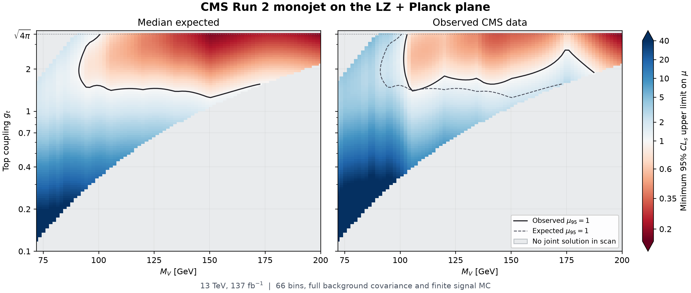
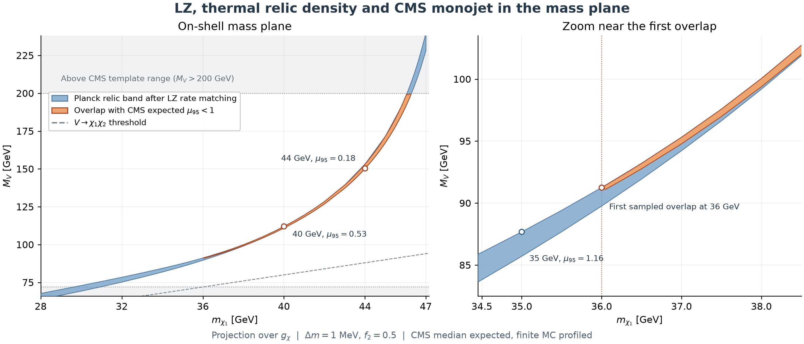
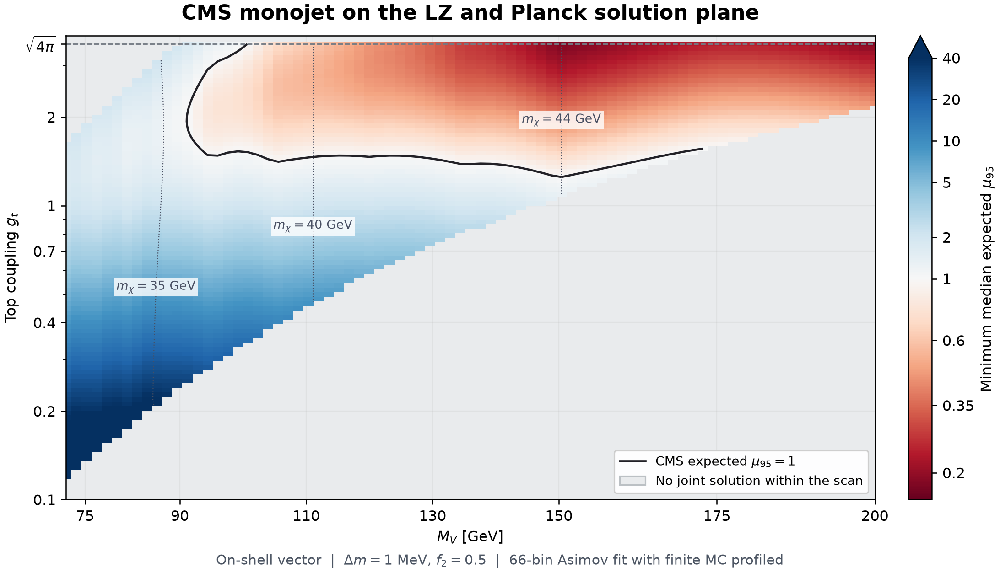
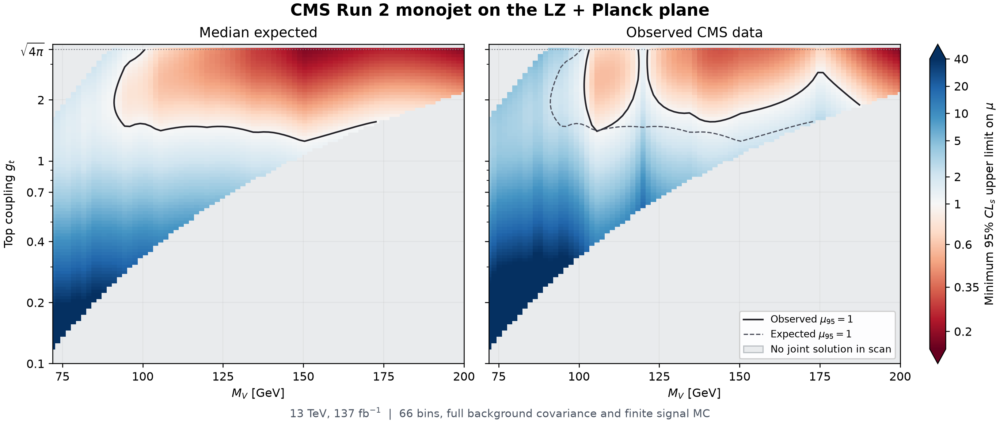
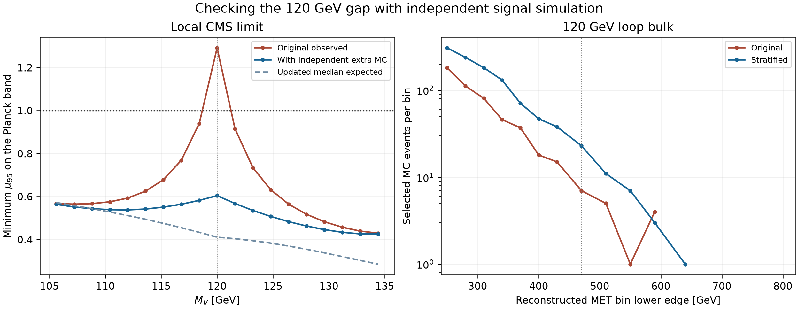
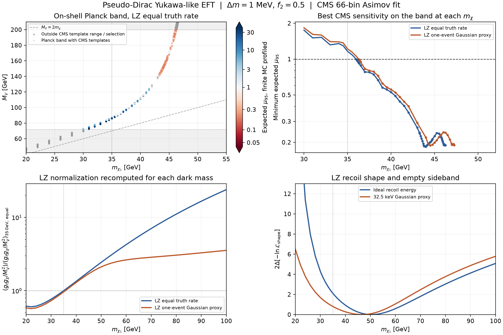

# 暗物质质量扫描中的 LZ、热遗迹丰度和 CMS Monojet

## 扫描结果

在 Yukawa-like 矢量 pseudo-Dirac EFT 中，固定 $\Delta m=1$ MeV、今日局域激发态比例 $f_2=0.5$，对每个 $m_{\chi_1}$ 重新归一化 LZ 反冲率。**当 $m_{\chi_1}$ 从 35 GeV 增加到约 36 GeV 时，Planck 丰度带开始进入现有 CMS monojet 的中位预期排除区。** 约 40–45 GeV 的质量给出更明显的重叠。

蓝色为沿 $g_\chi$ 投影的 Planck 丰度带包络，采用 $0.1176\le\Omega_\chi h^2\le0.1224$。橙色为其中至少有一个扫描 $g_\chi$ 满足 CMS 中位预期 $\mu_{95}<1$ 的部分的包络，已纳入有限模拟统计。扫描质量节点之间连接包络边界。右图放大首次重叠的位置。[主图 PDF](figures/mchi_mv_projection.pdf) · [三组固定暗质量的 $M_V$–$g_\chi$ 切片](figures/mchi_relic_cms_slices.pdf)

| $m_{\chi_1}$ [GeV] | 最灵敏丰度点的 $M_V$ [GeV] | $g_\chi$ | $g_t$ | 丰度带内最低 expected $\mu_{95}$ |
|---:|---:|---:|---:|---:|
| 35 | 87.68 | 0.180 | 1.80 | 1.163 |
| 36 | 91.25 | 0.190 | 1.96 | 0.995 |
| 38 | 100.05 | 0.220 | 2.28 | 0.744 |
| 40 | 112.11 | 0.261 | 2.73 | 0.527 |
| 42 | 128.65 | 0.309 | 3.42 | 0.356 |
| 44 | 150.43 | 0.460 | 3.54 | 0.183 |
| 45 | 167.46 | 0.608 | 3.53 | 0.225 |
| 46 | 198.04 | 0.900 | 3.54 | 0.195 |

表中为原 LZ 真值等率约定下的结果，expected $\mu_{95}$ 已剖面化有限模拟统计。最低值出现在 $m_\chi\simeq44$ GeV 附近，靠近所用的 $g_t\le\sqrt{4\pi}$ 上界。$m_\chi=40$ GeV 的代表点距耦合上界更远，仍有约两倍的信号强度余量。在 $m_\chi=40$ GeV 的当前采样中，约 $g_\chi=0.20$–$0.46$ 有丰度点进入 CMS 中位预期排除区。

| LZ 归一化 | 存在丰度点且 expected $\mu_{95}<1$ 的扫描质量节点 | 相邻两侧的检查 |
|---|---|---|
| 匹配原真值 ROI 事件率 | 36.00–46.25 GeV | 35.95 GeV 时最低 $\mu_{95}=1.005$。46.30 GeV 时丰度带已超过 $M_V=200$ GeV |
| 含高能侧带的单事件高斯近似 | 36.30–47.25 GeV | 36.25 GeV 时最低 $\mu_{95}=1.004$。47.30 GeV 时丰度带已超过 $M_V=200$ GeV |

上端由现有 CMS 信号模板的质量覆盖决定。丰度带超出 $M_V=200$ GeV 后，图上不再给出 CMS 上限。低端接近 $\mu_{95}=1$，应按约 36 GeV 解读。两种归一化在 40–45 GeV 都给出明显的中位预期灵敏度。完整模型判断还取决于实际 LZ 探测器响应、今日 $f_2$ 的演化、CMS 观测拟合和信号理论及探测器系统误差。

## $M_V$–$g_t$ 热力图

横轴为 $M_V$，纵轴为实际 $Vt\bar t$ 顶点系数 $g_t$。每格固定这两个参数，对候选 $m_\chi$ 用 LZ 真值等率关系求 $g_\chi=\kappa_{\rm LZ}(m_\chi)M_V^2/g_t$，再用 micrOMEGAs 直接求落入 Planck 区间的质量段。先前扫描在 $m_\chi\le28$ GeV、$72\le M_V\le200$ GeV 的网格最小丰度为 0.429，因此反解从 28 GeV 开始。沿用本报告的耦合、在壳和宽度筛选。

色阶是带内候选解的最低 CMS 中位预期 $\mu_{95}$，含有限模拟统计。用带端与中点的不可见分支比求最低值，并在七个有解的代表点用各 13 个带内质量复核。黑实线标记 $\mu_{95}=1$，红侧表示至少一个热遗迹解进入预期排除区。灰色表示在所扫描范围内未找到联立解。点线标出给出所画上限的 $m_\chi$。LZ 归一化在既有反冲网格之间插值，七个新增反冲谱的相对差均小于 $2.2\times10^{-5}$。

网格包含 8,181 个 $(M_V,g_t)$ 点，其中 3,589 个找到联立解。最早出现 $\mu_{95}<1$ 的 $M_V$ 网格节点为 91.2 GeV。最低 $\mu_{95}\simeq0.183$ 出现在 $M_V=150.4$ GeV、$g_t=\sqrt{4\pi}$，对应 $m_\chi\simeq44.0$ GeV、$g_\chi\simeq0.46$。最灵敏点位于所用的耦合上界。[热力图 PDF](figures/gt_mv_relic_cms_heatmap.pdf) · [逐点数据](results/gt_mv_heatmap.csv) · [数值复核](results/gt_mv/validation.log)

## 加入 CMS 数据后的 observed 95% CL 上限

两图使用同一 LZ 与 Planck 解集和相同色阶。右图实线为 observed $\mu_{95}=1$，虚线为 expected $\mu_{95}=1$。颜色继续表示对每格的丰度解所取的最低上限。取值低于 1 表示该格至少有一个热遗迹解的名义信号被对应检验排除。[比较图 PDF](figures/gt_mv_observed_cms_heatmap.pdf)

- **低质量端**从 expected 的第一个 $M_V=91.2$ GeV 网格节点移到 observed 的 $M_V=102.4$ GeV。在 102.4 GeV 节点，约 $g_t=1.86$–$3.07$ 的采样点进入 observed 排除区。
- **网格覆盖**从 1,621 个 expected 排除点变为 1,099 个 observed 排除点，分母均为 3,589 个联立解网格点。这些是网格计数。
- **最低 observed 上限**为 $\mu_{95}=0.180$，在 $M_V=200$ GeV、$g_t=\sqrt{4\pi}$，对应 $m_\chi=46.28$ GeV、$g_\chi=0.93$。该点的 expected $\mu_{95}=0.187$，并位于质量和耦合的扫描边界。

| 原 35 GeV 基准 | Expected $\mu_{95}$，含有限 MC | Observed $\mu_{95}$，固定模板 | Observed $\mu_{95}$，含有限 MC |
|---|---:|---:|---:|
| A | 1.196 | 1.667 | 3.277 |
| B | 1.868 | 2.552 | 5.516 |
| C | 20.33 | 29.56 | 46.05 |

原始 observed 轮廓对有限 MC 下的谱形变化敏感。以 $M_V=120$ GeV 为例，对该质量最灵敏的丰度解，expected $\mu_{95}\simeq0.43$，observed 含有限 MC 后约为 1.29。固定模板时同一解的 observed 值约为 0.51。下节拆分了该处缺口。

### 数据与统计实现

- 直接读取 CMS EXO-20-004 公开表 15 中 2016、2017、2018 各 22 个 monojet 信号区计数，以及控制区纯背景拟合给出的 $b_i$。逐项核对了 66 个观测计数和背景均值，以及表 14 的 4,356 个协方差条目。拟合使用逐 bin 计数，总计 1,212,846 个观测事件。[CMS EXO-20-004](https://cms-results.web.cern.ch/cms-results/public-results/publications/EXO-20-004/) · [HEPData 表 15](https://doi.org/10.17182/hepdata.106115.v2/t15) · [HEPData 表 14](https://doi.org/10.17182/hepdata.106115.v2/t14)
- 以相同 66-bin 信号模板和背景协方差，在每个信号强度对背景与有限 MC 扰动剖面化，要求每 bin 的信号预测非负、总泊松均值为正。用实测数据求 $\hat\mu\ge0$ 及单边 $\tilde q_\mu$，以 $\mu=0$ 的观测拟合生成条件背景 Asimov，采用渐近公式求 $CL_s=0.05$。左图 expected 仍用原控制区背景均值作为纯背景 Asimov。信号非负条件对这套 expected 上限的复算无数值影响。[渐近检验公式](https://arxiv.org/abs/1007.1727) · [CMS 简化似然](https://cds.cern.ch/record/2242860)
- 独立约束优化器复核了 5 个质量下的 $\hat\mu$ 和上限位置，剖面偏差量绝对差小于 $9\times10^{-12}$。另用 CMS 公开的 ADD $(d,M_D)=(2,10\,\mathrm{TeV})$ monojet 模板检查输入和拟合，得到固定模板 expected 0.418、observed 0.793。这里给出的是 monojet-only 复分析。仍沿用公开近似选区、现有快模拟和在壳信号模板。[CMS ADD 信号模板](https://doi.org/10.17182/hepdata.106115.v2/t3)

逐格 [observed 与 expected 上限](results/gt_mv_observed_heatmap.csv) · [66 个观测与背景计数](results/cms_monojet_observed_bins.csv) · [参考模板拟合](results/cms_observed_reference_limits.csv) · [独立优化器复核](results/observed_inputs/independent_fit_checks.csv) · [统计代码](scripts/observed_fit.py)

## $M_V=120$ GeV 缺口的来源

在同一 LZ＋Planck 代表点 $(M_V,g_t,m_\chi)\simeq(120\ \mathrm{GeV},3.07,41.20\ \mathrm{GeV})$，固定 CMS 观测数据和名义信号谱，分别剖面化不同来源的信号不确定度。

| 剖面化的信号不确定度 | Expected $\mu_{95}$ | Observed $\mu_{95}$ |
|---|---:|---:|
| 固定信号模板 | 0.409 | 0.511 |
| 仅截面积分误差 | 0.409 | 0.511 |
| 仅各样本有限统计产生的谱形误差 | 0.432 | 1.291 |
| 仅主圈图样本的误差 | 0.431 | 1.204 |
| 除主圈图样本外的有限 MC 误差 | 0.409 | 0.515 |
| 全部原有限 MC 误差 | 0.432 | 1.292 |

原主圈图样本以生成级 $p_T^j=100$ GeV 起始并在 480 GeV 处与硬尾部拼接。3,600 个生成事件中，507 个通过重建选区，其中 17 个落在重建 MET 470–690 GeV，且在更高重建 MET 中为零。单个主圈图事件的截面权重约为硬尾部事件的 72 倍，因而这 17 个事件能显著影响统计误差。该样本提供约 91% 的名义信号，并占 observed 上限处数据打分方向中信号 MC 方差的约 96%。在固定原中心谱的情况下，把它所在节点的全谱形协方差统一减半，observed 上限降至 0.674。用 105 和 135 GeV 模板插值得到的协方差替换原协方差、仍保留 120 GeV 中心谱，上限为 0.681。两个测试用于拆分效应。

把三年中 MET 为 470–690 GeV 的观测计数换成原背景剖面拟合值，保留全协方差和其余实测计数，observed 上限降至 0.724。单独替换 2018 年计数得到 0.777。这是诊断数据残差和谱形误差耦合的反事实测试。质量插值时独立节点协方差按权重的平方相加，120 GeV 正好采用原节点的完整协方差，放大了它与邻点的差异。

### 独立补样本和轮廓更新

| $120$ GeV 主圈图模板 | 通过重建选区的事件 | MET $\ge470$ GeV 的事件 | Expected $\mu_{95}$ | Observed $\mu_{95}$ |
|---|---:|---:|---:|---:|
| 原样本 | 507 | 17 | 0.432 | 1.292 |
| 独立生成 10,800 个事件，沿用原切选和拼接 | 1,572 | 58 | 0.412 | 0.668 |
| 原样本与上述样本合并 | 2,079 | 75 | 0.443 | 0.704 |
| 原样本保留 $100\le p_T^j<230$ GeV，独立加密 $230\le p_T^j<480$ GeV | 1,060 | 45 | 0.410 | 0.604 |

用独立的分层样本降低高权重区域的误差后，120 GeV 缺口闭合。仅换成新协方差并保留旧中心谱，observed $\mu_{95}=0.690$。仅换中心谱并保留旧协方差，得到 0.779。两个因素都参与了原尖峰，独立补样本的两种处理都恢复了 120 GeV 的 observed 灵敏度。

更新的完整图采用分层模板。加密样本独立生成了 1,800 个事件，使用其自身截面归一化，重建后保留其中位于生成级 $230\le p_T^j<480$ GeV 的 922 个事件。生成级 $p_T^j\ge480$ GeV 的原硬圈图模板和树图分量延用原结果。只替换 120 GeV 质量节点，并重算相邻 105–135 GeV 的模板插值，沿用相同 CMS 数据与统计模型。observed 排除网格点由 1,099 增至 1,173，低质量起点仍为 102.4 GeV。

[诊断图 PDF](figures/observed_gap120_diagnosis.pdf) · [更新后的完整热力图](figures/gt_mv_observed_cms_highstat120.pdf) · [更新后的逐格上限](results/gap120/gt_mv_observed_highstat.csv) · [独立样本比较](results/gap120/replica_comparison.csv)

[逐项拟合](results/gap120/fit_variants.csv) · [逐 bin 残差与信号漂移](results/gap120/bin_diagnostics.csv) · [数据替换测试](results/gap120/neutralized_data.csv) · [主圈图和硬尾部计数](results/gap120/channel_counts.csv)

## 为什么丰度带会移动

增大 $m_\chi$ 会抬高共湮灭阈值 $m_{\chi_1}+m_{\chi_2}$。在固定 $\Delta m$ 下，氙反冲的低速中心 $\Delta m\,m_\chi/(m_\chi+m_A)$ 也移向更高能量，真值 ROI 逐渐截去更多信号谱。为维持 LZ 事件率，$g_tg_\chi/M_V^2$ 在 $m_\chi=40$ 和 $44$ GeV 分别增至 35 GeV 基准的约 1.34 和 1.71 倍。在当前上分支，正确丰度要求更大的 $M_V$，让共湮灭离极点更远。与此同时，CMS 的信号因子 $g_t^2\operatorname{BR}(V\to\chi_1\chi_2)$ 也随重新归一化而改变。图中的相交来自逐点重算这两部分。[诊断图 PDF](figures/mchi_relic_cms_scan.pdf)

## 扫描定义与核对

- **LZ。** 使用原 CalcHEP 项目的九种天然氙同位素反冲程序，保持 $\rho_\chi=0.3\ \mathrm{GeV/cm^3}$、$v_0=238$、$v_E=254$、$v_{\rm esc}=544\ \mathrm{km/s}$。主结果逐质量重取 $\kappa=g_tg_\chi/M_V^2$，使 5.4–269.9 keV 真值 ROI 在 2.84 tonne yr 中的事件数等于旧基准的 1.12044。媒介子在反冲中采用接触极限缩放，保留以 $M_V=100$ GeV 实算的归一化。35 GeV 点复现原 $\kappa$ 至 $10^{-4}$ 相对精度以内。第二种归一化用 $\sigma_E=32.5$ keV 的恒定高斯近似，令 ROI 加 350–675 keV 侧带的预期总数等于 1。谱形诊断使用 248 keV 的单候选事件和空侧带，置信度未做覆盖率校准。[原论文式 (23)](https://arxiv.org/html/2609.26570v1#S2) · [先前 LZ 谱形分析](../pseudoDirac_LZfit_20261021/REPORT.md)
- **热遗迹丰度。** 暗质量粗扫 20–100 GeV，共 61 个质量节点及 58 个 $g_\chi$ 节点，交界处质量步长加密至 0.05 GeV。范围为 $0.10\le g_\chi\le1.50$、$g_t\le\sqrt{4\pi}$，沿在壳阈值上方扫描到 240 GeV 或微扰上限。用 micrOMEGAs 7.1.4 的 darkOmega、fast=0、Beps=$10^{-9}$ 直接计算 $\Omega_\chi h^2$，精化 0.1176、0.1200、0.1224 三条等值线。采用全量暗物质和标准热冻结。已有的离壳共湮灭支与轻媒介子 $VV$ 支位于本次在壳问题之外。[Planck 2018，式 (23)](https://arxiv.org/pdf/1807.06209) · [原热遗迹分支](../pseudoDirac_yukawaLZ_20261020/REPORT.md)
- **CMS。** 在窄宽度近似下，$V+j$ 产生后两个不可见暗态的总四动量等于母粒子四动量。复用同一 $M_V$ 的树图与圈图重建模板，重新计算 $\Gamma(V\to\chi_1\chi_2)/\Gamma_V$ 和信号产额。要求 $\Gamma_V/M_V<0.03$、$M_V-(m_{\chi_1}+m_{\chi_2})\ge5\Gamma_V$、$72\le M_V\le200$ GeV。保持 13 TeV、137 $\mathrm{fb}^{-1}$、66 bin 的 CMS 背景 Asimov 泊松似然。对各质量的最灵敏点和 $\mu_{95}\simeq1$ 附近点直接复算 66-bin 上限，插值结果与直接计算相差小于 0.2%。35 GeV 时复现原带内最小 $\mu_{95}=1.163$。[原 CMS 似然与模拟](../monojet_expected_lz_scan_20261106/REPORT.md)

## 数据

- 真值等率归一化的 [逐质量汇总](results/equal_rate_mass_summary.csv) 和 [丰度带逐点 CMS 上限](results/equal_rate_band_cms.csv)。
- 高斯响应近似的 [逐质量汇总](results/gaussian_profile_mass_summary.csv) 和 [丰度带逐点 CMS 上限](results/gaussian_profile_band_cms.csv)。
- [主图投影边界](results/mass_plane_projection.csv) 和 [投影绘图脚本](scripts/plot_mass_plane.py)。
- [热遗迹扫描](scripts/scan.py)、[micrOMEGAs 入口](scripts/mass_relic.c) 和 [CMS 复算与绘图](scripts/assess.py)。
