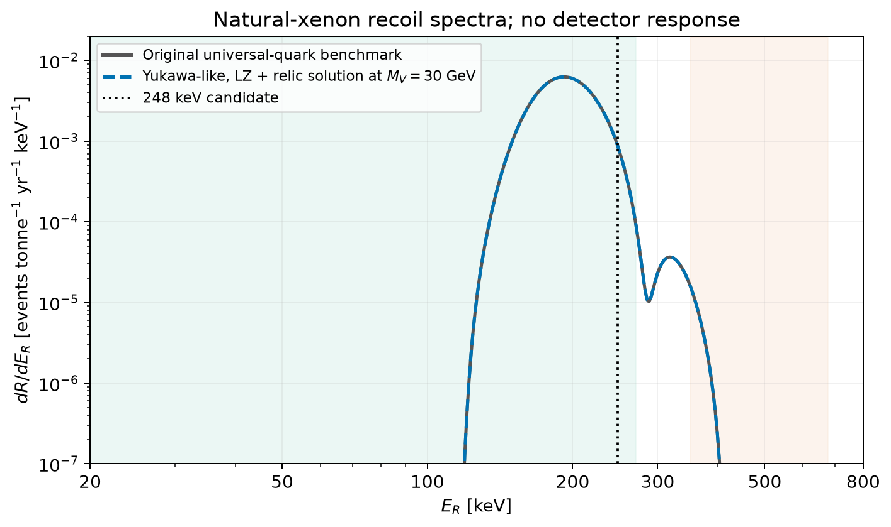
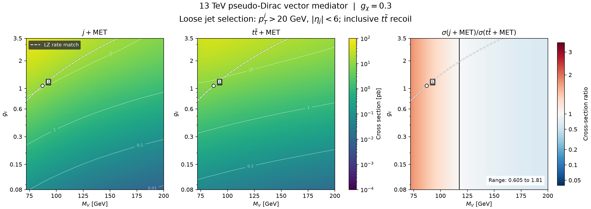
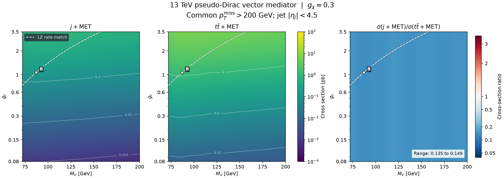
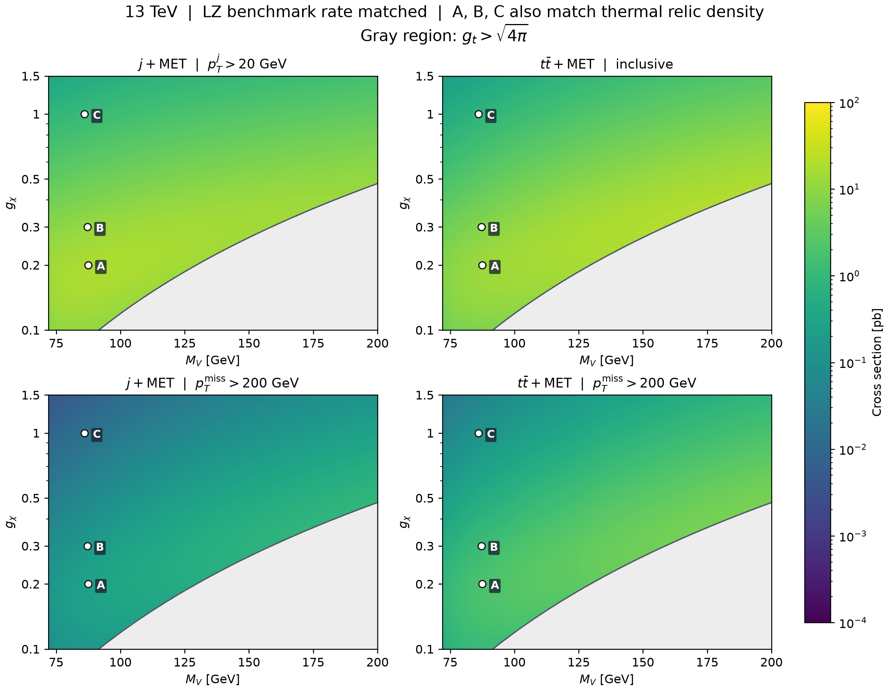
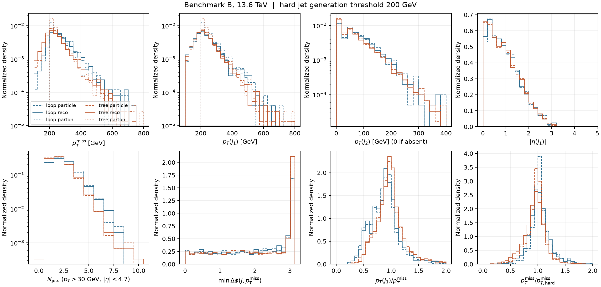
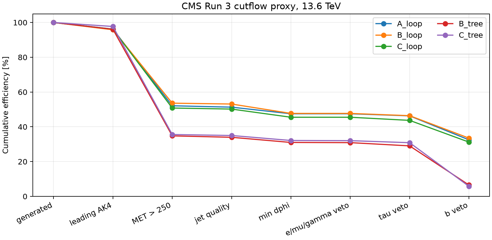
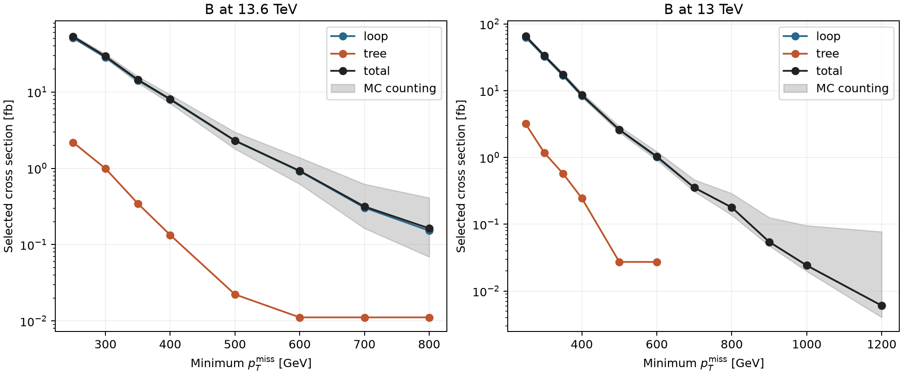
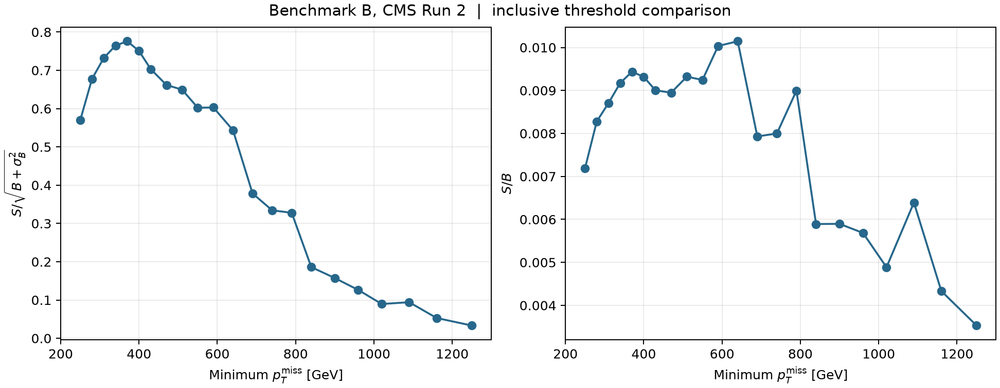

# Pseudo-Dirac 暗物质的 Monojet 分析报告

**13 与 13.6 TeV｜Yukawa-like 纯矢量媒介子｜结果整理至 2026-11-06**

## 摘要

- **圈图决定硬 monojet 的信号大小。** 13.6 TeV 的 B 点在硬过程 $p_T^j>200$ GeV 后，树级为 **33.47 fb**，$gg$ 圈图为 **152.54 fb**，合计 **186.01 fb**。采用 CMS Run 3 近似切选后，合计 **53.29 fb**，其中 **95.9%** 来自圈图。
- **喷注门槛改变了与 $t\bar t+\mathrm{MET}$ 的截面排序。** 13 TeV 的 B 点按 $p_T^j>20$ GeV 的宽选择直接计算得到 **11.36 pb**，超过无 MET 切选的 $t\bar t+\mathrm{MET}$ 的 **7.79 pb**。两通道共同要求 MET $>200$ GeV 后，截面约为 **0.165 pb** 和 **1.19 pb**。宽选择的喷注信号主要来自含 b 夸克的树级过程。
- **CMS Run 2 的 66-bin 试算给出 B 点中位预期上限 $\mu_{95}=1.74$。** 保留全部分箱和背景协方差后，预期上限低于把 MET $>370$ GeV 合成单区得到的 2.53。$\mu=1$ 对应 B 点的名义预测。试算固定信号模板，观测上限和信号系统误差留待验证阶段处理。

## 1. 模型与 LZ 基准点

暗扇区为两态 pseudo-Dirac 暗物质。固定 $m_{\chi_1}=35$ GeV、$m_{\chi_2}=35.001$ GeV。夸克与自旋 1 媒介子 $V$ 的相互作用为纯矢量流，味依赖按参考质量设置。

$$
g_{Vq}=g_t\frac{\widehat m_q}{172\ \mathrm{GeV}},
\qquad
(\widehat m_u,\widehat m_d,\widehat m_s,\widehat m_c,\widehat m_b,\widehat m_t)
=(0.0022,0.0047,0.096,1.27,4.18,172)\ \mathrm{GeV}.
$$

$g_t$ 是实际的 $Vt\bar t$ 顶点系数。暗顶点 $V\chi_1\chi_2$ 的大小为 $g_\chi/2$。参考质量用于定义耦合比例。相空间和圈图中的夸克质量由各自参数卡指定。本次采用有效模型中的 $V,\chi_1,\chi_2$。

### 1.1 LZ 事件率怎样决定耦合

树级氙核响应来自轻夸克矢量荷，$f_p=2g_{Vu}+g_{Vd}$，$f_n=g_{Vu}+2g_{Vd}$。对氙同位素 $A$，相干核荷为 $Q_A=Zf_p+(A-Z)f_n$。将天体和反冲谱形输入固定后，相关因子为

$$
\frac{dR_A}{dE_R}\ \propto\
\frac{f_2\rho_\chi}{m_\chi}\,
\frac{(g_\chi/2)^2 Q_A^2}{(M_V^2+2m_A E_R)^2}\,
F_A^2(q)\,\eta(v_{\min}).
$$

本扫描取今日局域激发态比例 $f_2=0.5$、$\rho_\chi=0.3\ \mathrm{GeV/cm^3}$ 和 $2.84\ \mathrm{tonne\,yr}$ 曝光。以原论文基准重算真值级 ROI 事件数，得到 $N_{\rm ROI}^{\rm truth}=1.12044$。要求新耦合纹理给出相同事件数后，得到

$$
g_tg_\chi\simeq
0.0380063\left(\frac{M_V}{30\ \mathrm{GeV}}\right)^2
\sqrt{\frac{0.5}{f_2}}.
$$

因此 LZ 等率线固定的是 $\sqrt{f_2}\,g_tg_\chi/M_V^2$ 的大小。$f_2$ 是输入假设，等率线沿用树级核子匹配。这条线用于构造基准，置信区间需由探测器响应和统计模型另行计算。[原 pseudo-Dirac 论文](https://arxiv.org/html/2609.26570v1) · [项目 LZ 与热遗迹扫描](evidence/lz_relic_method.md)

**图 1.** 纵轴沿用原报告的反冲率单位。图中对比原基准与一个 $M_V=30$ GeV 的等率解，用于展示归一化方法。

### 1.2 A、B、C 如何选取

先取三个代表性的 $g_\chi$，然后沿 LZ 等率线扫描 $M_V$，用 micrOMEGAs 7.1.4 求出 $\Omega_\chi h^2\simeq0.12$ 的解。以下三点均位于 $M_V>m_{\chi_1}+m_{\chi_2}=70.001$ GeV 的在壳分支。

| 点 | $M_V$ [GeV] | $g_t$ | $g_\chi$ | $\Gamma_V$ [GeV] | $\mathrm{BR}(V\to\chi_1\chi_2)$ |
|---|---:|---:|---:|---:|---:|
| A | 87.530 | 1.61770 | 0.20 | 0.03016 | 0.60994 |
| B | 87.183 | 1.06994 | 0.30 | 0.04614 | 0.88890 |
| C | 86.048 | 0.31268 | 1.00 | 0.44209 | 0.99902 |

B 点的 $g_tg_\chi\simeq0.321$，所以 $g_t\simeq1.07$。A 点较大的 $g_t^2$ 生产因子超过其较低不可见分支比带来的损失，因而三点中 A 的圈图截面最大。另一次仅拟合 LZ 归一化的简化计算，在 B 点的质量和 $g_\chi$ 下给出 $g_t=1.010$ 或 $1.028$，分别对应理想响应和示例高斯展宽。下文 collider 样本统一使用表中原 LZ＋relic 联立点。[基准点原始数表](data/lz_mass_roots.csv) · [LZ 条件拟合数表](data/lz_normalization_fits.csv)

## 2. 硬过程与 UFO 验证

### 2.1 树级与圈图各算什么

| 贡献 | 硬过程 | 处理 |
|---|---|---|
| 喷注树级 | $qg\to q\chi_1\chi_2$、$q\bar q\to g\chi_1\chi_2$ 及共轭过程 | 直接生成暗粒子末态用于基准比较和快模拟 |
| 喷注圈图 | $gg\to gV$ | 计算含夸克质量依赖的圈图产生率，再乘 $\mathrm{BR}(V\to\chi_1\chi_2)$ |
| 顶夸克对伴随产生 | $pp\to t\bar t\chi_1\chi_2$ | 树级直接生成，顶夸克稳定。质量扫描使用在壳 $t\bar tV$ 乘分支比 |

树级喷注定义包含 $g,u,d,s,c,b$ 及反夸克。树图和本次 $gg$ 圈图有不同的初态，因此在所用精度下可直接相加。这个和涵盖两类产生机制的领先贡献。纯矢量流的闭合夸克圈 $ggV$ 三角振幅抵消，额外发射一条胶子后 $gg\to gV$ 可以产生非零振幅。[关于矢量三角抵消与箱图的讨论](https://arxiv.org/html/1801.03505#S4)

### 2.2 圈图 UFO 的修正

组员上传的 UFO 继承了 `loop_sm` 的 QCD UV 与 $R_2$ 条目。对照其 $ggg\gamma$ 矢量顶点，在独立副本中为六种夸克各加入一个 $gggV$ 的 $R_2$ 有理项，系数为 $i g_{Vq}g_s^3/(48\pi^2)$，颜色结构为 $d^{abc}$。修正的验证范围是本报告的闭合夸克圈过程。

| B 点胶子 Ward/BRS 测试，$\sqrt{\hat s}=1$ TeV | BRS/matrix | 判定 |
|---|---:|---|
| 上传原件 | $4.41\times10^4$ | 未通过 |
| 加入 $R_2$ 的独立副本 | $6.27\times10^{-24}$ | 通过 |

使用 MadGraph5_aMC@NLO 3.6.6 和 `nn23lo1`。圈图命令为 `generate g g > Vb g PDB=1 QED=0 [noborn=QCD]`。在壳 $V$ 产生后，暗粒子对的真值级横动量等于 $p_T(V)$。单部分子反冲时有 $p_T^{\rm miss}=p_T(V)=p_T^j$。[UFO 审核详情](evidence/ufo_audit.md) · [修正 UFO](evidence/loop_ufo_R2fix.tar.gz) · [Ward 检查与积分归档](evidence/loop_runs.tar.gz)

## 3. 真值级截面

### 3.1 13.6 TeV 基准点

下表采用 $p_T^j>200$ GeV、$|\eta_j|<4.5$，均为硬过程截面。圈图信号已乘不可见分支比，所列误差为 MadGraph 积分误差。

| 点 | $\sigma(gg\to Vg)$ [fb] | 圈图信号 [fb] | 树图信号 [fb] | 合计 [fb] |
|---|---:|---:|---:|---:|
| A | $393.51\pm2.47$ | $240.02\pm1.51$ | — | — |
| B | $171.60\pm1.27$ | $152.54\pm1.13$ | 33.47 | 186.01 |
| C | $14.575\pm0.091$ | $14.560\pm0.090$ | 3.252 | 17.813 |

A 在 13.6 TeV 这批样本中只生成了圈图。B 点圈图约为树级的 4.56 倍，树圈相加后约为树级的 5.56 倍。只保留顶夸克生产耦合、沿用 B 的物理分支比时，圈图为 $145.15\pm1.36$ fb，说明顶圈主导。完整六味振幅含味间干涉。13 TeV 的 B 点同样硬选择下，圈图为 $135.15\pm0.73$ fb。[圈图数表](data/loop_cross_sections.csv) · [树级各通道数表](data/tree_cross_sections.csv)

### 3.2 13 TeV 宽选择与共同 MET 选择

| B 点，部分子级 [pb] | 宽喷注选择 $p_T^j>20$ GeV，$\lvert\eta_j\rvert<6$ | 共同 MET $>200$ GeV |
|---|---:|---:|
| $j+\mathrm{MET}$ 树图 | 10.77 | 0.030 |
| $j+\mathrm{MET}$ 圈图 | 0.587 | 0.135 |
| **$j+\mathrm{MET}$ 合计** | **11.36** | **0.165** |
| $t\bar t+\mathrm{MET}$ | 7.79，无 MET 切选 | 1.19 |

硬选择对喷注另要求 $|\eta_j|<4.5$。宽选择中约 76% 的树级事件以 $b$ 或 $\bar b$ 为硬喷注。把硬过程门槛提到 200 GeV 后，树级部分降幅远大于圈图。13.6 TeV 的直接生成 $t\bar t+\mathrm{MET}$ 总截面在 A、B、C 分别为 13.77、8.84、0.856 pb，共同要求真值 MET $>200$ GeV 后为 2.13、1.55、0.126 pb。[宽选择对照的运行卡与事件计数](evidence/loose_cut_check.tar.gz) · [顶夸克伴随产生数据](data/tree_cross_sections.csv)

### 3.3 质量与耦合扫描

在 13 TeV 直接积分 $M_V=72$、76、82、87.183、95、105、120、135、150、175、200 GeV，共 55 份运行结果。宽、硬两套喷注树级及圈图截面分别直接积分。$t\bar tV$ 的硬切选接受率由生成事件估算。每个质量点先计算 $g_t=1$ 的在壳产生率，再通过

$$
\sigma_X(M_V,g_t,g_\chi)
=\sigma_X^{\rm prod}(M_V,g_t=1)\,g_t^2\,
\mathrm{BR}(V\to\chi_1\chi_2)
$$

展开耦合依赖，质量节点之间对截面作对数线性插值。在此近似下，两通道的比值在固定质量时消去共同的 $g_t^2\mathrm{BR}$。主图固定 $g_\chi=0.30$ 并扫描 $g_t=0.08$–$3.5$。LZ 切片改用 $g_\chi$ 为纵轴，并沿等率关系求 $g_t$。

**图 2.** 黑线为两通道等截面，交点约在 $M_V=118$ GeV。更低的质量一侧，宽喷注选择下的 $j+\mathrm{MET}$ 更大。白虚线为固定 $g_\chi$ 时的 LZ 等率线。

**图 3.** 共同要求 MET $>200$ GeV 后，整个扫描内 $\sigma(j+\mathrm{MET})/\sigma(t\bar t+\mathrm{MET})=0.135$–$0.149$。B 点为 0.166 对 1.23 pb，与直接生成的 0.165 对 1.19 pb 一致到本次统计与方法精度。

**图 4.** 灰色区域对应 $g_t>\sqrt{4\pi}$。A、B、C 同时满足本项目设定下的热遗迹丰度条件，其余彩色像素仅施加 LZ 等率条件。A、C 的截面使用相邻质量节点插值，B 是直接计算节点。低于 70.001 GeV 的暗粒子对信号需要离壳计算。现有 13.6 TeV 树级结果在 $M_V=30$、62.263 GeV 两个代表点分别为 $2.28\times10^{-4}$、$9.43\times10^{-3}$ fb，均用硬喷注选择，离壳圈图仍待补充。[宽选择 PDF](figures/truth_loose.pdf) · [硬选择 PDF](figures/truth_met200.pdf) · [LZ 切片 PDF](figures/truth_lz_slice.pdf) · [扫描积分数表](data/madgraph_integrals.csv) · [A、B、C 数表](data/benchmark_cross_sections.csv)

## 4. 两组外部对照怎样比较

### 4.1 导师给的 top-philic $Z'$ 图

Cox 等人图 2 的两条 13 TeV 曲线是 $Z'+j$ 与 $t\bar t Z'$ 的媒介子产生率。其 $Z'$ 耦合右手顶夸克，$g_t=0.5$，动能混合取零。喷注使用 $p_T^j>20$ GeV、$|\eta_j|<6$，$Z'+j$ 算至领先一圈，$t\bar t Z'$ 算至 NLO。右手耦合同时含矢量和轴矢量项。轴矢量部分可以经 $Z'gg$ 三角顶点贡献 $qg$、$q\bar q$ 圈图。后续研究显示，这些贡献对异常消除和重伴随费米子的处理敏感。我们的纯矢量模型也在宽喷注选择下得到类似排序，但大截面来自含 b 喷注的树级过程。[Cox 等，图 2 与 §3.1](https://arxiv.org/pdf/1512.00471#page=6) · [Fox、Low、Zhang，§4](https://arxiv.org/html/1801.03505#S4)

### 4.2 组员截图的 15.68 pb

截图所列 SM 参数与 `loop_sm` 的默认限制卡一致。`YUKAWA 6` 是 SM Higgs 顶 Yukawa 的质量输入。我们的 $Vt\bar t$ 系数由 `FLAVCOUP 6` 控制。用同一台 MadGraph、13 TeV 和 `nn23lo1` 计算的对照如下。

| 对照过程 | 硬过程喷注门槛 | 截面 [pb] |
|---|---|---:|
| SM $gg\to h$ | 包容 Higgs 产生 | $15.735\pm0.071$ |
| SM $gg\to hg$ | $p_T^j>20$ GeV、$\lvert\eta_j\rvert<4.5$ | $10.199\pm0.075$ |
| B 点 $gg\to Vg$，乘暗衰变分支比 | 同上 | $0.590\pm0.003$ |

截图的 15.68 pb 与包容 Higgs 对照数值相容。对应过程仍需组员原始 MadGraph banner 的 `generate` 命令确认。[三个对照的 banner 与运行日志](evidence/sm_controls.tar.gz)

## 5. 运动学和切选效率

### 5.1 快模拟与运动学

共处理 9 份样本、34,000 个事件。生成后使用 Pythia 8.312（Monash）和 Delphes 3.5.0。CMS 卡的 AK4 喷注采用 anti-$k_T$、$R=0.4$。圈图用稳定、不可见的 $V$ 保留暗粒子对总四动量，树级保留两个暗粒子。逐事件检查了文件对齐、不可见粒子身份和硬过程横向平衡。内嵌 LHE 与原 LHE 的暗系统 $p_T$ 最大差为 $4.8\times10^{-5}$ GeV。

| B 点，13.6 TeV | 圈图 | 树级 |
|---|---:|---:|
| 硬过程 MET 中位数 [GeV] | 245.8 | 233.3 |
| shower 后粒子级 MET 中位数 [GeV] | 261.5 | 231.6 |
| 快模拟重建 MET 中位数 [GeV] | 258.2 | 225.5 |
| 重建 MET 第 90 百分位 [GeV] | 386.2 | 332.9 |
| 重建有至少两条喷注的比例 | 76.6% | 69.1% |

最后一行采用 $p_T^j>30$ GeV、$|\eta_j|<4.7$。shower 产生额外喷注，也使 $p_T(j_1)/p_T^{\rm miss}$ 和 $\min\Delta\phi(j,\mathrm{MET})$ 形成分布。

**图 5.** 同样的 $p_T^j>200$ GeV 生成门槛下比较硬过程、shower 后粒子级和快模拟重建。各曲线分别按各自样本归一化。[运动学统计表](data/kinematics.csv)

### 5.2 CMS Run 3 近似切选

CMS-PAS-NPS-25-008 使用 13.6 TeV 的 62 $\mathrm{fb}^{-1}$ 数据。本报告近似其主要切选，采用重建 MET $>250$ GeV、领先 AK4 喷注 $p_T>100$ GeV 且 $|\eta|<2.5$。取最多四条 $p_T>30$ GeV 的领先喷注并要求 $\min\Delta\phi(j,\mathrm{MET})>0.5$，同时应用领先喷注能量分数代理及 $e/\mu/\gamma$、$\tau$ 和 b 否决。b 工作点以 b 味 85% 和其他味 10% 近似，标签喷注的 $p_T>20$ GeV、$|\eta|<2.4$ 沿用 Run 2。[CMS Run 3 选区，§4](https://inspirehep.net/files/2ea92142316796b1c1e8b3079a0972b1#page=7)

| B 点切选步骤 | 圈图通过数 | 树级通过数 |
|---|---:|---:|
| 生成样本 | 1,000 | 3,000 |
| 领先 AK4 | 958 | 2,883 |
| MET $>250$ GeV | 536 | 1,044 |
| 喷注质量代理 | 531 | 1,019 |
| $\min\Delta\phi$ | 477 | 930 |
| $e/\mu/\gamma$ 否决 | 477 | 927 |
| $\tau$ 否决 | 464 | 871 |
| b 否决 | 335 | 196 |

B 点 13.6 TeV 树级硬喷注约 83% 是 b 或反 b，最后的 b 否决对树级和圈图分别保留 22.5% 和 72.2%。改用默认 Delphes b 标签参数，B 点总选后截面变为 66.24 fb，较名义近似的 53.29 fb 高约 24%，表明结果对标签工作点建模敏感。

| 样本，13.6 TeV | 累计效率 | 选后截面 [fb] |
|---|---:|---:|
| A 圈图 | 32.50% | 78.01 |
| B 圈图 | 33.50% | 51.10 |
| B 树级 | 6.53% | 2.19 |
| C 圈图 | 31.20% | 4.54 |
| C 树级 | 5.77% | 0.19 |

**图 6.** 累计效率以各自生成样本为分母。选后截面为 $\sigma_{\rm gen}\sum_{\rm pass}w_i/\sum_{\rm gen}w_i$。B 点合计 $53.29$ fb 的事件统计区间约为 $[51.03,55.59]$ fb，另有生成积分误差。[完整 cutflow](data/cutflow.csv) · [b 标签工作点对照](data/b_tag_variation_run3.csv)

## 6. MET 门槛与 CMS Run 2 背景

### 6.1 截面随重建 MET 门槛变化

| 重建 MET 下限 [GeV] | B，13 TeV [fb] | B，13.6 TeV [fb] | C，13.6 TeV [fb] |
|---|---:|---:|---:|
| 250 | 66.20 | 53.29 | 4.730 |
| 300 | 33.59 | 29.37 | 2.652 |
| 400 | 8.64 | 8.07 | 0.818 |
| 500 | 2.61 | 2.31 | 0.257 |
| 600 | 1.04 | 0.93 | 0.045 |

13 TeV 列采用 CMS Run 2 公开 MadAnalysis5 公共 cuts，逐年 HEM 否决在下一节的产额比较中应用。13.6 TeV 列采用 Run 3 近似 cuts，并以生成级 $p_T^j>200$ GeV 为条件。两列的能量、生成门槛和实验选择均不同。

13 TeV B 点增加了 $p_T^j>100$ GeV 的 6,000 个圈图和 15,000 个树级事件，以及 $p_T^j>480$ GeV 的 3,000 个圈图尾部事件。圈图样本按生成级 $p_T^j=480$ GeV 分区拼接，每个区域沿用其自身截面权重。重建 MET $>250$ GeV 的最终事件中，有 **11.7% 的圈图**和 **12.8% 的树级**来自生成级 $p_T^j<200$ GeV。13.6 TeV 数值仍保留该生成门槛造成的条件依赖。[门槛扫描](data/combined_thresholds.csv) · [迁移统计](data/migration.csv)

**图 7.** 误差带表示有限样本事件统计。尾部的空 bin 只表示这批样本中没有通过事件。

### 6.2 CMS Run 2 选区比较

对 CMS EXO-20-004 的 137 $\mathrm{fb}^{-1}$，使用其公开 MadAnalysis5 近似实现，将 B 点信号分为 2016、2017、2018 各 22 个 MET bin，2018 年应用公开实现中的 HEM 否决。背景均值、观测计数与协方差来自 CMS 公共数据。对每个单独使用的 inclusive 门槛，按

$$
\frac{S}{\sqrt{B+\sigma_B^2}},
\qquad
\sigma_B^2=\sum_{i,j\ \mathrm{in\ selection}}C_{ij}
$$

排序。相邻门槛的事件集合重叠，表中每行对应单独使用一个门槛的估计。[CMS EXO-20-004](https://cms-results.web.cern.ch/cms-results/public-results/publications/EXO-20-004/) · [公开 MadAnalysis5 实现](https://doi.org/10.14428/DVN/IRF7ZL) · [HEPData 背景及协方差](https://doi.org/10.17182/hepdata.106115.v2)

| 重建 MET 下限 [GeV] | B 点预期信号 $S$ | 背景 $B$ | $\sigma_B$ | $S/B$ | 排序指标 |
|---|---:|---:|---:|---:|---:|
| 250 | 8,389 | 1,166,878 | 14,676 | 0.72% | 0.57 |
| 340 | 2,450 | 267,073 | 3,163 | 0.92% | 0.76 |
| 370 | 1,663 | 176,263 | 2,102 | 0.94% | 0.78 |
| 400 | 1,121 | 120,296 | 1,452 | 0.93% | 0.75 |
| 470 | 483 | 54,016 | 692 | 0.89% | 0.66 |

**图 8.** 370 GeV 为这次扫描的最高点，340–400 GeV 的排序指标差异小于当前模拟和建模精度。这里比较的是信号对公开背景的单门槛表现。[66 个分箱数据](data/cms_run2_bin_yields.csv) · [门槛排序完整数据](data/cms_run2_cut_ranking.csv)

### 6.3 CMS Run 2 的 66-bin 泊松似然试算

沿用上节的 13 TeV B 点模板。逐项核对了 66 个观测计数、66 个背景均值及 $66\times66$ 个协方差条目。CMS 为简化似然提供的背景和协方差来自对应控制区的纯背景拟合，信号区观测计数可作为独立输入。此次使用背景协方差矩阵 $C$ 的完整年份间和分箱间相关性。[CMS HEPData 表 14](https://doi.org/10.17182/hepdata.106115.v2/t14) · [表 15](https://doi.org/10.17182/hepdata.106115.v2/t15)

令 $\mu=1$ 对应 B 点树图加圈图的名义信号产额 $s_i$，$b_i$ 为背景均值。对背景偏移 $\boldsymbol\theta$ 使用协方差约束，并在每个 $\mu$ 下对 $\boldsymbol\theta$ 做极大化。

$$
\mathcal L(\mu,\boldsymbol\theta)
\propto
\prod_{i=1}^{66}
\mathrm{Pois}(n_i\mid\mu s_i+b_i+\theta_i)
\exp\!\left[-\tfrac12\boldsymbol\theta^{\mathsf T}C^{-1}\boldsymbol\theta\right],
\qquad \mu s_i+b_i+\theta_i>0.
$$

用纯背景 Asimov 数据 $n_i=b_i$ 求中位预期上限。这里 $q_{\mu,A}$ 是对背景参数剖面化后的似然比检验统计量，采用渐近 $CL_s=2\Phi(-\sqrt{q_{\mu,A}})$，其中 $\Phi$ 为标准正态累积分布。求解 $CL_s=0.05$ 得到下表。[CMS 简化似然说明](https://cds.cern.ch/record/2242860/files/NOTE2017_001.pdf) · [Asimov 与渐近公式](https://arxiv.org/abs/1007.1727)

| 统计输入 | 中位预期 95% $CL_s$ 上限 $\mu_{95}$ |
|---|---:|
| MET $>370$ GeV 合成单个计数区，背景方差保留所选 bins 的协方差和 | 2.53 |
| 66 个分箱，完整背景协方差 | **1.74** |
| 66 个分箱，只保留对角元的诊断对照 | 0.86 |

完整分箱利用了 MET 谱形，把中位预期上限从 2.53 降到 1.74。B 点名义预测为 $\mu=1$，低于这次试算的预期上限。只保留对角元会让预期上限跨过 $\mu=1$，说明该比较对背景相关性敏感。本轮固定信号模板，观测上限和信号不确定度尚未纳入。

**后续验证计划。** 先用 CMS 公开的 ADD 基准模板校验分箱和统计实现。再对 B 点纳入有限 MC、喷注与 b 标签响应、尺度和 PDF 的影响，输出预期与观测 $\mu_{95}$ 及 $-2\Delta\ln\mathcal L(\mu)$ 曲线。扩展到 A、C 和其他媒介子质量前，分别检查 MET 谱形与选区接受率。[CMS 公开分析与验证材料](https://cms-results.web.cern.ch/cms-results/public-results/publications/EXO-20-004/)

## 7. 结果适用范围与复核材料

- **硬过程。** 圈图采用窄宽度近似。低于暗粒子对阈值的完整离壳圈图、全 NLO 和 PDF／尺度误差待单独计算。扫描热图的比值结论适用于本纯矢量纹理和所用两套切选。
- **重建。** shower 从单硬喷注样本开始。多喷注尾部依赖 shower 近似，尚未做多重度匹配。Run 2 使用公开近似实现，省略完整实验流程中的 DeepAK8 重叠剔除、MET 一致性及部分质量切选。Run 3 使用 CMS Delphes 卡代理，触发、pileup、PUPPI、HCAL timing、MET 一致性和 b 标签响应尚未完成实验标定。[CMS Run 3 公开结果](https://cms-results.web.cern.ch/cms-results/public-results/preliminary-results/NPS-25-008/index.html)
- **LZ 和 collider 的联合解释。** A、B、C 延用树级低能匹配和固定激发态比例。CMS 多分箱结果处于固定信号模板的预期试算阶段。低能辐射匹配、纳入信号系统误差的 CMS 观测检验，以及 $t\bar t+\mathrm{MET}$ 的顶衰变和实验选区仍待独立处理。
- **数据与归档。** [文件索引与 SHA-256](source_manifest.csv) 列出了复制进报告的图表和数据来源。热图的 [固定暗耦合网格](data/grid_fixed_gchi_0p30.csv)、[LZ 网格](data/grid_lz_normalized.csv) 和 [MadGraph 积分节点](data/production_nodes_gt1.csv) 可用于重画。保存有 [扫描卡与日志](evidence/truth_scan.tar.gz)、[快模拟卡、日志和逐事件变量](evidence/fastsim_analysis.tar.gz)、[分析脚本](evidence/scripts/)。
