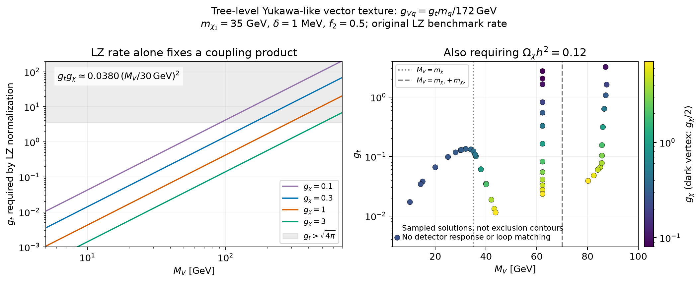
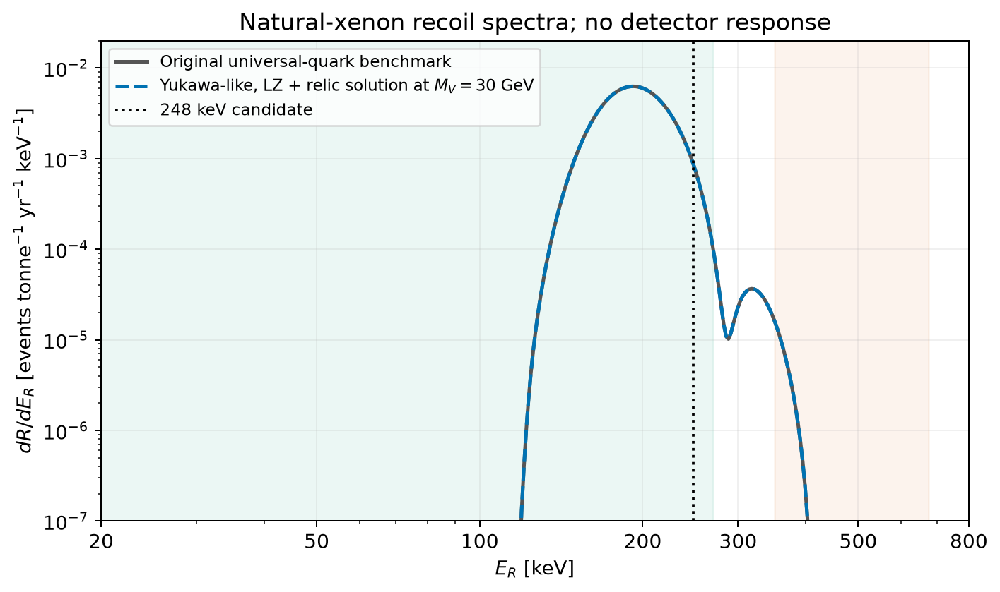
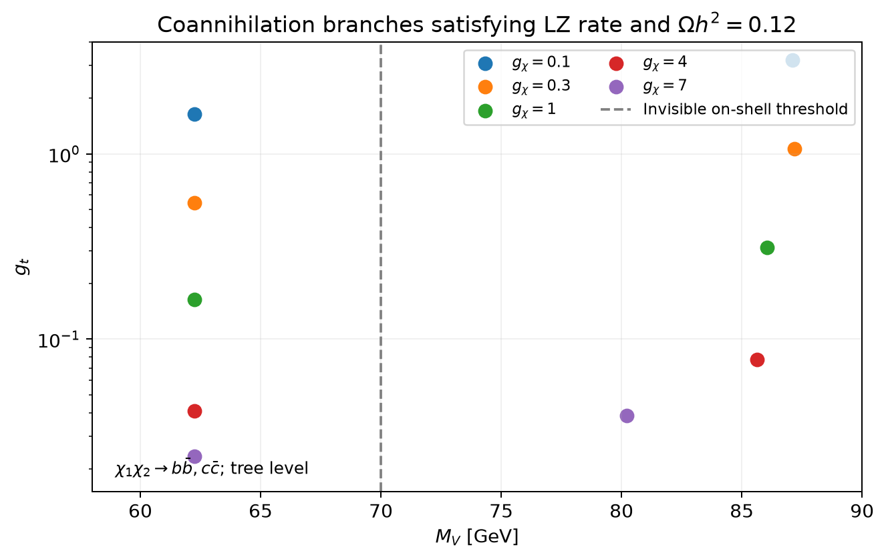

# Yukawa-like 矢量耦合：LZ 事件率与热遗迹丰度的联立扫描

日期：2026-10-20。计算环境：cms 账户下的独立 micrOMEGAs 7.1.4 项目。结果属于树级有效模型、真值级核反冲计算；不是新的 LZ 或 CMS 排除图。

## 1. 得到了哪些解

在固定 $m_{\chi_1}=35$ GeV、$\delta=1$ MeV、今日局域激发态比例 $f_2=0.5$，并要求核反冲事件率匹配原论文基准点的切片上，严格 Yukawa-like **矢量**耦合存在同时满足该事件率和 $\Omega_\chi h^2\simeq0.12$ 的解。

三类代表解如下。$g_t$ 是实际 $Vt\bar t$ 顶点系数；暗顶点仍为 $g_\chi/2$。

| $M_V$ [GeV] | $g_t$ | $g_\chi$ | $\Omega h^2$ | 主导丰度机制 | $\mathrm{BR}(V\to\chi_1\chi_2)$ |
|---:|---:|---:|---:|---|---:|
| 10 | 0.01708 | 0.24729 | 0.11999 | $\chi_i\chi_i\to VV$ | 0 |
| 20 | 0.06576 | 0.25691 | 0.12000 | $\chi_i\chi_i\to VV$ | 0 |
| 30 | 0.12763 | 0.29779 | 0.12000 | $\chi_i\chi_i\to VV$ | 0 |
| 35 | 0.12228 | 0.42306 | 0.12000 | 热平均包含 $VV$ 阈值 | 0 |
| 40 | 0.03471 | 1.94682 | 0.12001 | 热分布尾部开放的 $VV$ 通道 | 0 |
| 62.263 | 0.54569 | 0.30000 | 0.12000 | $\chi_1\chi_2\to b\bar b,c\bar c$ | 0 |
| 87.183 | 1.06994 | 0.30000 | 0.12000 | $\chi_1\chi_2\to b\bar b,c\bar c$ | 0.889 |
| 86.048 | 0.31268 | 1.00000 | 0.12000 | $\chi_1\chi_2\to b\bar b,c\bar c$ | 0.999 |

最后两点允许在对撞机上产生真实的 $V\to\chi_1\chi_2$，可作为 $t\bar t+$MET 的后续候选点。表中尚未施加重味搜索、间接探测、味物理等限制，不能称为完整实验允许点。分支比由独立二体宽度公式计算，在上述两个不可见开放点与 CalcHEP 总宽度的相对差小于 $3\times10^{-5}$。



图中的点是固定归一化下的数值解，没有代表统计置信区间的宽度。单个 LZ 事件允许归一化有较大变化；进一步放松 $m_\chi,\delta,f_2$ 后，这些解会移动，不能把 $62.3$ 或 $87$ GeV 解读为 LZ 的精确质量预测。

## 2. 模型和固定参数

保留 $V,\chi_1,\chi_2$，不包含 anomalon 或新标量。使用与此前 UFO 相同的质量本征态顶点：

$$
g_{Vq}=g_t\frac{\widehat m_q}{172\ \mathrm{GeV}},\qquad
V\chi_1\chi_2:\quad i\frac{g_\chi}{2}\gamma^\mu.
$$

夸克纹理输入为

$$
(\widehat m_u,\widehat m_d,\widehat m_s,\widehat m_c,\widehat m_b,\widehat m_t)
=(0.0022,0.0047,0.096,1.27,4.18,172)\ \mathrm{GeV}.
$$

这些数是定义该纹理的固定参考数，与上一轮 MadGraph 基准一致；它们不是在同一尺度运行得到的一组 SM Yukawa。这里给矢量流系数施加质量比例，并没有把矢量媒介子改成标量媒介子。

| 固定项 | 数值 | 原因或含义 |
|---|---|---|
| $m_{\chi_1}$ | 35 GeV | 延续原论文和已有 LZ 基准，先比较耦合纹理 |
| $m_{\chi_2}-m_{\chi_1}$ | 0.001 GeV | 保持放热非弹性核反冲运动学 |
| $f_2$ | 0.5 | 本次假定的今日局域比例，未重新求解晚期组分演化 |
| $\rho_\chi$ | 0.3 GeV/cm$^3$ | 假定 $\chi$ 构成全部局域暗物质 |
| $v_0,v_E,v_{\rm esc}$ | 238,254,544 km/s | 与原反冲复现计算一致 |
| 核组成 | 九种天然氙同位素 | 逐同位素计算再求和 |
| 核响应 | 原计算使用的共同 Helm 型相干响应 | 保持核物理基准一致 |
| 曝光 | 2.84 tonne yr | 与已有 LZ 复现一致 |
| 化学热史 | 标准热冻结，$\Omega_\chi h^2=0.12$ | 包含两态共湮灭和允许的 $VV$ 通道 |
| 其他新耦合 | 直接轻子耦合、对角暗流、新标量耦合均无 | 当前最简模型顶点内容 |

对 $g_t$ 和 $g_\chi$ 使用实际顶点的微扰范围

$$
g_t<\sqrt{4\pi},\qquad g_\chi/2<\sqrt{4\pi}.
$$

这只是扫描范围定义，并不代替完整的高能幺正性分析。夸克衰变运动学沿用原 CalcHEP 的有效运行质量；接近 $b\bar b$ 阈值的低质量宽度有阈值处理依赖，不用于精密强子衰变预测。

## 3. 为什么 LZ 要求变成这个耦合数量级

核子矢量荷在零动量转移的领先匹配为

$$
f_p=2g_{Vu}+g_{Vd},\qquad f_n=g_{Vu}+2g_{Vd}.
$$

对应本纹理，

$$
f_p=5.29070\times10^{-5}g_t,\qquad
f_n=6.74419\times10^{-5}g_t,\qquad f_n/f_p=1.27473.
$$

对氙同位素，核相干振幅中的夸克部分为

$$
Q_A=Zf_p+(A-Z)f_n.
$$

因此核反冲率的耦合依赖为

$$
\frac{dR_A}{dE_R}\ \propto
\frac{f_2\rho_\chi}{m_\chi}
\frac{(g_\chi/2)^2 Q_A^2}{(M_V^2+2m_AE_R)^2}
F_A^2(q)\,\eta(v_{\min}).
$$

旧普适模型中 $g_{Vq}=g_B/6$，所以 $f_p=f_n=g_B/2$，$Q_A=Ag_B/2$。代入 Xe-131，旧核荷为 $65.5g_B$，新核荷为约 $0.00805g_t$。同一暗顶点与传播子下，匹配旧事件率需要把极小的 $g_B$ 换成约 $8.14\times10^3g_B$ 的 $g_t$。

实际归一化使用完整同位素积分，而非只用 Xe-131。结果为

$$
\boxed{\quad
g_tg_\chi\simeq0.0380063
\left(\frac{M_V}{30\ \mathrm{GeV}}\right)^2
\sqrt{\frac{0.5}{f_2}}
\quad}
$$

该近似固定了上表的 $m_\chi,\delta,\rho_\chi$ 和事件率；在所讨论的几十 GeV 区域，有限传播子修正很小。若目标事件率相对原基准改变为 $r$ 倍，右侧再乘 $\sqrt r$。

核子匹配可参考 [D'Eramo、Kavanagh、Panci，arXiv:1605.04917，式 (3.4)](https://arxiv.org/html/1605.04917)。该领先矢量荷没有重夸克净数贡献；不能套用标量重夸克的胶子匹配来获得额外相干增强。有限动量形状因子与环图匹配属于进一步修正。

## 4. 这里的“LZ 归一化”具体是什么意思

原论文基准为

$$
m_\chi=35\ \mathrm{GeV},\quad\delta=1\ \mathrm{MeV},\quad
M_V=30\ \mathrm{GeV},\quad g_B=1.46\times10^{-5},\quad g_\chi=0.32.
$$

本次先重新运行原基准，得到

$$
N_{\rm ROI}^{\rm truth}=1.120444105,\qquad
N_{\rm SB}^{\rm truth}=7.387874253\times10^{-4}.
$$

随后调节新的耦合，使新的真值级 $N_{\rm ROI}$ 与这个值相等。原论文报告折叠效率与分辨率后的 $N_{\rm ROI}=1$。因此本次做的是**原论文基准等事件率匹配**，没有把真值事件数 $1.12$ 宣称为探测器观测事件数 $1$。

新旧谱几乎重合。$M_V=30$ GeV 的联立解给出

$$
N_{\rm ROI}^{\rm truth}=1.120444105,\qquad
N_{\rm SB}^{\rm truth}=7.384765778\times10^{-4}.
$$

小差别来自新的质子/中子荷比例改变了同位素权重。匹配原基准的谱和强度支持它作为相似的 LZ 候选解释，但本次没有重新实现官方探测器响应或拟合置信轮廓。[原论文的反冲率、似然和基准见式 (19)–(23) 与图 6](https://arxiv.org/html/2609.26570v1)。



## 5. 丰度进一步挑出了哪些分支

### 5.1 轻媒介子与热禁戒通道

$M_V<m_\chi$ 时，$\chi_i\chi_i\to VV$ 主导丰度，$g_\chi$ 约为 $0.25$–$0.4$，LZ 再固定 $g_t$。这解释了 $M_V=20$–$35$ GeV 时 $g_t$ 可以在 $0.06$–$0.13$ 左右。

当 $M_V$ 略大于 $m_\chi$，冻结时的动能仍可打开 $VV$ 末态。该通道随质量差增大被热分布压低，需要更大的 $g_\chi$。本微扰扫描中这条分支延伸至约 $43.76$ GeV，端点使用 $g_\chi/2=\sqrt{4\pi}$，不应当作保守弱耦合点。

### 5.2 $V$ 交换的共湮灭分支

$\chi_1\chi_2\to b\bar b,c\bar c$ 在两条质量分支给出正确丰度：

- 下分支约 $M_V=62.26$ GeV，$g_tg_\chi\simeq0.1637$。媒介子不能在壳衰变到暗物质，对撞机上的暗物质对仍可由离壳 $V^*$ 产生。
- 上分支在本扫描中约为 $M_V=80$–$88$ GeV；其中 $g_\chi=0.2$–$1$ 的代表解集中在约 $86$–$88$ GeV。总宽度和热平均共振尾使质量解随 $g_\chi/g_t$ 变化。

在 $M_V=87.183$ GeV、$g_t=1.06994$、$g_\chi=0.3$ 点，实际夸克顶点约为

$$
(g_{Vu},g_{Vd},g_{Vs},g_{Vc},g_{Vb},g_{Vt})
\simeq(1.37\times10^{-5},2.92\times10^{-5},5.97\times10^{-4},
7.90\times10^{-3},0.0260,1.070).
$$

暗顶点为 $g_\chi/2=0.15$，总宽度约 $0.04614$ GeV，$\Gamma_V/M_V\simeq5.29\times10^{-4}$。这个点有明显的顶夸克耦合和较大的不可见分支比，应优先检验 $pp\to t\bar tV\to t\bar t\chi_1\chi_2$。本次没有生成该新点的 MadGraph 样本，也没有计算其 CMS 灵敏度。



### 5.3 为什么不能沿用此前的 500 GeV 点

$M_V=500$ GeV 时，同一 LZ 归一化要求 $g_tg_\chi\simeq10.5568$。此前的 $g_t=0.1,g_\chi=0.32$ 只有乘积 $0.032$，事件率相对目标约为

$$
(0.032/10.5568)^2\simeq9.2\times10^{-6}.
$$

即使在实际顶点微扰范围内增大耦合，该质量点的本次扫描仍给出 $\Omega h^2\simeq1.35$–$2.13$，没有同时满足 $0.12$ 的解。这个结论仅限本固定切片和当前通道内容；不能推广到其他 $m_\chi,f_2$ 或非标准热史。

## 6. 数值验证和结果边界

使用独立目录

```text
/home/cms/phenomenology/micromegas_7.1.4_el8/PseudoDiracYukawa_20261020
```

从原模型复制 CalcHEP 表，逐味替换六个 $Vq\bar q$ 顶点，保留原暗顶点归一化。扫描了 33 个媒介子质量，每个质量先对耦合比取 17 个网格点，再对变号区间求根，共保留 743 次丰度评估；另以固定 $g_\chi$ 对质量求根加密两条共湮灭分支。

验证包括：重新运行原模型的核反冲基准；新模型使用完整天然氙积分匹配事件率；独立二体宽度核对；34 个质量根用 micrOMEGAs 的 fast=0 重新计算。fast=0 与 fast=1 的丰度差最大约 1.32%，表中 $g_\chi=0.3$ 和 1 的上分支点分别为 $0.119878$ 与 $0.120008$，支持本次报告的参数精度。输出更多小数用于复现，不代表相应物理精度。

还需明确三项边界：

1. **环图和匹配尺度。** 重夸克耦合可通过电磁环图/动能混合生成低能轻夸克耦合。由于树级 $u,d$ 系数很小，这种修正可能影响甚至主导 LZ 振幅；其值取决于规定耦合纹理的尺度、混合项边界值和阈值匹配。当前扫描是清楚定义的树级基准，不能宣称跨尺度匹配已完成。[相关机制与计算见 arXiv:1605.04917](https://arxiv.org/html/1605.04917)。
2. **激发态存活。** $f_2=0.5$ 是本次输入。没有用新的味结构完整重算转换冻结、晚期自转换或环图诱导衰变。改变 $f_2$ 会移动上面的归一化与丰度分支。
3. **实验和 EFT 有效性。** 尚未重新施加间接探测、重味与轻子搜索等限制；独立的破缺相矢量耦合没有自动给出电弱规范不变完成或 EFT 截止尺度。上面的参数是后续检验的候选解，不是完整允许空间。

第一项可以量化：若低能额外有 $V_\mu\varepsilon eJ_{\rm em}^\mu$，则

$$
f_p=5.29070\times10^{-5}g_t+\varepsilon e,\qquad
f_n=6.74419\times10^{-5}g_t.
$$

在 Xe-131 上，$\varepsilon/g_t=+10^{-4}$ 已使相干振幅增加约 20%，事件率增加约 45%。这只是一个明确的混合项敏感度例子，不是对实际环图大小的预测。因此本次 $g_tg_\chi=0.0380(M_V/30)^2$ 必须连同“树级、不额外加入该混合项”的约定使用。

## 7. 交付文件

- `model/`：CalcHEP 模型表、参数卡、计算入口和扫描脚本快照。
- `results/evaluations.csv`：固定质量扫描的全部丰度评估。
- `results/mass_summary.csv`：LZ 所需耦合乘积和各质量的丰度范围。
- `results/roots.csv`：固定质量求得的 LZ＋relic 解。
- `results/mass_roots.csv`：固定暗耦合时的质量根及 fast=0 复核。
- `results/selected_benchmarks.csv`：代表点、实际顶点与独立宽度核对。
- `results/*recoil*.csv`：反冲谱，纵轴原始单位为 events/(kg day keV)；图中换算为 events/(tonne yr keV)。
- `plots/`：三张 PNG 图和相应矢量 PDF。
- `scan.log`、`refine.log`：远端扫描记录。
- `SHA256SUMS.csv`：本次交付文件校验和。
