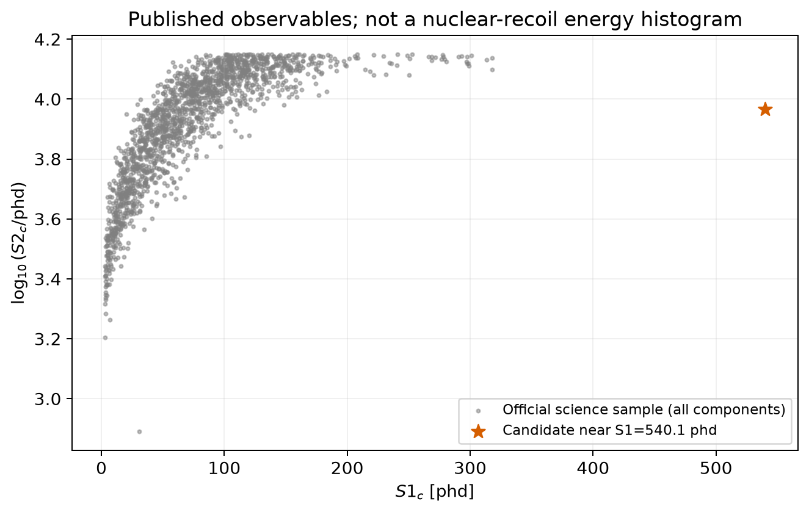
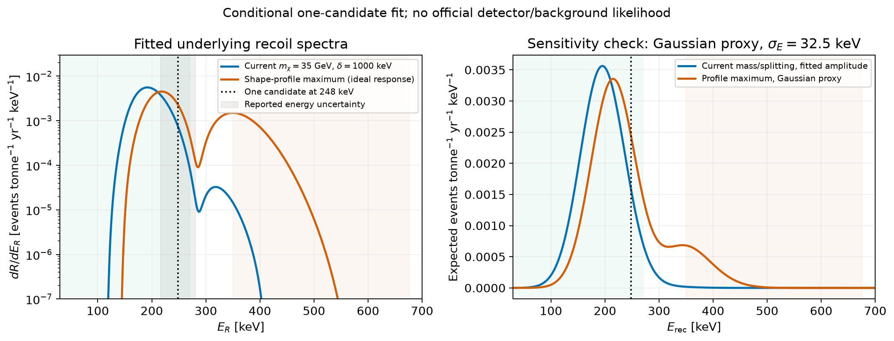
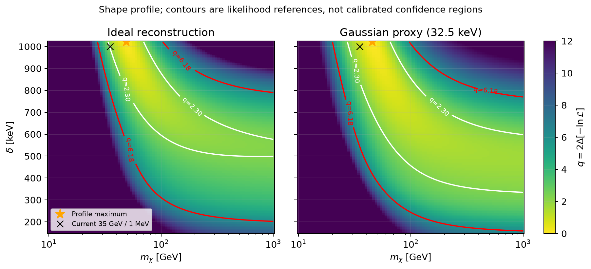

# 当前 Yukawa-like 模型的 LZ 核反冲谱简化拟合

日期：2026-10-21。结论：可以对单个候选事件做条件式谱拟合；当前 $m_\chi=35$ GeV、$\delta=1$ MeV 谱形仍能容纳该事件。现有公开材料不足以在本工作中重建官方完整探测器和背景似然，因此这里不是 LZ 官方联合拟合，也不是对一条实测连续 $dR/dE_R$ 曲线做最小二乘拟合。

## 1. 实际使用的公开数据

下载并核对 [LZ HEPData 数据发布](https://doi.org/10.17182/hepdata.182472.v1)：46 张表，其中 science、prompt-veto、delayed-veto 样本分别含 1710、66、55 个观测点；其余表主要给出预设有效相互作用的耦合限制和显著性。

观测点发布在 $S1_c$–$\log_{10}S2_c$ 空间。Science 样本中与候选事件对应的点为

$$
(S1_c,\log_{10}S2_c)=(540.07916,3.966964).
$$

[实验论文](https://arxiv.org/html/2609.02823)给出的核反冲能量为 $248\pm23_{\rm stat}\pm23_{\rm sys}$ keV，曝光为 2.84 tonne yr。公开的 1710 个 science 观测点含大量 ER 等背景，不能全部当成 NR 事件，也不能在没有响应模型的情况下直接换算成实验 NR 能谱。本次检查的数据目录没有可直接使用的逐能量效率曲线、完整响应矩阵和各背景二维 PDF。

## 2. 具体拟合定义

假设这个高反冲候选事件来自暗物质信号，忽略它附近的背景。沿用[原 pseudo-Dirac 理论论文的式 (23)](https://arxiv.org/html/2609.26570v1)所采用的一维形式：

$$
-\ln\mathcal L=N_{\rm ROI}+N_{\rm SB}-\ln\lambda(248\ \mathrm{keV}),
$$

其中 $\lambda$ 为本曝光下的预期事件密度，单位 events/keV；ROI 为 5.4–269.9 keV，空侧带为 350–675 keV。269.9–350 keV 的间隙没有加入这个简化似然。空侧带条件沿用理论论文的分析假设，本次没有通过官方响应重建该辅助样本。

一般而言，应使用

$$
\lambda(E_{\rm rec})=\mathcal E\int dE_R\,
\epsilon(E_R)K(E_{\rm rec}|E_R)\frac{dR}{dE_R}.
$$

本次同时计算两种清楚标注的情形：

- **主结果：理想响应。** $\epsilon=1$，$K(E_{\rm rec}|E_R)=\delta_D(E_{\rm rec}-E_R)$。
- **敏感度检查：高斯展宽近似。** $\epsilon=1$，取常数 $\sigma_E=\sqrt{23^2+23^2}=32.53$ keV。这个宽度只是用候选事件报告误差构造的示例，不能等同于官方分辨率函数，也未完整处理能标系统误差的 nuisance。

对每个谱形，把耦合乘积 $P=g_tg_\chi$ 作为自由归一化。由于 $dR/dE_R\propto P^2$，记 $\lambda=P^2\lambda_0$，则一个候选事件的归一化极大似然解为

$$
\widehat{P^2}=\frac{1}{N_{{\rm ROI},0}+N_{{\rm SB},0}}.
$$

因此最优点的 ROI 加侧带预期总数为 1。这一步是泊松事件似然的结果，不能解释为实验已经测定了每个能量 bin 的 $dR/dE_R$。

## 3. 当前 35 GeV、1 MeV 谱形的结果

固定 $M_V=87.18334$ GeV、$m_\chi=35$ GeV、$\delta=1000$ keV、$f_2=0.5$，得到：

| 量 | 理想响应 | 高斯展宽近似 |
|---|---:|---:|
| 最优 $g_tg_\chi$ | 0.303125 | 0.308538 |
| 固定 $g_\chi=0.3$ 时的最优 $g_t$ | 1.01042 | 1.02846 |
| $N_{\rm ROI}$ | 0.999343 | 0.998571 |
| $N_{\rm SB}$ | 0.0006566 | 0.0014290 |
| 相对本简化扫描最佳谱形的 $2\Delta[-\ln\mathcal L]$ | 2.211 | 0.861 |

当前质量和劈裂的谱形可以作为候选解释继续使用。上述似然差不能直接换算成模型被接受或排除的置信度；只有一个候选事件，本次没有做 toy-MC 覆盖率校准。

此前 $g_t=1.06994$、$g_\chi=0.3$ 的点采用“匹配原论文基准事件率”的约定，在理想响应的本次计算中预期总数约为 1.12129，而事件数极大似然值为 1，所以最优耦合乘积缩小到原来的约 94.44%。原先的点并没有因此被排除；它相对固定谱形的最佳幅度只有约 0.014 的 $2\Delta[-\ln\mathcal L]$ 差别。

单个计数本身的统计误差很大。在本无背景、固定谱形假设下，$n=1$ 的精确中央 Garwood 95% 泊松均值区间为

$$
\mu\in[0.02532,5.57164].
$$

对应 $g_\chi=0.3$ 的这个固定谱形点，LZ 强度单独给出的 $g_t$ 区间约为 $[0.161,2.385]$。这不是加入 relic、对撞机、核物理和 halo 不确定度后的联合参数区间。

左图是底层核反冲率，纵轴保持 events/(tonne yr keV)；右图展示高斯响应近似的影响。竖线只表示候选事件的位置，没有给单个事件虚构一个实验微分率纵坐标。

## 4. 放松暗物质质量与劈裂

扫描 $m_\chi=10$–1000 GeV、$\delta=150$–1021.9979 keV，并在每点解析 profile 耦合乘积。媒介子固定为 87.18334 GeV；在几十 GeV 以上，改变它主要影响归一化，对形状的传播子修正很小。

| 情形 | 谱形极大似然 $m_\chi$ [GeV] | $\delta$ [keV] | 最优 $g_tg_\chi$ | $N_{\rm ROI}$ | $N_{\rm SB}$ |
|---|---:|---:|---:|---:|---:|
| 理想响应 | 48.79 | 1021.998 | 0.67152 | 0.7750 | 0.2250 |
| 高斯展宽近似 | 45.22 | 1021.998 | 0.59668 | 0.8854 | 0.1146 |

两个极大值都碰到 $\delta<2m_e$ 的输入上界，因此不能把 1022 keV 当成数据精确测出的劈裂。45–49 GeV 也不是置信区间，只是两个响应假设分别得到的极大值。当前 35 GeV、1 MeV 点和这些极大值之间的似然差不大。

这些新谱形极大值没有重新计算热遗迹丰度，也没有重新生成对撞机截面，不能把它们自动替换成新的联合允许点。

图中 $q=2.30,6.18$ 只用作似然差参考线，没有宣称是正确覆盖率的 68% 或 95% 区域。

## 5. 现有对撞机候选点的幅度拟合

以下保持各点原来的 $m_\chi,\delta,g_\chi,M_V$，仅拟合 $g_t$：

| $M_V$ [GeV] | 固定 $g_\chi$ | 原 $g_t$ | 理想响应拟合 $g_t$ | 高斯近似拟合 $g_t$ |
|---:|---:|---:|---:|---:|
| 30.000 | 0.297793 | 0.12763 | 0.12053 | 0.12268 |
| 62.263 | 0.300000 | 0.54569 | 0.51534 | 0.52454 |
| 87.183 | 0.300000 | 1.06994 | 1.01042 | 1.02846 |
| 87.530 | 0.200000 | 1.61770 | 1.52770 | 1.55498 |
| 86.048 | 1.000000 | 0.31268 | 0.29528 | 0.30056 |

这里是 **LZ 强度单独的更新**。改变 $g_t$ 会改变 $b\bar b,c\bar c$ 共湮灭以及媒介子分支比，尤其 86–88 GeV 分支必须重新联立 relic，才能更新此前对撞机截面。不能把本表的耦合与旧的 $\Omega h^2=0.12$ 和旧截面直接拼成新结论。

## 6. 核响应核对与限制

沿用九种天然氙同位素、$\rho_\chi=0.3$ GeV/cm$^3$、$f_2=0.5$、$v_0=238$、$v_E=254$、$v_{\rm esc}=544$ km/s。逐同位素矢量荷为 $Q_A=54f_p+(A-54)f_n$，其中 $f_p/g_t=5.29070\times10^{-5}$，$f_n/g_t=6.74419\times10^{-5}$。

本次直接检查了 micrOMEGAs 的 `FermiFF` 源码：实际核密度是数值积分的双参数 Fermi 分布，$R=1.23A^{1/3}-0.6$ fm、$a=0.52$ fm，积分到 $R+5$ fm。此前若干报告把这个已运行实现称为 Helm，不够准确；这里按实际代码处理，没有在本次拟合中悄悄换核响应。它也不同于官方使用的完整 DMFormfactor 核响应。

独立的矢量化反冲计算在原 35 GeV、1 MeV 参考谱的主要信号区与已验证的 micrOMEGAs 输出相差不超过 $2.24\times10^{-5}$。核子到核的绝对归一化以已有 micrOMEGAs 基准校准，形状与有限传播子、速度积分独立计算。

本结果没有加入正式效率、能标 nuisance、背景二维 PDF、核响应误差、halo nuisance、重夸克环图/动能混合匹配，或新的激发态组分演化。平坦效率的变化可以重标幅度，但真实能量依赖效率会改变谱形，因此不能用一个整体因子声称已经完成官方响应折叠。

## 7. 可复现文件

- `sources/`：官方 HEPData 元数据和三个公开样本。
- `results/fit_summary.json`：两个响应假设下的数值结果与全部假设。
- `results/fitted_spectra.csv`：底层谱与示例展宽谱，单位 events/(tonne yr keV)。
- `results/shape_profile_scan.csv`：质量—劈裂似然差扫描。
- `results/current_benchmark_normalization_fits.csv`：现有候选点的强度拟合。
- `results/public_data_inventory.json`：样本点数和候选点坐标核对。
- `scripts/fit_recoil.py`：完整计算与绘图入口。
- `plots/`：三张图，每张提供 PNG 和 PDF。
