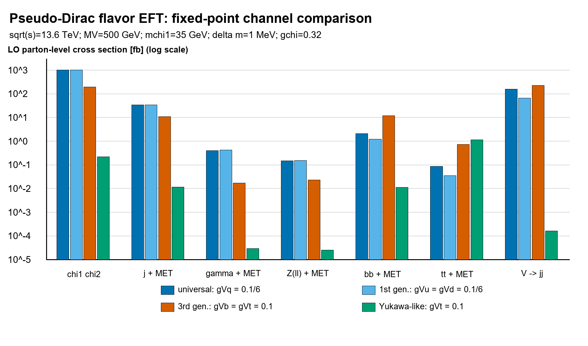
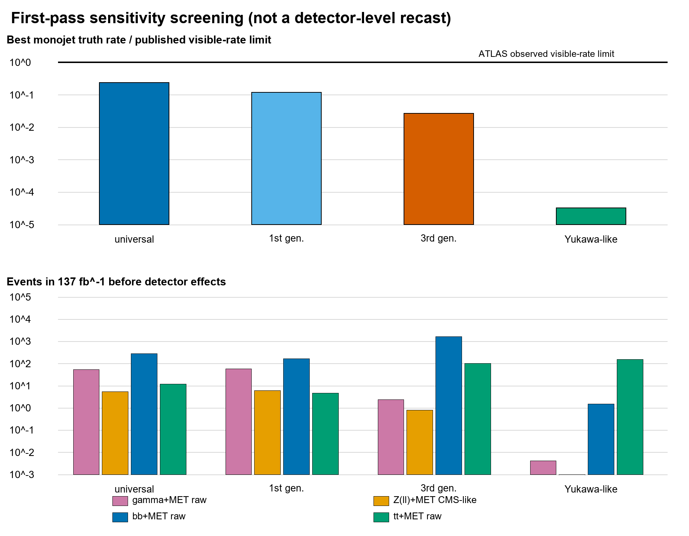

# 最简 pseudo-Dirac 模型的味依赖 UFO 与末态初筛

日期：2026-10-20  
状态：UFO 已修改并验证；完成一个固定质量点的 7 通道、4 种耦合纹理扫描。这里的“灵敏度”是生成级初筛，不是 CMS/ATLAS 的完整 detector-level recast。

## 1. 结论先行

在固定点

$$
\sqrt{s}=13.6\ \mathrm{TeV},\quad M_V=500\ \mathrm{GeV},\quad
m_{\chi_1}=35\ \mathrm{GeV},\quad \Delta m=1\ \mathrm{MeV},\quad
g_\chi=0.32
$$

得到三个直接结论：

1. 普适耦合或只耦合第一代时，$j+\mathrm{MET}$ 仍是最大的 MET 末态；$\gamma+\mathrm{MET}$ 和 $Z(\ell\ell)+\mathrm{MET}$ 小约 2--3 个数量级。
2. 只耦合第三代且 $g_{Vb}=g_{Vt}=0.1$ 时，$b\bar b+\mathrm{MET}=11.74$ fb，已经略高于 $j+\mathrm{MET}=10.73$ fb。因此这个纹理应优先做 $b\bar b+\mathrm{MET}$ recast。
3. Yukawa-like 纹理归一到 $g_{Vt}=0.1$ 时，$t\bar t+\mathrm{MET}=1.129$ fb，是 $j+\mathrm{MET}=0.01154$ fb 的约 98 倍。此时 monojet 已不是正确的主搜索道，$t\bar t+\mathrm{MET}$ 才是。

## 2. 使用的模型与 UFO 修改

保留最开始的最简粒子内容：标准模型之外只有 $V$、$\chi_1$ 和 $\chi_2$，没有 anomalon，也没有新标量。相互作用写成

$$
\mathcal L_{\rm int}
=V_\mu\sum_{q=u,d,s,c,b,t}g_{Vq}\,\bar q\gamma^\mu q
+ i\frac{g_\chi}{2}V_\mu\bar\chi_1\gamma^\mu\chi_2+\mathrm{h.c.}
$$

新 UFO 将原来的单一 $g_B$ 拆成 6 个外部参数：

$$
(g_{Vu},g_{Vd},g_{Vs},g_{Vc},g_{Vb},g_{Vt}).
$$

这里的 $g_{Vq}$ 是写进 $Vq\bar q$ 顶点的实际系数。若要复现旧的普适 $g_B$ 记号，应设置

$$
g_{Vu}=\cdots=g_{Vt}=\frac{g_B}{6}.
$$

UFO 路径为 `model/PseudoDiracFlavorEFT_UFO`。MadGraph 必须用 `-full` 导入；普通默认 restriction 会因为 6 个默认值相等而把它们错误合并为同一个参数。

旧 FeynRules 1.7 导出的衰变表不会把 $V$ 正确交给 MadWidth，`set decay 9900032 Auto` 会静默得到零宽度。因此每个点均使用解析二体宽度重新计算 $\Gamma_V$，不能把宽度作为随意独立输入。

## 3. 固定参数与四种耦合纹理

本轮固定参数及原因：

| 参数 | 数值 | 原因 |
|---|---:|---|
| $M_V$ | 500 GeV | 处于 Run-2/Run-3 可触发且暗衰变开放的代表点 |
| $m_{\chi_1}$ | 35 GeV | 保留最初 LZ 研究使用的暗物质质量 |
| $\Delta m$ | 1 MeV | 保留 pseudo-Dirac 小劈裂；对硬散射运动学基本无影响 |
| $g_\chi$ | 0.32 | 保留原模型值；实际暗顶点大小为 $g_\chi/2=0.16$ |
| $\sqrt{s}$ | 13.6 TeV | 对应当前 LHC Run-3 生成设置 |
| PDF | NNPDF2.3 LO (`nn23lo1`) | 与已有 MadGraph 扫描保持一致 |
| 计算阶数 | LO parton level | 用于第一轮通道排序 |

四种纹理为：

| 纹理 | $g_{Vu}$ | $g_{Vd}$ | $g_{Vs}$ | $g_{Vc}$ | $g_{Vb}$ | $g_{Vt}$ |
|---|---:|---:|---:|---:|---:|---:|
| 普适 $g_B=0.1$ | 0.01667 | 0.01667 | 0.01667 | 0.01667 | 0.01667 | 0.01667 |
| 仅第一代 $g_B=0.1$ | 0.01667 | 0.01667 | 0 | 0 | 0 | 0 |
| 仅第三代 | 0 | 0 | 0 | 0 | 0.1 | 0.1 |
| Yukawa-like，$g_{Vt}=0.1$ | $1.28\times10^{-6}$ | $2.73\times10^{-6}$ | $5.58\times10^{-5}$ | $7.38\times10^{-4}$ | $2.43\times10^{-3}$ | 0.1 |

Yukawa-like 定义为 $g_{Vq}=0.1m_q/m_t$，只是有效理论的味结构基准，不声称已经给出了电弱规范不变的 UV 完成。

对应总宽度分别为 0.405、0.362、1.094 和 0.697 GeV，即 $\Gamma_V/M_V=0.07\%$--$0.22\%$，均为窄共振。

## 4. 生成过程与选择

MadGraph5_aMC@NLO 版本为 3.6.6。主要过程为：

| 标签 | 过程 | 生成级选择 |
|---|---|---|
| inclusive | $pp\to\chi_1\chi_2$ | 无硬切选 |
| monojet | $pp\to\chi_1\chi_2j$ | $p_T^j>200$ GeV，$|\eta_j|<4.5$ |
| monophoton | $pp\to\chi_1\chi_2\gamma$ | $p_T^\gamma>150$ GeV，$|\eta_\gamma|<2.5$ |
| mono-Z | $pp\to\chi_1\chi_2Z$，$Z\to e^+e^-,\mu^+\mu^-$ | 总截面表中无后续切选；另计算 CMS-like truth selection |
| $b\bar b+$MET | $pp\to\chi_1\chi_2b\bar b$ | $p_T^b>25$ GeV，$|\eta_b|<2.5$，$\Delta R_{bb}>0.4$ |
| $t\bar t+$MET | $pp\to\chi_1\chi_2t\bar t$ | 顶夸克未衰变、无分析切选 |
| dijet | $pp\to V\to jj$ | 无实验级 dijet 选择，仅作速率和已有约束对照 |

## 5. 固定点截面

所有数值单位为 fb：

| 纹理 | $\chi_1\chi_2$ | $j+$MET | $\gamma+$MET | $Z(\ell\ell)+$MET | $b\bar b+$MET | $t\bar t+$MET | $V\to jj$ |
|---|---:|---:|---:|---:|---:|---:|---:|
| 普适 | 989.3 | 33.63 | 0.3933 | 0.1480 | 2.063 | 0.08591 | 157.7 |
| 仅第一代 | 1010 | 33.25 | 0.4195 | 0.1524 | 1.217 | 0.03423 | 64.29 |
| 仅第三代 | 194.4 | 10.73 | 0.01702 | 0.02266 | 11.74 | 0.7246 | 221.7 |
| Yukawa-like | 0.2160 | 0.01154 | $2.93\times10^{-5}$ | $2.49\times10^{-5}$ | 0.01095 | 1.129 | $1.59\times10^{-4}$ |

普适与仅第一代的 monojet 几乎相同，直接说明 $u,d$ PDF 主导。第三代纹理中 $b\bar b+$MET 上升；Yukawa-like 纹理则由 $gg\to t\bar t$ 后从顶线辐射 $V$ 的关联产生主导，所以 $t\bar t+$MET 可以大于无伴随粒子的 $q\bar q\to V\to\chi_1\chi_2$。

## 6. 第一轮灵敏度代理

### 6.1 monojet

把 truth-level MET 谱与 ATLAS 13 TeV、139 fb$^{-1}$ monojet 分析给出的 model-independent visible cross-section 上限逐阈值比较，并要求最佳阈值至少保留 20 个生成事件。定义

$$
R_{\rm monojet}=\frac{\sigma_{\rm truth}(p_T^{\rm miss}>p_T^{\rm cut})}
{\sigma^{95}_{\rm vis,ATLAS}(p_T^{\rm miss}>p_T^{\rm cut})}.
$$

| 纹理 | 最佳阈值 | truth 截面 | 公开上限 | $R_{\rm monojet}$ |
|---|---:|---:|---:|---:|
| 普适 | 700 GeV | 0.975 fb | 4.1 fb | 0.238 |
| 仅第一代 | 600 GeV | 1.197 fb | 10 fb | 0.120 |
| 仅第三代 | 400 GeV | 1.394 fb | 52 fb | 0.0268 |
| Yukawa-like | 400 GeV | $1.73\times10^{-3}$ fb | 52 fb | $3.33\times10^{-5}$ |

即使把 $A\epsilon$ 乐观地取为 1，所有点仍有 $R<1$；真实 shower、jet veto 和 detector efficiency 只会进一步降低。因此这个 $M_V=500$ GeV 固定点没有 monojet 排除灵敏度。普适点的最佳 bin 只有 29/1000 个事件，当前 $R$ 还有约 20% 的 Monte Carlo 统计误差，后续质量扫描需要增加事件量。

### 6.2 mono-Z 与重味通道

CMS EXO-19-003 的主要生成级运动学选择应用到 mono-Z LHE 后，普适、第一代、第三代和 Yukawa-like 点的选择后截面分别为

$$
0.0395,\quad0.0444,\quad0.00585,\quad5.94\times10^{-6}\ \mathrm{fb}.
$$

在 137 fb$^{-1}$ 下仅约 5.4、6.0、0.80 和 $8.1\times10^{-4}$ 个探测器前事件，因此最简 ISR mono-Z 在这些点没有竞争力。

重味通道暂时没有套 CMS/ATLAS detector-level selection，所以下图下半部分只画 137 fb$^{-1}$ 的探测器前事件数，不能把柱高直接叫作排除显著性。不过它足以完成通道排序：

- 第三代点约有 1608 个 $b\bar b+$MET 原始事件，值得优先做 CMS/ATLAS $b\bar b+$MET recast；
- Yukawa-like 点约有 155 个 $t\bar t+$MET 原始事件，仍可能在完整选择后留下可检验事件数；
- $\gamma+$MET 和 ISR mono-Z 对 Yukawa-like 点基本失去灵敏度。

ATLAS monojet 上限来自 [JHEP 02 (2021) 143 / arXiv:2102.10874](https://arxiv.org/abs/2102.10874)。mono-Z truth selection 对应 [CMS EXO-19-003](https://cms-results.web.cern.ch/cms-results/public-results/publications/EXO-19-003/index.html)。可用于下一步 $t\bar t+$MET 重解释的完整 Run-2 分析是 [ATLAS JHEP 03 (2024) 139 / arXiv:2401.13430](https://arxiv.org/abs/2401.13430)，但其官方 benchmark 是 spin-0 mediator，不能直接把公开质量排除线套到这里的 spin-1 模型。

## 7. 回归检查中发现的旧结果问题

旧报告把原始 LZ benchmark 的 $pp\to\chi_1\chi_2$ 截面记为

$$
5.737\times10^{-10}\ \mathrm{pb}.
$$

新 UFO 在同一点给出

$$
1.724\times10^{-9}\ \mathrm{pb}.
$$

差异严格接近 3 倍。检查生成的 Fortran 后发现：旧的 `fixed_pp_chi1chi2` 目录虽然 UFO 源文件后来已改成 `Identity(1,2)`，但目录中的旧矩阵元代码仍是 `ColorOne(), CF=1`；新鲜生成的过程为物理的夸克颜色求和 `CF=3`。因此颜色修正后的参考值应为

$$
3\times5.737\times10^{-10}=1.7211\times10^{-9}\ \mathrm{pb},
$$

与本次新结果只差 0.17%。这说明新 UFO 的耦合归一化正确，旧的 5.737e-10 pb 是 stale generated code，不能继续作为物理基准。

## 8. 当前结果能说什么、不能说什么

可以说：

- 味结构会改变最优对撞机末态；
- 普适/第一代优先 monojet，第三代优先 $b\bar b+$MET，严格 Yukawa-like 优先 $t\bar t+$MET；
- 在本固定点，ISR mono-Z 和 monophoton 不值得优先投入完整 recast。

暂时不能说：

- $b\bar b+$MET 或 $t\bar t+$MET 已被排除/可发现；它们还没有 shower、top decay、detector simulation 和实验 likelihood；
- 这些 $g_{Vq}$ 同时满足 LZ 事件率与 relic density；本轮只保留了 $m_\chi,\Delta m,g_\chi$，没有对新的味依赖夸克耦合重新做 LZ 与 relic-density 联立归一化；
- 6 个独立 Dirac-vector 耦合已经构成规范不变、无反常的 UV 理论。它们目前是有效简化模型参数。

## 9. 下一步扫描建议

基于本轮排序，下一轮不应平均分配算力：

1. Yukawa-like：主扫 $t\bar t+$MET，取 $M_V=100,200,300,500,750,1000$ GeV，$m_{\chi_1}=10,35,100,200$ GeV，增加顶衰变、Pythia 和 Delphes；
2. 第三代等强：主扫 $b\bar b+$MET，并同时保留 $t\bar t+$MET；
3. 普适/第一代：继续 monojet MET shape，只在 $M_V\lesssim300$ GeV 区域加密，因为此前已知 $g_\chi=0.32$ 时高质量处 monojet 饱和上限偏低；
4. dijet 只作为已有约束叠加，不再作为本项目的新信号重点；
5. 对每个候选点重新联立 LZ rate、relic density、$\Gamma_V$ 和 collider likelihood，避免把 collider-only benchmark 误称为完整允许点。

## 10. 文件

- 修改后的 UFO：`model/PseudoDiracFlavorEFT_UFO/`
- 可传输压缩包：`model/PseudoDiracFlavorEFT_UFO.tar.gz`
- 固定点原始截面：`remote_results/pilot_channel_cross_sections.csv`
- truth 接受率与 monojet 代理：`remote_results/truth_acceptance_and_sensitivity.csv`
- 最佳 monojet bin：`remote_results/monojet_best_bin_proxy.csv`
- 宽度表：`remote_results/benchmark_widths.csv`
- 脚本：`scripts/`

压缩包 SHA256：`86C97E2BA60EC2664FC28EE2A4A6886694D260600351015BE3ABEA31BE321A9F`。
