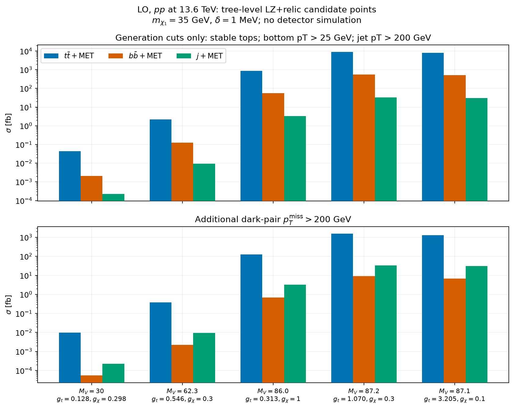
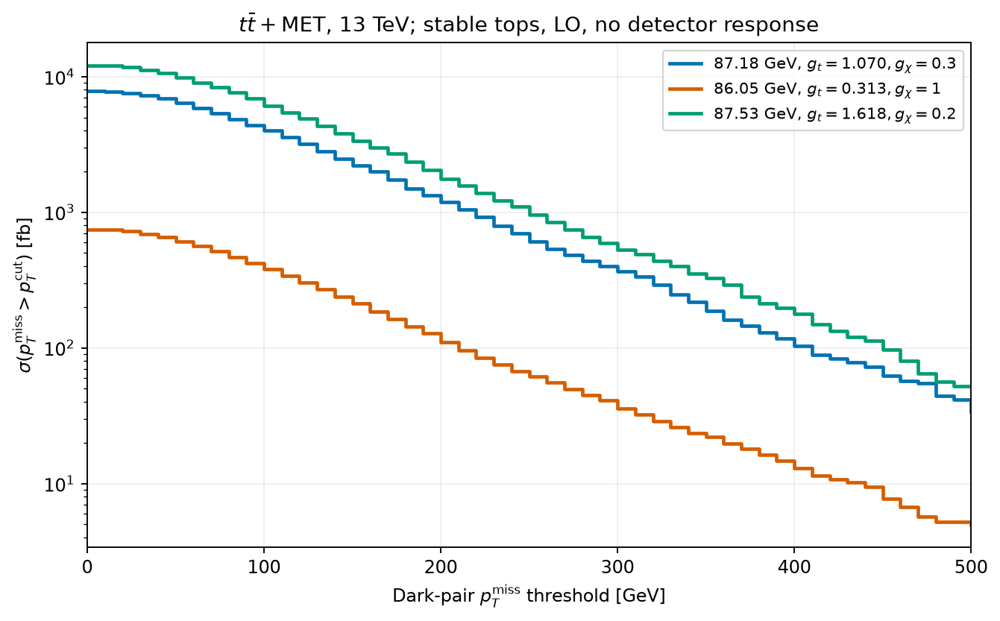

# Yukawa-like LZ＋relic 候选点的对撞机截面

计算标签：20261020；报告整理：2026-10-21。MadGraph5_aMC@NLO 3.6.6，LO，NNPDF2.3 LO（`nn23lo1`）。数值来自直接生成完整 $\chi_1\chi_2$ 末态；另独立生成在壳 $t\bar tV$ 进行交叉检查。

## 1. CMS Run-2 碰撞能量：13 TeV

所有点固定 $m_{\chi_1}=35$ GeV、$\delta=1$ MeV，采用前一轮树级 LZ＋热丰度解。夸克耦合为 $g_{Vq}=g_t\widehat m_q/(172\ \mathrm{GeV})$，暗顶点为 $g_\chi/2$。MET 在本报告中定义为两个暗粒子的横动量矢量和。

以下截面均为 $pp\to t\bar t\chi_1\chi_2$，顶夸克尚未衰变，不含分析选择或探测器效率。

| $M_V$ [GeV] | $g_t$ | $g_\chi$ | 总截面 [pb] | MET $>200$ GeV [pb] | MET $>300$ GeV [pb] |
|---:|---:|---:|---:|---:|---:|
| 87.530 | 1.61770 | 0.200 | 12.097 | 1.766 | 0.528 |
| 87.183 | 1.06994 | 0.300 | 7.795 | 1.193 | 0.366 |
| 86.048 | 0.31268 | 1.000 | 0.7479 | 0.1102 | 0.03590 |

总截面的积分误差约 $0.4\%$；MET $>200$ GeV 的结果还包含有限事件数引起的约 $4\%$–$5\%$ 统计误差。这些误差不包含 NLO、PDF 和尺度不确定度。

因此这一分支的产生率已经达到 pb 量级，值得直接进行重味＋MET 实验重解释。是否被 CMS 排除，需要进一步加入顶衰变、辐射、探测器选择和实验似然。

## 2. 13.6 TeV 下的不同末态

以下均为 fb。各列的生成选择不同，列中包含的相空间见表后说明。

| $M_V$ [GeV] | $g_t$ | $g_\chi$ | $t\bar t+$MET | $b\bar b+$MET | monojet |
|---:|---:|---:|---:|---:|---:|
| 30.000 | 0.12763 | 0.29779 | 0.04390 | 0.002095 | 0.000228 |
| 62.263 | 0.54569 | 0.30000 | 2.182 | 0.1274 | 0.009432 |
| 86.048 | 0.31268 | 1.00000 | 855.9 | 55.48 | 3.252 |
| 87.183 | 1.06994 | 0.30000 | 8839 | 559.1 | 33.47 |
| 87.115 | 3.20477 | 0.10000 | 8029 | 509.8 | 30.54 |

$t\bar t+$MET：稳定顶夸克，无额外硬选择。$b\bar b+$MET：4-flavour 初态，两个 $b$ 满足 $p_T>25$ GeV、$|\eta|<2.5$、$\Delta R_{bb}>0.4$。monojet：5-flavour 初态与 jet 定义，$p_T^j>200$ GeV、$|\eta_j|<4.5$。后两者不是同一可见事例定义，不能把不同通道的截面相加当成互斥实验分类。

在额外要求 MET $>200$ GeV 后：

| $M_V$ [GeV] | $g_t$ | $g_\chi$ | $t\bar t+$MET [fb] | $b\bar b+$MET [fb] | monojet [fb] |
|---:|---:|---:|---:|---:|---:|
| 30.000 | 0.12763 | 0.29779 | 0.009864 | 0.000054 | 0.000228 |
| 62.263 | 0.54569 | 0.30000 | 0.3840 | 0.002230 | 0.009432 |
| 86.048 | 0.31268 | 1.00000 | 126.1 | 0.6935 | 3.252 |
| 87.183 | 1.06994 | 0.30000 | 1550 | 9.225 | 33.47 |
| 87.115 | 3.20477 | 0.10000 | 1274 | 6.882 | 30.54 |

在 $87.183$ GeV 点，$b\bar b+$MET 的 MET $>200$ GeV 结果只有 33/2000 个生成事件通过，统计误差约 $17\%$，应按初筛精度使用。$t\bar t+$MET 有 526/3000 个事件通过，明显更适合继续做实验重解释。

额外的 $M_V=87.530$ GeV、$g_t=1.61770$、$g_\chi=0.2$ 点，在 13.6 TeV 下给出 $t\bar t+$MET 总截面 $13768.6$ fb，MET $>200$ GeV 后 $2129.5$ fb。本次只为该点额外计算了顶夸克通道。





## 3. 独立在壳产生率核对

对 $M_V=87.183$ GeV、$g_t=1.06994$、$g_\chi=0.3$ 点，在 13 TeV 下：

$$
\sigma(pp\to t\bar tV)=8.8832\ \mathrm{pb},\qquad
\mathrm{BR}(V\to\chi_1\chi_2)=0.888904.
$$

所以窄宽度近似为

$$
\sigma(pp\to t\bar tV)\times\mathrm{BR}_{\rm inv}
=7.8963\ \mathrm{pb}.
$$

完整 $2\to4$ 过程直接给出 $7.7949$ pb，两者相差约 $1.30\%$，支持这里的 pb 量级结果。窄宽度核对使用独立新生成的 $2\to3$ 矩阵元，保留其原始记录。

## 4. 生成过程与可靠性范围

过程为

```text
p5 p5 > chi1 chi2 t t~  PDB=2 QCD=2 QED=0
p4 p4 > chi1 chi2 b b~  PDB=2 QCD=2 QED=0
p5 p5 > chi1 chi2 j5    PDB=2 QCD=1 QED=0
p5 p5 > t t~ Vb        PDB=1 QCD=2 QED=0
```

三个完整暗物质末态均包括在壳和离壳媒介子图。每个点均由实际耦合重新计算 $V$ 的二体总宽度，没有把宽度独立固定为零。$\chi_1,\chi_2$ 均视为不可见稳定末态。每个顶夸克、monojet 样本生成 3000 个事件，底夸克样本生成 2000 个。

扫描在新目录 `/home/cms/phenomenology/PseudoDiracYukawaLZ_xsec_20261020` 的独立过程副本内完成，没有改动上一轮过程的参数卡。模型使用已审计的独立味耦合 UFO，按 `-full` 导入后生成的矩阵元计算。

本次截面沿用前一轮树级 LZ＋relic 候选解；仍未完成重夸克环图与动能混合匹配、激发态晚期演化或 CMS detector-level recast。monojet 表只包含给出的树级过程，没有计算顶夸克环诱导的 $gg\to gV^{(*)}$；因此这里的通道比较限于所列过程。表中 MET 也不包含顶衰变的中微子。这些数是明确模型与生成选择下的信号产生率，不是 CMS 可见截面或发现显著性。

## 5. 文件

- `results/all_cross_sections.csv`：合并后的全部完整暗物质末态结果；包含各 MET 阈值的截面及通过事件数。
- `results/nwa_crosscheck.csv`、`results/nwa_validation.json`：独立在壳产生率核对。
- `results/*_MET.json`：各样本的暗物质对 MET。
- `evidence/`：实际参数卡、运行卡、MadGraph banner。
- `logs/`：积分与生成记录。
- `scripts/`：运行和整理脚本。
- `plots/`：截面比较和累积 MET 图，提供 PNG 和 PDF。
