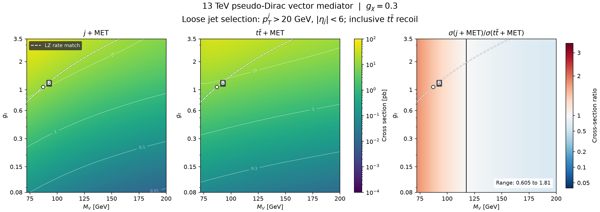
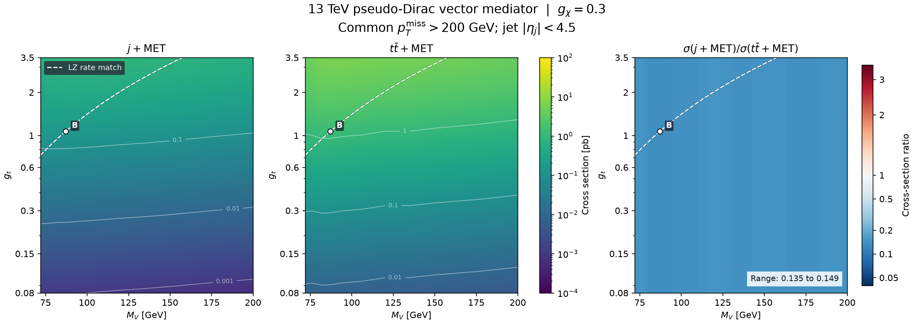
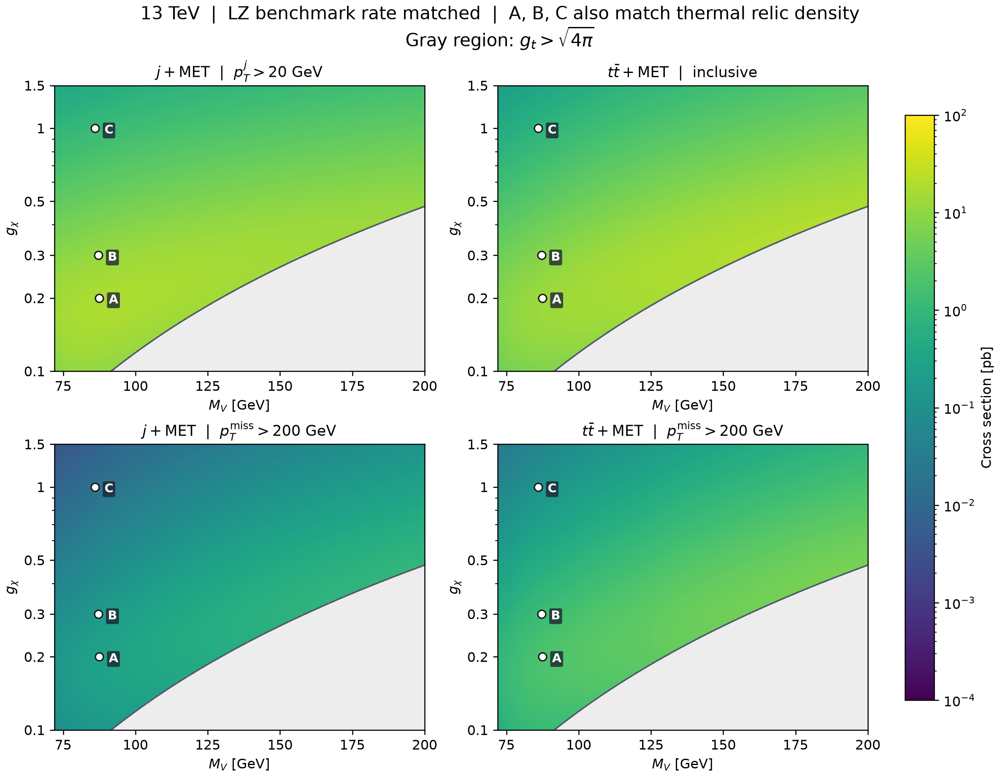

# Pseudo-Dirac 模型的真值级截面热图

计算使用 MadGraph5_aMC@NLO 3.6.6、`nn23lo1`、13 TeV。喷注和 MET 均在硬过程层面定义。顶夸克保持稳定，$p_T^{\rm miss}=p_T(V)$。两种选择分开呈现。

| 选择 | $j+\mathrm{MET}$ | $t\bar t+\mathrm{MET}$ |
|---|---|---|
| 宽切选 | $p_T^j>20$ GeV、$|\eta_j|<6$ | 对 $p_T^{\rm miss}$ 不加切选 |
| 硬 MET | $p_T^{\rm miss}>200$ GeV、$|\eta_j|<4.5$ | $p_T^{\rm miss}>200$ GeV |

宽切选的喷注定义取自导师给的图。树级 $j$ 包含 $g,u,d,s,c,b$ 及反夸克。曲线是当前纯矢量模型的预测。 [Cox 等，图 2 与 §3.1](https://arxiv.org/pdf/1512.00471#page=6)

## 图

前两张图固定 $g_\chi=0.30$，横轴是 $M_V$，纵轴是顶夸克的矢量顶点系数 $g_t$。白虚线是原论文 LZ 基准事件率的树级等率线。第三张图的纵轴是 $g_\chi$，每个点按 LZ 等率条件求出 $g_t$。灰色区域超过扫描采用的 $g_t<\sqrt{4\pi}$。A、B、C 是此前另外用 micrOMEGAs 验证了热遗迹丰度的基准点。LZ 切片其他点仅施加了事件率匹配。

## 数值读图

宽切选下，两通道的截面比在 $M_V\simeq118$ GeV 附近经过 1，较低质量一侧以喷注通道为大。共同要求 MET $>200$ GeV 后，整个扫描中 $\sigma(j+\mathrm{MET})/\sigma(t\bar t+\mathrm{MET})$ 为 $0.135$–$0.149$。

| 点 | 宽切选 $j+\mathrm{MET}$ [pb] | 宽切选 $t\bar t+\mathrm{MET}$ [pb] | 硬 MET $j+\mathrm{MET}$ [pb] | 硬 MET $t\bar t+\mathrm{MET}$ [pb] |
|---|---:|---:|---:|---:|
| A | 17.31 | 12.23 | 0.260 | 1.92 |
| B | 11.14 | 7.84 | 0.166 | 1.23 |
| C | 1.106 | 0.764 | 0.0160 | 0.118 |

B 的质量是直接积分节点，A、C 的生产截面取自相邻质量节点的插值。B 点的宽切选 jet 截面与此前直接生成暗物质末态和独立圈图所得的 11.36 pb 相差约 2%。硬 MET 下的 0.166 pb 与此前的 0.165 pb 一致。

## 参数和积分

固定 $m_{\chi_1}=35$ GeV、$m_{\chi_2}=35.001$ GeV、$g_{Vq}=g_t\widehat m_q/(172\,\mathrm{GeV})$，实际暗顶点是 $g_\chi/2$。LZ 切片沿用局域激发态比例 $f_2=0.5$ 和树级归一化

$$
g_t g_\chi=0.0380063\left(\frac{M_V}{30\,\mathrm{GeV}}\right)^2.
$$

在 $M_V=72$、$76$、$82$、$87.1833$、$95$、$105$、$120$、$135$、$150$、$175$、$200$ GeV 上直接积分。每个质量点用 $g_t=1$ 分别生成 $pp\to Vj$ 树图、修正 UFO 的 $gg\to Vg$ 圈图和 $pp\to t\bar tV$ 树图。对于硬切选，$Vj$ 树图和圈图各自单独积分，$t\bar tV$ 使用 LHE 中的 $p_T(V)$ 接受率。喷注树图与胶子圈图来自不同初态，图中按截面相加。

固定质量和夸克耦合比例后，三种在壳产生率都正比于 $g_t^2$。质量节点间对产生截面作对数线性插值，并按窄宽度近似乘不可见分支比。

$$
\sigma_X(M_V,g_t,g_\chi)=
\sigma_X^{\rm prod}(M_V,g_t=1)\,g_t^2\,
\mathrm{BR}(V\to\chi_1\chi_2).
$$

因此在此近似下，同一选择的 jet 与 $t\bar t$ 截面比只随质量变化。扫描从 72 GeV 开始，在壳阈值是 70.001 GeV。低于阈值的信号需要直接积分离壳暗物质末态。

## 数据

- `results/madgraph_integrals.csv` 是直接计算的产生截面、积分误差及事件计数。
- `results/production_nodes_gt1.csv` 是用于插值的产生截面，包括由有限事件统计得到的硬切选误差。
- `results/benchmark_cross_sections.csv` 汇总 A、B、C 两种切选的结果，并分别列出喷注树图和圈图。
- `results/grid_fixed_gchi_0p30.csv` 与 `results/grid_lz_normalized.csv` 是两套绘图网格，所有截面列单位为 pb。
- `scan_evidence.tar.gz` 包含脚本、逐次运行卡及日志。

这里的误差覆盖 MadGraph 数值积分及有限样本的切选统计。图中没有折入探测器效率、PDF 或尺度变化、全 NLO 修正，LZ 等率线也沿用树级低能匹配。颜色表示信号截面和截面比，实验灵敏度还取决于背景和各自选区。
