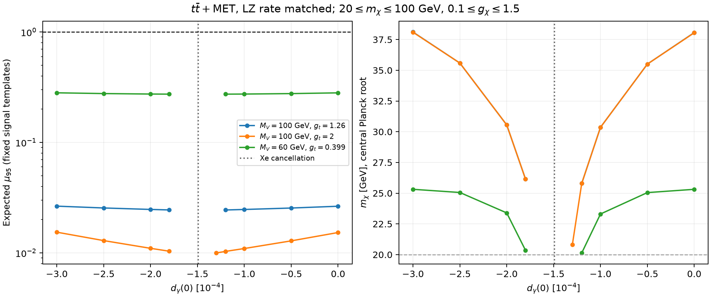

# 光子混合相消附近的 ttbar + MET expected 上限

2026-11-18

在这次选取的三个坐标上，向氙振幅相消点靠近会降低 expected $\mu_{95}$。信号增长受不可见分支比的上限约束。相消最强的几个测试位置已无法在既有质量与耦合范围内匹配 LZ 率，因此没有对应的 CMS 上限数值。穿过相消点后，LZ、Planck 解重新出现。

## 定义与计算

采用 $d=d_\gamma(0)=e\epsilon_\gamma(0)/g_t$，$e=0.302822$。固定 $\Delta m=1$ MeV、$f_2=0.5$ 和真值率目标 $N_{\rm ROI}=1.120444105$。LZ 使用项目既有质量归一化表、天然氙同位素求和与零动量减除后的 $c,b,t$ 有限项。光子混合的符号约定使质子耦合增加 $g_td$。

每个 $(M_V,g_t,d)$ 都通过工作站上已验证的光子流 CalcHEP/micrOMEGAs 实现重新计算 $\Omega h^2$，对质量求根，使 $\Omega h^2=0.1200$。扫描范围沿用 $20\leq m_\chi\leq100$ GeV、$0.1\leq g_\chi\leq1.5$。对阈值两侧分别搜索，质量括区最大间距为 0.70 GeV。主表展示通过 $M_V-m_1-m_2>5\Gamma_V$ 和 $\Gamma_V/M_V<3\%$ 的在壳解。湮灭顶点按既有扫描使用常数 $d$，完整时样形状因子未加入热平均。

ttbar 统计响应来自组员交付包 `ttbar_full_pkg.tar.gz` 的 `phase9/grid_gN.npz` 和 `templates_gN.json`，对应 CMS EXO-22-014 AH $0\ell2b$ 区。该分析使用 15 个 MET bin。通过组员的宽度、LZ 表和网格恢复固定信号模板的 expected 上限响应

$$
C(M_V)=\mu_{95}^{\rm exp}g_t^2\,\mathrm{BR}_{\rm inv}.
$$

在 60 和 100 GeV 两列分别用 40 和 23 个合法原网格点验证这一关系，最大相对离散为 $5.6\times10^{-5}$。恢复得到 $C(60)=0.04359450$、$C(100)=0.03863981$。新丰度解对应

$$
\mu_{95}^{\rm exp}(d)\simeq
\frac{C(M_V)}{g_t^2[1+2d/3]^2\mathrm{BR}_{\rm inv}(d)}.
$$

这一重标定沿用组员的分箱接受率和背景似然，并加入顶夸克辐射顶点的常数光子修正。它提供同一统计框架下的归一化敏感性估算。新探测器样本、各图干涉和完整时样光子形状因子尚未重算。组员模板的 CMS cutflow 验证仍是绝对上限的误差来源。有限样本规模在 60 GeV 为 399/26591，通过率 1.50%，100 GeV 为 619/26884，通过率 2.30%。

## 代表点结果

下表中的 $d$ 以 $10^{-4}$ 为单位，数值为 expected $\mu_{95}$。

| $d/10^{-4}$ | $M_V=60$ GeV, $g_t=0.39927$ | $M_V=100$ GeV, $g_t=1.26376$ | $M_V=100$ GeV, $g_t=2$ |
|---:|---:|---:|---:|
| 0 | 0.28131 | 0.026435 | 0.015281 |
| -0.5 | 0.27694 | 0.025466 | 0.012842 |
| -1.0 | 0.27433 | 0.024710 | 0.010946 |
| -1.2 | 0.27377 | 0.024457 | 0.010310 |
| -1.3 | 无在壳根 | 无在壳根 | 0.009979 |
| -1.4 | 无在壳根 | 无在壳根 | 无在壳根 |
| -1.49 | 无在壳根 | 无在壳根 | 无在壳根 |
| -1.6 | 无在壳根 | 无在壳根 | 无在壳根 |
| -1.8 | 0.27381 | 0.024473 | 0.010346 |
| -2.0 | 0.27441 | 0.024731 | 0.010991 |
| -2.5 | 0.27710 | 0.025500 | 0.012915 |
| -3.0 | 0.28156 | 0.026487 | 0.015391 |

“无在壳根”表示本次有界求根未找到目标解。该位置的 $\mu_{95}$ 留空。$g_\chi\leq1.5$ 是既有扫描上界。在相消中心，三个坐标仅匹配 LZ 率所需的最小 $g_\chi$ 分别约为 12.56、11.02、6.97，均已超出该上界。此最小值取自归一化质量节点，供解释截断来源。

对 100 GeV、$g_t=2$，参数从 $d=0$ 的 $(m_\chi,g_\chi,\mathrm{BR}_{\rm inv})=(38.049,0.2523,0.6322)$，变为 $d=-1.3\times10^{-4}$ 的 $(20.812,0.9773,0.9682)$。expected 上限由 0.015281 降到 0.009979，下降约 34.7%。60 GeV 点的分支比本来已达 0.9721，向相消点靠近时，上限只下降约 2.7%。

同一 $M_V$ 的纯在壳不可见衰变在窄宽极限下具有相同的总 MET，暗质量变化主要通过分支比进入本估算。离壳根的完整矩阵元与接受率需要另算，当前结果不向离壳支外推。

左图断线表示该采样位置缺少通过筛选的在壳根。右图两条 100 GeV 曲线在部分位置重叠。

## 可追溯文件

- `roots.jsonl` 保存工作站 micrOMEGAs 的全部 48 组求根结果，含辅助的 $M_V=60$ GeV、$g_t=1$ 一列。
- `expected_limits.csv` 保存主表的完整参数、分支比与 expected 上限。
- `matching.csv` 保存各混合设置下的 LZ 积分率倍率。
- `scaling_checks.json` 保存从组员网格恢复 expected 响应的一致性检查。
- `run_scan.py`、`remote_scan.py`、`summarize.py` 给出本次求根和固定模板重标定。
- `ttbar_inputs/` 保存从组员交付包读取的统计源代码及模板元数据。

本次数值用于评估光子混合对既有 ttbar 分析的影响。绝对 expected 上限继承组员统计模型和信号效率的验证精度。
