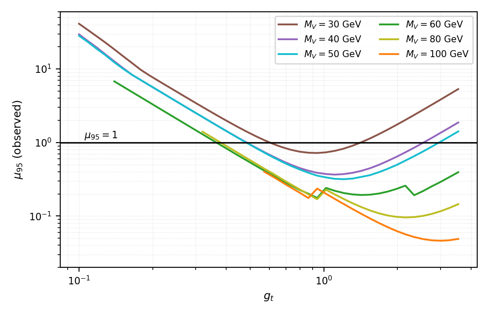

# Xenon recoil and LHC $t\bar t$+MET constraints on an exothermic pseudo-Dirac dark sector

**Abstract:** We study a pseudo-Dirac dark-matter model in which a vector mediator $V$ couples to quarks with a mass-weighted strength, $g_{Vq}=g_t\,\hat m_q/172$, and to the two nearly degenerate dark states through an off-diagonal current. The model has four free parameters: the dark-matter mass $m_\chi$, the mediator mass $M_V$, and the two couplings $g_t$ and $g_\chi$; the mass splitting is fixed at $\delta\equiv m_{\chi_2}-m_{\chi_1}=1$ MeV. We impose three constraints simultaneously: the xenon recoil rate reported by LZ, the thermal relic abundance measured by Planck ($\Omega_\chi h^2=0.12$), and the CMS search for $t\bar t$+MET at $\sqrt s=13$ TeV with $138\ \mathrm{fb}^{-1}$. The first two reduce the parameter space to the $(M_V,g_t)$ plane, on which the third defines a 95% CL exclusion region. At $M_V=20$ GeV the whole column survives; for $M_V=30$–$50$ GeV the allowed region splits into two $g_t$ windows with an excluded band in between; for $M_V=60$–$80$ GeV only a narrow strip $g_t\lesssim0.35$–$0.38$ remains; above $M_V\simeq90$ GeV the entire valid parameter range is excluded. The two windows arise because a small $g_t$ suppresses the signal as $g_t^2$, while a large $g_t$ drives $\Gamma(V\to q\bar q)\propto g_t^2$ and crushes $\mathrm{BR}(V\to\chi\chi)$.

## 1. Introduction

If dark matter scatters off nuclei exothermically — that is, if the incoming state is the heavier of the two mass eigenstates — then even very slow dark matter can produce nuclear recoils of several tens of keV. LZ has reported a candidate event at 248 keV in this energy range with a local significance of about 2.6$\sigma$. A single event neither establishes a discovery nor excludes a model, but it provides a quantitative constraint: if the event is due to dark-matter scattering, the scattering rate at the corresponding dark-matter mass must reproduce exactly the observed number of events.

We combine this condition with two independent constraints:

- **Direct detection:** the LZ recoil rate depends only on the combination $\kappa=g_tg_\chi/M_V^2$, and therefore fixes a surface in $\kappa$;
- **Thermal relic abundance:** the Planck value of $\Omega_\chi h^2$ fixes $m_\chi$ for each $M_V$;
- **Collider:** the CMS $t\bar t$+MET search sets an upper limit on $g_t$, which feeds back on $g_t$ itself through $\mathrm{BR}(V\to\chi\chi)$.

Section 2 introduces the model; Sections 3 and 4 give the normalisation of the first two constraints; Section 5 presents the $t\bar t$+MET analysis; Section 6 gives the combined exclusion region; Section 7 summarises.

## 2. Model

The dark sector consists of two nearly degenerate Majorana states and a vector mediator,

$$
\chi_1,\ \chi_2 \quad (m_{\chi_2}=m_{\chi_1}+\delta),\qquad
V_\mu\ (M_V),\qquad \delta=1\ \mathrm{MeV}.
$$

The Lagrangian is

```{=latex}
\begin{equation}\label{eq:lag}
\mathcal{L}\supset -\tfrac14 V_{\mu\nu}V^{\mu\nu}+\tfrac12 M_V^2V_\mu V^\mu
+\tfrac12\,V_\mu\,\bar\chi_2\,(g_\chi\gamma^\mu)\,\chi_1+\text{h.c.}
-V_\mu\sum_q g_{Vq}\,\bar q\gamma^\mu q ,
\end{equation}
```

```{=latex}
\begin{equation}\label{eq:gvq}
g_{Vq}=g_t\,\frac{\hat m_q}{172\ \mathrm{GeV}} .
\end{equation}
```

By Eq. (2) the coupling is linear in the quark mass and therefore largest for the top quark ($g_{Vt}=g_t$), which is what makes the $t\bar t$+MET channel sensitive. The relic abundance is solved on the grid $5\le m_\chi\le56$ GeV, $20\le M_V\le200$ GeV; the collider scan covers

$$
20\le M_V\le 200\ \mathrm{GeV},\qquad
0.1\le g_t\le\sqrt{4\pi}=3.545 ,
$$

and we require $\Gamma_V/M_V<3\%$ (narrow width) and $M_V-2m_\chi\ge 5\Gamma_V$ (kinematically open).

The model is implemented as a UFO. The signal samples were generated with `PseudoDiracFlavorEFT_UFO_loop`, in which the six quark couplings are independent external parameters (`Block flavcoup` entries 1–6) that the parameter card sets one by one according to Eq. (2); for $g_t=1$ they are $1.279\times10^{-5}$, $2.733\times10^{-5}$, $5.407\times10^{-4}$, $7.384\times10^{-3}$, $2.430\times10^{-2}$ and $1.000$. The $g_\chi$ and $\delta$ values go into `PDBINPUTS`, the mediator and dark-matter masses into `Block mass` (`9900032`, `100051`, `100052`). A second, single-parameter packaging, `PseudoDiracFlavorEFT_UFO_massprop` ($c_V=g_t/172$ in `PDBINPUTS`, $g_{Vq}=c_V\hat m_q$), has identical Feynman rules and gives 5.905 versus 5.836 pb at $M_V=100$ GeV, $g_t=1$ (a 1.17% difference); it serves as a cross-check of the coupling conventions. Signal samples are generated with MadGraph5_aMC@NLO 3.6.6, hadronised with Pythia8, passed through Delphes, and subjected to the analysis selection.

## 3. Direct detection: LZ rate normalisation

For exothermic scattering $\chi_2 N\to\chi_1 N$ the minimum incoming speed is

```{=latex}
\begin{equation}\label{eq:vmin}
v_{\min}=\left|\frac{q}{2\mu_N}-\frac{\delta}{q}\right|,
\qquad \mu_N=\frac{m_\chi m_N}{m_\chi+m_N},
\qquad q=\sqrt{2m_N E_R}.
\end{equation}
```

In Eq. (3) the $\delta$ term is negative, which pushes $v_{\min}$ well below its elastic value; this is what makes a 248 keV recoil accessible for $m_\chi\sim10$ GeV.

The rate factorises in the model parameters, $R\propto(g_tg_\chi)^2/M_V^4\equiv\kappa^2$, so requiring one event in the region of interest fixes a single combination:

```{=latex}
\begin{equation}\label{eq:kappa}
\kappa_{\mathrm{LZ}}(m_\chi)=\frac{g_tg_\chi}{M_V^2},
\qquad\Longrightarrow\qquad
g_\chi=\frac{\kappa_{\mathrm{LZ}}(m_\chi)\,M_V^2}{g_t}.
\end{equation}
```

Equation (4) is the first constraint and removes one degree of freedom. The calculation uses the coherent recoil spectrum of nine xenon isotopes ($\rho_\chi=0.3\ \mathrm{GeV/cm^3}$, $v_0=238$, $v_E=254$, $v_{\rm esc}=544$ km/s, ROI 5.4–269.9 keV, exposure 2.84 t$\cdot$yr) with an excited-state fraction $f_{\rm exc}=0.5$. The quantities $g_t$ and $g_\chi$ in Eq. (4) are model parameters, whereas the recoil code needs a nucleon coupling. For the vector current with $g_{Vq}=g_t\hat m_q/172$ the nucleon matrix element at $q^2\to0$ is the valence sum

$$g_N(p)=2g_{Vu}+g_{Vd}=g_t\times5.291\times10^{-5},$$

i.e. $5.291\times10^{-5}$ at $g_t=1$; the same model file (`vars1.mdl`) quotes $g_{Vu}=1.279\times10^{-5}$ and $g_{Vd}=2.733\times10^{-5}$, in exact agreement. The rate is proportional to $(g_Ng_\chi)^2/M_V^4$; the normalisation constant $1/16\pi$ in the code corresponds to the $1/2$ on the dark vertex in Eq. (1).

Solving point by point on 36 mass values (choosing $g_\chi$ such that the region of interest contains exactly one event; the 9–26 GeV range is sampled every 0.5 GeV) gives the curve of Fig. 1(b); the joint constraint is evaluated at the 14 abundance solutions:

$$
\kappa(8.53)=2.68\times10^{-5},\qquad
\kappa(12.03)=9.37\times10^{-5},
$$

$$
\kappa(24.10)=5.73\times10^{-5},\qquad
\kappa(37.86)=1.10\times10^{-4}\ \mathrm{GeV}^{-2}.
$$

The curve is not monotonic: it peaks at $m_\chi\approx13$ GeV ($1.17\times10^{-4}$), falls back to $5.6\times10^{-5}$ at $m_\chi\approx22$ GeV, and then rises slowly. The peak and the dip come from exothermic kinematics: which part of the region-of-interest window the recoil spectrum falls into varies steeply with $m_\chi$, and near $m_\chi\approx13$ GeV the minimum of $v_{\min}$ matches the ROI threshold worst, so the same event rate requires a larger coupling. This is also why a few-point interpolation cannot replace the point-by-point solution.

$\kappa$ scales as $f_{\rm exc}^{-1/2}$; with $f_{\rm exc}=0.1$ it increases by a factor 2.19, which is the largest single systematic uncertainty on the direct-detection axis.

The meaning of $\kappa$ changes with the dark-matter mass. A 248 keV true recoil has a kinematic floor: from Eq. (3) with $q=\sqrt{2m_N E_R}=0.246$ GeV the minimum speed $v_{\min}=\left|q/(2\mu_N)-\delta/q\right|$ is 3400, 2150, 1380 and 910 km/s at $m_\chi=8.5$, 12, 16 and 20 GeV, all above $v_{\rm esc}+v_E=798$ km/s; the lightest mass that can produce a 248 keV recoil is about 21.5 GeV. Hence for the $M_V\le50$ GeV columns ($m_\chi=8.5$–$20.2$ GeV) $\kappa$ means "one event in total in the region of interest", not "one event at 248 keV": the predicted recoil spectrum there is softer, 5–100 keV. Only the $M_V\ge60$ GeV columns ($m_\chi\ge24.1$ GeV) can also match the energy.

{width=98%}

## 4. Thermal relic abundance

The two states are almost degenerate, so before freeze-out $\chi_1\chi_1$, $\chi_1\chi_2$ and $\chi_2\chi_2$ annihilate simultaneously, with the effective cross section

```{=latex}
\begin{equation}\label{eq:sigmav}
\langle\sigma v\rangle_{\rm eff}
=\tfrac14\langle\sigma v\rangle_{11}
+\tfrac12\langle\sigma v\rangle_{12}
+\tfrac14\langle\sigma v\rangle_{22},
\end{equation}
```

and the abundance follows from the standard freeze-out equation. Neglecting co-annihilation (keeping only the first term of Eq. 5) underestimates $\Omega h^2$ by about a factor of two, so it must be included.

We solve `darkOmega` with micrOMEGAs 7.1 on a $(m_\chi,M_V)$ grid: $m_\chi$ from 5 to 56 GeV and $M_V$ from 20 to 200 GeV, 20–26 points per column, refined to 0.3 GeV around the $\chi\chi$ threshold $m_\chi=M_V/2$. At every grid point $g_\chi$ is fixed by the LZ condition of Eq. (4) ($g_t=1$, $g_\chi=\kappa_{\rm LZ}M_V^2$), and we then impose the Planck band $0.1176\le\Omega_\chi h^2\le0.1224$. At the reference point $m_\chi=35$ GeV, $M_V=87.68$ GeV, $g_\chi=0.180$, $g_t=1.80$ we reproduce $\Omega h^2=0.123$, 2.5% from the target, which validates the chain. Since $\mathrm{d}\Omega/\mathrm{d}m_\chi$ is steep, the $\pm1\sigma$ abundance band corresponds to an O(1%) change in $m_\chi$, so each $M_V$ has a single solution at the centre of the band, $m_\chi^{\rm relic}(M_V)$. Figure 1(a) shows this band: $m_\chi$ rises monotonically from 8.53 GeV at $M_V=20$ GeV to 37.86 GeV at $M_V=200$ GeV, always satisfying $2m_\chi<M_V$, i.e. the $\chi\chi$ channel is open along the whole band.

The $M_V=20$ GeV column deserves a comment: at the $\chi\chi$ threshold $m_\chi=M_V/2=10$ GeV the resonance drives $\Omega h^2$ down to $1.3\times10^{-4}$, and $\Omega h^2=0.12$ has a solution on each side (8.53 and 10.34 GeV). We take 8.53 GeV, which satisfies $2m_\chi<M_V$; the other solution lies above threshold, where the $\chi\chi$ channel is closed and contributes nothing to the $t\bar t$+MET signal. At this solution $2m_\chi/M_V=0.85$, 2.9 GeV below threshold, so it is no longer on the steep resonance flank; with the 0.3 GeV grid the root is obtained by interpolation between adjacent points and is accurate to about 0.05 GeV (below 2% in $\kappa$). The other 13 solutions all lie in $0.38\le2m_\chi/M_V\le0.81$: for $M_V\le60$ GeV they sit about 20% below the $s$-channel $V$ pole (the resonance funnel) and move away as $M_V$ grows, reaching 0.38 at 200 GeV. No column lies on the steep flank at $2m_\chi=M_V$.

## 5. LHC $t\bar t$+MET analysis

### 5.1 Signal and selection

The signal is $pp\to t\bar t\,V$ with $V\to\chi_1\chi_2$, giving a top-quark pair plus large $p_T^{\rm miss}$. We use the AH $0\ell 2b$ region of CMS EXO-22-014: zero leptons, $n_{\rm jet}\ge3$ ($p_T>30$ GeV, $|\eta|<2.4$), $n_b\ge2$, $p_T^{\rm miss}>250$ GeV, $\min\Delta\phi(j_{1,2},p_T^{\rm miss})>0.8$, $m_T^b>140$ GeV and $p_T(j_1)/H_T<0.5$, for an integrated luminosity of $138\ \mathrm{fb}^{-1}$.

The signal yield is

```{=latex}
\begin{equation}\label{eq:yield}
s_i(M_V,g_t)=\varepsilon_i(M_V)\;\sigma_{t\bar tV}(M_V)\;g_t^2\;
\mathrm{BR}(V\to\chi\chi;g_\chi,g_t)\;\mathcal{L},
\end{equation}
```

where $\varepsilon_i$ is the efficiency and shape in the 15 $p_T^{\rm miss}$ bins, measured on $2.6$–$2.7\times10^4$ full-chain events per mass point (164–1346 passing, efficiency 0.61%–4.92%).

### 5.2 Statistical model

The statistical inputs are taken directly from the CMS post-fit results: signal, total background, background components and observed counts in 15 bins, with the per-bin background uncertainty reconstructed from the quadrature sum of the components (Fig. 2). The likelihood is

```{=latex}
\begin{equation}\label{eq:lik}
\begin{split}
-2\ln L(\mu,\theta)=\;&\sum_{i=1}^{15}\Big[-2\big(n_i\ln\!\big(b_i(1+\theta)+\mu s_i\big)
-\big(b_i(1+\theta)+\mu s_i\big)\big)\Big]\\
&+\Big(\frac{\theta}{w}\Big)^{2},
\qquad w=\frac{\sum_i\sigma_i}{\sum_i b_i}=3.26\% ,
\end{split}
\end{equation}
```

i.e. one background nuisance $\theta$ per signal region (coherent within the region; the constraint term is the second line of Eq. 7). The test statistic is $\tilde q_\mu$, CLs is computed with the asymptotic formulae of Cowan et al., and the expected limit uses the Asimov data set.

{width=72%}

### 5.3 Independent validation of the statistical framework

The statistical chain is cross-checked at two levels (the itemised records are in `cmsrepro/phase2/PHASE_2_REPORT.md` and `cmsrepro/phase25/PHASE_25_REPORT.md`).

**Single signal region.** The likelihood of Eq. (7) is compared point by point with the HEP-standard implementation pyhf 0.7.6 on the same inputs (Table 1):

| | $\hat\mu$ | $\mu_{95}$ (this work) | $\mu_{95}$ (pyhf) | deviation |
|---|---|---|---|---|
| Expected (Asimov) | 0.000 | 0.3959 | 0.3963 | −0.10% |
| Observed | 1.0465 | 1.3893 | 1.3896 | −0.02% |

: Comparison of the likelihood of Eq. (7) with pyhf 0.7.6 on the same inputs (AH $0\ell2b$, single region).

**All signal regions.** The CMS record contains 11 signal regions (AH 3, SL 6, DL 2) with 99 bins in total. Combining them in a joint likelihood with a shared $\mu$, the agreement with pyhf is 0.04% (expected) and 0.01% (observed).

**Signal normalisation.** The production cards published by CMS show that the signal is generated from the 0-parton and 1-parton sub-processes of $pp\to t\bar tV$ with MLM matching and a fixed scale of 91.188 GeV, so the signal templates correspond to the combined LO cross section $\sigma_{\rm ref}=1.06241$ pb. The ratio of this value to the 0-parton table rises monotonically from 1.29 at 50 GeV to 1.95 at 200 GeV, consistent with one additional parton.

### 5.4 Limits

Table 2 collects the 95% CL limits. $\mu_{95}$ is the dimensionless signal strength relative to the CMS template; the cross-section limits in the third and fifth columns follow from $\sigma_{95}=\mu_{95}\,\sigma_{\rm ref}$ with $\sigma_{\rm ref}=1.06241$ pb. Row 1 is the single region, row 2 the 11-region combination with per-bin independent errors and row 3 the same with the coherent errors of Eq. (7). All calculations use the CMS signal templates, so they can be compared directly with the official row.

| calculation | $\mu_{95}$ exp | $\sigma_{95}$ exp [pb] | $\mu_{95}$ obs | $\sigma_{95}$ obs [pb] |
|---|---|---|---|---|
| single region $0\ell2b$ | 0.396 | 0.421 | 1.389 | 1.476 |
| 11 regions (independent) | 0.232 | 0.246 | 0.954 | 1.013 |
| 11 regions (coherent) | 0.258 | 0.274 | 0.784 | 0.833 |
| CMS official | — | 0.295 | — | 0.532 |

: Summary of the 95% CL limits ($\sigma_{\rm ref}=1.06241$ pb, $\sigma_{95}=\mu_{95}\sigma_{\rm ref}$).

The combination is about 35% stronger than the single region, consistent with AH $0\ell2b$ dominating the sensitivity. The residual difference from the official value has two sources: the official fit includes correlated systematic uncertainties across regions and the control-region constraints, whereas our inputs are the post-fit per-bin errors.

One further caveat applies to the observed column: the background central values of CMS Fig. 2 come from a joint signal-plus-background fit to the same data. Treating the post-fit background as an independent prior and then applying the observed counts of the same signal region re-uses the data, so the observed limits are indicative only; the validation of the statistical framework rests on the agreement of the expected column with pyhf (0.04%).

## 6. Combined constraints and exclusion region

### 6.1 The $(M_V,g_t)$ plane

Inserting Eq. (4) and the abundance solution of Section 4 reduces the parameter space to two dimensions:

```{=latex}
\begin{equation}\label{eq:plane}
g_\chi=\frac{\kappa_{\rm LZ}(m_\chi)M_V^2}{g_t},
\qquad m_\chi=m_\chi^{\rm relic}(M_V).
\end{equation}
```

Each column $M_V$ then fixes $m_\chi$, $g_\chi(g_t)$, $\Gamma_V(g_t)$ and $\mathrm{BR}(V\to\chi\chi)$; where several abundance solutions exist for one $M_V$ we keep the branch with $2m_\chi<M_V$ (only $M_V=20$ GeV has two, and we take 8.53 GeV). Substituting Eq. (8) into Eq. (6) gives the signal yield of that column.

### 6.2 Origin of the two $g_t$ windows

The contour structure of Fig. 3 is governed by two opposing scalings:

```{=latex}
\begin{equation}\label{eq:br}
s\propto g_t^2\;\mathrm{BR}(V\to\chi\chi),
\qquad
\mathrm{BR}=\frac{\Gamma_{\chi\chi}}{\Gamma_{\chi\chi}+\Gamma_{q\bar q}},
\qquad
\Gamma_{q\bar q}\propto g_t^2\sum_q\Big(\frac{m_q}{172}\Big)^2 .
\end{equation}
```

By Eq. (9), a small $g_t$ suppresses the yield through $g_t^2$ and the signal falls below the background; a large $g_t$ makes $\Gamma_{q\bar q}$ grow as $g_t^2$ and crushes $\mathrm{BR}$, so the signal vanishes again. In between, $\mu_{95}$ has a minimum and defines an excluded interval. For $M_V=30$–$50$ GeV this interval does not reach $g_t=0$ or $g_t=\sqrt{4\pi}$, so the allowed region appears as two disconnected $g_t$ windows; above $M_V\simeq60$ GeV the large-$g_t$ side is excluded entirely and only a narrow low-$g_t$ strip survives. Figure 4 shows $\mu_{95}(g_t)$; the window edges are its intersections with $\mu_{95}=1$.

{width=100%}

### 6.3 Results

| $M_V$ [GeV] | $\min\mu_{95}$ (exp) | $\min\mu_{95}$ (obs) | verdict |
|---|---|---|---|
| 20 | 2.07 | 5.71 | column allowed |
| 30 | 0.221 | 0.720 | $g_t\le0.57$ or $\ge1.42$ |
| 40 | 0.105 | 0.366 | $g_t\le0.48$ or $\ge2.76$ |
| 50 | 0.103 | 0.317 | $g_t\le0.45$ or $\ge3.00$ |
| 60 | 0.042 | 0.177 | $g_t\lesssim0.35$ |
| 70 | 0.028 | 0.146 | $0.21\le g_t\le0.38$ |
| 80 | 0.018 | 0.096 | $0.32\le g_t\le0.38$ |
| 90 | 0.011 | 0.053 | column excluded |
| 100 | $8.6\times10^{-3}$ | 0.046 | column excluded |
| 120 | $6.0\times10^{-3}$ | 0.033 | column excluded |
| 140 | $4.2\times10^{-3}$ | 0.020 | column excluded |
| 160 | $4.0\times10^{-3}$ | 0.021 | column excluded |
| 180 | $4.2\times10^{-3}$ | 0.022 | column excluded ($g_t\ge2.34$) |
| 200 | $3.9\times10^{-3}$ | 0.020 | column excluded ($g_t\ge3.00$) |

: Minimum $\mu_{95}$ per $M_V$ column and the allowed $g_t$ interval (observed, with the error model of Table 2).

The large white area in the lower-right of Fig. 3 is produced by the validity requirement $g_\chi\le1.5$: by Eq. (8), $g_\chi=\kappa M_V^2/g_t$ grows as $M_V^2$ at fixed $g_t$, so every column requires $g_t\ge\kappa M_V^2/1.5$ — 0.14 from $M_V=60$ GeV, 0.55 from 100 GeV, 1.28 from 140 GeV, 2.31 from 180 GeV and 2.93 from 200 GeV. The last value is still below the perturbativity bound $\sqrt{4\pi}=3.545$, so the 200 GeV column retains a narrow valid strip at the top. The bound $\Gamma_V/M_V\le3\%$ only acts at smaller $g_t$, with a boundary to the left of $g_\chi=1.5$, so the white edge seen in the figure is set by the $g_\chi$ criterion.

For $M_V=30$–$50$ GeV both ends of the two windows lie inside $g_\chi<1.5$ and $\Gamma_V/M_V<3\%$ (the tightest point is $M_V=50$ GeV, $g_t=0.1$, with $g_\chi=1.42$), so these windows are genuine $\mu_{95}$ crossings rather than artefacts of the validity cuts.

{width=74%}

### 6.4 Systematic uncertainties

Table 4 summarises the systematic uncertainties and the direction in which they move the exclusion region.

| source | effect |
|---|---|
| $f_{\rm exc}$ (0.5 versus 0.1) | $\kappa$ changes by a factor 2.19, the allowed region shrinks |
| single region, no control regions | observed limit about 50% weaker |
| coherent errors instead of the official covariance | expected limit 7%–16% stronger |
| full-chain efficiency not aligned with the CMS cut-flow | exclusion region systematically larger |
| no NLO corrections | signal rate too low, $g_t$ limit conservative |
| nucleon normalisation of $\kappa_{\rm LZ}$ (valence-quark prescription for $g_N$) | shifts the windows overall; the equal-weight $g_B/6$ prescription gives a $g_N$ that differs by 7.25 |
| signal templates generated at the previous band's $m_\chi$ (3%–26% higher, above 14% for $M_V\ge100$) | samples not regenerated; about 10% extra uncertainty on the $M_V=70$–80 GeV window edges |

: Systematic uncertainties and their effect on the exclusion region.

The value of $\kappa_{\rm LZ}$ depends on the nucleon-coupling convention. We use the mass-weighted couplings of the model itself, $g_N(p)=2g_{Vu}+g_{Vd}=5.291\times10^{-5}$ at $g_t=1$, which are the same parameters as $g_{Vq}=g_t\hat m_q/172$, so there is no additional normalisation uncertainty. In the alternative convention often used in the literature — $g_B$ shared equally among six quarks, $g_{Vq}=g_B/6$ — the valence sum gives $g_B/2$, a factor 7.25 smaller than ours, and the corresponding $\kappa$ differs by the same factor, translating the exclusion region as a whole. We do not adopt that convention: its quark couplings are flavour-blind, so it is not the same Lagrangian as the model studied here (whose top coupling is the largest), and the two $g_t$ cannot be converted into one another by a single number. Table 3 and Fig. 3 use our convention throughout.

## 7. Conclusions

We have combined the LZ xenon-recoil candidate, the Planck thermal relic abundance and the CMS $t\bar t$+MET search within a single parameterisation. The conclusions are:

1. The first two constraints reduce the four-dimensional parameter space to the $(M_V,g_t)$ plane: $g_\chi$ follows from Eq. (4) and $m_\chi$ from $\Omega_\chi h^2=0.12$.
2. At $M_V=20$ GeV the whole column survives; for $M_V=60$–$80$ GeV only a narrow strip $g_t\lesssim0.35$–$0.38$ remains (the lower edge at $M_V=70$ and 80 GeV is set by $g_\chi\le1.5$, at 0.21 and 0.32); above $M_V\simeq90$ GeV the entire valid parameter range is excluded.
3. For $M_V=30$–$50$ GeV two $g_t$ windows appear (e.g. $g_t\le0.48$ and $g_t\ge2.76$ at $M_V=40$ GeV). They follow from the opposing scalings of $g_t^2$ and $\mathrm{BR}(V\to\chi\chi)$ in Eq. (9) and are not statistical fluctuations; both windows lie inside $g_\chi<1.5$ and $\Gamma_V/M_V<3\%$.
4. The statistical framework is independently validated against pyhf (0.10%/0.02% for the single region, 0.04%/0.01% for the 11-region combination) and the signal normalisation is fixed by the CMS production cards at 1.06241 pb, so Table 2 can be compared directly with the official limits.

Further work includes control-region constraints to recover the observed sensitivity, the official covariance matrix, NLO corrections to the signal, and a bin-by-bin alignment of the efficiency curve with the CMS cut-flow.

## References

[1] CMS Collaboration, *Search for dark matter produced in association with top quarks in proton–proton collisions at $\sqrt s=13$ TeV*, JHEP 08 (2025) 085, arXiv:2505.05300.

[2] Planck Collaboration, *Planck 2018 results. VI. Cosmological parameters*, A&A 641 (2020) A6.

[3] G. Cowan, K. Cranmer, E. Gross, O. Vitells, *Asymptotic formulae for likelihood-based tests of new physics*, Eur. Phys. J. C 71 (2011) 1554.

[4] L. Heinrich et al., *pyhf: pure-Python implementation of HistFactory statistical models*, JOSS 6 (2021) 3173.

[5] G. Bélanger, F. Boudjema, A. Pukhov, A. Semenov, *micrOMEGAs: a tool for dark matter studies*, Comput. Phys. Commun. 192 (2015) 322.

[6] J. Alwall et al., *The automated computation of tree-level and next-to-leading order differential cross sections*, JHEP 07 (2014) 079.

[7] T. Sjöstrand et al., *An introduction to PYTHIA 8.2*, Comput. Phys. Commun. 191 (2015) 159.

[8] J. de Favereau et al., *DELPHES 3: a modular framework for fast simulation of a generic collider experiment*, JHEP 02 (2014) 057.
