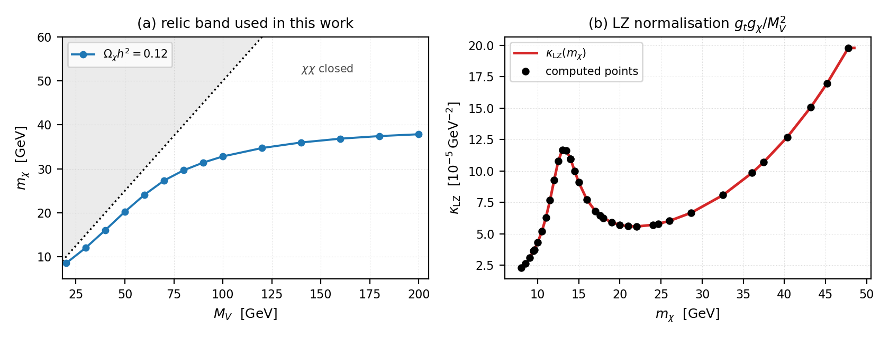
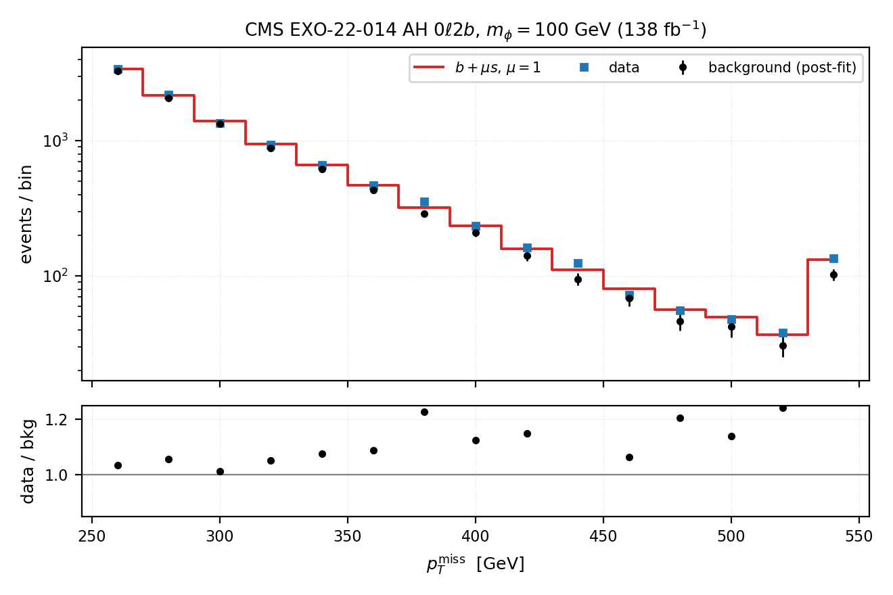
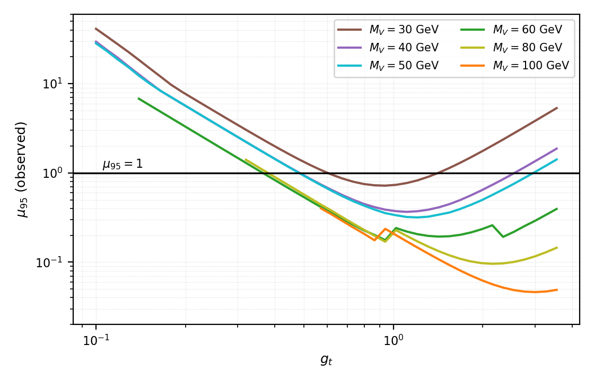

# 放热型伪狄拉克暗物质的氙核反冲与 LHC $t\bar t$+MET 约束

**摘要：** 本文研究一个由矢量中介子 $V$ 传递相互作用的伪狄拉克暗物质模型。模型有四个自由参数：
暗物质质量 $m_\chi$、中介子质量 $M_V$ 与两个耦合 $g_t$、$g_\chi$；两个暗物质态的质量劈裂固定为
$\delta\equiv m_{\chi_2}-m_{\chi_1}=1$ MeV。夸克耦合按质量加权，$g_{Vq}=g_t\,\hat m_q/172$。
我们同时施加三条约束：LZ 实验的氙核反冲事件率、Planck 卫星测定的热遗迹丰度
$\Omega_\chi h^2=0.12$，以及 CMS 在 $\sqrt s=13$ TeV、$138\ \mathrm{fb}^{-1}$ 下对
$t\bar t$+MET 末态的搜索。前两条把参数空间压到 $(M_V,g_t)$ 平面，第三条在该平面上给出 95% CL 排除域。
结果显示：$M_V=20$ GeV 整列存活；在 $M_V=30$–$50$ GeV，允许区被分成两个 $g_t$ 窗口，
中间一段被排除；$M_V=60$–$80$ GeV 只剩 $g_t\lesssim0.35$–$0.38$ 的窄带；
$M_V\gtrsim90$ GeV 的有效参数区整段被排除。
两个窗口的成因是：$g_t$ 过小使信号按 $g_t^2$ 压低，$g_t$ 过大又使
$\Gamma(V\to q\bar q)\propto g_t^2$ 压垮 $\mathrm{BR}(V\to\chi\chi)$。

## 1. 引言

暗物质与核的散射若为放热（exothermic）型，即入射态是较重的那一个质量本征态，
则极低速度的暗物质也能把核反冲推到几十 keV 的量级。LZ 实验在这一能区报告了一个
位于 248 keV 的候选事例，局部显著性约 2.6$\sigma$。单个事例既不足以宣布发现，
也不足以排除模型，但它提供了一个定量的约束：如果该事例来自暗物质散射，
则在对应的暗物质质量上，散射率必须恰好给出观测到的事件数。

本文把这一条件与另外两条独立约束联合使用：

- **直接探测**：LZ 的反冲率只依赖耦合组合 $\kappa=g_tg_\chi/M_V^2$，因而给出 $\kappa$ 的一个等值面；
- **热遗迹丰度**：Planck 测定的 $\Omega_\chi h^2$ 固定了每个 $M_V$ 对应的 $m_\chi$；
- **对撞机**：CMS 的 $t\bar t$+MET 搜索对 $g_t$ 给出上限，且该上限经 $\mathrm{BR}(V\to\chi\chi)$ 反作用于 $g_t$ 本身。

第 2 节给出模型；第 3、4 节分别给出前两条约束的归一化；第 5 节是 $t\bar t$+MET 分析；
第 6 节给出联合后的排除域；第 7 节总结。

## 2. 模型

伪狄拉克暗物质由两个几乎简并的 Majorana 态与一个矢量中介子组成：

$$
\chi_1,\ \chi_2 \quad (m_{\chi_2}=m_{\chi_1}+\delta),\qquad
V_\mu\ (M_V),\qquad \delta=1\ \mathrm{MeV}.
$$

拉格朗日量为

```{=latex}
\begin{equation}\label{eq:lag}
\mathcal{L}\supset -\tfrac14 V_{\mu\nu}V^{\mu\nu}+\tfrac12 M_V^2V_\mu V^\mu
+\tfrac12\,V_\mu\,\bar\chi_2\,(g_\chi\gamma^\mu)\,\chi_1+\text{h.c.}
-V_\mu\sum_q g_{Vq}\,\bar q\gamma^\mu q ,
\end{equation}
```

```{=latex}
\begin{equation}\label{eq:gvq}
g_{Vq}=g_t\,\frac{\hat m_q}{172\ \mathrm{GeV}} .
\end{equation}
```

由式 (2)，耦合对夸克质量线性，顶夸克处最大（$g_{Vt}=g_t$），这正是 $t\bar t$+MET 通道敏感的原因。
遗迹丰度的求解范围为 $5\le m_\chi\le56$ GeV、$20\le M_V\le200$ GeV；
对撞机侧的扫描范围为

$$
20\le M_V\le 200\ \mathrm{GeV},\qquad
0.1\le g_t\le\sqrt{4\pi}=3.545 ,
$$

并要求 $\Gamma_V/M_V<3\%$（窄宽度）与 $M_V-2m_\chi\ge 5\Gamma_V$（运动学开阈）。

模型以 UFO 形式实现。信号样本用 `PseudoDiracFlavorEFT_UFO_loop` 生成：该实现把六个夸克耦合
写成独立的外部参数（`Block flavcoup` 的 1–6），参数卡按式 (2) 逐个设定，$g_t=1$ 时依次为
$1.279\times10^{-5}$、$2.733\times10^{-5}$、$5.407\times10^{-4}$、$7.384\times10^{-3}$、
$2.430\times10^{-2}$、$1.000$；$g_\chi$、$\delta$ 写入 `PDBINPUTS`，中介子与暗物质质量写入
`Block mass`（`9900032`、`100051`、`100052`）。另有一份单参数封装
`PseudoDiracFlavorEFT_UFO_massprop`（$c_V=g_t/172$ 写入 `PDBINPUTS`，$g_{Vq}=c_V\hat m_q$），
其费曼规则与前者逐项相同，在 $M_V=100$ GeV、$g_t=1$ 上给出 5.905 对 5.836 pb
（差 1.17%），用作耦合约定的交叉检查。信号样本由 MadGraph5_aMC@NLO 3.6.6 生成，
经 Pythia8 强子化与 Delphes 探测器模拟，再施加分析选择。

## 3. 直接探测：LZ 事件率归一化

对放热散射 $\chi_2 N\to\chi_1 N$，最小入射速度为

```{=latex}
\begin{equation}\label{eq:vmin}
v_{\min}=\left|\frac{q}{2\mu_N}-\frac{\delta}{q}\right|,
\qquad \mu_N=\frac{m_\chi m_N}{m_\chi+m_N},
\qquad q=\sqrt{2m_N E_R}.
\end{equation}
```

式 (3) 中 $\delta$ 项为负，使 $v_{\min}$ 显著低于弹性情形，这是 248 keV 反冲在
$m_\chi\sim10$ GeV 下可行的原因。

反冲率对模型参数的依赖完全因子化，$R\propto(g_tg_\chi)^2/M_V^4\equiv\kappa^2$，
因此"感兴趣区内的事件数等于观测值"只固定一个组合：

```{=latex}
\begin{equation}\label{eq:kappa}
\kappa_{\mathrm{LZ}}(m_\chi)=\frac{g_tg_\chi}{M_V^2},
\qquad\Longrightarrow\qquad
g_\chi=\frac{\kappa_{\mathrm{LZ}}(m_\chi)\,M_V^2}{g_t}.
\end{equation}
```

式 (4) 是第一个约束，消去一个自由度。计算采用九种氙同位素的相干反冲谱
（$\rho_\chi=0.3\ \mathrm{GeV/cm^3}$，$v_0=238$、$v_E=254$、$v_{\rm esc}=544$ km/s，
ROI 5.4–269.9 keV，曝光 2.84 t$\cdot$yr），受激态比例 $f_{\rm exc}=0.5$。
式 (4) 的 $g_t$、$g_\chi$ 是模型参数，反冲程序需要的是核子耦合。对 $g_{Vq}=g_t\hat m_q/172$
的矢量流，核子矩阵元在 $q^2\to0$ 时等于价夸克之和，
$$g_N(p)=2g_{Vu}+g_{Vd}=g_t\times5.291\times10^{-5},$$
取 $g_t=1$ 即 $5.291\times10^{-5}$；同一模型的 `vars1.mdl` 给出
$g_{Vu}=1.279\times10^{-5}$、$g_{Vd}=2.733\times10^{-5}$，与之逐位相符。
反冲率与 $(g_Ng_\chi)^2/M_V^4$ 成正比；程序中的归一常数 $1/16\pi$ 对应式 (1)
暗物质顶点上的 $1/2$。

在 36 个质量点上逐个求解（$g_\chi$ 取使感兴趣区事件数等于 1 的值；9–26 GeV 区间以 0.5 GeV 间隔加密），得图 1(b) 的曲线；联合约束在 14 个丰度解处取值：

$$
\kappa(8.53)=2.68\times10^{-5},\qquad
\kappa(12.03)=9.37\times10^{-5},
$$

$$
\kappa(24.10)=5.73\times10^{-5},\qquad
\kappa(37.86)=1.10\times10^{-4}\ \mathrm{GeV}^{-2}.
$$

曲线不是单调的：在 $m_\chi\approx13$ GeV 有一个峰（$1.17\times10^{-4}$），随后在
$m_\chi\approx22$ GeV 回落到 $5.6\times10^{-5}$，再随质量缓慢上升。峰与谷来自放热运动学——
1 MeV 的质量劈裂把反冲谱推到感兴趣区窗口的哪一段，随 $m_\chi$ 变化很陡；
在 $m_\chi\approx13$ GeV 附近 $v_{\min}$ 的极小值与 ROI 下阈最不匹配，同样的事件率需要更大的耦合。
这也说明不能用少数几个点的插值代替逐点求解。

$\kappa$ 与 $f_{\rm exc}^{-1/2}$ 成正比，$f_{\rm exc}=0.1$ 会使 $\kappa$ 增大 2.19 倍，
这是直接探测轴上最大的单一系统不确定性。

需要指出 $\kappa$ 的物理含义随质量变化。248 keV 的真值反冲有运动学下限：由式 (3) 与
$q=\sqrt{2m_N E_R}=0.246$ GeV，$v_{\min}=\left|q/(2\mu_N)-\delta/q\right|$ 在
$m_\chi=8.5$、12、16、20 GeV 时分别为 3400、2150、1380、910 km/s，全部超过
$v_{\rm esc}+v_E=798$ km/s；能产生 248 keV 反冲的最小质量约为 $21.5$ GeV。
因此 $M_V\le50$ GeV 各列（$m_\chi=8.5$–$20.2$ GeV）的 $\kappa$ 应读作
"感兴趣区内总计一个事例"，而不是"该事例的能量为 248 keV"——这些列预测的反冲谱更软，
集中在 5–100 keV；只有 $M_V\ge60$ GeV（$m_\chi\ge24.1$ GeV）才可能同时对上能量。

{width=98%}

## 4. 热遗迹丰度

两个态质量几乎简并，冻结前 $\chi_1\chi_1$、$\chi_1\chi_2$、$\chi_2\chi_2$ 同时湮灭，
有效截面为

```{=latex}
\begin{equation}\label{eq:sigmav}
\langle\sigma v\rangle_{\rm eff}
=\tfrac14\langle\sigma v\rangle_{11}
+\tfrac12\langle\sigma v\rangle_{12}
+\tfrac14\langle\sigma v\rangle_{22},
\end{equation}
```

丰度由标准冻结方程演化。忽略共湮灭（即式 (5) 只保留第一项）会低估 $\Omega h^2$ 约 2 倍，因此必须包含。

用 micrOMEGAs 7.1 在 $(m_\chi,M_V)$ 网格上求解 `darkOmega`：$m_\chi$ 取 5–56 GeV、
$M_V$ 取 20–200 GeV，每列 20–26 个点，$\chi\chi$ 阈值 $m_\chi=M_V/2$ 附近单独加密到 0.3 GeV；
每个网格点的 $g_\chi$ 由式 (4) 的 LZ 条件定出（$g_t=1$，$g_\chi=\kappa_{\rm LZ}M_V^2$），
再取 Planck 带 $0.1176\le\Omega_\chi h^2\le0.1224$。
在基准点 $m_\chi=35$、$M_V=87.68$、$g_\chi=0.180$、$g_t=1.80$ 上复算得
$\Omega h^2=0.123$，与目标值相差 2.5%，确认计算链正确。
由于 $\mathrm{d}\Omega/\mathrm{d}m_\chi$ 很陡，$\pm1\sigma$ 的丰度带只对应
$m_\chi$ 的 O(1%) 变化，故每个 $M_V$ 取带中心的唯一解 $m_\chi^{\rm relic}(M_V)$。
图 1(a) 给出这条带：$m_\chi$ 从 $M_V=20$ GeV 的 8.53 GeV 单调升到 $M_V=200$ GeV 的 37.86 GeV，
始终满足 $2m_\chi<M_V$，即 $\chi\chi$ 道在整条带上开放。

对 $M_V=20$ GeV 需要单独说明：$\Omega h^2(m_\chi)$ 在 $\chi\chi$ 阈值
$m_\chi=M_V/2=10$ GeV 处被共振压到 $1.3\times10^{-4}$，两侧各有一个 $\Omega h^2=0.12$ 的解
（8.53 与 10.34 GeV）。本文取 8.53 GeV——它满足 $2m_\chi<M_V$，另一个解位于阈值之上，
$\chi\chi$ 道已关闭，对 $t\bar t$+MET 信号没有贡献。该列在这个解处
$2m_\chi/M_V=0.85$，距阈值 2.9 GeV，已不在陡峭的共振翼上；网格加密到 0.3 GeV 后，
根由相邻两点插值定出，$m_\chi$ 的误差约 0.05 GeV（对 $\kappa$ 的影响 $<2\%$）。
其余 13 列的解全部落在 $0.38\le2m_\chi/M_V\le0.81$：$M_V\le60$ GeV 时紧贴
s-道 $V$ 极点下方约 20%（共振漏斗），$M_V$ 增大后逐渐离开，到 200 GeV 时为 0.38。
这条带上没有一列落在阈值 $2m_\chi=M_V$ 的陡翼上。

## 5. LHC $t\bar t$+MET 分析

### 5.1 信号与选择

信号过程为 $pp\to t\bar t\,V$、$V\to\chi_1\chi_2$，末态为顶夸克对加大 $p_T^{\rm miss}$。
采用 CMS EXO-22-014 的 AH $0\ell 2b$ 信号区：0 轻子、$n_{\rm jet}\ge3$（$p_T>30$ GeV，
$|\eta|<2.4$）、$n_b\ge2$、$p_T^{\rm miss}>250$ GeV、
$\min\Delta\phi(j_{1,2},p_T^{\rm miss})>0.8$、$m_T^b>140$ GeV、$p_T(j_1)/H_T<0.5$，
对应积分亮度 $138\ \mathrm{fb}^{-1}$。

信号产额按

```{=latex}
\begin{equation}\label{eq:yield}
s_i(M_V,g_t)=\varepsilon_i(M_V)\;\sigma_{t\bar tV}(M_V)\;g_t^2\;
\mathrm{BR}(V\to\chi\chi;g_\chi,g_t)\;\mathcal{L}
\end{equation}
```

计算，其中 $\varepsilon_i$ 为 15 个 $p_T^{\rm miss}$ bin 的效率与形状，
由 14 个质量点各 $2.6$–$2.7\times10^4$ 个全链样本测得（通过数 164–1346，效率 0.61%–4.92%）。

### 5.2 统计模型

统计输入直接取自 CMS 公布的拟合后结果：15 个 bin 的信号、总背景、分过程背景与观测数，
逐 bin 背景不确定度由各分项平方和重建（图 2）。似然取

```{=latex}
\begin{equation}\label{eq:lik}
\begin{split}
-2\ln L(\mu,\theta)=\;&\sum_{i=1}^{15}\Big[-2\big(n_i\ln\!\big(b_i(1+\theta)+\mu s_i\big)
-\big(b_i(1+\theta)+\mu s_i\big)\big)\Big]\\
&+\Big(\frac{\theta}{w}\Big)^{2},
\qquad w=\frac{\sum_i\sigma_i}{\sum_i b_i}=3.26\% .
\end{split}
\end{equation}
```

即每个信号区共用一个背景 nuisance $\theta$（区内相干，式 (7) 第二行的约束项）。
检验统计量取 $\tilde q_\mu$，用 Cowan 等人的渐近公式计算 CLs，expected 限值用 Asimov 数据集。

{width=72%}

### 5.3 统计框架的独立验证

统计链条在两个层级上被独立复核（逐项校验记录见 `cmsrepro/phase2/PHASE_2_REPORT.md`
与 `cmsrepro/phase25/PHASE_25_REPORT.md`）。

**单信号区。** 式 (7) 的似然与 HEP 标准实现 pyhf 0.7.6 在同一输入上逐点比较（表 1）：

| | $\hat\mu$ | $\mu_{95}$（本文） | $\mu_{95}$（pyhf） | 偏差 |
|---|---|---|---|---|
| Expected（Asimov） | 0.000 | 0.3959 | 0.3963 | −0.10% |
| Observed | 1.0465 | 1.3893 | 1.3896 | −0.02% |

: 式 (7) 的似然与 pyhf 0.7.6 在同一输入上的结果比较（AH $0\ell2b$，单区）。

**全部信号区。** CMS 记录中共有 11 个信号区（AH 3、SL 6、DL 2），合计 99 个 bin。
以共享 $\mu$ 的联合似然合并后，本文与 pyhf 的一致性为 0.04%（expected）与 0.01%（observed）。

**信号归一化。** CMS 公布的产生卡显示信号由 $pp\to t\bar tV$ 的 0-parton 与 1-parton
两个子过程生成、采用 MLM 匹配与固定标度 91.188 GeV，因此信号模板对应的是
合并后的 LO 截面 $\sigma_{\rm ref}=1.06241$ pb。该值与 0-parton 表的比值从 50 GeV 的 1.29
单调升到 200 GeV 的 1.95，与"多一个额外 parton"的预期一致。

### 5.4 限值

表 2 汇总 95% CL 上限。$\mu_{95}$ 是无量纲的信号强度，定义为相对 CMS 模板的倍数；
第三、五列的截面上限由 $\sigma_{95}=\mu_{95}\,\sigma_{\rm ref}$ 换算（$\sigma_{\rm ref}=1.06241$ pb）。
第 1 行为单区、第 2 行为 11 区合并且逐 bin 独立误差、第 3 行为式 (7) 的区内相干误差。
所有计算都使用 CMS 自己发布的信号模板，因此可以与官方行直接比较。

| 计算 | $\mu_{95}$ exp | $\sigma_{95}$ exp [pb] | $\mu_{95}$ obs | $\sigma_{95}$ obs [pb] |
|---|---|---|---|---|
| 单区 $0\ell2b$ | 0.396 | 0.421 | 1.389 | 1.476 |
| 11 区（独立） | 0.232 | 0.246 | 0.954 | 1.013 |
| 11 区（相干） | 0.258 | 0.274 | 0.784 | 0.833 |
| CMS 官方 | — | 0.295 | — | 0.532 |

: 95% CL 上限汇总（$\sigma_{\rm ref}=1.06241$ pb，$\sigma_{95}=\mu_{95}\sigma_{\rm ref}$）。

联合限值比单区强约 35%，与 AH $0\ell2b$ 主导灵敏度一致。与官方值的剩余差异来自两处：
官方拟合包含跨区相关的系统误差与控制区约束，而本文的输入是拟合后的逐 bin 误差。

observed 一列另有一处需要说明：CMS 图 2 的背景中心值来自对同一数据的信号+背景联合拟合。
把拟合后的背景当作独立先验、再输入同一信号区的观测计数，会重复使用数据，因此 observed 限值只作参考；
统计框架的验证依据是 expected 一列与 pyhf 的一致性（0.04%）。

## 6. 联合约束与排除域

### 6.1 $(M_V,g_t)$ 平面

把式 (4) 与第 4 节的丰度解代入，参数空间降为二维：

```{=latex}
\begin{equation}\label{eq:plane}
g_\chi=\frac{\kappa_{\rm LZ}(m_\chi)M_V^2}{g_t},
\qquad m_\chi=m_\chi^{\rm relic}(M_V).
\end{equation}
```

每一列 $M_V$ 由此确定 $m_\chi$、$g_\chi(g_t)$、$\Gamma_V(g_t)$ 与 $\mathrm{BR}(V\to\chi\chi)$；
若同一 $M_V$ 有多个丰度解，取满足 $2m_\chi<M_V$ 的那一支（只有 $M_V=20$ GeV 有两个解，取 8.53 GeV）。
把式 (8) 代入式 (6) 即得该列的信号产额。

### 6.2 两个 $g_t$ 窗口的成因

图 3 的等值线结构由两个相反的标度决定：

```{=latex}
\begin{equation}\label{eq:br}
s\propto g_t^2\;\mathrm{BR}(V\to\chi\chi),
\qquad
\mathrm{BR}=\frac{\Gamma_{\chi\chi}}{\Gamma_{\chi\chi}+\Gamma_{q\bar q}},
\qquad
\Gamma_{q\bar q}\propto g_t^2\sum_q\Big(\frac{m_q}{172}\Big)^2 .
\end{equation}
```

由式 (9)，$g_t$ 很小时 $g_t^2$ 压低总产额，信号落入背景之下，模型存活；
$g_t$ 很大时 $\Gamma_{q\bar q}$ 按 $g_t^2$ 增长而把 $\mathrm{BR}$ 压得很小，
信号同样消失，模型重新存活。两者之间 $\mu_{95}$ 取极小值，构成被排除的区间。
在 $M_V=30$–$50$ GeV，被排除的区间没有触及 $g_t=0$ 与 $g_t=\sqrt{4\pi}$ 两端，
于是允许区表现为两个互不相连的 $g_t$ 窗口；$M_V\ge60$ GeV 后，
$g_t$ 大的一侧整段被排除，只剩低 $g_t$ 的一条窄带。
图 4 给出 $\mu_{95}(g_t)$ 的曲线，窗口边界即它与 $\mu_{95}=1$ 的交点。

{width=100%}

### 6.3 结果

| $M_V$ [GeV] | $\min\mu_{95}$ (exp) | $\min\mu_{95}$ (obs) | 判定 |
|---|---|---|---|
| 20 | 2.07 | 5.71 | 整列存活 |
| 30 | 0.221 | 0.720 | $g_t\le0.57$ 或 $\ge1.42$ |
| 40 | 0.105 | 0.366 | $g_t\le0.48$ 或 $\ge2.76$ |
| 50 | 0.103 | 0.317 | $g_t\le0.45$ 或 $\ge3.00$ |
| 60 | 0.042 | 0.177 | $g_t\lesssim0.35$ |
| 70 | 0.028 | 0.146 | $0.21\le g_t\le0.38$ |
| 80 | 0.018 | 0.096 | $0.32\le g_t\le0.38$ |
| 90 | 0.011 | 0.053 | 整列排除 |
| 100 | $8.6\times10^{-3}$ | 0.046 | 整列排除 |
| 120 | $6.0\times10^{-3}$ | 0.033 | 整列排除 |
| 140 | $4.2\times10^{-3}$ | 0.020 | 整列排除 |
| 160 | $4.0\times10^{-3}$ | 0.021 | 整列排除 |
| 180 | $4.2\times10^{-3}$ | 0.022 | 整列排除（$g_t\ge2.34$） |
| 200 | $3.9\times10^{-3}$ | 0.020 | 整列排除（$g_t\ge3.00$） |

: 各 $M_V$ 列的最小 $\mu_{95}$ 与 $g_t$ 的允许区间（observed 判定，表 2 的误差模型）。

图 3 右下方的大片白色是有效性判据 $g_\chi\le1.5$ 造成的：由式 (8)，
$g_\chi=\kappa M_V^2/g_t$，固定 $g_t$ 时它按 $M_V^2$ 增长，于是每一列都要求
$g_t\ge\kappa M_V^2/1.5$——$M_V=60$ GeV 起为 $0.14$，$100$ GeV 起为 $0.55$，
$140$ GeV 起为 $1.28$，$180$ GeV 起为 $2.31$，$200$ GeV 起为 $2.93$。
最后这个值仍低于微扰上限 $\sqrt{4\pi}=3.545$，所以 200 GeV 一列只剩顶端一条窄带有效。
$\Gamma_V/M_V\le3\%$ 在更小的 $g_t$ 处才起作用，其边界落在 $g_\chi=1.5$ 的左侧，
因此图上看到的白边由 $g_\chi$ 判据给出。

在 $M_V=30$–$50$ GeV，两个窗口的两端都落在 $g_\chi<1.5$ 与 $\Gamma_V/M_V<3\%$ 之内
（最紧的一处是 $M_V=50$ GeV、$g_t=0.1$，$g_\chi=1.42$），
因此这些窗口是真实的 $\mu_{95}$ 穿越，不是被有效性判据切出来的。

{width=74%}

### 6.4 系统不确定性

各项系统不确定性及其对排除域的影响方向汇总于表 4。

| 来源 | 影响 |
|---|---|
| $f_{\rm exc}$（0.5 对 0.1） | $\kappa$ 变化 2.19 倍，存活区整体收缩 |
| 单区、无控制区 | observed 限值偏弱约 50% |
| 区内相干替代官方协方差 | expected 限值偏强 7%–16% |
| 全链效率未与 CMS cut-flow 对齐 | 图 3 的排除域系统性偏大 |
| 无 NLO 修正 | 信号率偏低，$g_t$ 上限偏保守 |
| $\kappa_{\rm LZ}$ 的核子归一（$g_N$ 的价夸克口径） | 整体移动窗口；换成等权 $g_B/6$ 口径时 $g_N$ 差 7.25 倍 |
| 信号模板按上一版丰度带的 $m_\chi$ 生成（低 3%–26%，$M_V\ge100$ 起超过 14%） | 样本未重生成，$M_V=70$–$80$ 的窗口边界另有约 10% 不确定度 |

: 系统不确定性及其对排除域的影响方向。

$\kappa_{\rm LZ}$ 的数值依赖核子耦合的口径。本文用模型自身的质量加权耦合，
$g_N(p)=2g_{Vu}+g_{Vd}=5.291\times10^{-5}$（$g_t=1$），这与 $g_{Vq}=g_t\hat m_q/172$
是同一套参数，不存在额外的归一不确定性。若改用另一种常见写法——$g_B$ 等权分给六个夸克、
$g_{Vq}=g_B/6$——则按价夸克求和的核子耦合是 $g_B/2$，与本文相差 7.25 倍，
对应的 $\kappa$ 相差 7.25 倍，排除域会整体平移。
本文不采用那套口径：它的夸克耦合与味无关，与本模型（顶夸克耦合最大）不是同一个拉氏量，
两边的 $g_t$ 不能用一个数互相换算。表 3 与图 3 一律用本文口径。

## 7. 结论

本文把 LZ 的氙核反冲候选事例、Planck 的热遗迹丰度与 CMS 的 $t\bar t$+MET 搜索
放在同一套参数化下联合分析，结论如下。

1. 前两条约束将四维参数空间压到 $(M_V,g_t)$ 平面：$g_\chi$ 由式 (4) 决定，
   $m_\chi$ 由 $\Omega_\chi h^2=0.12$ 决定。
2. $M_V=20$ GeV 整列存活；$M_V=60$–$80$ GeV 只剩 $g_t\lesssim0.35$–$0.38$ 的窄带
   （$M_V=70$、$80$ GeV 的窗口下界由 $g_\chi\le1.5$ 给出，分别为 0.21、0.32）；
   $M_V\gtrsim90$ GeV 的有效参数区整段被排除。
3. $M_V=30$–$50$ GeV 出现两个 $g_t$ 窗口（例如 $M_V=40$ GeV 为 $g_t\le0.48$ 与
   $g_t\ge2.76$），成因是式 (9) 中 $g_t^2$ 与 $\mathrm{BR}(V\to\chi\chi)$ 的相反标度，
   不是统计涨落；这些窗口都落在 $g_\chi<1.5$、$\Gamma_V/M_V<3\%$ 的有效区内。
4. 统计框架经 pyhf 独立复核（单区 0.10%/0.02%，11 区联合 0.04%/0.01%），
   信号归一化由 CMS 产生卡确定为 1.06241 pb，表 2 因而可与官方限值直接比较。

进一步的工作包括：引入控制区约束以恢复 observed 灵敏度、使用官方协方差矩阵、
信号过程的 NLO 修正，以及把效率曲线与 CMS 的 cut-flow 逐条对齐。

## 参考文献

[1] CMS Collaboration, *Search for dark matter produced in association with top quarks in proton–proton collisions at $\sqrt s=13$ TeV*, JHEP 08 (2025) 085, arXiv:2505.05300.

[2] Planck Collaboration, *Planck 2018 results. VI. Cosmological parameters*, A&A 641 (2020) A6.

[3] G. Cowan, K. Cranmer, E. Gross, O. Vitells, *Asymptotic formulae for likelihood-based tests of new physics*, Eur. Phys. J. C 71 (2011) 1554.

[4] L. Heinrich et al., *pyhf: pure-Python implementation of HistFactory statistical models*, JOSS 6 (2021) 3173.

[5] G. Bélanger, F. Boudjema, A. Pukhov, A. Semenov, *micrOMEGAs: a tool for dark matter studies*, Comput. Phys. Commun. 192 (2015) 322.

[6] J. Alwall et al., *The automated computation of tree-level and next-to-leading order differential cross sections*, JHEP 07 (2014) 079.

[7] T. Sjöstrand et al., *An introduction to PYTHIA 8.2*, Comput. Phys. Commun. 191 (2015) 159.

[8] J. de Favereau et al., *DELPHES 3: a modular framework for fast simulation of a generic collider experiment*, JHEP 02 (2014) 057.
