# Xenon recoils and top-pair missing-momentum sensitivity to exothermic pseudo-Dirac dark matter

> [!info] 正文主线重构
> 本轮以顶对预期灵敏度为主结果；具体迁移见 [[结构调整说明_中文]]。

## Abstract

We study whether top-pair production with missing transverse momentum can probe an exothermic pseudo-Dirac dark matter model motivated by the high-energy xenon recoil candidate reported by LUX-ZEPLIN. A vector mediator couples to quarks in proportion to their masses, linking the light-quark recoil amplitude to tree-level top-associated production. We match a reference truth-level recoil yield and solve for the dark matter mass and coupling that reproduce the central Planck abundance. An all-hadronic CMS-inspired recast with 15 missing-momentum bins gives median expected signal-strength limits below unity at 381 of 470 sampled on-shell points, including all retained points with mediator masses of at least 100 GeV. At low mediator masses, the invisible branching fraction produces a turnover at large top coupling. Template statistics remove the single nominal crossing at 20 GeV, while tested scale variations shift the limits by up to about 30%. These results identify a region of strong expected sensitivity under a simplified post-fit background model. A supplementary monojet analysis and its validation are presented in the appendices.

> [!info] 正文主线重构
> 本轮以顶对预期灵敏度为主结果；具体迁移见 [[结构调整说明_中文]]。

## Introduction

In an extended recoil window with an exposure of $2.84$ tonne yr, the
LUX-ZEPLIN (LZ) Collaboration reported a candidate consistent with a
nuclear recoil energy of $E_R=248\pm23_{\rm stat}\pm23_{\rm syst}$ keV.
Across the models tested by LZ, the excess over the background-only
hypothesis had a global significance of $2.6\sigma$ and a maximum local
significance of $3.4\sigma$. In exothermic scattering, the heavier dark
state releases energy as it transitions to the lighter state. Dark
matter with a mass of tens of GeV can therefore produce energetic
nuclear recoils. Gemmell, Hooper, and Krnjaic studied this mechanism and
the Galactic Center gamma-ray excess using a flavor-universal quark
vector current. We use their exothermic benchmark to set a reference
yield for our study of xenon recoils, thermal freeze-out, and LHC
signatures. [lz2026](#ref-lz2026) · [gemmell2026](#ref-gemmell2026)

The quark flavor structure connects this recoil interpretation to collider production. In a mass-weighted vector model, the up- and down-quark currents determine the leading coherent nuclear response, while the top coupling can produce a mediator in association with a top-quark pair at tree level. Earlier work studied loop-induced and top-associated production of top-philic vector mediators. Du, Huang, and Xie instead considered endothermic scattering in a gauge-complete leptophobic $U(1)_B$ model with a TeV-scale benchmark whose invisible two-body decay is closed. We focus on lighter mediators with open invisible decays and ask whether the recoil-yield and thermal-abundance conditions leave parameters that can be tested through $t\bar t+\mathrm{MET}$, where MET denotes missing transverse momentum. [cox2016](#ref-cox2016) · [du2026](#ref-du2026)

We solve the recoil and relic conditions at fixed mediator mass and top coupling and reconstruct the all-hadronic top-pair signal. The main result is its median expected sensitivity in a 15-bin approximation to the CMS category. We examine the turnover with coupling and the dependence on template statistics, the thermal-abundance measurement, and perturbative scales. The monojet analysis uses a separate physical grid and a different public likelihood input; its methods, limits, and validation are collected in Appendix A. The two channels are not statistically combined.

> [!info] 正文主线重构
> 本轮以顶对预期灵敏度为主结果；具体迁移见 [[结构调整说明_中文]]。

## Effective model

We take $m_1=m_\chi$ and $m_2=m_\chi+\Delta m$. A spin-1 mediator
$V_\mu$ couples to the off-diagonal vector current of the two dark
states. The benchmark interaction in the electroweak-broken basis is

$$

\mathcal L_{\rm int}=V_\mu\left[\sum_q g_{Vq}\bar q\gamma^\mu q
+i\frac{g_\chi}{2}\bar\chi_1\gamma^\mu\chi_2\right].
$$

Here $g_{Vq}=g_t\widehat m_q/(172\,\mathrm{GeV})$. In the order
$(u,d,s,c,b,t)$, the reference masses $\widehat m_q$ are
$(0.0022,0.0047,0.096,1.27,4.18,172)$ GeV.

At zero mixing, $g_t$ is the coefficient of the $Vt\bar t$ vertex, and
the dark transition coupling has magnitude $g_\chi/2$. We adopt
$g_{Vq}\propto\widehat m_q$ in an effective model for the electroweak
broken phase. The reference masses $\widehat m_q$ fix the ratios of
quark couplings. A complete $U(1)_X$ theory would also specify the
charges, the mechanism of fermion mass generation, and the matching
conditions. For purely vector couplings, different coefficients for the
up- and down-type members of a left-handed weak doublet require
electroweak-breaking operators or additional mixing.
[kahlhoefer2016](#ref-kahlhoefer2016) · [deramo2016](#ref-deramo2016)

The off-diagonal vector interaction converts the heavier state into the lighter one in nuclear scattering and produces the two states together at colliders. The present local excited fraction is fixed to $f_2=0.5$ and the splitting to $\Delta m=1$ MeV. We use $\rho_\chi=0.3\ \mathrm{GeV\,cm^{-3}}$ and halo speeds $v_0=238$, $v_E=254$, and $v_{\rm esc}=544\ \mathrm{km\,s^{-1}}$.

The primary top-pair scan uses $20\le M_V\le200$ GeV, $0.1\le g_t\le\sqrt{4\pi}$, and $0<g_\chi\le\sqrt{4\pi}$. The dark mass is solved in $8~\mathrm{GeV}\le m_\chi\le\min(47.8~\mathrm{GeV},M_V/2)$. Retained roots satisfy $\Gamma_V/M_V<0.03$ and $M_V-m_1-m_2\ge5\Gamma_V$. These coupling bounds define the scan; the largest couplings require higher-order uncertainty estimates. The supplementary monojet grid has different bounds, specified in Appendix A.

The model is an effective description in the electroweak-broken phase. Additional matching operators or new particles can change the recoil amplitude, the width, or annihilation channels. Charged-current single-top production also depends on electroweak cancellations and is retained only as an exploratory calculation in Appendix C. [kahlhoefer2016](#ref-kahlhoefer2016) · [deramo2016](#ref-deramo2016)

> [!info] 正文主线重构
> 本轮以顶对预期灵敏度为主结果；具体迁移见 [[结构调整说明_中文]]。

## Xenon recoils and the reference yield

At zero momentum transfer, the vector current measures the net number of
quarks of each flavor in a nucleon. A proton contains two net up quarks
and one net down quark, and a neutron contains one net up quark and two
net down quarks. The tree-level couplings are therefore
$f_p=2g_{Vu}+g_{Vd}$ and $f_n=g_{Vu}+2g_{Vd}$.
[the relevant equation](#eq:interaction) gives $f_p/g_t=5.29\times10^{-5}$ and
$f_n/g_t=6.74\times10^{-5}$. For a nucleus with $Z$ protons and $A-Z$
neutrons, the nucleon amplitudes add coherently to give the effective
vector charge $Q_A=Zf_p+(A-Z)f_n$.

Let $m_A$ be the nuclear mass and $\mu_A=m_2m_A/(m_2+m_A)$ the reduced
mass of the incident dark state and the nucleus. Energy and momentum
conservation give the minimum incident speed $v_{\min}$ required for a
recoil of energy $E_R$. This speed and the differential truth-level
recoil rate are

$$

\begin{aligned}
v_{\min}(E_R)&=\frac{|m_A E_R/\mu_A-\Delta m|}{\sqrt{2m_A E_R}},\\
\frac{dR}{dE_R}&=\frac{f_2\rho_\chi}{m_2}\sum_A w_A\,
\frac{(g_\chi Q_A/2)^2 F_A^2(q)}{2\pi(M_V^2+q^2)^2}\,\eta(v_{\min}).
\end{aligned}
$$

Here $q^2=2m_AE_R$, and $w_A$ is the mass fraction of each isotope in
natural xenon. For the primary top-pair grid we use a Helm form factor [engel1991](#ref-engel1991). The supplementary monojet matching uses a two-parameter Fermi density and retains a finite spacelike photon-mixing term, as specified in Appendix A. The
velocity integral is
$\eta(v_{\min})=\int_{v>v_{\min}}d^3v\,f_{\rm lab}(\mathbf v)/v$. We
approximate the dark masses as degenerate in the flux and reduced mass
and retain the splitting in $v_{\min}$. The recoil energy at zero
incident speed is $E_R^\star=\Delta m\,\mu_A/m_A$. The location of the
spectral peak also depends on the velocity distribution and nuclear form
factors [gemmell2026](#ref-gemmell2026) · [deramo2016](#ref-deramo2016).

We recalculate the yield at the benchmark in Fig. 6 of
Ref. [gemmell2026](#ref-gemmell2026), with $m_\chi=35$ GeV, $M_V=30$ GeV,
$g_B=1.46\times10^{-5}$, $g_\chi=0.32$, and $g_{Vq}=g_B/6$. We obtain
$N_0=1.12044$ expected truth-level events in the signal window
$[5.4,269.9]$ keV and $7.39\times10^{-4}$ in the sideband $[350,675]$
keV. Including the detector response, the reference paper reports about
1 and $8\times10^{-4}$ events, respectively. We adjust the couplings of
the mass-weighted model to predict the same yield $N_0$ in the same
truth-level signal window. The LZ event-level analysis uses corrected S1
and S2 signals from 1710 events in its science sample
[lz2026](#ref-lz2026) · [gemmell2026](#ref-gemmell2026) · [lzdata](#ref-lzdata).

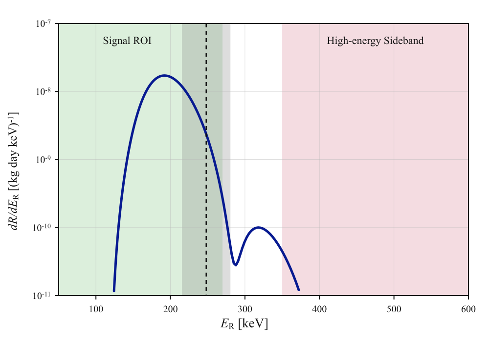

Independent reproduction of the universal-vector reference
benchmark, used to check the recoil shape and units.

At fixed dark mass and splitting, the contact-limit yield is proportional to $f_2\kappa^2$, where $\kappa=g_tg_\chi/M_V^2$. We impose

$$
N_{\rm ROI}^{\rm truth}(m_\chi,M_V,g_t,g_\chi)=N_0=1.12044,
\qquad g_\chi=\frac{M_V^2}{g_t}\kappa_{\rm LZ}(m_\chi).
$$

This is a reference-rate matching condition inspired by the LZ candidate. It does not define an LZ confidence region or require that every rate-matched spectrum peak at 248 keV. In particular, the low dark masses retained in part of the grid require a separate spectral assessment before interpreting the candidate energy. The collider upper limits below are conditional on this rate-matched slice and the thermal-abundance assumption. Appendix B discusses photon matching and the present excited fraction.

> [!info] 正文主线重构
> 本轮以顶对预期灵敏度为主结果；具体迁移见 [[结构调整说明_中文]]。

## Thermal abundance and the on-shell projection

We assume a standard thermal history and chemical equilibrium between
the two states during freeze-out. Their total number density $n=n_1+n_2$
obeys

$$

\begin{aligned}
\dot n+3Hn&=-\langle\sigma_{\rm eff}v\rangle[n^2-(n^{\rm eq})^2],\\
\langle\sigma_{\rm eff}v\rangle
&=\sum_{i,j=1,2}\frac{n_i^{\rm eq}n_j^{\rm eq}}{(n^{\rm eq})^2}\langle\sigma_{ij}v\rangle .
\end{aligned}
$$

The two dark states have the same spin degeneracy. In the
nonrelativistic limit their equilibrium number densities satisfy

$$
\frac{n_2^{\rm eq}}{n_1^{\rm eq}}\simeq\left(\frac{m_2}{m_1}\right)^{3/2}e^{-\Delta m/T}.
$$

The freeze-out temperature $T_f$ is much larger than the splitting
$\Delta m$, so the Boltzmann factor $e^{-\Delta m/T_f}$ is close to
unity. Each state therefore contributes about half of the equilibrium
number density at freeze-out. The present-day local fraction $f_2$ also
depends on late state conversion and the lifetime of the heavier state
(Appendix B).

Each coannihilation through $\chi_1\chi_2\to V^*\to b\bar b,c\bar c$
consumes one particle of each state and reduces the total number by two.
The $(1,2)$ and $(2,1)$ terms in
[the relevant equation](#eq:boltzmann) together contribute
$2n_1^{\rm eq}n_2^{\rm eq}\langle\sigma_{12}v\rangle/(n^{\rm eq})^2$, or
about $\langle\sigma_{12}v\rangle/2$ for equal equilibrium fractions. As
the Universe cools and the actual density exceeds its equilibrium value,
a larger coannihilation rate removes dark particles faster and lowers
the relic abundance. Coannihilation is enhanced near the mediator
resonance, making the abundance sensitive to $M_V$. At one on-shell
benchmark with $m_\chi=35$ GeV, $b\bar b$ accounts for about $92\%$ of
the coannihilation rate. Annihilation of two particles in the same dark
state to $VV$ can set the abundance when that channel opens.
[griest1991](#ref-griest1991) · [gondolo1991](#ref-gondolo1991)

We compute the cross sections and solve for the total abundance with
CalcHEP and micrOMEGAs 7.1.4, using `Fast=0` and `Beps=1e-9`. We assume
that the two states together account for the full Planck dark matter
abundance $\Omega_ch^2=0.1200\pm0.0012$. [micromegas2024](#ref-micromegas2024) · [planck2020](#ref-planck2020)

The abundance depends on the coupling product and the mediator width. The quark coannihilation rate contains

$$
\frac{(g_tg_\chi)^2}{(M_V^2-s)^2+M_V^2\Gamma_V^2(g_t,g_\chi)}.
$$

Holding the product fixed therefore does not in general fix the abundance. At each $(M_V,g_t)$ we substitute the recoil-matched $g_\chi(m_\chi)$ and search for $\Omega_\chi h^2=0.1200$ on the on-shell branch using the actual couplings and width. Of 616 trial coordinates, 470 pass the root and width criteria, 51 have no root within the search range, and 95 fail the width requirement. The retained masses span 8.42–46.59 GeV. Missing roots are not assigned a collider limit. Other mass branches, including off-shell solutions, are outside this primary projection and are discussed in Appendix C.

We propagate the Planck measurement by solving again at $\Omega_\chi h^2=0.1176$ and 0.1224. The resulting changes in the top-pair signal are reported with the main results. The endpoint test probes abundance uncertainty at fixed reference recoil yield; it does not profile over that yield or the late-time excited fraction.

> [!info] 正文主线重构
> 本轮以顶对预期灵敏度为主结果；具体迁移见 [[结构调整说明_中文]]。

## Top-pair signal and statistical method

The top-quark coupling also produces a dark pair in association with a top-quark pair. We estimate the expected sensitivity of the CMS all-hadronic $0\ell2b$ category at $\sqrt{s}=13$ TeV with $138~\mathrm{fb}^{-1}$ [cmstop](#ref-cmstop). This extends the truth-level top-pair discussion to reconstructed events on an on-shell grid. The off-shell rates and exploratory single-top estimates are given in Appendix C.

### Physical grid and signal projection

We use the mass-weighted quark couplings and the same reference truth-level yield of 1.12044 events in the $5.4$–$269.9$ keV recoil window. The top-pair grid uses tree-level recoil matching with a Helm form factor [engel1991](#ref-engel1991), $f_2=0.5$, and $\Delta m=1$ MeV. The supplementary monojet prescription differs in its nuclear form factor and finite photon-mixing term (Appendix A). The two grids implement the same reference yield without defining an identical point-by-point parameter slice.

The retained grid is shown in [the physical-grid projections](#fig:ttbar_grid). The invisible branching fractions range from $1.7\times10^{-5}$ to unity.

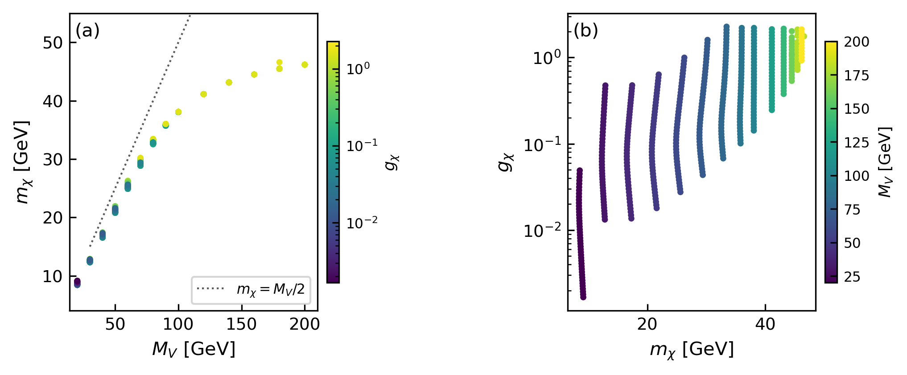

On-shell top-pair grid after the recoil-yield, central-abundance, and narrow-width requirements. The left panel shows dark matter mass versus mediator mass, colored by the dark coupling. The right panel shows the dark coupling versus dark matter mass, colored by mediator mass. The line in the left panel marks the approximate invisible-decay threshold.

### Signal generation and expected likelihood

We generate the $pp\to t\bar t\chi_1\chi_2$ signal at leading order with MadGraph5_aMC@NLO, decay both top quarks hadronically, shower the events with Pythia 8, and apply a CMS-like Delphes detector simulation. We generate $8\times10^3$–$2\times10^4$ events per point, about $8.3\times10^6$ in total. The generated cross section $\sigma_{\rm vis}$ includes the hadronic decays and the invisible decay through the mediator propagator. The signal-region yield is $\mathcal L\,\varepsilon_{\rm SR}\sigma_{\rm vis}$. Selection efficiencies range from $0.66\%$ to $6.59\%$.

We veto electrons and muons with $p_T>10$ GeV and $|\eta|<2.4$ and require at least three jets with $p_T>30$ GeV and $|\eta|<2.4$, including at least two $b$ tags. We require $p_T^{\rm miss}>250$ GeV, $p_T(j_1)/H_T<0.5$, $\min\Delta\phi(j_{1,2},p_T^{\rm miss})>0.8$, and $m_T^b>140$ GeV, using the highest-$p_T$ tagged jet for $m_T^b$. The detector model uses parameterized $b$ tagging, a jet radius of 0.5, and no simulated pileup.

We use the 15 bins of the published post-fit $p_T^{\rm miss}$ projection, with 20 GeV bins from 250 to 530 GeV and an overflow bin. The full CMS analysis combines signal and control regions across several lepton categories. We use one category and take its published post-fit background yields $b_i$ as the background-only Asimov data, $n_i=b_i$. A coherent Gaussian normalization nuisance $\theta$, with width $w=0.03198$, gives

$$
-2\ln L(\mu,\theta)=2\sum_{i=1}^{15}
\left[\nu_i-n_i\ln\nu_i\right]+\left(\frac{\theta}{w}\right)^2,
\qquad \nu_i=b_i(1+\theta)+\mu s_i.
$$

Here $s_i$ is the signal yield in bin $i$. We profile $\theta$ and solve $\mathrm{CL}_s=0.05$ for the median expected upper limit $\mu_{95}$. The post-fit inputs and the approximate background covariance limit this interpretation to expected sensitivity. We do not fit the observed counts or combine the likelihood with the monojet analysis.

> [!info] 正文主线重构
> 本轮以顶对预期灵敏度为主结果；具体迁移见 [[结构调整说明_中文]]。

## Expected sensitivity and stability

### Sensitive region and coupling dependence

The median expected limit falls below unity at 381 of the 470 sampled points, including all sampled points with $M_V\ge100$ GeV. Between 50 and 90 GeV the lower boundary lies near $g_t=0.17$. At 30 and 40 GeV the limit rises above unity again near $g_t=2.7$ and 3.0, respectively. The single nominal crossing at 20 GeV is within the template Monte Carlo uncertainty.

| $M_V$ [GeV] | Sampled points | Expected $\mu_{95}<1$ | Expected $\mu_{95}$ range |
|---:|---:|---:|---:|
| 20 | 44 | 1 | 0.938 to $>60$ |
| 30 | 44 | 34 | 0.099–2.93 |
| 40 | 44 | 36 | 0.105–3.21 |
| 50 | 44 | 37 | 0.085–2.58 |
| 60 | 44 | 38 | 0.055–3.11 |
| 70 | 44 | 37 | 0.031–2.67 |
| 80 | 43 | 37 | 0.023–2.70 |
| 90 | 38 | 36 | 0.017–1.05 |
| 100 | 34 | 34 | 0.011–0.61 |
| 120 | 27 | 27 | 0.007–0.20 |
| 140 | 22 | 22 | 0.005–0.10 |
| 160 | 17 | 17 | 0.003–0.04 |
| 180 | 14 | 14 | 0.004–0.03 |
| 200 | 11 | 11 | 0.003–0.02 |

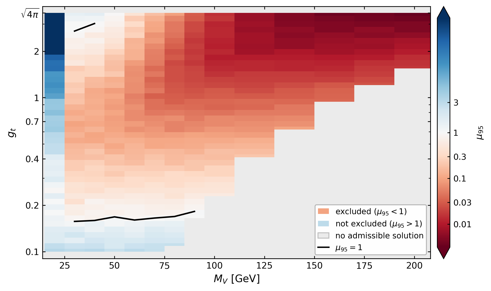

Median expected 95% CL signal-strength limits from the all-hadronic top-pair recast. Each colored cell represents one sampled point. The line joins the nominal unity crossings of neighboring mass columns where the crossings are close enough to connect. Gray cells have no retained solution on the scanned branch.

At low coupling, the production rate falls and the expected limit weakens. At large coupling, the quark width can reduce the invisible branching fraction enough to reverse this trend. The selected yield depends on both the cross section and the acceptance. At 30 and 40 GeV the turnover takes the yield below the level needed for the expected limit to reach unity. At 50 GeV the higher selection efficiency keeps the expected limit below unity at the largest scanned coupling.

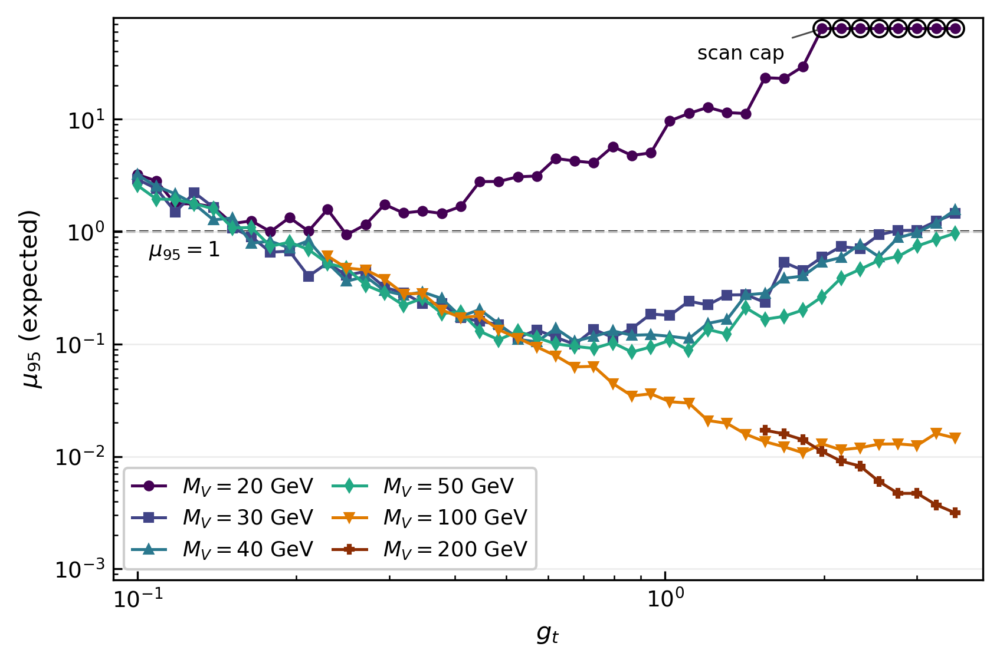

Median expected upper limits as a function of the top-quark coupling at six mediator masses. The dashed line marks unity. Open markers indicate points beyond the numerical scan cap of 60.

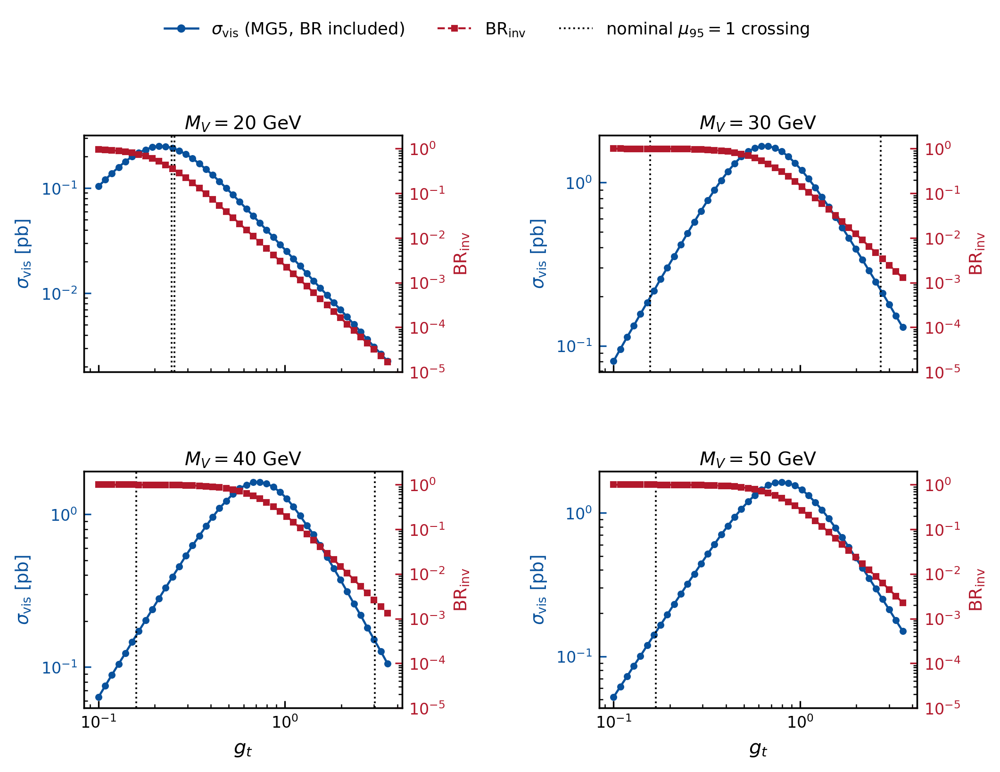

Generated hadronic signal cross section (left axis) and invisible branching fraction (right axis) for four mediator masses. Vertical lines mark the nominal unity crossings of the expected limit. The high-coupling boundary depends on the selected yield and the missing-momentum template.

### Template, scale, and abundance tests

We propagate template statistics at all 132 sampled points with $M_V=20$–40 GeV. Requiring $\mu_{95}+2\sigma_{\rm MC}<1$ changes the counts at 20, 30, and 40 GeV from 1, 34, and 36 to 0, 32, and 32. The renormalization- and factorization-scale envelope tested at three representative points shifts the expected limits by $-29\%$ to $+28\%$. This is the largest theory variation tested.

We solve the relic equation again at $\Omega_\chi h^2=0.1176$ and 0.1224. All 470 central points remain admissible at both edges. Rescaling the signal by the change in invisible branching fraction shifts the median limit by $0.02\%$. One point crosses unity, by $0.05\%$, within its template statistical uncertainty. Dedicated endpoint samples at four nodes give efficiencies consistent with the central samples within their statistical precision. The endpoint simulations directly test those four nodes.

> [!info] 正文主线重构
> 本轮以顶对预期灵敏度为主结果；具体迁移见 [[结构调整说明_中文]]。

## Conclusions

We have identified substantial expected sensitivity to a recoil-rate-matched, thermally produced pseudo-Dirac dark sector in the all-hadronic top-pair channel. The mass-weighted vector coupling links the light-quark nuclear response to tree-level top-associated production. Within the retained on-shell grid, the median expected limit is below the nominal signal strength at 381 of 470 sampled points, including all retained points with $M_V\ge100$ GeV. The high-coupling turnover at light mediator masses follows the competition between production, invisible branching fraction, and acceptance.

The 20 GeV crossing is not stable against template statistics. Perturbative-scale variations of up to about 30% are larger than the reported median effect of the Planck abundance uncertainty. The limits use one all-hadronic category and a simplified model of a published post-fit background projection, so the main inference is expected sensitivity rather than an observed experimental exclusion. A calibrated observed limit requires suitable independent background constraints and a treatment of the relevant shape uncertainties. The supplementary monojet results in Appendix A provide a separate collider test; a joint analysis would require compatible parameter grids and shared uncertainties.

> [!info] 正文主线重构
> 本轮以顶对预期灵敏度为主结果；具体迁移见 [[结构调整说明_中文]]。

## Data availability

The experimental inputs are available through the LUX-ZEPLIN and CMS
public data releases
[lzdata](#ref-lzdata) · [cmscovariance](#ref-cmscovariance) · [cmsyields](#ref-cmsyields) · [cmssignal](#ref-cmssignal) · [cmscutflow](#ref-cmscutflow). The
model files, analysis code, public-input snapshots, binned signal
templates, numerical scans, and reproduction instructions are available
at <https://github.com/Jim11451/lz_paper>, with the earlier archived version
[`reproducibility-2026.11.19`](https://github.com/Jim11451/lz_paper/tree/reproducibility-2026.11.19).

> [!info] 移至附录并压缩
> 本轮以顶对预期灵敏度为主结果；具体迁移见 [[结构调整说明_中文]]。

## Appendix A. Supplementary monojet analysis

### Grid, production, and reconstructed signal

The supplementary CMS EXO-20-004 recast uses a separate rate-matched grid with $72\le M_V\le200$ GeV, $20\le m_\chi\le100$ GeV, $0.10\le g_\chi\le1.50$, and $0.1\le g_t\le\sqrt{4\pi}$. Its recoil calculation uses a two-parameter Fermi density, $d_\gamma(0)=0$, and the finite spacelike $c,b,t$ photon-mixing contribution. It searches each side of the invisible threshold and assigns an on-shell template only where a unique root meets the narrow-width requirements. The 1015 coordinates yield 434 retained central-abundance on-shell solutions. This is a different slice from the primary top-pair grid.

The hard signal includes tree-level $q\bar q\to gV$ and $qg\to qV$ channels and their charge conjugates, plus the finite heavy-quark-loop channel $gg\to gV$. The three-point pure-vector $gg\to V$ amplitude cancels. We calculate the distinct initial states separately with MadGraph5_aMC@NLO 3.6.6 and `nn23lo1` at 13 TeV and sum their rates. The loop UFO includes the rational $gggV$ term obtained from `loop_sm`, with coefficient $i g_{Vq}g_s^3/(48\pi^2)$ per flavor and color structure $d^{abc}$. Its Ward/BRS test ratio is about $6.3\times10^{-24}$ at the tested 87.18 GeV mediator point and 1 TeV partonic energy. [alwall2014](#ref-alwall2014) · [hirschi2015](#ref-hirschi2015) · [cox2016](#ref-cox2016)

On-shell production is normalized as $\sigma_X=\sigma_X^{\rm prod}(g_t=1)g_t^2\mathrm{BR}(V\to\chi_1\chi_2)$. Pythia 8.312 and Delphes 3.5.0 treat the mediator as invisible. Nominal samples start at generator $p_T^j=100$ GeV, with additional tree and loop samples above 350 and 480 GeV, respectively, combined in mutually exclusive intervals. The 120 GeV loop node also uses a 230 GeV boundary. Reconstructed cuts require a leading AK4 jet with $p_T>100$ GeV and $|\eta|<2.4$, $p_T^{\rm miss}>250$ GeV, jet azimuthal cuts, and lepton, photon, and heavy-flavor-related vetoes, including the 2018 HEM treatment. The 2016–2018 data contain 22 bins per year and about $137\ \mathrm{fb}^{-1}$. [pythia2022](#ref-pythia2022) · [delphes2014](#ref-delphes2014) · [cmsmonojet](#ref-cmsmonojet) · [albert2021](#ref-albert2021)

### Likelihood and central limits

The public control-region background prediction and covariance, observed counts, and simulated signal define

$$

\begin{aligned}
\mathcal L(\mu,\mathbf b',\mathbf s') &=
\prod_{i=1}^{66}\operatorname{Pois}(n_i\mid b_i'+\mu s_i')\\
&\quad\times G(\mathbf b';\mathbf b,C_b)\,G(\mathbf s';\mathbf s,C_s).
\end{aligned}
$$

The signal covariance contains finite-template counting correlations, integration errors, and a common 1.6% luminosity uncertainty, retaining correlations across years that share events. Yields are linearly interpolated in mass and independent covariances combined with squared weights. We profile nonnegative signal yields and positive Poisson means and solve asymptotic $CL_s=0.05$. Expected limits use a background Asimov data set, and observed limits use the measured counts with a conditional background Asimov construction. [cmscovariance](#ref-cmscovariance) · [cmsyields](#ref-cmsyields) · [cmssimplified](#ref-cmssimplified) · [cowan2011](#ref-cowan2011) · [read2002](#ref-read2002)

Reference templates give 208 expected and 151 observed sampled points with $\mu_{95}<1$; the lowest sampled mediator masses are 92 and 104 GeV. The smallest observed reference-template limit is 0.181 at $(M_V,g_t)=(200\,\mathrm{GeV},\sqrt{4\pi})$. The following three reference benchmarks remain below unity under the prescribed yield variations.

| $M_V$ [GeV] | $g_t$ | Expected $\mu_{95}$ | Observed $\mu_{95}$ | Observed, $r=0.75$–$1.25$ |
|---:|---:|---:|---:|---:|
| 120 | 3.073 | 0.412 | 0.607 | 0.570–0.664 |
| 150.4 | 3.545 | 0.184 | 0.340 | 0.329–0.357 |
| 190.4 | 3.545 | 0.219 | 0.273 | 0.270–0.277 |

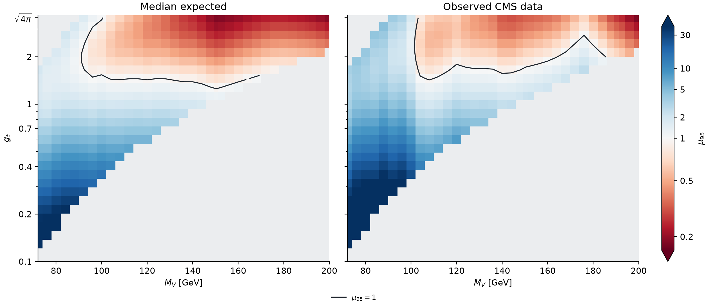

Expected and observed CMS monojet 95% confidence-level
limits on the unique branch satisfying the recoil-yield,
central-abundance, and narrow-width conditions. The black contour marks
<em>μ</em>95 = 1. Gray
denotes coordinates with no unique in-scope solution.

At the representative points tested, changing the Planck target by $\pm2\sigma$ changes the median expected limit by at most 0.44%. The yield test $r=0.75$–1.25 changes it by at most 9.4%; reducing $f_2$ to 0.45 or 0.30 changes it by up to 3.0% or 12.8%. The tested $|d_\gamma(0)|\le7\times10^{-6}$ variation changes it by at most 2.8%. These are monojet checks on its own grid, not uncertainty estimates for the primary top-pair map. At $r=2$, the three benchmark observed limits remain below unity at 0.507, 0.310, and 0.265. A lower-coupling 150.4 GeV point remains above unity, and some low-abundance roots disappear at the dark-coupling scan boundary.

### Official benchmark and template validation

Using official CMS vector templates, the reconstructed expected and observed mediator mass boundaries are 2.208 and 1.941 TeV, compared with official values of 2.198 and 1.957 TeV. Individual observed limits disagree more at low mass. This checks the statistical reconstruction using official templates. [cmsmonojet](#ref-cmsmonojet) · [cmssignal](#ref-cmssignal)

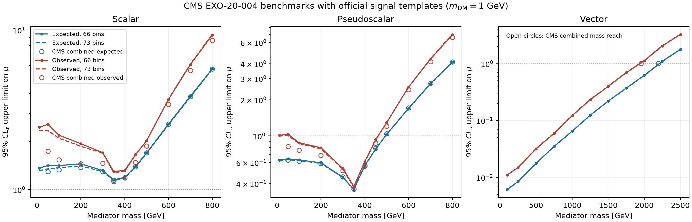

Comparison of limits obtained using official CMS signal
templates. For scalar and pseudoscalar benchmarks between 50 and 800
GeV, the expected limits from the 66-bin fit differ from the published
combination by at most about 9%. The
largest difference in observed limits is about 48%. The mass boundaries provide a separate
check of the overall reach for the official vector benchmark. 

Independent LO plus Delphes simulation gives 62.9% of the official 2017 100 GeV vector signal yield. The independent and official samples differ in generation and reconstruction settings. The discrepancy limits validation of absolute acceptance, including heavy-flavor-related selections, and remains relevant to the inferred exclusion boundary.

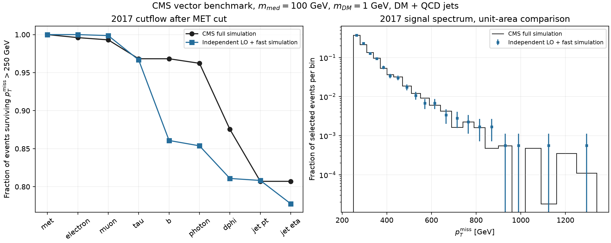

Cutflow and MET spectrum for the 100 GeV CMS vector
benchmark. Comparison of independent LO event generation and fast
detector simulation with official CMS vector benchmarks. For the 100 GeV
benchmark in 2017, the efficiency after the MET cut is 76.91% for CMS and 77.76% in our simulation. The absolute QCD
signal yield in our simulation is 0.629 times the CMS yield. The two
samples use different generator and reconstruction settings, including
NLO matching in the official sample. We compare the normalized shapes
and the absolute yields separately. 

Independent loop replicas and stratified tail samples test three sensitive nodes. The templates agree within about 1.7 Monte Carlo standard deviations in the key bins and combined high-MET intervals. Across the tested templates and yield targets, all three exclusion decisions persist, with a largest observed limit of 0.680. However, pooled-template limits at 150.4 and 190.4 GeV are about 31% and 27% below the reference values, respectively. Replacing the relevant mass templates changes the full-grid counts to 199 expected and 162 observed sampled points below unity, while the lowest sampled masses remain 92 and 104 GeV. Finite-template and acceptance effects therefore remain material to numerical contours.

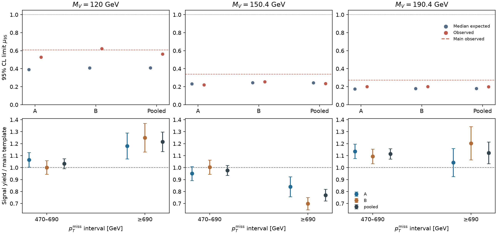

The top panels show the CMS 95% CL limits. The dashed lines
mark the reference observed limits from Table [[tab:benchmarks]](#tab:benchmarks). The lower panels
show the yield of each template divided by the reference yield in two
combined MET intervals. The error bars represent the Monte Carlo
uncertainty of each template. The accompanying analysis tables give
yields by year and bin.

> [!info] 移至附录并压缩
> 本轮以顶对预期灵敏度为主结果；具体迁移见 [[结构调整说明_中文]]。

## Appendix B. Recoil matching and late-state assumptions

### Photon matching

Photon kinetic mixing adds an electromagnetic-current coupling. We define $d_\gamma=e\epsilon_\gamma/g_t$; its zero-momentum value is an independent matching input. Relative to zero momentum, the retained heavy-quark term is

$$

\begin{aligned}
\delta d_{cbt}(s)&=-\frac{2\alpha}{\pi}\sum_{q=c,b,t}N_cQ_q\frac{\widehat m_q}{m_t}\\
&\quad\times\int_0^1 dx\,x(1-x)\log\left[1-\frac{s x(1-x)}{\widehat m_q^2}-i0\right].
\end{aligned}
$$

With a common Helm form factor, the nuclear charge shifts by $g_tZ[d_\gamma(0)+\delta d_{cbt}(-q^2)]$. For $^{131}$Xe, $Q_A/g_t\simeq8.05\times10^{-3}$, so cancellation occurs near $d_\gamma(0)=-1.49\times10^{-4}$. At 35 GeV and zero matching input, the retained finite spacelike term reduces the integrated rate by about 0.077%. Varying the matching input to $\mp7\times10^{-6}$ changes the fixed-coupling rate to 0.908 or 1.095 times the tree result, requiring $\kappa/\kappa_0=1.050$ or 0.956. Near cancellation this ratio reaches about 56.5. These matching checks motivate stating the prescription separately for the two collider grids. [deramo2016](#ref-deramo2016) · [forner2026](#ref-forner2026)

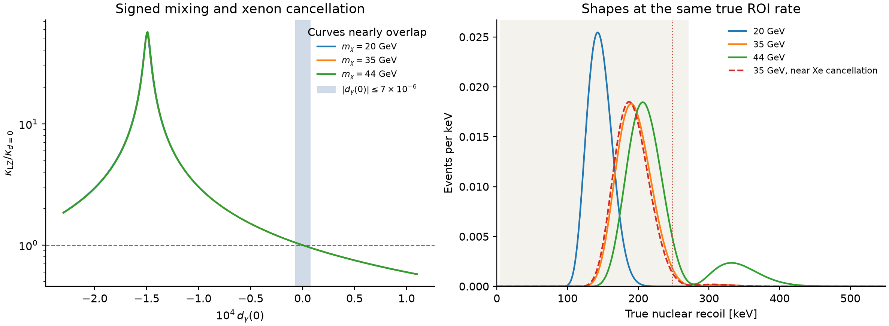

The left panel shows how photon mixing changes the coupling
required to match the yield. The right panel compares spectra with the
same integrated truth-level yield. After Gaussian smoothing with a width
of 32.5 keV, the signal densities near 248 keV at <em>m</em><em>χ</em> = 20, 35, 44
GeV are approximately 2.75 × 10−4, 4.54 × 10−3, and 6.98 × 10−3 events/keV. The
energy-spectrum approximation uses Gaussian smoothing alone. The LZ
S1/S2 response and backgrounds enter an event-level
analysis.

### Present excited fraction

The main scan fixes $f_2=0.5$. After freeze-out, conversion is modeled by

$$
\dot f_2=-n_\chi\langle\sigma v\rangle_{22\to11}
[f_2^2-e^{-2\Delta m/T_\chi}(1-f_2)^2].
$$

Born contact-scattering estimates with varied kinetic-decoupling assumptions give a minimum near 0.45 at the tested on-shell benchmarks and about 0.30 at some off-shell benchmarks, assuming additional decay is suppressed. The 1 MeV splitting closes the electron-pair decay channel; independent $V$–$Z$ mixing or a transition dipole can alter the excited-state lifetime. These calculations define thermal-history benchmarks, not a determination of $f_2$ across the full top-pair grid. The top-pair abundance-endpoint tests keep $f_2$ fixed. [gemmell2026](#ref-gemmell2026) · [carrillo2022](#ref-carrillo2022)

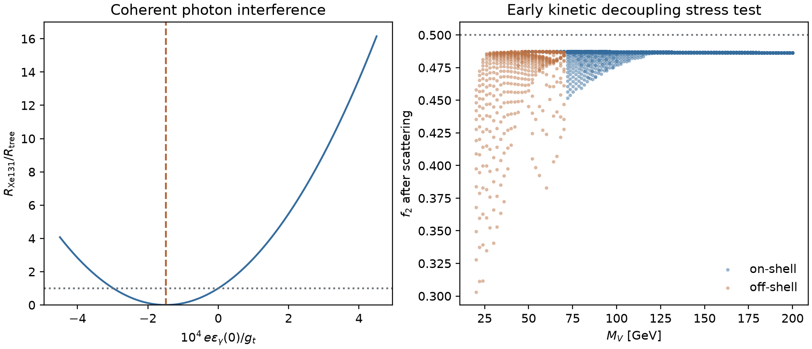

The conversion <em>χ</em>2<em>χ</em>2 ↔︎ <em>χ</em>1<em>χ</em>1
can change the excited-state fraction after chemical freeze-out. In the
standard thermal histories tested, with additional decay suppressed and
the Standard Model bath included, the minimum at the on-shell benchmarks
is <em>f</em>2 ≃ 0.45 and
falls to about 0.30 at some off-shell
benchmarks. The splitting <em>Δ</em><em>m</em> &lt; 2<em>m</em><em>e</em>
closes the electron-pair decay channel. Independent <em>V</em>–<em>Z</em> mixing or a transition dipole can
still affect the lifetime. 

> [!info] 移至附录并压缩
> 本轮以顶对预期灵敏度为主结果；具体迁移见 [[结构调整说明_中文]]。

## Appendix C. Off-shell and single-top checks

At the same $(M_V,g_t)$, the yield and abundance equations can admit more than one dark mass. In a low-mass scan, $(M_V,g_t)=(48\,\mathrm{GeV},0.252)$ has central-abundance roots at 20.445, 25.260, and 45.878 GeV; the lightest is on shell. The primary top-pair map retains only its defined on-shell branch. Below the invisible threshold, production must be calculated with the full four-body amplitude rather than an on-shell rate times a branching fraction.

At three off-shell benchmarks with mediator masses 30, 46, and 60 GeV, full matrix elements with truth $p_T^{\rm miss}>250$ GeV give top-pair cross sections of 0.033, 0.041, and 1.13 fb. These truth-level rates do not define an off-shell exclusion; top decays, reconstruction, and an appropriate likelihood would be needed. [cmstop](#ref-cmstop)

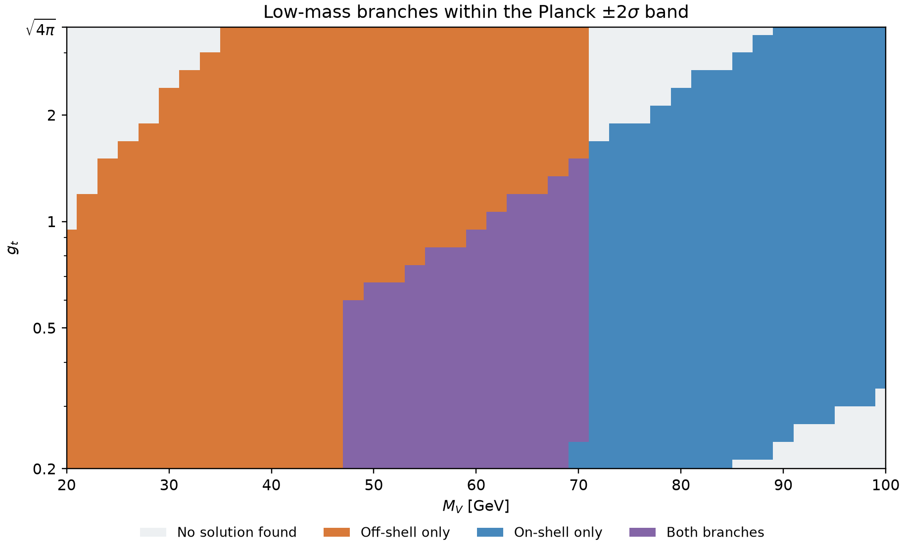

Independent low-mass scan with tree-level yield matching.
Colors identify the relic branches found within the Planck ±2<em>σ</em> band. Purple indicates that both
on-shell and off-shell solutions are present.

The exploratory single-top calculation uses the 15-bin CMS AH $1b\,1\mathrm{FJ}$ projection with diagonal background uncertainties, truth cuts, simplified top decays, and approximate $b$ tagging. At $(M_V,g_t)=(60\,\mathrm{GeV},0.399)$, partonic-energy cuts $\sqrt{\hat s}<1.5,1.0,0.75$ TeV give median expected limits of 0.052, 0.337, and 3.43. This strong variation reflects the sensitivity of longitudinal charged-current amplitudes to electroweak cancellations with unequal top and bottom vector couplings. It limits the result to an exploratory estimate and is not used in the primary sensitivity map. [kahlhoefer2016](#ref-kahlhoefer2016) · [cmstop](#ref-cmstop) · [cmsahdata](#ref-cmsahdata)

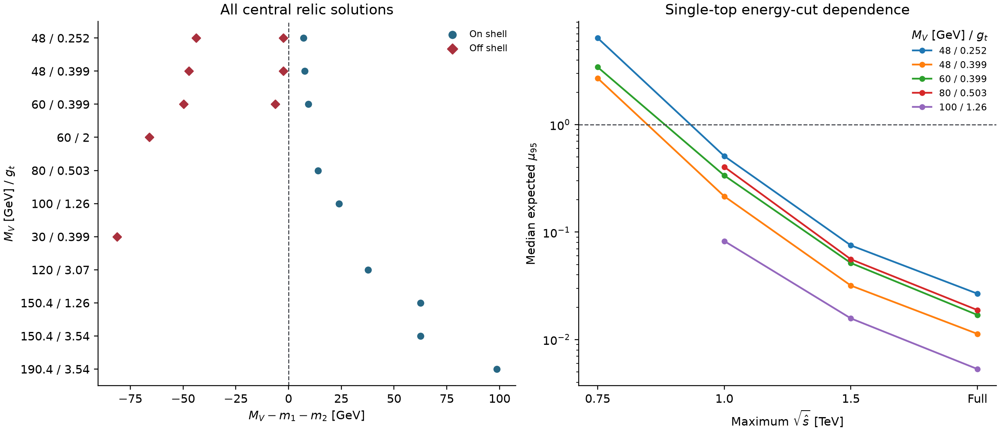

The left panel shows <em>M</em><em>V</em> − <em>m</em>1 − <em>m</em>2
at representative central relic solutions. The right panel shows how the
expected single-top sensitivity varies with the partonic-energy cut for
on-shell solutions. The charged weak current connects top and bottom
quarks with different <em>V</em>
couplings, so the high-energy behavior of longitudinal weak-boson
amplitudes depends on cancellations in the electroweak completion.
Varying the cut probes that dependence. Missing markers at 0.75 TeV
indicate samples for which the approximate likelihood gives no finite
limit.

> [!info] 正文主线重构
> 本轮以顶对预期灵敏度为主结果；具体迁移见 [[结构调整说明_中文]]。

## References

[lz2026] [Search for Dark Matter Particle Interactions in an Extended Nuclear Recoil Energy Window with the LUX-ZEPLIN (LZ) Experiment](https://arxiv.org/abs/2609.02823). 2026.

[gemmell2026] [A Simple Dark Matter Model to Explain the LZ Event and Galactic Center Excess](https://arxiv.org/abs/2609.26570). 2026.

[du2026] [Pseudo-Dirac Inelastic Dark Matter in the Leptophobic $U(1)_B$ Model: Confronting the LUX-ZEPLIN High-Recoil Event with Collider Searches](https://arxiv.org/abs/2609.07225). 2026.

[cox2016] [Novel Collider and Dark Matter Phenomenology of a Top-philic $Z'$](https://doi.org/10.1007/JHEP06(2016)110). 2016.

[kahlhoefer2016] [Implications of Unitarity and Gauge Invariance for Simplified Dark Matter Models](https://doi.org/10.1007/JHEP02(2016)016). 2016.

[deramo2016] [You Can Hide but You Have to Run: Direct Detection with Vector Mediators](https://doi.org/10.1007/JHEP08(2016)111). 2016.

[lzdata] [extended nuclear-recoil search, HEPData record](https://doi.org/10.17182/hepdata.182472.v1). 2026.

[griest1991] [Three Exceptions in the Calculation of Relic Abundances](https://doi.org/10.1103/PhysRevD.43.3191). 1991.

[gondolo1991] [Cosmic Abundances of Stable Particles: Improved Analysis](https://doi.org/10.1016/0550-3213(91)90438-4). 1991.

[micromegas2024] [micrOMEGAs 6.0: N-Component Dark Matter](https://doi.org/10.1016/j.cpc.2024.109133). 2024.

[planck2020] [Planck 2018 Results. VI. Cosmological Parameters](https://doi.org/10.1051/0004-6361/201833910). 2020.

[alwall2014] [The Automated Computation of Tree-Level and Next-to-Leading Order Differential Cross Sections, and Their Matching to Parton Shower Simulations](https://doi.org/10.1007/JHEP07(2014)079). 2014.

[hirschi2015] [Automated Event Generation for Loop-Induced Processes](https://doi.org/10.1007/JHEP10(2015)146). 2015.

[pythia2022] [A Comprehensive Guide to the Physics and Usage of PYTHIA 8.3](https://doi.org/10.21468/SciPostPhysCodeb.8). 2022.

[delphes2014] [DELPHES 3: A Modular Framework for Fast Simulation of a Generic Collider Experiment](https://doi.org/10.1007/JHEP02(2014)057). 2014.

[cmsmonojet] [Search for New Particles in Events with Energetic Jets and Large Missing Transverse Momentum in Proton-Proton Collisions at $\sqrt{s}=13$ TeV](https://doi.org/10.1007/JHEP11(2021)153). 2021.

[albert2021] [Implementation of a Search for New Phenomena in Events Featuring Energetic Jets and Missing Transverse Energy (137 fb$^{-1}$, 13 TeV, CMS EXO-20-004)](https://doi.org/10.14428/DVN/IRF7ZL). 2021.

[cmscovariance] [public monojet background covariance, HEPData Table 14](https://doi.org/10.17182/hepdata.106115.v2/t14). 2021.

[cmsyields] [observed and background yields, HEPData Table 15](https://doi.org/10.17182/hepdata.106115.v2/t15). 2021.

[cmssimplified] [Simplified Likelihood for the Re-Interpretation of Public CMS Results](https://cds.cern.ch/record/2242860). 2017.

[cowan2011] [Asymptotic Formulae for Likelihood-Based Tests of New Physics](https://doi.org/10.1140/epjc/s10052-011-1554-0). 2011.

[read2002] [Presentation of Search Results: The $CL_s$ Technique](https://doi.org/10.1088/0954-3899/28/10/313). 2002.

[forner2026] [Renormalization of $U(1)$ Gauge Boson Kinetic Mixing](https://doi.org/10.1103/tqw9-zm9x). 2026.

[cmstop] [Search for Dark Matter Produced in Association with One or Two Top Quarks in Proton-Proton Collisions at $\sqrt{s}=13$ TeV](https://doi.org/10.1007/JHEP08(2025)085). 2025.

[cmsahdata] [AH $1b\,1\mathrm{FJ}$ post-fit MET spectrum, HEPData Table 2](https://doi.org/10.17182/hepdata.154755.v1/t2). 2025.

[carrillo2022] [Cosmology and Signals of Light Pseudo-Dirac Dark Matter](https://doi.org/10.1007/JHEP04(2022)060). 2022.

[cmssignal] [public spin-1 signal templates, HEPData Table 1](https://doi.org/10.17182/hepdata.106115.v2/t1). 2021.

[cmscutflow] [public monojet cutflow, HEPData Table 20](https://doi.org/10.17182/hepdata.106115.v2/t20). 2021.

[engel1991] [Nuclear form factors and WIMP-nucleus elastic scattering](https://doi.org/10.1016/0370-2693(91)90712-Y). 1991.

